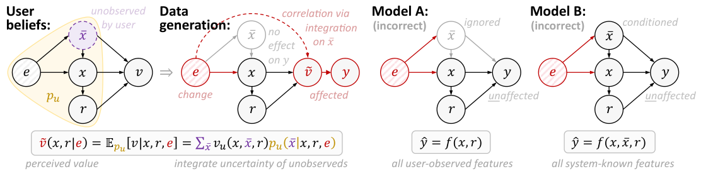
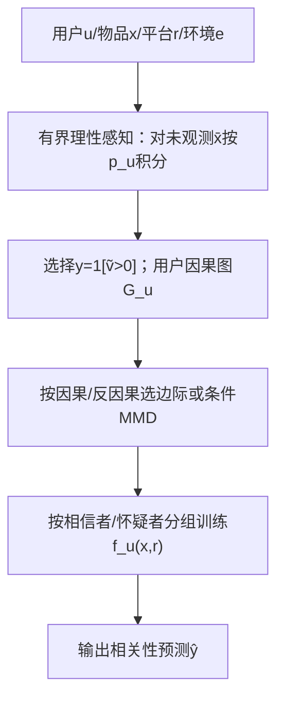
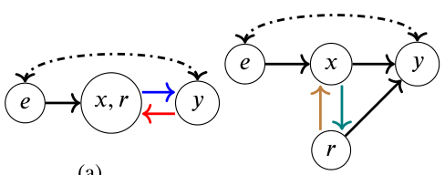

# In the Eye of the Beholder: Robust Prediction with Causal User Modeling（观者眼中：因果用户建模的鲁棒预测）

- **会议/期刊**: NeurIPS 2022
- **作者与机构**: Amir Feder (Columbia University)、Guy Horowitz、Yoav Wald、Roi Reichart、Nir Rosenfeld (Technion / JHU)
- **推荐链路定位**: 精排/相关性预估（二分类，不是排序实验）
- **研究方向**: 去偏公平、可信隐私与工业架构（Causal Rec / OOD 鲁棒）
- **论文原文**: [https://arxiv.org/abs/2206.00416v2](https://arxiv.org/abs/2206.00416v2)
- **开源代码**: 暂未开源

## TL;DR (1分钟核心速览)

针对推荐系统新内容与时尚趋势导致日志分布漂移、ERM 易学虚假相关的问题，本文把用户视为凭因果信念做选择的有限理性决策者，用因果/反因果图类决定边际或条件 MMD 正则，并按相信者/怀疑者分组建模。RecBeer 按年预测、RecFashion 相关性偏移及合成 OOD 实验中，匹配用户类型的正则化保持稳定；合成 skeptic OOD 50.0→75.6、believer 75.1→85.2。

## Background & Motivation (背景与核心矛盾)

- **主流范式**: 在日志数据 $(u,x,r,y)$上训练相关性预测器$f_u(x,r)$，以 ERM 拟合历史选择；环境$e$（时间、风尚、供给）变化后，测试分布随之漂移。
- **前人局限**: ① ERM 会利用训练环境中 $x/r$与$y$的虚假相关，环境一变即失效；② 若把系统可见但用户不可见的$\bar{x}$也喂给模型，模型又会过拟合$\bar{x}$ 的实例，而非学习用户真实的稳定偏好。
- **核心洞察 (Key Insight)**: 用户并不观测 $\bar{x}$，但知道其缺失，并以依赖$e$的信念$p_u(\bar{x}|x,r,e)$对未观测价值积分；这一步会在数据中制造$e\to y$ 的相关性。**用户本身就是因果机制，不存在唯一“真实因果图”，一切取决于用户如何感知**。
- **本文切入点**: 用个性化因果图 $G_u$ 编码用户信念，再仅依据图类（因果/反因果）与子类（相信者/怀疑者）选择不变正则，无需推断完整图。

<figure class="paper-figure" markdown="span">
  <figcaption>图 2：（左）用户信念与 푦 的由此产生的数据生成过程。用户不观测 푥̄，但知道其缺失。为补偿该不确定性，用户依据可能依赖 푒 的概率信念 푝푢 对 푥̄ 积分；这形成其感知价值 ṽ，并决定其选择 푦。对不确定性积分可通过 푝푢(⋅|푒) 在 푒 与 ṽ（进而 푦）之间引入相关性。注意 푦 不依赖 푥̄ 的实例。（中）仅使用用户观测到的特征学习预测模型 푓(푥, 푟)。假设 푥̄ 可被丢弃会造成如下印象：</figcaption>
</figure>

## Method (核心方法设计)

### 1. 整体框架 (Overall Architecture)

输入用户 $u$、物品属性$x$、平台信息$r$与环境$e$；用户按有界理性信念对未观测$\bar{x}$积分，形成感知价值并作出选择$y$。学习端不直接拟合$\bar{x}$，而是按用户因果图类型施加 MMD/CORAL 正则，迫使预测$\hat{y}$对环境$e$不变；若用户子类不同，则按子类分组训练独立预测器，最终以$f_u(x,r)$ 输出相关性。

### 2. 关键设计拆解 (Key Designs)

1. **有界理性用户与虚假相关生成**：经典 EUT 假设全信息，但用户实际只知道 $x,r$，不知道$\bar{x}$。其感知价值为  
$\tilde{v}_u(x,r|e)=\sum_{\bar{x}}v_u(x,\bar{x},r)p_u(\bar{x}|x,r,e),\quad y=\mathbb{I}[\tilde{v}_u(x,r|e)>0]$。  
$p_u(\cdot|e)$使$e$通过“对不确定性的积分”进入$y$；因此$f_u(x,r)$可能用$x,r$补偿训练环境的残余效应，$f_u(x,\bar{x},r)$又会过拟合$\bar{x}$。这解释了“用户选择本身即可制造虚假相关”。

2. **因果/反因果图类决定正则形式**：因果用户认为 $x,r\to y$，需边际不变；反因果用户认为$x,r\leftarrow y$，需在给定$y$ 下条件不变。于是  
$R(f;S)=\sum_k\mathrm{MMD}(\Phi_{k,u},\Phi_{-k,u})$（因果，边际 MMD）；  
$R=\sum_y\sum_k\mathrm{MMD}(\Phi^{(y)}_{k,u},\Phi^{(y)}_{-k,u})$（反因果，条件 MMD）。  
关键结论是：只需知道用户属于两类中的哪一类，无需完整图，即可选对正则；多用户同类的样本应共享同一正则方式。

<figure class="paper-figure" markdown="span">
  <figcaption>图 1：描述不同用户的简化图：(a) 类别：因果或反因果；(b) 子类：相信者或怀疑者（此处展示因果用户）。虚线表示可能的虚假性（例如通过选择）。</figcaption>
</figure>

3. **相信者/怀疑者与训练目标**：即使两个用户 ID 最优预测器相同，只要 $x,r$的因果方向不同（believer:$x\to r$；skeptic:$x\leftarrow r$），其最优 CI 预测器也可能不同。故应按子类分组训练：  
$\arg\min_{f\in F} L(f;S)+\lambda R(f;S_1,\dots,S_K)$。  
训练用 MMD/CORAL 正则，$\lambda>0$；不涉及负采样（二分类相关性预测），推理仅需$f_u(x,r)$ 加用户类型路由，开销与基模型同阶。

## Experimental Setup & Evaluation Protocol (实验设置与评估协议)

- **数据集与预处理**: 未采用 `5-core`；RateBeer 保留约 10 年评论，Fashion 使用 44.4k 商品图像/属性/文本，合成数据为 3 个二值特征。  
| 数据集 | #Users | #Items | #Interactions | 稀疏度/密度 | 特征/场景说明 |
| :--- | :---: | :---: | :---: | :---: | :--- |
| RateBeer | 未披露 | 未披露 | ~3M reviews | — | 啤酒类型风尚随年份 $e$ 变化 |
| Fashion | 未披露 | 44.4k | 未披露 | — | 图像灰度 $x$、颜色$r$、选择$y$ |
| Synthetic | 未披露 | 3 个二值特征 | 未披露 | — | $e_1,e_2$训练，$e_3$ 测试 |

- **数据划分与防穿越**: RateBeer 按年份做时间外推：用过去数据训练、预测下一年；Fashion 训练相关性 $p_e'\in[0.1,0.8]$、测试固定$p_e=0.8$，考察训练-测试相关性偏离与翻转；合成实验用$e_1,e_2$训练、$e_3$ 测试，属 OOD 划分。
- **排名评测协议**: **不是 Full-Ranking，也不是 Sampled Ranking**；本文任务是二分类相关性/选择预测，报告 Accuracy，无候选集构造与负采样。
- **对比基线与超参设置**: 主要对比 causal / anti-causal / non-causal 三种正则方案，以及按子类分组 vs 池化训练；正则用 MMD 或 CORAL，$\lambda>0$；正文未给统一 embedding 维度，未报告$p$ 值显著性检验。

## Key Experimental Results (实验关键数据)

### 1. 主实验对比 (Main Results)

原文 Fig.3/Fig.4 以曲线呈现，未给统一主表数值；下表按原文结论归纳，避免新造数字。

| 训练方案 | RecBeer：啤酒风尚漂移 | RecFashion：训练-测试相关性偏离 | RecFashion：相关性翻转 $<0.5$ | 合成 OOD 参考 |
| :--- | :---: | :---: | :---: | :---: |
| 因果正则（匹配 causal） | **稳定，显著优于另两者** | 非一致类型，偏离时不稳定 | 崩溃 | — |
| 反因果正则（匹配 anti-causal） | 崩溃 | **稳定，优于另两者** | **保持鲁棒** | 用于 anti-causal 合成 |
| 非因果/ERM | 漂移时崩溃 | 偏离时退化 | 崩溃 | $\lambda=0$：skeptic 50.0 / believer 75.1 |
| 按子类分组（Prop.2） | — | — | — | **skeptic 75.6 / believer 85.2** |
| 池化训练 | — | — | — | skeptic 64.57 / believer 78.13 |

### 2. 消融实验 (Ablation Study)

| 正则 | 训练用户 | 测试 skeptic ID/OOD | 测试 believer ID/OOD |
| :--- | :--- | :---: | :---: |
| $\lambda=0$ | skeptic / believer / both | 78.0 / 50.0 | 89.8 / 75.1 |
| $\lambda>0$ | skeptic | 71.1 / **75.6** | 74.67 / 75.5 |
| $\lambda>0$ | believer | 69.8 / 52.5 | 88.5 / **85.2** |
| $\lambda>0$ | both | 70.03 / 64.57 | 78.88 / 78.13 |

相对 $\lambda=0$ 池化 OOD：skeptic **+51.2%**，believer **+13.5%**；分组训练同时基本保持 ID 精度。

### 3. 关键实验发现 (Key Findings)

1. **正则必须与用户因果类一致**：RecBeer 中 causal 正则在啤酒类型风尚显著变化时保持稳定，而 anti-causal/非因果方案崩溃；2006/2008 年 causal 非最优，是因为训练-测试相关性被刻意设得相近。
2. **反因果场景同样成立**：RecFashion 中 anti-causal 正则在训练-测试相关性偏离时优于另两者；一旦相关性翻转（$<0.5$），causal 与 ERM 崩溃，anti-causal 仍鲁棒。
3. **子类分组比池化更稳**：合成实验 $\lambda=0$ 时 skeptic OOD 仅 50.0；按 skeptic/believer 分别训练后升至 75.6/85.2，而池化仅 64.57/78.13；即使 25% 子群混合噪声，分组模型仍优于池化。

## Highlights & Limitations (亮点、对比与审稿批判)

- **与代表作对比 (vs. Prior Work)**: 既往因果推荐多处理曝光/选择偏差或系统对用户的影响；本文首次把“用户对推荐生成过程的因果误解”作为数据生成机制。与 Veitch et al. 的不变学习相比，本文证明无需完整因果图，只需因果/反因果类；与 Spiegler 的因果主观模型相比，本文将其落到可训练的推荐正则。
- **可迁移亮点**: ① 用环境标签 $e$ 做表示层 MMD/CORAL 正则，可直接迁移到跨时间/跨场景推荐；② 按可推断的用户因果类型分组训练，比单一池化模型更适合异质用户。
- **审稿级局限批判**: ① 真实数据实验仍属半合成：RateBeer 的 causal 标签通过反事实干预空间模拟，Fashion 的 anti-causal 数据也是生成式构造，缺少真实线上 A/B；② 依赖用户类别/子类先验或推断，且正文未报告显著性检验与统一数值表，工程部署需额外解决用户类型漂移与冷启动路由。

## Rating (四维评分)

- **方法创新性 (Novelty)**: ⭐⭐⭐⭐ （把用户因果感知当作数据生成机制，并提出“只需图类即可选正则”的命题，概念新颖）
- **评估协议与实验扎实度 (Protocol & Experiments)**: ⭐⭐⭐ （时间外推与相关性翻转设计有针对性，但真实数据半合成、无全库排序/显著性检验）
- **写作与数学规范度 (Clarity & Rigor)**: ⭐⭐⭐⭐ （定义、命题与正则推导清晰，附录含证明；部分实验细节留附录）
- **工业落地与复现价值 (Industrial & Practical Value)**: ⭐⭐⭐ （正则轻量、易挂载现有精排模型，但用户类型知识难得，且暂未开源）

