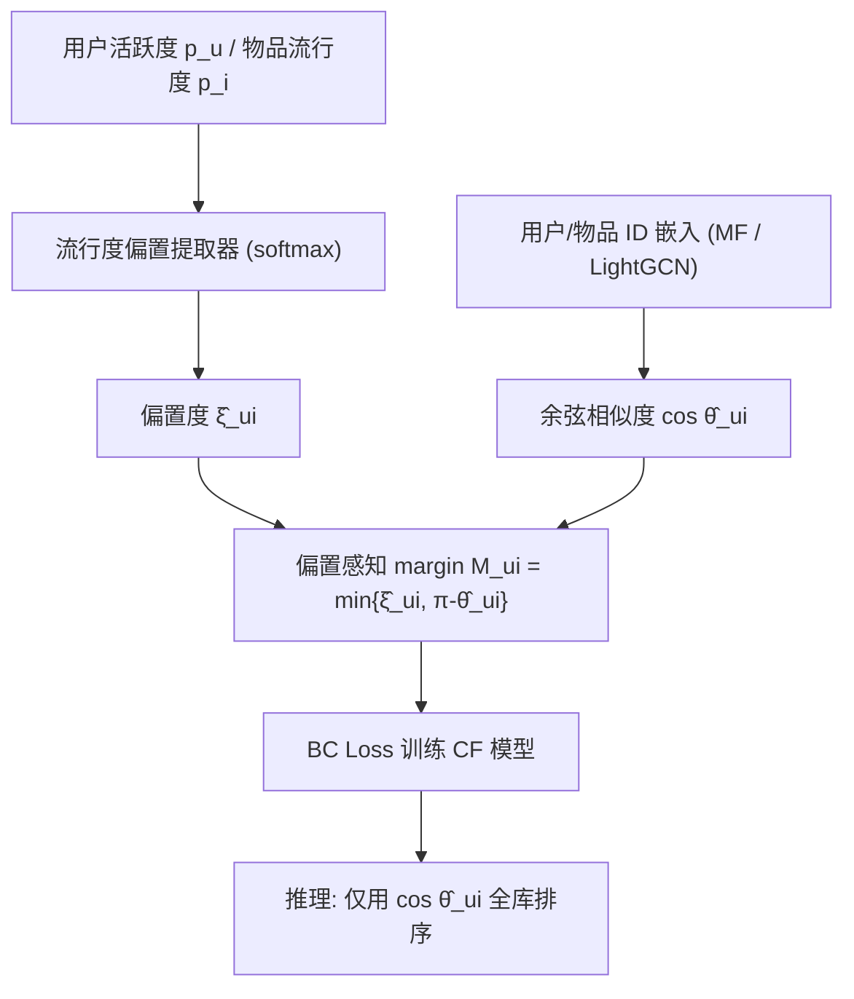
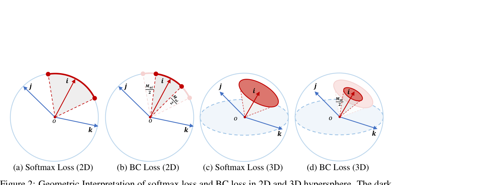

# Incorporating Bias-aware Margins into Contrastive Loss for Collaborative Filtering (将偏置感知间隔注入协同过滤对比损失)

- **会议/期刊**: NeurIPS 2022
- **作者与机构**: An Zhang, Wenchang Ma, Xiang Wang, Tat-Seng Chua（Sea-NExT Joint Lab / NUS / USTC）
- **推荐链路定位**: 召回（表征学习阶段的损失函数改造）
- **研究方向**: 去偏公平与工业架构 / 协同过滤
- **论文原文**: [https://arxiv.org/abs/2210.11054v2](https://arxiv.org/abs/2210.11054v2)
- **开源代码**: [https://github.com/anzhang314/BC-Loss](https://github.com/anzhang314/BC-Loss)

## TL;DR (1分钟核心速览)

现有流行度去偏方法（重加权 IPS、因果去偏、后处理重排）几乎都在"头尾性能"之间做零和交换：抬尾部必伤头部，整体精度反降。本文提出 **BC Loss**：先训一个只看用户/物品流行度统计的"偏置提取器"量化每个交互的偏置度 $\hat{\xi}_{ui}$，再把它转成角度间隔$M_{ui}$ 加到 softmax 对比损失的正样本角度上，实现"偏置越重、约束越松"的自适应判别学习。在 MF/LightGCN 两个骨干、8 个数据集、平衡/非平衡/时间切分/全观测无偏四类评测下，相对最强去偏基线稳定提升 **12.1%–58.4%**，且是唯一头、中、尾三档同时上涨的方法。

## Background & Motivation (背景与核心矛盾)

- **主流范式**: CF 以 softmax/InfoNCE 式对比损失（式 2）在长尾交互上学用户/物品表征；去偏则靠 IPS 重加权、样本重采样、因果图去偏或后处理重排。
- **前人局限**: (i) 几乎所有去偏方法都假设"测试分布已知且平衡"或"存在一小份无偏数据"，据此调超参，实际不可得；(ii) 它们靠盲目抬升尾部物品排名换取公平，头部精度崩塌——MACR 在 Tencent 上尾部 NDCG@20 暴涨 1662%，头部却跌 60%，整体跌 62%。
- **核心洞察 (Key Insight)**: 真正的问题不是"排序位置不公平"，而是**表征判别力不足**。图 1 的可视化显示：BPR/Softmax 下正负物品嵌入严重重叠；IPS-CN 只把尾部正样本角度拉小，却把头部正样本推远——判别力在头尾之间被搬运而非被提升。
- **本文切入点**: 不改数据分布、不加正则项，只在损失函数里给每个交互一个**与其偏置度成正比的角间隔**，让模型"把该学的学好、把靠流行度蒙对的放松"，从而同时改善头尾表征。

<figure class="paper-figure" markdown="span">
  ![图1：LightGCN \[25\] 在 Yelp2018 \[25\] 上学习到的物品表示可视化，其中子图 (a-d)/(e-h) 将相同头/尾用户表示为绿色星号，红点和蓝点分别表示正物品和负物品。每个子图中，第一行展示投影到单位球面上的 3D 物品表示，第二行展示物品相对于特定用户的角度分布及平均角度的统计。与其他损失相比，BC loss 能学习到更好的头部表示（参见最小平均正角度，绝大多数](../../../../assets/papers/2210.11054v2/figure_1.png)<figcaption>图1：LightGCN [25] 在 Yelp2018 [25] 上学习到的物品表示可视化，其中子图 (a-d)/(e-h) 将相同头/尾用户表示为绿色星号，红点和蓝点分别表示正物品和负物品。每个子图中，第一行展示投影到单位球面上的 3D 物品表示，第二行展示物品相对于特定用户的角度分布及平均角度的统计。与其他损失相比，BC loss 能学习到更好的头部表示（参见最小平均正角度，绝大多数</figcaption>
</figure>

## Method (核心方法设计)

### 1. 整体框架 (Overall Architecture)

模型由两支共享"编码器-余弦相似度"范式（$\hat{y}(u,i)=\cos(\hat{\theta}_{ui})$）的网络组成：**支路 A 为流行度偏置提取器**，仅输入用户活跃度$p_u$与物品流行度$p_i$，用标准 softmax 损失训练到收敛，其正样本角$\hat{\xi}_{ui}$即"该交互能被流行度解释的程度"；**支路 B 为目标 CF 模型**（MF 或 LightGCN）。训练 B 时，把冻结的$\hat{\xi}_{ui}$转为角度 margin$M_{ui}$ 注入 softmax 损失的正样本项。推理阶段**完全丢弃支路 A**，只保留 B，打分与常规 CF 完全一致，无额外在线开销。

### 2. 关键设计拆解 (Key Designs)

1. **流行度偏置提取器（把"偏置"变成一个可测量的角度）**：无偏数据不可得，作者用"仅凭流行度能否复原该交互"作为偏置度的代理。提取器 embedding 为 $\psi_b(p_u),\phi_b(p_i)$，用与式 2 同构的 softmax 损失训练；能被子流行度统计轻易拟合的交互（活跃用户×热门物品）$\hat{\xi}_{ui}$ 小，说明其偏好信号弱、偏置强。
2. **偏置感知角度间隔（Bias-aware Margin）**：核心算子为
$$M_{ui}=\min\{\hat{\xi}_{ui},\ \pi-\hat{\theta}_{ui}\},\qquad \mathcal{L}_{BC}=-\sum_{(u,i)\in\mathcal{O}^+}\log\frac{\exp(\cos(\hat{\theta}_{ui}+M_{ui})/\tau)}{\exp(\cos(\hat{\theta}_{ui}+M_{ui})/\tau)+\sum_{j\in\mathcal{N}_u}\exp(\cos(\hat{\theta}_{uj})/\tau)}$$
   上界 $\pi-\hat{\theta}_{ui}$保证$\cos(\cdot)$在优化区间单调递减。几何上（图 2），原 softmax 的判决边界是$\hat{\theta}_{ui}=\hat{\theta}_{uj}$，BC 强化为$\hat{\theta}_{ui}+M_{ui}<\hat{\theta}_{uj}$，把可行域压缩成单位超球面上的"球冠"；$M_{ui}$ 越大球冠越小，判别约束越紧。因此**低偏置交互被强力挤压（正样本聚拢），高偏置交互几乎不受约束（避免被流行度带偏）**，天然兼作 hard example mining。
3. **理论性质与训练开销**：定理 1 给出
$$\mathcal{L}_{BC}\geq\underbrace{\sum_{u}\|\mathbf{v}_u-\mathbf{c}_u\|^2+\sum_{i}\|\mathbf{v}_i-\mathbf{c}_i\|^2}_{\text{紧凑性}}\ -\underbrace{\sum_{u}\sum_{j\in\mathcal{N}_u}\|\mathbf{v}_u-\mathbf{v}_j\|^2}_{\text{离散性}}\ \propto\ H(V|Y)-H(V)$$
   即最小化 BC 等价于"正对低熵聚簇 + 负对高熵扩散"，这解释了为何头尾表征可同时变好。训练负采样沿用 softmax 的采样未交互集 $\mathcal{N}_u$（batch 内负采样），超参仅温度$\tau$ 一个；相较骨干仅增加可忽略的训练时间（原文表 5），推理零成本。

<figure class="paper-figure" markdown="span">
  <figcaption>图2：softmax 损失与 BC loss 在 2D 和 3D 超球面上的几何解释。深红色区域表示判别性用户约束，浅红色区域用于比较。</figcaption>
</figure>

## Experimental Setup & Evaluation Protocol (实验设置与评估协议)

- **数据集与预处理**: 8 个真实基准，覆盖全部主流测试分布；论文未逐一报告用户/物品规模统计（下表以评测设置为主）：

| 数据集 | 划分方式 | 测试分布类型 | 说明 |
| :--- | :--- | :--- | :--- |
| Tencent | 60%/10%/15% 随机划分 | 非平衡 + 均匀重采样平衡 + 头/中/尾分桶 | 主实验与分桶分析主战场 |
| Amazon-Book | 同上 | 平衡 / 非平衡 | 图书域，较稠密 |
| Alibaba-iFashion | 同上 | 平衡 / 非平衡 | 最稀疏，考验偏置度估计鲁棒性 |
| Douban Movie | **时间戳 7:1:2 切分** | 时间漂移 | 检验流行度分布迁移鲁棒性 |
| Yelp2018 | 留出划分 | 平衡 / 非平衡 | 经典 LightGCN 基准 |
| KuaiRec / Yahoo!R3 / Coat | 全观测 | **无偏测试集** | 见附录 B.3 |

- **数据划分与防穿越 (Splitting Strategy)**: 主实验用 `比例划分`（60/10/15），Douban 用 `全局时间戳切分`，KuaiRec/Yahoo!R3/Coat 用 `全观测无偏划分`；平衡测试集为**在物品维度等概率**随机抽 15% 交互，训练/验证/非平衡测试共享同一长尾分布，且调参时**不提供任何平衡测试信息**（避免"已知测试分布"的作弊假设）。
- **排名评测协议 (Ranking Protocol)**: 采用 `Full-Ranking`（全库未交互物品排序），指标 Recall@20 / NDCG@20 / HR@20；训练侧为 softmax 内的采样负样本，非评测侧采样。
- **对比基线与超参设置**: 骨干 MF 与 LightGCN，$d$与官方默认一致；基线含 MostPop、IPS-CN（重加权）、CausE / MACR（因果去偏）、sam+reg（正则化）；`*` 表示相对最强基线的显著性提升（$p<0.05$）。

## Key Experimental Results (实验关键数据)

### 1. 主实验对比 (Main Results)

Tencent / Amazon-Book / Alibaba-iFashion，Recall@20 / NDCG@20（节选）：

| Backbone + 方法 | Tencent 平衡 | Tencent 非平衡 | Amazon 平衡 | Amazon 非平衡 | iFashion 非平衡 |
| :--- | :---: | :---: | :---: | :---: | :---: |
| MostPop | 0.0002/0.0002 | 0.0384/0.0208 | 0.0001/0.0001 | 0.0102/0.0063 | 0.0212/0.0084 |
| MF (骨干) | 0.0052/0.0040 | 0.0982/0.0643 | 0.0109/0.0103 | 0.0856/0.0638 | 0.0843/0.0411 |
| MF + IPS-CN | 0.0075/0.0058 | 0.0686/0.0421 | 0.0132/0.0123 | 0.0765/0.0554 | 0.0551/0.0255 |
| MF + CausE | 0.0056/0.0043 | 0.0687/0.0468 | 0.0115/0.0105 | 0.0720/0.0551 | 0.0185/0.0086 |
| MF + sam+reg | 0.0070/0.0054 | 0.0406/0.0266 | 0.0141/0.0132 | 0.0599/0.0443 | 0.0305/0.0146 |
| MF + MACR | 0.0067/0.0046 | 0.0326/0.0241 | 0.0181/0.0146 | 0.0292/0.0229 | 0.0650/0.0331 |
| **MF + BC Loss** | **0.0087/0.0068** | **0.1298/0.0904** | **0.0221/0.0202** | **0.1198/0.0948** | **0.0967/0.0487** |
| Improv.% | +16.0/+17.2 | +32.2/+40.1 | +22.1/+38.4 | +40.0/+49.6 | +14.7/+18.5 |
| LightGCN (骨干) | 0.0055/0.0042 | 0.1065/0.0712 | 0.0123/0.0116 | 0.0941/0.0724 | 0.0660/0.0322 |
| LightGCN + MACR | 0.0075/0.0050 | 0.0731/0.0532 | 0.0183/0.0153 | 0.0767/0.0600 | 0.0475/0.0238 |
| **LightGCN + BC Loss** | **0.0095/0.0073** | **0.1194/0.0832** | **0.0257/0.0227** | **0.1123/0.0903** | **0.0992/0.0510** |
| Improv.% | +25.0/+30.1 | +12.1/+16.9 | +40.4/+48.4 | +19.3/+24.7 | +50.3/+58.4 |

时间切分（Douban，HR/Recall/NDCG@20）：MF+BC **0.3742/0.0324/0.0601** vs. MF 0.2924/0.0294/0.0472（+28.0/+10.2/+27.3）；LightGCN+BC **0.3562/0.0346/0.0652**（+0.5/+10.4/+8.3）。对照：MF+IPS-CN 0.2514/0.0174/0.0324、MF+MACR 0.1084/0.0087/0.0163——**所有去偏基线在时间切分下均低于骨干**。

### 2. 消融实验 (Ablation Study)

以 Tencent NDCG@20 为对象的组件拆解（"常数 margin"即 CosFace 式去偏版，Figure 3a）：

| 变体 | 平衡 NDCG@20 | 非平衡 NDCG@20 | 说明 |
| :--- | :---: | :---: | :--- |
| Softmax（$M=0$） | 0.0044 | 0.0707 | 基线损失 |
| + 常数 margin $M=0.3$ | — | 0.0871 | 全局统一间隔 |
| + 常数 margin $M=0.5$ | 0.0066 | 0.0873 | 常数最优档 |
| + 常数 margin $M=0.7$ | 0.0049 | 0.0627 | 过大约束反而崩坏 |
| **+ BC Loss（自适应）** | **0.0087** | **0.0904** | 偏置感知 margin 最优 |
| 去掉温度调优（$\tau$ 偏离 0.05–0.07） | 显著下降 | 显著下降 | 单超参敏感性 |

### 3. 关键实验发现 (Key Findings)

1. **BC 是唯一"无 trade-off"的方法**：Tencent 分桶表中 MF+BC 在非平衡设置下头部 +40%、中部 +261%、尾部 +576%、整体 +41%；而 MACR 尾部 +1662% 却让头部 −60%、整体 −62%——证明"抬尾部排名"与"提升判别力"是两件不同的事。
2. **自适应 margin 明显强于常数 margin**：平衡 NDCG@20 从 Softmax 0.0044 → 常数最优 0.0066 → BC 0.0087（+32%），非平衡 0.0707 → 0.0873 → 0.0904，说明 margin 必须按交互的偏置度定制，一刀切的大 margin 会把可靠交互也过度压缩（$M=0.7$ 时跌至 0.0627）。
3. **对分布迁移鲁棒**：时间切分下所有因果/重加权基线全部失效（IPS-CN 的 MF Recall 0.0174 低于骨干 0.0294），BC 仍提升 10.2%/10.4%，因为它不依赖"预设的尾部物品集合"，而依赖交互级的相对偏置度。

## Highlights & Limitations (亮点、对比与审稿批判)

- **与代表作对比 (vs. Prior Work)**: 与 IPS-CN 的本质区别是——IPS 用**物品频率**给损失加权（全局、单侧），BC 用**交互级**的"流行度可解释度"调制**角度几何**（局部、双侧，且同时约束正负样本的相对角度）；与 MACR/CausE 相比，BC 不假设任何因果图结构，而有定理 1 的熵分解下界做支撑；与 CosFace 式常数 margin 相比，BC 的 margin 是数据自适应的。
- **可迁移亮点**: (i) "用一个只吃偏置变量的辅助模型输出当作样本难度/偏置度代理"这一 trick 可直接迁移到曝光偏置、位置偏置、跨域迁移中的样本重加权；(ii) 把标量难度转成角度 margin 注入 softmax，比直接改采样权重更稳、更易实现（改几行代码）。
- **审稿级局限批判**: (i) **两阶段训练**：偏置提取器需先独立训到收敛，且其容量/正则强度直接决定 $\hat{\xi}_{ui}$的可靠性，论文未给出该模块的敏感性分析；(ii) margin 形式$M_{ui}=\min\{\hat{\xi}_{ui},\pi-\hat{\theta}_{ui}\}$中的比例系数被固定为 1，作者自陈"更复杂的$\lambda\cdot\hat{\xi}_{ui}$ 留待未来"，说明关键超参尚未调优；实验也仅覆盖流行度偏置，曝光/选择偏置未涉及，且缺少线上 A/B 与工业级规模验证。

## Rating (四维评分)

- **方法创新性 (Novelty)**: ⭐⭐⭐⭐ （把"去偏"重构为"判别力提升"，用交互级偏置度生成角度 margin，思路简洁且与 CosFace 的常数 margin 形成清晰对比）
- **评估协议与实验扎实度 (Protocol & Experiments)**: ⭐⭐⭐⭐⭐ （8 数据集 × 4 类测试分布 × 2 骨干，并显式做头/中/尾分桶与"不告知平衡测试"的防作弊设定，覆盖度罕见）
- **写作与数学规范度 (Clarity & Rigor)**: ⭐⭐⭐⭐ （几何解释 + 熵分解下界定理闭环完整；但式 6 上界截断与系数选择的讨论略显简略）
- **工业落地与复现价值 (Industrial & Practical Value)**: ⭐⭐⭐⭐ （只改损失、推理零额外开销、代码开源，但需额外维护一个偏置提取器训练流程，多阶段上线成本需评估）

