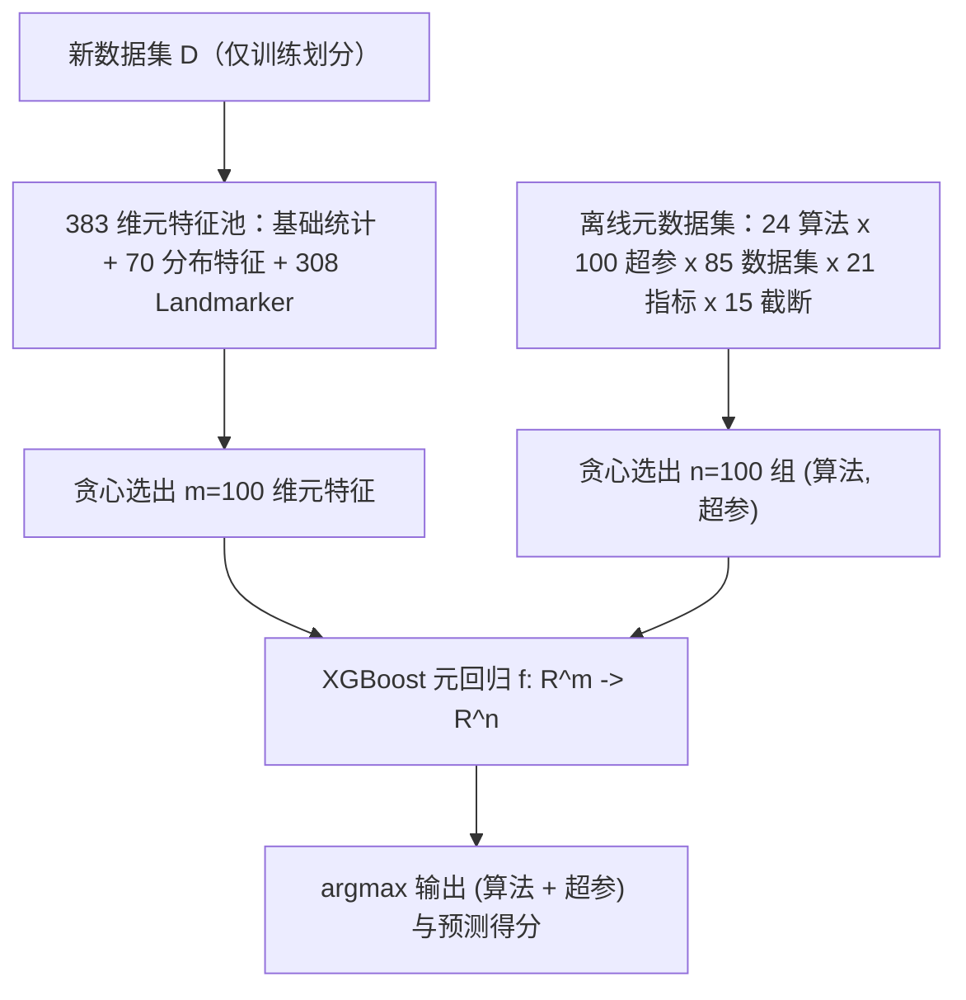

# On the Generalizability and Predictability of Recommender Systems (推荐系统的泛化性与可预测性)

- **会议/期刊**: NeurIPS 2022
- **作者与机构**: Duncan McElfresh, Sujay Khandagale, Jonathan Valverde, John P. Dickerson, Colin White (Abacus.AI / ArthurAI / UMD)
- **推荐链路定位**: 召回与全链路模型选型（AutoML / 元学习）
- **研究方向**: 去偏公平、可信隐私与工业架构 / 跨域与多场景推荐
- **论文原文**: [https://arxiv.org/abs/2206.11886v2](https://arxiv.org/abs/2206.11886v2)
- **开源代码**: [https://github.com/naszilla/reczilla](https://github.com/naszilla/reczilla)

## TL;DR (1分钟核心速览)

针对"面对新数据集与新指标，该选哪个推荐算法、哪组超参"这一工业与科研共同痛点，本文先做了一次 24 算法 × 85 数据集 × 315 指标的 84,850 次训练的元研究，实证表明**不存在普适最优算法、超参也几乎不可跨数据集迁移**；随后提出 RecZilla，用 383 维数据集元特征 + XGBoost 直接回归每个 (算法, 超参) 组合的归一化性能。在 leave-one-dataset-family-out 的 950 次试验中，%Diff 从 cf4cf-meta 的 43.5、cunha2018 的 52.9 降至 33.2（相对降低 24%），预测耗时仅 6.69 秒。

## Background & Motivation (背景与核心矛盾)

- **主流范式**: 视觉/NLP 靠 ImageNet/BERT 预训练与 NAS 复用算力；而推荐系统论文几乎都是"一个数据集、一个模型"定制化设计，模型间无法复用。
- **前人局限**: ①Dacrema 等已指出 2015–2018 年 12 个神经推荐模型中 11 个打不过调好的 KNN/线性基线；②既有元学习选型工作（Cunha 2018、cf4cf-meta）最多覆盖 9 个数据集族、4 个指标，且**只选算法不选超参**、方法与指标强绑定。
- **核心洞察 (Key Insight)**: 作者用大规模实验证实两点——(a) 算法与超参的最优性高度依赖数据集与指标，几乎不可迁移；(b) 但数据集的统计/谱性质（元特征）与算法性能、运行时长乃至"数据集硬度"强相关（最高 |r| = 0.941）。
- **本文切入点**: 既然"迁移模型"失败而"预测性能"可行，就把选型问题改写为**元回归问题**：$f:\mathbb{R}^m\to\mathbb{R}^n$ 输入元特征、输出各候选 (算法, 超参) 的归一化得分。

<figure class="paper-figure" markdown="span">
  ![图 2：相对算法性能同时取决于数据集和指标：没有算法在所有数据集或指标上占优。每个图展示一个不同指标，并在每个数据集上归一化到 \[0, 1\]；横轴展示不同数据集，按字母顺序排列。每条曲线对应一个不同算法：基于相似度的方法为红色，矩阵分解方法为绿色，基线方法为黑色，神经网络方法为灰色。](../../../../assets/papers/2206.11886v2/figure_2.png)<figcaption>图 2：相对算法性能同时取决于数据集和指标：没有算法在所有数据集或指标上占优。每个图展示一个不同指标，并在每个数据集上归一化到 [0, 1]；横轴展示不同数据集，按字母顺序排列。每条曲线对应一个不同算法：基于相似度的方法为红色，矩阵分解方法为绿色，基线方法为黑色，神经网络方法为灰色。</figcaption>
</figure>

## Method (核心方法设计)

### 1. 整体框架 (Overall Architecture)

RecZilla 分离线与在线两段。离线：先用贪心覆盖度从全部 (算法, 超参) 与 383 维元特征池中各挑 $n=100$、$m=100$的子集，再在元数据集$\mathcal{M}$上训练 XGBoost 回归器$f$，输入为数据集元特征向量$d$，输出为该数据集上每个候选组合的归一化性能$\hat{y}$。在线：对新数据集只用**训练划分**计算$m$维元特征，一次前向即得全部候选的预测得分，取 argmax 输出 (算法$a$, 超参$\omega$)，无需任何超参搜索或模型训练。整个流程对指标解耦：用户只要给出由元数据集中 315 个指标任意组合构成的目标函数$\varphi$，即可按需重训。

### 2. 关键设计拆解 (Key Designs)

1. **覆盖度贪心的候选子集选择（算法侧与特征侧同构）**：元学习处在低数据区间（仅 85 个数据点），直接把 2,400 组候选全喂进去必然过拟合。作者定义子集 $S'$的覆盖度$C(S') = \frac{1}{|\mathcal{D}|}\sum_{D\in\mathcal{D}}\max_{(a,\omega)\in S'}\varphi(a,\omega,D)$，即"该子集中最好的那个候选在各数据集上的平均归一化表现"，并用前向贪心每次加入使覆盖度增益最大的候选。物理直觉：覆盖度衡量的是"子集整体的天花板"，保证被选入的候选**互补**而非彼此冗余；同一套贪心逻辑套在元特征上则改为最大化与目标指标的相关性。

2. **跨数据集可比的归一化性能目标**：不同数据集的 PREC@10 绝对量级差异达两个数量级（0.008 vs 0.2+），直接回归原始值会让模型偏向大数值数据集。作者对每个数据集做 min-max 归一化 $\varphi(a,\omega,D)\equiv 100\times\frac{\varphi(a,\omega,D)-P_D^{\min}}{P_D^{\max}-P_D^{\min}}$，使所有元数据点落在$[0,100]$的同一尺度；这也让用户可自由更换指标$\varphi$（含多指标组合、性能-时延 Pareto 前沿）而无需改动流程。

3. **训练目标、数据划分与推理开销**：元模型为多输出回归（每个候选组合一个回归头，XGBoost/线性/KNN(k=5, L2) 均可替换），优化 MSE；**防泄漏关键点是按数据集族（family）而非单个划分做 leave-one-out**，测试族整体不可见，避免同源切分泄漏。在线推理只做一次元特征计算 + 一次回归，实测 6.69 秒，与 cf4cf-meta 的 6.68 秒持平而质量显著更优；相比"逐算法跑完 10 小时超参搜索"的基线，代价几乎可忽略。

## Experimental Setup & Evaluation Protocol (实验设置与评估协议)

- **数据集与预处理**: 85 个数据集划分来自 19 个数据集族（Amazon、Movielens、Netflix、Gowalla、Jester2、Epinions、Frappe、Yahoo 等），无统一 k-core 过滤，密度跨 6 个数量级：

| 数据集 | #Users | #Items | #Interactions | 密度 | 场景说明 |
| :--- | :---: | :---: | :---: | :---: | :--- |
| AmazonBooks | 1,686,577 | 2,330,066 | 11,498,997 | 2.9e-06 | 极稀疏电商 |
| NetflixPrize | 476,694 | 17,770 | 99,521,398 | 1.2e-02 | 稠密影视评分 |
| Jester2 | 56,333 | 140 | 1,640,712 | 2.1e-01 | 超稠密笑话 |
| Movielens100K | 943 | 1,682 | 98,114 | 6.2e-02 | 小规模基准 |
| Gowalla | 91,846 | 1,247,095 | 3,735,522 | 3.3e-05 | POI 签到 |
| Epinions | 28,487 | 139,738 | 592,236 | 1.5e-04 | 社交评论 |
| **合计** | — | — | **85 个划分 / 84,850 次训练 / >2,600 万次评估** | — | 19 个族 |

- **数据划分与防穿越**: 主实验用 `leave-last-k-out`（每用户留最后若干交互作验证/测试），仓库另提供 `全局时间戳切分`；元特征、Landmarker 与特征选择**全部只在训练划分上计算**，元学习评估按数据集族整体留出，双重防泄漏。
- **排名评测协议**: `Full-Ranking`——对每个用户对全库物品预测打分并全排序，截断 $K\in\{1,\dots,10,15,20,30,40,50\}$；21 个指标 × 15 个截断 = 315 个指标，不使用负采样排序。
- **对比基线与超参设置**: 24 个算法（6 类：User/Item-KNN 等相似度、7 种 MF、5 种线性模型 SLIM/EASE-R、2 个简单基线、6 个神经模型），非神经方法每 (算法, 数据集) 用 Sobol 采样最多 100 组超参、10 小时上限；神经方法因 GPU 成本**仅用原论文默认超参**、15 小时上限。元学习基线为 cunha2018 与 cf4cf-meta，50 次随机试验 × 19 个测试族 = 950 次。

## Key Experimental Results (实验关键数据)

### 1. 主实验对比 (Main Results)

**(a) 算法在 85 数据集 × 10 个 accuracy/hit-rate 指标上的全排名（20 个算法）**

| 算法 | Item-KNN | P3alpha | SLIM-BPR | EASE-R | RP3beta | SVD | iALS | User-KNN | TopPop | Random | SlopeOne |
| :--- | :---: | :---: | :---: | :---: | :---: | :---: | :---: | :---: | :---: | :---: | :---: |
| 最优排名 | **1** | **1** | **1** | **1** | **1** | **1** | **1** | **1** | **1** | **9** | 7 |
| 最差排名 | 14 | 18 | 14 | 18 | 17 | 16 | 19 | 17 | **16** | 20 | 20 |
| 平均排名 ↓ | **2.3** | 4.2 | 4.7 | 5.3 | 6.0 | 6.0 | 7.0 | 7.6 | 10.4 | 16.2 | 16.7 |

**(b) RecZilla vs 算法选择基线（950 次试验，PREC@10 为目标指标）**

| 方法 | 运行时间 (s) | %Diff ↓ | 预测算法的 PREC@10 ↑ | 是否预测超参 |
| :--- | :---: | :---: | :---: | :---: |
| cunha2018 | 0.39 | 52.9 ± 23.0 | 0.00813 ± 0.0113 | 否 |
| cf4cf-meta | 6.68 | 43.5 ± 21.8 | 0.00808 ± 0.00773 | 否 |
| **RecZilla** | 6.69 | **33.2 ± 22.8** (`Improv.` 23.7% / 37.2%) | **0.00915 ± 0.00840** (`Improv.` 12.6%) | **是** |

### 2. 消融实验 (Ablation Study)

| 消融维度 | 设置 | 关键结果 |
| :--- | :--- | :--- |
| 元训练族数量 | 2 → 18 个族（200 次随机抽样，leave-one-out） | XGB 的 MAE 由 ≈0.010 降至 ≈0.005，单调下降；数据越多越准 |
| 元学习器 | XGB / 线性 / KNN(k=5) | XGB 全区间 MAE 最低，线性与 KNN 次之，均随数据增加而改善 |
| 元特征维度 $m$| 随机抽样$m$维子集 | 增大$m$ 初期显著增益，过多后趋平（低数据下需控维防过拟合） |
| 元特征来源 | 去掉 Landmarker（308 维）仅留统计/分布特征 | Landmarker 是与性能相关性最强的一类（如 UserKNN vs PureSVD mAP@5, r=0.846） |

### 3. 关键实验发现 (Key Findings)

1. **"没有普适算法"被定量坐实**：NDCG@1 上 20 个算法中 17 个至少在某个数据集排进前二，RECALL@50 上除 SlopeOne/GlobalEffects/Random 外全部进过前二；同时每个算法的最差排名都 ≥14（共 20 个），Item-KNN 平均排名 2.3 却也能跌到 14。这直接否定了"抄 SOTA 模型即可"的工程惯例。
2. **超参不可跨数据集迁移**：图 3 的 $i\to j$迁移矩阵中大多数格点接近 0，Gowalla、Jester2 尤其"排外"；即使在同一算法内，在数据集$i$上最优的超参在$j$ 上常接近最差。这解释了为何 RecZilla 必须**同时预测超参**而非只挑算法家族——这也是它与 cunha2018/cf4cf-meta 的本质差异。
3. **元特征确实可预测**：'物品评分数分布的均值'这一最简单的统计量与 SlopeOne 性能相关性高达 0.941，中位数与 CoClustering 达 0.933，稀疏度与 MF-BPR 达 0.887；由此支撑的 RecZilla 把 %Diff 从 43.5 压到 33.2，且 6.69 秒出结果、同时产出可训练的超参配置，而两个基线均不输出超参。

## Highlights & Limitations (亮点、对比与审稿批判)

- **与代表作对比 (vs. Prior Work)**: 相比 Dacrema 等的"复现批判"研究，本文不止于证伪，而给出可执行的选型器；相比 cunha2018 / cf4cf-meta，本文在数据集族（19 vs ≤9）、指标（315 vs ≤4）、超参预测（是 vs 否）、开源（Python 全量 vs 无/R only）四个维度全面超出一档。
- **可迁移亮点**: ①"覆盖度贪心 + 归一化性能"这套候选池裁剪范式可直接迁移到多场景粗排模型选型、甚至召回通道组合；②Landmarker 元特征（在小采样子集上跑 7 个轻量基线）是极低成本的"数据集画像"，可用于新业务冷启动时的架构预设。
- **审稿级局限批判**: ①神经方法只跑默认超参（15h GPU 限制），与非神经方法的 100 组 Sobol 搜索不对等，Table 1 对 Mult-VAE/NeuRec 的排名存在系统性低估偏差，作者在结论中也承认；②元数据仅 85 个数据点、且 84,850 次实验中 1,530 组有 126 组失败（OOM/非法超参），失败偏差未建模；③正文、摘要与 Table 1 分别出现 24/18/20 个算法的口径不一致，复现时易混淆；④%Diff 仍有 33.2（即平均离最优差三分之一），且以 PREC@10 为主战场，对 NDCG/覆盖率等指标的预训练模型仅是附带发布。

## Rating (四维评分)

- **方法创新性 (Novelty)**: ⭐⭐⭐⭐ （把"选模型"重构为数据集级元回归，并首次做到指标无关 + 超参感知，思路清晰但技术栈以 XGBoost + 贪心为主，缺乏理论保证）
- **评估协议与实验扎实度 (Protocol & Experiments)**: ⭐⭐⭐⭐⭐ （84,850 次训练、2,600 万次评估、按族留出的严格防泄漏，并开源全部原始结果，稀缺的元研究级实验体量）
- **写作与数学规范度 (Clarity & Rigor)**: ⭐⭐⭐ （归一化性能、覆盖度、%Diff 定义干净，但 18/20/24 算法数量与 85/88 数据集数量的口径前后不一致，削弱严谨性）
- **工业落地与复现价值 (Industrial & Practical Value)**: ⭐⭐⭐⭐⭐ （统一 API + 预训练模型 + 原始元数据全开源，6.7 秒完成选型，可直接用于新业务冷启动的算法基线预设与人力节省）

