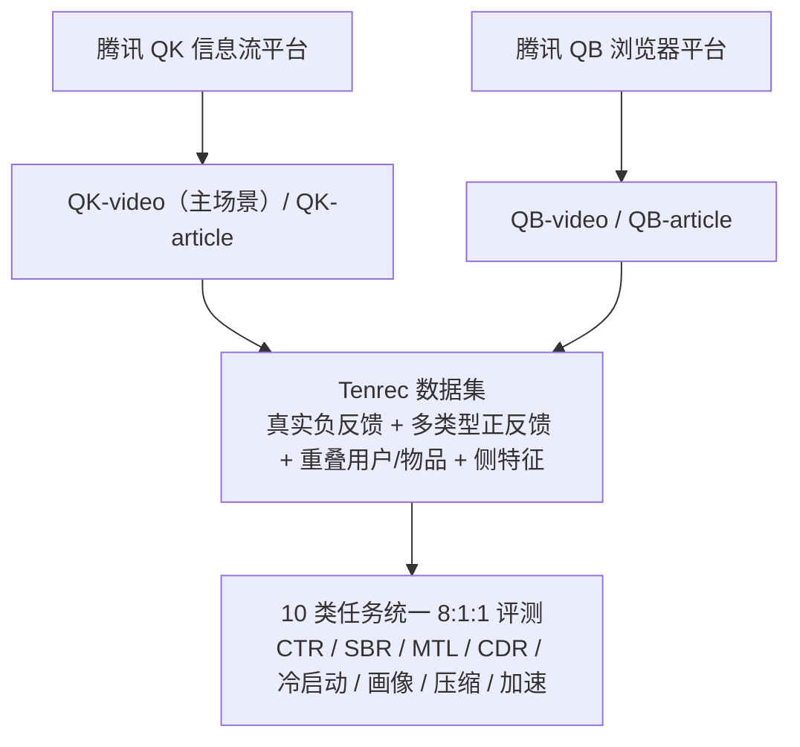
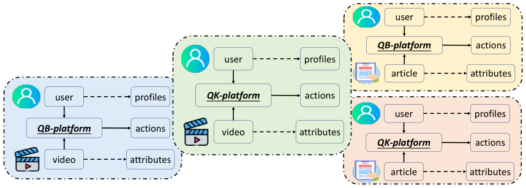

# Tenrec: A Large-scale Multipurpose Benchmark Dataset for Recommender Systems (Tenrec：面向推荐系统的大规模多用途基准数据集)

- **会议/期刊**: NeurIPS 2022 Datasets & Benchmarks Track
- **作者与机构**: Guanghu Yuan、Fajie Yuan（西湖大学）、Yudong Li、Beibei Kong 等（腾讯、中科院深圳先进院、中科大、中山大学）
- **推荐链路定位**: 召回 / 精排 / 端到端评测基准
- **研究方向**: 工业级基准数据集与评测架构 / 跨域多场景推荐
- **论文原文**: [https://arxiv.org/abs/2210.10629v3](https://arxiv.org/abs/2210.10629v3)
- **开源代码**: [https://github.com/shenweichen/DeepCTR-Torch](https://github.com/shenweichen/DeepCTR-Torch)（单模型基线实现；数据集与各任务 leaderboard 由作者官方仓库托管）

## TL;DR (1分钟核心速览)

现有推荐基准普遍规模小、反馈单一、缺乏真实负样本与跨场景重叠，导致模型评测失真。Tenrec 从腾讯 QQ KanDian（QK）与 QQ Browser（QB）两平台抽取 4 个真实推荐场景，含约 500 万用户、1.4 亿次交互、真实曝光未点击负反馈、多类型正反馈与重叠用户/物品。作者在 10 类任务上重跑经典基线，实测 NFM 与 Wide&Deep 的 AUC 差距仅 0.5%，SBR 各架构差距 < 5%，远小于文献宣称的"大幅提升"。

## Background & Motivation (背景与核心矛盾)

- **主流范式**: 推荐系统社区长期以 MovieLens、Amazon、Yelp、Mind 等单一场景、单一反馈形式的数据集作为稳定基准，模型创新主要在这些数据集上刷分。
- **前人局限**: (1) 这些数据集规模按现代标准偏小，且只含一种反馈（评分或点击），无法支撑 CTR、MTL、CDR、终身学习等真实需求；(2) 单场景且无重叠用户/物品，迁移学习与跨域方法无从验证；(3) 复现性危机：Dacrema 等指出众多"先进"基线在统一配置下甚至不如十几年前的 MF，Rendle 等进一步论证 dot-product 在正确训练下优于 MLP。
- **核心洞察 (Key Insight)**: 推进 RS 研究的关键瓶颈不是模型结构，而是缺少 ImageNet/GLUE 式的统一、大规模、多用途真实基准——只有同时具备规模、多场景重叠、多类型反馈、真实负样本与附加特征，才能真正评测主流推荐任务。
- **本文切入点**: 从腾讯两条信息流平台上一次性抽取四个场景，构造覆盖 10 类任务的开放基准。

## Method (核心方法设计)

### 1. 整体框架 (Overall Architecture)

Tenrec 从腾讯 QQ KanDian（内容资讯）与 QQ Browser（浏览器）两个信息流推荐系统采集数据，拆分为 QK-video、QK-article、QB-video、QB-article 四个场景；以 QK-video 为主场景（~502 万用户、375 万视频、1.42 亿点击、4.93 亿曝光），其余三者为副场景，用于 CDR/TF 任务。采集流程：先随机抽取至少 5 次视频点击行为的用户，再抽取其全部正反馈（点击/点赞/分享/关注/阅读/收藏）与真实负反馈（有曝光无动作），同时保留脱敏后的用户年龄/性别与物品类别特征。为控制算力，CTR/SBR 等任务在随机抽取 100 万用户的 QK-video-1M 上评测，全量结果在附录给出。最终以统一 8:1:1 划分在 10 类任务上跑通经典基线并建立 leaderboard。

<figure class="paper-figure" markdown="span">
  <figcaption>图1：Tenrec 的数据来源。Tenrec 包含四个推荐场景：QK-video、QK-article、QB-video 和 QB-article，其中每两个或三个场景之间存在一定比例的重叠用户和物品。</figcaption>
</figure>

### 2. 关键设计拆解 (Key Designs)

1. **真实负反馈与多类型正反馈（区别于 one-class 推荐）**：以往数据集要么只有隐式正反馈、要么只有显式评分，无法构造真实 CTR 场景。Tenrec 保留"曝光但未点击"作为 true negative，并将正反馈细分为 click / like / share / follow / read / favorite 六种强度层级。物理直觉：点击率仅 ~29%（1.42 亿点击 / 4.93 亿曝光），而点赞/分享/关注数量依次递减一个数量级，天然刻画用户偏好的强弱梯度，可直接用于 MTL 与偏好等级迁移。
2. **跨场景重叠用户与物品（支撑 CDR / 终身学习）**：四个场景共享同一脱敏 ID 空间，QK-video 与 QK-article 重叠用户 268,207 人，与 QB-video 重叠 3,261 人、重叠视频 78,482 个。这使"预训练→微调→持续学习"链路可端到端验证，而非依赖人工构造的伪重叠。
3. **训练目标、负采样与评测一致性保障**：各任务沿用其原生损失（CTR 用交叉熵，SBR 统一用自回归交叉熵 + softmax 以隔离架构差异），无额外负采样技巧。作者特别强调：SBR 三个单向模型仅在统一损失/采样/数据增强下才可比；附录表 16/17 进一步证明随机采样器与流行度采样器（power=0.75）会使 LightGCN 的 Recall@20 从 0.1065 跃至 0.1211，负采样策略对结论的影响超过架构本身。

## Experimental Setup & Evaluation Protocol (实验设置与评估协议)

- **数据集与预处理**（主场景 QK-video 与三副场景统计）：

| 场景 | #Users | #Items | #Clicks | #Exposure | 稀疏度/说明 |
| :--- | :---: | :---: | :---: | :---: | :--- |
| QK-video | 5,022,750 | 3,753,436 | 142,321,193 | 493,458,970 | 主场景，含 click/like/share/follow |
| QK-article | 1,325,838 | 220,122 | 46,111,728 | — | 额外 read/favorite 与阅读时长 |
| QB-video | 34,240 | 130,637 | 1,701,171 | 2,442,299 | 小规模副场景，用于 TF |
| QB-article | 24,516 | 7,355 | 348,736 | — | 极稀疏，仅点击 |
| QK-video-1M | ~1,000,000 | 1,948,388 | 86,642,580 | — | 1:2 正负采样后，密度 3.3%（稀疏度 96.7%） |

  物品流行度呈典型长尾分布（图 2a/2b 双对数坐标近似直线）；会话长度 [0,20] 区间占全部会话 53%（图 2c）。
- **数据划分与防穿越**: 统一采用 `比例划分` **8:1:1**（train/valid/test）；SBR 任务额外采用 `Leave-One-Out`（会话末位为 test、次末位为 valid）。
- **排名评测协议**: 大规模 item 空间下采用 `Sampled Ranking`（每个用户 4 个负样本，随机采样器与流行度采样器分别报告）；CTR/MTL 用 AUC + Logloss；SBR 用 HR@20 / NDCG@20。
- **对比基线与超参**: CTR 侧 Wide&Deep、DeepFM、NFM、xDeepFM、AFM、DCN、DCNv2；SBR 侧 GRU4Rec、NextItNet、SASRec、BERT4Rec；MTL 侧 ESMM、MMOE、PLE；CDR 侧 Conure；压缩/加速侧 CpRec、StackRec、SkipRec。嵌入维度 $d \in \{16,32,64,128\}$（CTR 最终取 32，SBR 取 64/128），$f \in \{64,128,256\}$，$\eta \in \{10^{-3},\dots,10^{-5}\}$，batch 4096，层数$h \in \{1,2\}$。

## Key Experimental Results (实验关键数据)

### 1. 主实验对比 (Main Results)

**CTR（QK-video-1M，正负比 1:2）与 SBR（QK-video-1M）**

| 任务 | 模型 | AUC | Logloss | HR@20 | NDCG@20 |
| :--- | :--- | :---: | :---: | :---: | :---: |
| CTR | Wide & Deep | 0.7919 | 0.5100 | — | — |
| CTR | DeepFM | 0.7930 | 0.5083 | — | — |
| CTR | **NFM** | **0.7957** | **0.5080** | — | — |
| CTR | xDeepFM | 0.7931 | 0.5081 | — | — |
| CTR | DCNv2 | 0.7932 | 0.5085 | — | — |
| SBR | GRU4Rec | — | — | 0.04882 | 0.0192 |
| SBR | **NextItNet** | — | — | **0.05112** | **0.0199** |
| SBR | SASRec | — | — | 0.05017 | 0.0194 |
| SBR | BERT4Rec | — | — | 0.04902 | 0.0185 |

> NFM 相对最差 Wide&Deep 的 AUC 提升仅 **0.48%**；SBR 中 NextItNet 相对 BERT4Rec 的 HR@20 提升仅 **4.3%**。

**迁移/冷启动/画像/终身学习（NDCG@20 或 ACC）**

| 任务 | 模型 | 指标 | w/o PT | w/ PT | 相对提升 |
| :--- | :--- | :---: | :---: | :---: | :---: |
| TF（QK→QB-video） | NextItNet | NDCG@20 | 0.0473 | **0.0489** | +3.4% |
| TF | SASRec | NDCG@20 | 0.0445 | **0.0479** | +7.6% |
| 冷启动（QK→article） | BERT4Rec | HR@20 | 0.03555 | **0.04963** | **+39.6%** |
| 用户画像（Gender） | BERT4Rec | ACC | 0.89856 | **0.90082** | +0.25% |
| 终身学习 Task4（QB-article） | Conure-NextItNet | NDCG@20 | 0.0931 | **0.1074** | **+15.4%** |
| MTL（click/like） | ESMM | AUC | — | 0.7940 / 0.9110 | 优于 MMOE (0.7900/0.9020) |

### 2. 消融实验 (Ablation Study)

| 变体 | 参数量 | 训练/推理耗时 | HR@20 | NDCG@20 | 结论 |
| :--- | :---: | :---: | :---: | :---: | :--- |
| NextItNet（基线） | 305M | 66,880 s | 0.05112 | 0.0199 | 参考 |
| Stack-NextItNet | 305M | **24,320 s** | 0.05090 | 0.0202 | 训练加速 63.6%，精度持平 |
| Stack64-NextItNet | 305M | 29,380 s | **0.05215** | 0.0200 | 64 层仍比 16 层快 2.3× |
| Cp-NextItNet | **204M** | — | 0.05001 | 0.0195 | 参数降 33%，精度降 < 2% |
| 推理 NextItNet | — | 308 s | 0.11922 | 0.0473 | 参考 |
| Skip-NextItNet | — | **236 s** | 0.12158 | 0.0472 | 推理加速 23.4% |
| Skip-SASRec | — | **206 s** | 0.11086 | 0.0431 | 推理加速 32.5%，精度略降 |
| 随机负采样 vs 流行度采样（LightGCN） | — | — | Recall@20 0.1065 → **0.1211** | NDCG 0.0542 → **0.0617** | 采样器影响 > 架构差异 |

### 3. 关键实验发现 (Key Findings)

- **"先进 baseline 大幅超越"的结论在大规模真实数据上系统性失效**：CTR 7 个模型 AUC 全部落在 0.7919–0.7957 区间（极差 0.48%），SBR 4 个模型 HR@20 落在 0.0488–0.0511（极差 4.7%），与文献中动辄 20%+ 的宣称提升形成鲜明反差，直接印证 Dacrema/Rendle 等对 RS 复现性的质疑。
- **预训练对数据稀缺场景的收益远大于丰富场景**：冷启动 BERT4Rec 的 HR@20 因预训练提升 **39.6%**，LL Task4 的 NDCG@20 提升 **15.4%**；而用户画像任务上预训练增益仅 **0.25%**，说明当目标域数据充足时，迁移的价值主要来自隐层初始化而非表示空间的语义复用。
- **评测协议（尤其负采样与损失统一）的影响常被架构差异掩盖**：LightGCN 仅更换负采样器就使 Recall@20 提升 13.7%（0.1065→0.1211），远超 NCF↔NGCF 之间的架构差距（0.0764→0.0878，15%），提示基准论文应强制锁定采样/损失后才有资格比较网络结构。

## Highlights & Limitations (亮点、对比与审稿批判)

- **与代表作对比 (vs. Prior Work)**: 相比 MovieLens/Amazon 等单场景单反馈基准，Tenrec 同时提供多场景重叠、真实负样本与多粒度正反馈；相比 Mind 等大规模新闻数据集，Tenrec 覆盖视频+文章双模态且带跨平台迁移关系；相比 Meta/Google 内部数据集，Tenrec 是**公开可下载**（CC BY-NC 4.0）的工业级基准。
- **可迁移亮点**: (1) "真实曝光未点击"负样本构造方式可直接迁移到任何工业 CTR 数据集构建；(2) 统一损失/采样器后再比较架构的评测纪律，是所有 RS 基准论文与模型论文都应遵循的实践。
- **审稿级局限批判**: (1) **时间戳被移除**（仅保留行为相对顺序），使得严格的时间切分评估与序列周期性建模无法开展；(2) **缺乏多模态内容**（仅保留视频/文章类别标签，无标题、封面或视频帧），无法支撑多模态推荐与内容理解实验，削弱了"多用途"的宣称力；(3) 主实验使用 1M 用户采样版，附录全量结果中 CTR 排名（xDeepFM 与 DeepFM 并列 0.8235）与采样版（NFM 领先）不一致，说明结论对采样与超参搜索预算较为敏感。

## Rating (四维评分)

- **方法创新性 (Novelty)**: ⭐⭐⭐ （数据集构造维度（真实负反馈+跨场景重叠+多粒度正反馈）组合新颖，但无算法创新，属于资源型贡献）
- **评估协议与实验扎实度 (Protocol & Experiments)**: ⭐⭐⭐⭐⭐ （10 类任务全覆盖，统一 8:1:1 划分与损失/采样纪律，附录补充全量、共享嵌入、多冷启动比例与两种负采样器对照，非常扎实）
- **写作与数学规范度 (Clarity & Rigor)**: ⭐⭐⭐⭐ （数据统计与特征格式描述清晰，但正文缺少对任务选择依据与 leaderboard 维护机制的深入论证，且部分表格符号不统一）
- **工业落地与复现价值 (Industrial & Practical Value)**: ⭐⭐⭐⭐⭐ （公开可下载的真实工业多场景数据 + 完整基线代码与 leaderboard，是 RS 社区少有的可直接用于预训练/迁移/压缩研究的大规模基准）

