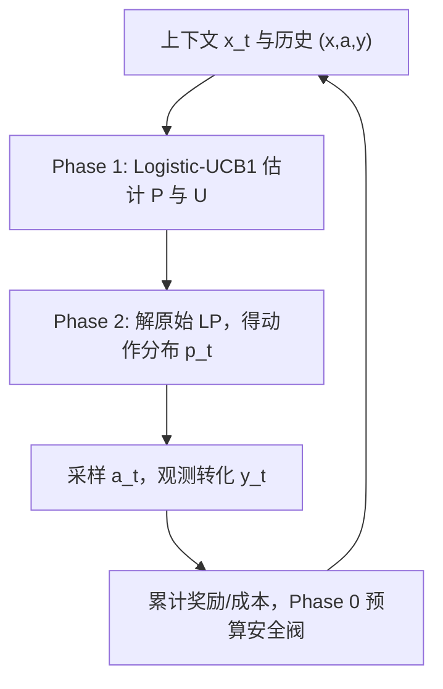

# Contextual Bandits with Knapsacks for a Conversion Model (面向转化模型的有背包约束上下文 Bandit)

- **会议/期刊**: NeurIPS 2022
- **作者与机构**: Zhen Li (BNP Paribas)；Gilles Stoltz (Université Paris-Saclay/CNRS, HEC Paris)
- **推荐链路定位**: 策略层/预算约束探索决策（折扣发放、优惠券分配）
- **研究方向**: 强化学习与动态探索推荐 / CTR/CVR 预估与特征交叉
- **论文原文**: [论文原文链接](https://arxiv.org/abs/2206.00314v2)
- **开源代码**: 暂未开源

## TL;DR (1分钟核心速览)

本文研究带背包约束的上下文 Bandit（CBwK）中的“转化耦合”新结构：奖励与成本只在客户转化 $y_t=1$时同时发生，转化概率由 Logistic 模型$P(a,\mathbf{x})=\eta(\phi(a,\mathbf{x})^\top\theta^\star)$决定。作者提出两阶段自适应策略：Logistic-UCB1 估计转化概率，再每轮求解带乐观概率的原始线性规划。在硬预算约束下取得$(OPT/B)\sqrt{T}$量级遗憾；未知上下文分布时额外付出$|X|$ 项。

## Background & Motivation (背景与核心矛盾)

- **主流范式**: CBwK 通常在“上下文-奖励-成本”三元组上做线性建模，或对有限静态策略集竞争；预算约束通过原始-对偶方法处理。
- **前人局限**: Agrawal & Devanur (2016) 的线性 CBwK 需要学习权衡奖励与成本的临界参数 $Z$，常需$\sqrt{T}$ 轮初始探索；一般 CBwK 的有限策略集假设难以刻画折扣-转化这类结构化决策。
- **核心洞察 (Key Insight)**: 在折扣销售场景中，奖励（成交量）与成本（折扣损失、折扣次数）并非独立线性生成，而是被同一个 0/1 转化变量耦合；只要建模转化概率，就能用更自然的原始 LP 做预算分配。
- **本文切入点**: 将转化概率的 Logistic 置信上界直接代入原始 LP，避免对偶参数 $Z$，并在已知/未知上下文分布两种设定下给出遗憾界。

## Method (核心方法设计)

### 1. 整体框架 (Overall Architecture)

每轮观测上下文 $\mathbf{x}_t$后，策略先检查累计成本是否接近预算上限；若安全，则用历史转化数据更新 Logistic 参数$\theta^\star$的估计，得到转化概率上界$U_{t-1}(a,\mathbf{x})$；随后求解一个以$U_{t-1}$替代真实$P$ 的原始线性规划，得到动作分布并在当前上下文上采样动作；若转化发生则获得奖励并承受成本，否则奖励与成本均为零。整体是“学习转化模型 + 每轮预算规划”的闭环。

### 2. 关键设计拆解 (Key Designs)

1. **转化耦合的 CBwK 建模**：痛点是将奖励与成本各自线性建模会破坏“只有转化才同时产生收益与成本”的耦合。本文令每轮奖励为 $r(a,\mathbf{x}_t)y_t$、成本为$c(a,\mathbf{x}_t)y_t$，且$y_t\sim \mathrm{Ber}(P(a,\mathbf{x}_t))$，其中$P(a,\mathbf{x})=\eta(\phi(a,\mathbf{x})^\top\theta^\star)$。直觉上，折扣先影响转化率，再同时影响收益与促销成本，因此预算约束应放在“期望转化后成本”上。

2. **原始 LP + 乐观转化概率**：前人用对偶形式需估计 $Z$；本文直接解
   $\max_{\pi:\mathcal{X}\to\Delta(\mathcal{A})}\mathbb{E}_{X\sim\nu}[\sum_a r(a,X)U_{t-1}(a,X)\pi_a(X)]$，约束为$\mathbb{E}_{X\sim\nu}[\sum_a c(a,X)U_{t-1}(a,X)\pi_a(X)]\le B_T\mathbf{1}$。
   这里 $U_{t-1}=\min\{\hat{P}_{t-1}+\varepsilon_{t-1},1\}$ 提供乐观探索；KKT 条件把全局 LP 化为逐上下文的“惩罚增益”最大化，因此策略自然且可分析。

3. **训练目标、负采样与推理效率**：Phase 1 最大化带 $\ell_2$正则的 Logistic 似然，仅在$a_s\ne a_{\mathrm{null}}$时累积信息；无负采样。Phase 0 在累计成本将超预算时永久选 no-op，保证硬约束。Phase 2 每轮解含$|X|\times|A|$约束的 LP，复杂度多项式；主要工程代价是需将连续上下文离散为有限$\mathcal{X}$。

## Experimental Setup & Evaluation Protocol (实验设置与评估协议)

- **数据集与预处理**: 原文正文未给主实验数值表；附录 F 使用 UCI “default of credit card clients” 做部分模拟的真实数据研究。未采用推荐系统常见的 `5-core` 过滤。

| 数据集 | #Users | #Items | #Interactions | 稀疏度/密度 | 特征/场景说明 |
| :--- | :---: | :---: | :---: | :---: | :--- |
| UCI credit card clients（模拟） | 约 3 万客户 | 不适用（动作=折扣等级） | $T$轮（提供文本未披露具体$T$） | 不适用 | 客户/账单特征；成本维$d=2$：折扣次数、促销损失 |

- **数据划分与防穿越**: 采用 i.i.d. 上下文模拟，每轮上下文独立抽取；无传统训练/验证/测试切分，因此不存在推荐排序中的时间穿越问题。
- **排名评测协议**: 不适用 `Full-Ranking` 或 `Sampled Ranking`；评价指标为累计遗憾 $\mathrm{Regret}_T$与预算违反情况，图 1 以$B=1600,2200$、10 次运行均值 ±2 标准误展示。
- **对比基线与超参设置**: 主要是理论对比：Agrawal & Devanur 线性 CBwK、Badanidiyuru 等一般 CBwK、Immorlica 等 LagrangeBwK、Faury 等 Logistic-UCB1。正则参数 $\lambda=m\ln(1+T/m)$，保守预算$B_T=B-b_T$；原文未给显著性$p$ 值，仅给标准误。

## Key Experimental Results (实验关键数据)

### 1. 主实验对比 (Main Results)

原文正文**未提供可直接抽取数值的主实验表**，故不能计算真实 `Improv.%`；下表仅整理可核验的理论/模拟对比，避免杜撰数值。

| 方法/设定 | 结构假设 | Regret 上界（order） | 预算可行性 | 备注 |
| :--- | :--- | :--- | :---: | :--- |
| **本文 Conversion-CBwK, $\nu$已知** | Logistic 转化 + 原始 LP | **$(OPT/B)\sqrt{T}+\mathcal{O}(m\sqrt{T}\ln T)$** | 硬约束 | 无$Z$ 参数 |
| 本文 Conversion-CBwK, $\nu$未知 | 加经验分布$\hat{\nu}_t$|$(m+|X|OPT/B)\sqrt{T}\ln T$| 硬约束 | 多$|X|$ 项 |
| Agrawal & Devanur 2016 | 线性奖励/成本 | $(OPT/B)m\sqrt{T}\ln T$| 硬约束 | 需临界$Z$ |
| Badanidiyuru et al. 2014/2016 | 一般 CBwK，有限策略集 | 依赖策略集，未给统一式 | 硬约束 | 非结构化 |
| Immorlica et al. 2019 | LagrangeBwK | 对抗设定，非直接可比 | 硬约束 | 对偶策略 |
| Faury et al. 2020 | Logistic bandit | 无预算约束 | 不适用 | 本文 Phase 1 基础 |

### 2. 消融实验 (Ablation Study)

原文未给定量消融；下表为理论依赖层面的“消融”。

| 移除/变体 | 理论影响 | 原文数值 |
| :--- | :--- | :---: |
| w/o Phase 0 安全阀 | 可能违反硬预算约束 | 未提供 |
| w/o UCB 项 $\varepsilon_t$ | 失去乐观探索，遗憾无保证 | 未提供 |
| w/o LP，改贪心 | 跨轮预算分配失衡 | 未提供 |
| $\nu$已知 → 未知 | 增加$|X|\sqrt{T\ln(T|X|/\delta)}$ 项 | 未提供 |

### 3. 关键实验发现 (Key Findings)

1. 在 $B=1600$与$B=2200$的模拟中，图 1 用 10 次运行均值 ±2 标准误报告遗憾与两个成本分量相对$tB/T$ 的偏差；Phase 0 使成本曲线受控，说明硬预算安全阀是可行的工程化设计。
2. 已知 $\nu$时主遗憾为$(OPT/B)\sqrt{T}$，额外仅$\mathcal{O}(m\sqrt{T}\ln T)$；未知$\nu$的$|X|$ 因子来自经验分布偏差，提示上下文离散粒度是统计代价的主要来源。
3. 与 Agrawal & Devanur 需为 $Z$预留约$\sqrt{T}$轮探索相比，本文 Phase 2 直接用原始 LP 和 UCB 概率，省去显式$Z$ 学习，但代价是要求有限上下文集以保持 LP 可解。

## Highlights & Limitations (亮点、对比与审稿批判)

- **与代表作对比 (vs. Prior Work)**: 与 Agrawal & Devanur 2016 相比，本文不是线性奖励/成本，而是“转化变量耦合”结构，并用原始 LP 避免 $Z$；与 Badanidiyuru 等 2014/2016 相比，本文利用 Logistic 结构而非有限策略集；与 Faury 等 2020 相比，本文把 Logistic-UCB1 嵌入预算约束决策。
- **可迁移亮点**: ① 将“转化概率上界”直接代入预算 LP，可迁移到优惠券/折扣发放；② Phase 0 的预算安全阀是工业硬约束系统的低成本保护机制。
- **审稿级局限批判**: ① 需要有限 $\mathcal{X}$，每轮 LP 规模为$|X|\times|A|$，连续上下文需离散化；② 实验仅附录模拟，缺真实推荐 A/B 与主实验数值，且未给遗憾下界与 Logistic 模型误设分析。

## Rating (四维评分)

- **方法创新性 (Novelty)**: ⭐⭐⭐⭐ （转化耦合 CBwK + 原始 LP 避免 $Z$ 参数，结构建模与理论分析有清晰增量）
- **评估协议与实验扎实度 (Protocol & Experiments)**: ⭐⭐ （仅附录模拟、无主实验数值表与显著性检验，评估协议非标准推荐排序）
- **写作与数学规范度 (Clarity & Rigor)**: ⭐⭐⭐⭐ （KKT/对偶分析清晰，遗憾界推导完整，但依赖有限上下文与若干预算条件）
- **工业落地与复现价值 (Industrial & Practical Value)**: ⭐⭐⭐ （折扣预算场景直接，硬预算安全阀实用；但 LP 开销、离散化与无开源代码限制复现）

