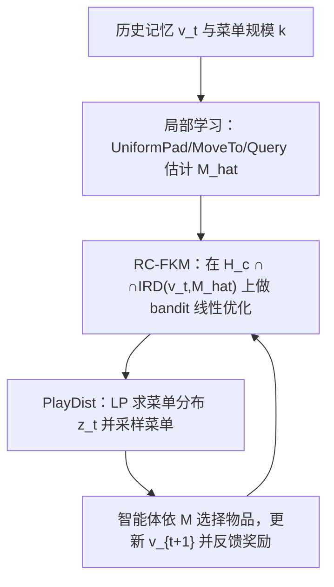

# Diversified Recommendations for Agents with Adaptive Preferences (面向自适应偏好智能体的多样化推荐)

- **会议/期刊**: NeurIPS 2022
- **作者与机构**: Arpit Agarwal, William Brown（Columbia University）
- **推荐链路定位**: 端到端长期策略（菜单推荐/探索）
- **研究方向**: 强化学习与动态探索推荐
- **论文原文**: [https://arxiv.org/abs/2210.07773v2](https://arxiv.org/abs/2210.07773v2)
- **开源代码**: 暂未开源

## TL;DR (1分钟核心速览)

本文针对用户偏好随历史自适应、推荐易把用户推入“兔子洞”的问题，将 $k$选 1 菜单推荐建模为未知偏好下的对抗 bandit，并约束长期物品分布熵。作者提出 EIRD 基准与局部可学习偏好类，用“局部学习+RC-FKM”在$H_c\cap\mathrm{EIRD}(M)$上取得$\tilde{O}(T^{3/4})$遗憾，并证明最佳菜单/均匀 IRD 基准存在$\Omega(T)$ 下界。

## Background & Motivation (背景与核心矛盾)

- **主流范式**: 推荐/bandit 通常假设用户偏好固定或仅依赖上下文，优化即时奖励；多样性多作为约束或后处理。
- **前人局限**: 用户偏好会随历史自适应，算法可能制造 echo chamber/rabbit hole；同时未知偏好下可行物品分布随历史变化，导致“最佳菜单分布”或“均匀记忆下最佳 IRD 分布”不可学，且非局部偏好类需要指数级查询。
- **核心洞察 (Key Insight)**: 若要求物品分布在任意记忆向量下都可瞬时实现（EIRD），且偏好模型 $\lambda$-dispersed，则 EIRD 能覆盖所有足够高熵分布；局部可学习类可在均匀向量附近查询并估计全域行为。
- **本文切入点**: 以 $H_c\cap\mathrm{EIRD}(M)$ 作为可学习遗憾基准，先局部学习偏好模型，再在收缩可行域上做 bandit 线性优化。

## Method (核心方法设计)

### 1. 整体框架 (Overall Architecture)

推荐器每轮从 $n$个物品中选$k$个组成菜单，智能体按未知偏好模型$M$将历史记忆$v$映射为选择概率并选一项，推荐器只观测被选物品的对抗奖励。算法先通过 UniformPad/MoveTo/Query 在均匀记忆附近局部学习$\hat{M}$，再令 RC-FKM 在$H_c\cap\bigcap_t\mathrm{IRD}(v_t,\hat{M})$上选择目标物品分布$x_t$，由 PlayDist 解 LP 得到菜单分布并采样，智能体选择后更新$v_{t+1}$，形成“学习—优化—反馈”闭环。

### 2. 关键设计拆解 (Key Designs)

1. **EIRD 基准与高熵包含**：痛点是最佳菜单分布与均匀记忆下最佳 IRD 分布均不可达。定义 $p_{K,v,i}=\frac{s_{v,i}}{\sum_{j\in K}s_{v,j}}$、$\mathrm{IRD}(v,M)=\mathrm{conv}\{p_{K,v}:|K|=k\}$、$\mathrm{EIRD}(M)=\bigcap_{v\in\Delta(n)}\mathrm{IRD}(v,M)$，并将遗憾基准设为$H_c\cap\mathrm{EIRD}(M)$。当$M$满足$s_{v,i}\ge\lambda$且$c=\log n-\gamma$、$\lambda\ge k^2e^{\gamma/\tau}/n$时，任意$v\in H_c$都有$v'\in\mathrm{EIRD}(M)$满足$d_{\mathrm{TV}}(v,v')\le O(\tau)$，从而把“多样性”和“可实时实现”绑定。

2. **局部可学习与两阶段学习**：痛点是在累积记忆下，查询相距较远的点会指数级拖慢学习。定义 $h$-局部可学习：在$v^*\in\mathrm{EIRD}(M)$的$\alpha$-球内查询归一化分数，输出$\hat{M}$使全单纯形上$\|\hat{M}(x)/\hat{M}^*_x-M(x)/M^*_x\|\le\epsilon$，且$\epsilon=\Omega(\beta)$。作者证明有界阶单变量多项式、双线性/归一化多变量多项式、稀疏 Fourier 类均局部可学习；反例给出查询下界$T\ge\min_{\sigma\in\pi(S)}\prod_{i=1}^{|S|-1}(1+d_{\max}(\sigma(i),\sigma(i+1)))$，说明非局部类（如 ReLU 网络）难以高效学习。学习阶段用 UniformPad/MoveTo/Query 实现局部查询，耗时$t_0=\tilde{O}(1/\epsilon^3)=\tilde{O}(T^{3/4})$。

3. **RC-FKM 与 PlayDist：收缩域 bandit 优化及推理**：痛点 $\mathrm{EIRD}(M)$无法显式表示，且可行域随$v_t$收缩，常规 FKM 假定固定决策集。RC-FKM 每步投影到$K_{t+1,\delta,\epsilon}=\{x:\frac{r}{r-\delta-\epsilon}x\in K_{t+1}\}$，更新$x_{t+1}=\Pi_{K_{t+1,\delta,\epsilon}}[x_t-\eta g_t]$，并显式处理$\hat{M}$误差带来的扰动$\|\xi_t\|\le\epsilon$；PlayDist 解 LP 将目标$x_t$转为菜单分布。本文无监督损失与负采样，优化目标是遗憾$\mathrm{Regret}_{H_c\cap\mathrm{EIRD}(M)}(T)$，每轮仅收被选物品的 bandit 奖励；主定理给出$\tilde{O}(T^{3/4})$遗憾，且$H_c$以$1-O(T^{-1/4})$概率仅$O(\epsilon)$-满足。

## Experimental Setup & Evaluation Protocol (实验设置与评估协议)

- **数据集与预处理**: 本文为纯理论论文，无真实数据集、无 `5-core` 过滤、无 `Leave-One-Out`/比例划分、无 `Full-Ranking`/`Sampled Ranking` 评测；下表以理论评估对象替代数据集统计。

| 评估对象 | 设置/条件 | 指标 | 说明 |
| :--- | :--- | :---: | :--- |
| 偏好模型类 | $\lambda$-dispersed、局部可学习（BUP/BMLP/BNMP/SFR） | 累积遗憾 | 合成理论类，非真实数据 |
| 主基准 | $H_c\cap\mathrm{EIRD}(M)$|$\tilde{O}(T^{3/4})$ | 主定理可达 |
| 负结果基准 | 最佳菜单分布 / 均匀记忆最佳 IRD | $\Omega(T)$ | 不可达基准 |
| 非局部学习 | 查询学习下界 | 指数轮数 | 说明局部可学习必要性 |

- **数据划分与防穿越 (Splitting Strategy)**: 不适用；无离线数据切分，评估对象为对抗奖励序列上的在线学习。
- **排名评测协议 (Ranking Protocol)**: 不适用；以累积遗憾和熵约束满足度为指标，不做全库排序或采样排序。
- **对比基线与超参设置**: 理论基准为最佳菜单分布、均匀记忆下最佳 IRD 分布、$H_c\cap\mathrm{EIRD}(M)$；参数含$\lambda,k,c,T,\epsilon,\delta$，无 embedding 维度与显著性检验。

## Key Experimental Results (实验关键数据)

### 1. 主实验对比 (Main Results)

原文无经验主实验表；下表汇总核心理论结果，**加粗**为本文可达到的主上界。

| 结果 | 基准/对象 | 遗憾/复杂度 | 条件 |
| :--- | :--- | :---: | :--- |
| 下界 1 | 最佳菜单分布 $\Delta(\binom{n}{k})$|$\Omega(T)$| 即使$M$ 已知且为单变量线性 |
| 下界 2 | 均匀记忆 $v_U$下最佳 IRD 物品分布 |$\Omega(T)$ | 同上 |
| **主上界** | $H_c\cap\mathrm{EIRD}(M)$| **$\tilde{O}(T^{3/4})$** |$\lambda$-dispersed + 局部可学习 |
| 学习阶段 | 局部学习查询 | $t_0=\tilde{O}(1/\epsilon^3)=\tilde{O}(T^{3/4})$ | 查询数与误差项解耦 |
| RC-FKM | 收缩域 + 扰动 | $nGDT^{3/4}+\frac{GDT^{3/4}}{r}+\frac{2\epsilon GDT}{r}$|$r=O(k^2/n)$ |
| 高熵包含 | $H_c$与$\mathrm{EIRD}(M)$| TV 距离$O(\tau)$|$c=\log n-\gamma$，$\lambda$ 足够大 |

### 2. 消融实验 (Ablation Study)

本文无实证消融；下表为“假设/组件移除”的理论消融。

| 移除/放松 | 理论后果 | 依据 |
| :--- | :--- | :--- |
| 去掉 EIRD 基准，改用最佳菜单/均匀 IRD | 线性遗憾下界，无法亚线性学习 | Theorem 1 |
| 去掉局部可学习 | 非局部类需指数查询轮数 | Theorem 3 |
| 去掉 $\lambda$-dispersion | 高熵分布未必在 EIRD，包含性与探索失效 | Theorem 2 条件 |
| 去掉 RC-FKM 的收缩/扰动处理 | 无法处理 $\hat{M}$ 误差与收缩可行域 | Theorem 4/5 |
| 去掉熵约束 $H_c$ | 退化为纯奖励 bandit，失去多样性保证 | 问题定义 |

### 3. 关键实验发现 (Key Findings)

1. **多样性是使遗憾可优化的结构性条件**：当 $\lambda\ge k^2e^{\gamma/\tau}/n$时，所有$c=\log n-\gamma$的高熵分布都被 EIRD 以$O(\tau)$TV 覆盖，因此$H_c\cap\mathrm{EIRD}$既多样又可优化；相反，最佳菜单/均匀 IRD 基准有$\Omega(T)$ 下界。
2. **局部可学习性是必要假设**：查询下界表明非局部类（如 ReLU 网络）需要指数轮；多项式/Fourier 类可在 $\tilde{O}(1/\epsilon^3)$ 轮内学到全域行为，说明偏好模型的结构假设直接决定可学习性。
3. **两阶段解耦把“未知 $M$”与“收缩可行域”分离**：学习阶段耗$\tilde{O}(T^{3/4})$轮，优化阶段 RC-FKM 对$G$-Lipschitz 损失取得$\tilde{O}(T^{3/4})$遗憾，并以$1-O(T^{-1/4})$概率使$H_c$仅$O(\epsilon)$-满足。

## Highlights & Limitations (亮点、对比与审稿批判)

- **与代表作对比 (vs. Prior Work)**: 既有反馈回路/echo chamber 工作多为实证或简单自适应模型；dueling bandits 假设偏好固定；performative prediction 不涉及菜单与多样性约束。本文首次把自适应偏好菜单推荐形式化为对抗 bandit，并给出 EIRD 基准、局部可学习性与上下界。
- **可迁移亮点**: EIRD 的“任意历史可实时实现”基准可用于其他自适应推荐；局部可学习 + 收缩域 bandit 优化可迁移到可行域随状态变化的在线决策问题。
- **审稿级局限批判**: 纯理论无实证，$\lambda$-dispersion 与局部可学习假设较强（排除 ReLU 等非局部模型）；算法需枚举菜单/每轮解 LP，学习阶段$\tilde{O}(T^{3/4})$探索开销大，且$T^{3/4}$ 遗憾未必最优，单智能体设定也限制多用户平台直接落地。

## Rating (四维评分)

- **方法创新性 (Novelty)**: ⭐⭐⭐⭐ （将自适应偏好菜单推荐形式化为对抗 bandit，EIRD 基准与局部可学习性具有理论新意）
- **评估协议与实验扎实度 (Protocol & Experiments)**: ⭐⭐⭐ （纯理论无实证，但上界、下界与假设必要性论证完整）
- **写作与数学规范度 (Clarity & Rigor)**: ⭐⭐⭐⭐ （定义、定理与证明链条清晰，假设条件交代充分）
- **工业落地与复现价值 (Industrial & Practical Value)**: ⭐⭐ （无开源代码，菜单枚举/LP 与强假设使其更偏理论工具）

