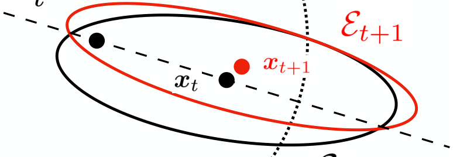

# Learning from a Learning User for Optimal Recommendations (面向学习型用户的最优推荐学习)

- **会议/期刊**: ICML 2022
- **作者与机构**: Fan Yao, Chuanhao Li, Denis Nekipelov, Hongning Wang, Haifeng Xu；University of Virginia
- **推荐链路定位**: 在线召回/候选对主动探索
- **研究方向**: 强化学习与动态探索推荐 / 去偏与可信推荐
- **论文原文**: [https://arxiv.org/abs/2202.01879v1](https://arxiv.org/abs/2202.01879v1)
- **开源代码**: 暂未开源

## TL;DR (1分钟核心速览)

本文指出推荐系统常把用户当作全知打分器，忽略用户也在从交互中学习偏好，导致仅二值比较反馈非平稳且会累积偏差。作者提出 RAES：用主动椭球搜索学习隐藏偏好，并按用户学习收敛率调节切割与探索，在合成场景取得接近最优的遗憾。

## Background & Motivation (背景与核心矛盾)

- **主流范式**: 传统推荐/线性 bandit 多假设用户对物品效用“全知”，反馈噪声独立同分布，系统可直接查询偏好或奖励。
- **前人局限**: 真实大物品空间中，用户只根据已消费物品估计新物品效用；反馈误差依赖历史并被历史选择偏置，形成“推荐偏差—用户学习偏差—反馈偏差”的循环。且系统通常只能观察成对选择，无法获得评分。
- **核心洞察 (Key Insight)**: 用户对物品的估计不确定性由数据加权范数刻画：越远离已消费物品空间的方向，反馈越不可靠。系统可通过主动探索“补齐”用户未覆盖方向，而非仅利用当前最优估计。
- **本文切入点**: 将用户形式化为 $(c,\gamma)$-rational 学习智能体，设计噪声鲁棒主动椭球搜索 RAES，并给出与用户学习收敛率$\gamma$ 优雅退化的遗憾界。

## Method (核心方法设计)

### 1. 整体框架 (Overall Architecture)

系统每轮推荐一对候选 $(a_{0,t},a_{1,t})$，用户依据自身估计$\theta_t$与探索项选择$a_t$，系统仅见二值比较。RAES 将比较反馈转成关于真实$\theta^\star$的半个空间约束，维护置信椭球$E_t$；用 top-2 特征向量选切割方向，按用户噪声估计切割深度$\alpha_t$，足够深才收缩椭球，否则探索$V_t$的最小特征方向以“培养”用户反馈精度；$T_0$后利用$u_1$ 推荐经验最优臂。

```mermaid
flowchart TD
    A["候选对 (a0,t,a1,t)"] --> B["用户按 θt+βt‖a‖Vt^-1 选择"]
    B --> C["系统仅见二值比较"]
    C --> D["计算切割深度 αt"]
    D -->|αt≥-1/(kd)| E["更新置信椭球 Et+1"]
    D -->|反馈不足| F["探索 Vt 最小特征方向"]
    E --> G["T0 后利用 u1 推荐"]
    F --> G
```

### 2. 关键设计拆解 (Key Designs)

1. **学习型用户模型（Learning User）**：痛点是把反馈噪声当作静态随机噪声；本文让用户也学习。用户估计满足 $\|\theta^\star-\theta_t\|_{V_t}\le c t^{\gamma_1}g(\delta)$，决策满足$\hat{r}_{i,t}=\theta_t^\top a_{i,t}+\beta_t^{(i)}\|a_{i,t}\|_{V_t^{-1}}$。$\gamma=\max\{\gamma_1,\gamma_2\}$越大，用户越不理性/越探索；LinUCB 用户对应任意小$\gamma$。

2. **RAES 主动椭球与噪声切割**：经典椭球法被动接收分离超平面，且无法处理非随机噪声。RAES 令 $g_t$落在 top-2 特征向量张成空间且正交于椭球中心$x_t$，使切割尽量穿过中心；但用户反馈有偏，真实截距含$\beta$与估计误差，故仅当切割深度$\alpha_t=-\frac{c t^\gamma(\|a_{0,t}\|_{V_t^{-1}}+\|a_{1,t}\|_{V_t^{-1}}+g(\delta)\|a_{0,t}-a_{1,t}\|_{V_t^{-1}})+2\epsilon_0}{\|g_t\|_{P_t}}$满足$\alpha_t\ge -1/(kd)$时才收缩椭球，否则推荐最小特征方向以提升$\lambda_{\min}(V_t)$。这保证每次切割体积按$\exp(-(k-1)^2/(2k^2d))$ 缩小，同时避免被不可靠反馈“切错”。

<figure class="paper-figure" markdown="span">
  <figcaption>图1：单位球（虚线）以原点为中心。Lt 穿过原点，经过 Et 的中心 xt 切割 Et 并得到 Et+1。在高维空间中，我们有额外自由度选择 Lt，使 Et 沿所有可能方向收缩。</figcaption>
</figure>
图 1：椭球 $E_t$被过中心$x_t$的切割平面$L_t$一分为二；RAES 主动选择$g_t$，使不确定方向持续收缩。

3. **优化目标、负采样与推理**：本方法为在线 bandit，无离线训练损失与负采样；优化目标为最小化累积遗憾 $R_T=\sum_{t=1}^{T}\theta_\star^\top(2a^\star-a_{0,t}-a_{1,t})$。每轮仅需一次成对比较；$T_0$后推荐$\arg\max_{a\in\mathcal{A}}u_1^\top a$，主要开销是$d\times d$ 椭球更新与特征分解。

## Experimental Setup & Evaluation Protocol (实验设置与评估协议)

- **数据集与预处理**: 无真实推荐数据集，全部为合成在线仿真；动作集为单位球 $\mathcal{A}=\mathcal{B}_2(0,1)$，无 `5-core` 过滤。

| 场景 | #Users | #Items/动作集 | #Rounds | 稀疏度/密度 | 特征/场景说明 |
| :--- | :---: | :---: | :---: | :---: | :--- |
| 合成-5D | 1 | 连续无穷 | $10^4$/$8\times10^4$| — |$d=5$，$\gamma\in\{0,0.1,0.2,0.3\}$，$V_0$ 变化 |
| 合成-10D/20D | 1 | 连续无穷 | $2\times10^4$–$3.2\times10^5$| — | 验证$d^2$ 依赖与长时优势 |

- **数据划分与防穿越 (Splitting Strategy)**: 在线交互，无离线划分；同一问题实例连续跑 $T$ 轮，报告 10 次独立运行均值，无数据穿越。
- **排名评测协议 (Ranking Protocol)**: 非 Full-Ranking/采样排序，指标为累积遗憾 regret；每轮只观察成对比较的二值反馈。
- **对比基线与超参设置**: DBGD、Doubler（OFUL 子程序）、Sparring（OFUL 子程序）；固定 $\delta=0.1,k=1.05,m\ge2D_0$，实验取$T_0=0.25d^2\sqrt{T}$，用户$\beta_t^{(i)}$从$[-t^\gamma,t^\gamma]$ 独立采样。原文未报告显著性检验。

## Key Experimental Results (实验关键数据)

### 1. 主实验对比 (Main Results)

原文只给图 3/4 曲线；下表为 $T=8\times10^4$、10 次平均的近似读数（非原文表值），用于展示量级。

| 算法 | $V_0=100I,\gamma=0$|$V_0=\mathrm{diag},\gamma=0$|$V_0=100I,\gamma=0.2$|$V_0=\mathrm{diag},\gamma=0.2$ |
| :--- | :---: | :---: | :---: | :---: |
| RAES | **≈1.2k** | **≈1.6k** | **≈2.1k** | **≈4.2k** |
| DBGD | ≈3.0k | ≈7.5k | ≈5.2k | ≈2.0e4 |
| Doubler | ≈1.2e4 | ≈2.0e4 | ≈1.7e4 | ≈2.6e4 |
| Sparring | ≈1.5e4 | ≈2.2e4 | ≈1.9e4 | ≈2.8e4 |

RAES 相对次优 DBGD 的遗憾降幅约 60%/79%/60%/79%。

### 2. 消融实验 (Ablation Study)

原文无组件消融，以下为参数敏感性（替代消融）：

| 配置 | 观测 | 归因 |
| :--- | :--- | :--- |
| $\gamma=0$（LinUCB 用户） | 遗憾最低，近$\tilde{O}(\sqrt{T})$ | 用户学习收敛快，反馈噪声小 |
| $\gamma=0.1\to0.3$| 遗憾斜率上升 | 上界$T^{1/2+\gamma}$，用户体验越不理性系统越难学 |
| $V_0$小特征值/病态 | RAES 略升，DBGD/Doubler/Sparring 显著恶化 | 探索分支提升$\lambda_{\min}(V_t)$ 关键 |
| $d=5\to10/20$| 需更长$T$才显优势 | 遗憾含$d^2$ 因子，高维收敛更慢 |

### 3. 关键实验发现 (Key Findings)

- 在 $T=8\times10^4$、$V_0=100I,\gamma=0$下，RAES 约$1.2$k，Doubler/Sparring 约$1.2$–$1.5$e4，差近一个数量级，说明主动切割比“转 MAB”更适配非平稳用户反馈。
- 病态 $V_0$且$\gamma=0.2$时，DBGD 约$2.0$e4，而 RAES 约$4.2$k；基线的失败并非随机波动，而是缺乏“培养用户”探索机制。
- 实验趋势与理论一致：$\gamma$增大遗憾递增；任意$\gamma>0$的下界仍为$\Omega(\sqrt{T})$，因此一般$\gamma$ 下上界紧性仍是开放问题。

## Highlights & Limitations (亮点、对比与审稿批判)

- **与代表作对比 (vs. Prior Work)**: 与 DBGD/Doubler/Sparring 等 dueling bandit 相比，本文首次把“用户也在学习”作为非平稳反馈源；与战略用户/激励探索不同，系统不占信息优势，只观察比较；与传统椭球法相比，本文增加主动切割与噪声自适应浅切。
- **可迁移亮点**: “先培养用户再收割”的探索思路可迁移到冷启动/新物品推荐；用 $\gamma$ 量化用户学习收敛率并调节系统遗憾，可用于设计交互式推荐评测。
- **审稿级局限批判**: 仅线性效用、动作集需稠密/光滑，真实非线性推荐未验证；遗憾含 $d^2$且依赖$T_0$与$c,\gamma$ 上界，工程超参敏感；仅合成实验、无开源代码，工业落地证据弱。

## Rating (四维评分)

- **方法创新性 (Novelty)**: ⭐⭐⭐⭐ （把学习型用户与主动椭球结合，非平稳反馈下的切割深度设计有理论新意）
- **评估协议与实验扎实度 (Protocol & Experiments)**: ⭐⭐⭐ （合成实验与理论对应，但无真实数据、无显著性检验、无组件消融）
- **写作与数学规范度 (Clarity & Rigor)**: ⭐⭐⭐⭐ （模型、定理与证明完整；符号较多，但 $\gamma$ 的物理解释清楚）
- **工业落地与复现价值 (Industrial & Practical Value)**: ⭐⭐ （理论强、代码未开源，$d^2$ 与在线特征分解开销限制大规模推荐部署）

