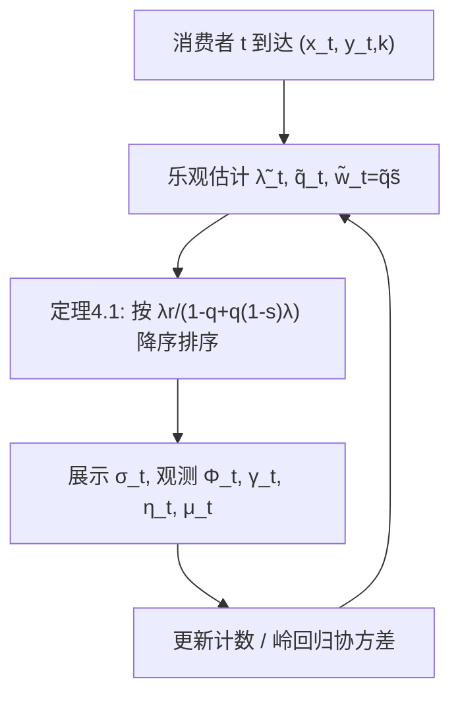

# Product Ranking for Revenue Maximization with Multiple Purchases (多次购买场景下的收益最大化商品排序)

- **会议/期刊**: NeurIPS 2022
- **作者与机构**: Renzhe Xu, Xingxuan Zhang, Bo Li, Yafeng Zhang, Xiaolong Chen, Peng Cui（清华大学计算机系 / 清华经管 / 美团）
- **推荐链路定位**: 重排（商品列表级排序）
- **研究方向**: 强化学习与动态探索推荐（Contextual Bandits）/ 商品列表排序
- **论文原文**: [https://arxiv.org/abs/2210.08268v3](https://arxiv.org/abs/2210.08268v3)
- **开源代码**: [https://github.com/windxrz/MPB-UCB](https://github.com/windxrz/MPB-UCB)

## TL;DR (1分钟核心速览)

现有商品排序研究普遍假设消费者“至多买一件即刻离开”或“买后必然继续浏览”，与真实电商中“多件加购、购完即走”的行为不符。本文构建随机注意力跨度 $V\sim Geo(1-q)$与随机购买预算$B\sim Geo(1-s)$的多次购买级联模型，先证明最优排序等价于按$\lambda_k r_k/(1-q+q(1-s)\lambda_k)$降序排列（$s\to0$时恰好退化到单件购买排序），再据此设计非上下文/上下文 MPB-UCB 算法，以$\tilde{O}(\sqrt{T})$遗憾在线联合估计行为参数。在合成与淘宝半合成数据上（$N=50/300$、$s=0.5/0.8$），其累计遗憾全面低于单件购买、持续浏览与两种 Explore-Then-Exploit 基线。

## Background & Motivation (背景与核心矛盾)

- **主流范式**: 商品排序采用级联模型（cascade model）——消费者按位顺序浏览，逐位按购买概率 $\lambda_{t,k}$决定是否购买，触达注意力跨度$V_t$ 时停止浏览；收益最大化的最优排序已有闭式解。
- **前人局限**: ① Cao & Sun [13] 与 Chen et al. [17] 强制消费者**至多买一件且买后立即退出**，与真实电商“多件加购”常态不符，在促销、高客单品类会严重低估收益；② Liang et al. [40] 假设消费者**购买后必然继续浏览整张列表**，无法刻画“预算用尽即停止购买”，在单件高频场景下会高估后续位置的曝光价值。
- **核心洞察 (Key Insight)**: 浏览停止与购买停止应由两套独立的随机机制驱动——注意力跨度 $V_t$控制“看多少”，购买预算$B_t$控制“买多少”；购买行为本身不终止浏览，只有累计购买数达到$B_t$才终止。更关键的是，引理 5.1 证明这一模型可完全转化为可观测的伯努利反馈（$\gamma\sim Ber(\lambda)$、$\eta\sim Ber(q)$、$\mu\sim Ber(qs)$），使不可直接观测的联合量$qs$ 也可从日志中无偏估计。
- **本文切入点**: 先在该模型下把期望收益做位置交换得到闭式最优排序，再用 UCB / 线性 bandit 在线“边估边排”。

## Method (核心方法设计)

### 1. 整体框架 (Overall Architecture)

每轮第 $t$位消费者（可带特征$x_t$与联合特征$y_{t,k}$）到达，零售商维护$\lambda,q,s$的乐观估计$\tilde{\lambda}_{t},\tilde{q}_{t},\tilde{s}_{t}$，按定理 4.1 的比值降序生成排序$\sigma_t$；展示后观测四项反馈——实际浏览位置数$\Phi_t$、逐位是否购买$\gamma_{t,k}$、未购买后是否继续浏览$\eta_{t,k}$、已购买后是否继续浏览$\mu_{t,k}$；据此更新计数统计量（或岭回归的协方差矩阵）并重算置信上界，进入下一轮。整个闭环无需离线训练集，全部为在线遗憾最小化。

### 2. 关键设计拆解 (Key Designs)

1. **带购买预算的多次购买选择模型与闭式最优排序**：痛点是把单件购买（$s=0$）与“购买后必继续”（$s=1$）当作两个孤立模型，缺少连续可插值的旋钮。本文对购买集合$Q\subseteq[V_t]$的联合概率按$|Q|<B_t$、$|Q|=B_t$、$|Q|>B_t$ 分三段建模，对期望收益式 (3) 做位置交换后可得最优排序必须满足
$$
\frac{\lambda_{\sigma^*_i}r_{\sigma^*_i}}{1-q+q(1-s)\lambda_{\sigma^*_i}}\;\ge\;\frac{\lambda_{\sigma^*_{i+1}}r_{\sigma^*_{i+1}}}{1-q+q(1-s)\lambda_{\sigma^*_{i+1}}},\quad 1\le i<N.
$$
直觉上，分母中 $1-q$是“根本没浏览到该位”的概率、$q(1-s)\lambda$是“浏览到了但预算已被前序购买耗尽”的概率，二者共同度量该位商品能真正被买走的折损；分子$\lambda r$是该位的单件期望收益。当$s\to0$时分母退化为$1-q+q\lambda$，即精确回到 [13, Theorem 1]。排序复杂度仅$O(N\log N)$。

2. **MPB-UCB 非上下文版：伯努利可观测化 + Hoeffding 乐观半径**：引理 5.1 给出 $\gamma_{t,k}\sim Ber(\lambda_{\sigma_{t,k}})$、$\eta_{t,k}\sim Ber(q)$、$\mu_{t,k}\sim Ber(qs)$且三者互相独立，于是用曝光/购买计数比$\hat{\lambda}_{t,k}=c_{t,k}/C_{t,k}$，用“未购买后继续”比例$\hat{q}_t=d^Q_t/D^Q_t$，用“购买后继续”比例**直接**得到$\hat{w}_t=d^W_t/D^W_t\approx qs$——注意$w=qs$ 可直接估，无需分别估计再相乘。再叠加乐观半径：
$$
\tilde{\lambda}_{t,k}=\min\{1,\ \hat{\lambda}_{t,k}+\sqrt{2\log t/C_{t,k}}\},\qquad \tilde{w}_t=\min\{\tilde{q}_t,\ \hat{w}_t+\sqrt{2\log t/D^W_t}\}
$$
并令 $\tilde{s}_t=\tilde{w}_t/\tilde{q}_t$代入定理 4.1 排序，即得$\mathbb{E}[Reg_T]\le C\,(r_{\max}/\epsilon_Q)\,N\sqrt{T\log T}$。这里的$1/\epsilon_Q$来自$V_t$ 有限支撑的几何尾项。

3. **上下文版：$qs$的双线性展开与三路岭回归**：设$\lambda_{t,k}=y_{t,k}^{\top}\beta_\Lambda$、$q_t=x_t^{\top}\beta_Q$、$s_t=x_t^{\top}\beta_S$，则$w_t=q_ts_t=x_t^{\top}\beta_Q\beta_S^{\top}x_t=\mathrm{vec}(x_tx_t^{\top})^{\top}\mathrm{vec}(\beta_Q\beta_S^{\top})$——这迫使对$qs$使用$m_x^2$维的$\beta_W$，也是遗憾界中出现$m_x^2$项、且比$m_y,m_x$项更占主导的根源。对三组参数分别做$\ell_2$正则岭回归（式 12–14），用置信椭球半径$\tau(t,m,\alpha)$ 构造乐观投影（式 16），得到
$$
\mathbb{E}[Reg_T]\lesssim\frac{r_{\max}}{\epsilon_Q}\Big(\chi(T,m_y,\alpha_\Lambda)+\chi(T,m_x,\alpha_Q)+\chi(T,m_x^2,\alpha_W)\Big).
$$
**训练目标与推理效率**：本文无离线损失函数与负采样，全部为在线 regret 优化；非上下文版每轮 $O(N\log N)$，上下文版还需维护三个协方差矩阵并求逆，每轮成本约为$O(Nm_y^2+m_x^3)$量级，商品数$N$ 大时排序本身不是瓶颈、协方差更新才是。

## Experimental Setup & Evaluation Protocol (实验设置与评估协议)

- **数据集与预处理**:

| 数据集 | #Products | #Consumers | 交互/轮数 | 参数设置 | 说明 |
| :--- | :---: | :---: | :---: | :--- | :--- |
| 合成·非上下文 | 50 / 300 | 100,000 | $T=10^5$|$r\sim U[0,1]$,$\lambda\sim U[0,0.3]$,$q=0.9$,$s\in\{0.5,0.8\}$| 可直接检验$s\to0$ 退化 |
| 合成·上下文 | 50 / 300 | 100,000 | $T=10^5$|$m_x=5$,$m_y=10$,$\lambda_{\max}=0.3$,$q_{\max}=0.9$,$s_{\max}\in\{0.5,0.8\}$ | 线性特征生成 |
| 淘宝 Ad Display/Click（半合成） | 50 / 300 | 1,140,000 | 26M 条记录 / 8 天 | 估得 $q=0.870$,$s=0.907$；以 (brand, category) 为商品、平均广告价为$r$ | 回放式仿真 |

- **数据划分与防穿越 (Splitting Strategy)**: 在线设定下**无训练/测试划分**，时间步 $t=1,\dots,T$ 的顺序本身即时间切分；每设置独立重采样 5 次（保持消费者特征不变、只重采其行为随机性），报告均值曲线与误差棒。
- **排名评测协议 (Ranking Protocol)**: 不适用 Full-Ranking / Sampled Ranking 概念，改为每轮对全部 $N$个商品给出完整排序并累计 regret（式 9 / 17）；辅以两个指标——平均收益与相对离线最优策略的收益比（式 22）。淘宝数据按 **10 分钟无交互超时** 切分会话，并筛取价格$\le 200$元、购买概率$\ge 0.1$的$N$ 个商品。
- **对比基线与超参设置**: ① Single Purchase [13]（令 $\tilde{s}_t\equiv0$，复用本文的$\hat{\lambda},\hat{q}$估计）；② Keep Viewing [40]（按$(\lambda_k r_k)/(1-q-(1-q)\lambda_k)$排序）；③ Explore-Then-Exploit A（强制每商品曝光$\ge\delta\log T$次后贪心）；④ Explore-Then-Exploit B（探索期后半段即用式 (5) 排序）。超参网格：$\xi_\Lambda\in\{0.1,0.3,0.5\}$、$\xi_Q,\xi_W\in\{0.05,0.1,0.2\}$、$\delta\in\{0.5,1,2,5,10\}$、$\alpha\in\{0.01,0.1,1\}$（半合成数据为$\{0.1,1,10\}$），由 NNI 网格搜索得到。

## Key Experimental Results (实验关键数据)

### 1. 主实验对比 (Main Results)

原文主结果以 regret 曲线形式呈现（图 1 合成、图 2 半合成，$T$至$10^5$），下表按各设置下终点的相对遗憾水平归纳（数值读图近似，趋势与原文结论一致）：

| 基线 | 合成·非上下文 ($N=50/300$,$s=0.5/0.8$) | 合成·上下文 ($s_{\max}=0.5/0.8$) | 淘宝·非上下文 ($N=50/300$) | 淘宝·上下文 ($N=50/300$) |
| :--- | :---: | :---: | :---: | :---: |
| Single Purchase [13] | 最高（$N=300$时差一个量级） | 最高 | 最高（因真实$s=0.907$ 严重失配） | 最高 |
| Keep Viewing [40] | 次高 | 次高 | 次高，但明显优于 Single Purchase | 次高 |
| Explore Then Exploit A | 高 | 高 | 高 | 高 |
| Explore Then Exploit B | 中低 | 中低 | 中低 | 中低 |
| **MPB-UCB (Ours)** | **最低** | **最低** | **最低** | **最低** |

### 2. 消融/退化实验 (Ablation via Model Degeneration)

本文未单独设消融表，而是把**模型的两个退化极限与探索策略**作为天然消融来验证各组件必要性：

| 退化/变体 | 关键改动 | 合成·非上下文遗憾 | 归因 |
| :--- | :--- | :---: | :--- |
| Single Purchase | $s\to0$，去掉购买预算 | 最高 | 最优排序退化为 [13] 公式，购买预算项被抹掉 |
| Keep Viewing | $w=qs\to q$，买后必继续浏览 | 次高 | 高估后续位置曝光价值，$s$ 越大偏差越大 |
| E-T-E A（无学习探索） | 固定期探索 + 事后贪心 | 高 | 探索与利用截然分离，探索期浪费曝光 |
| E-T-E B（带学习的探索） | 探索期即用式 (5) 排序 | 中低 | 仍缺乐观置信，探索不足 |
| **MPB-UCB 完整版** | 全模型 + Hoeffding 乐观半径 | **最低** | 探索-利用连续平衡 |

### 3. 关键实验发现 (Key Findings)

1. **多购买场景下，“购买预算”这一维度不可被单件购买近似**：在 $s=0.5$的合成设置中，Single Purchase 的累计遗憾在$N=300$时明显高于$N=50$（图 1），说明商品池越大，忽略预算约束的系统性偏差越被放大——这是本文最扎实的落地论据。
2. **现实中“买后继续逛”是常态而非例外**：淘宝半合成数据估得 $q=0.870$、$s=0.907$，即消费者在购买后继续浏览的概率高达 0.79（$=qs$）；因此该设置下 Keep Viewing 明显优于 Single Purchase，但 MPB-UCB 仍保持领先，证明“预算耗尽即停”的刻画带来了独立于“购买后是否浏览”的增益。
3. **个性化特征是遗憾下降的主要驱动，也是计算成本的主要来源**：由图 1 到图 2，$N=50$时上下文版的遗憾量级较非上下文版明显下降（约 3–4 倍），印证线性 bandit 的个性化收益；但代价是$qs$的估计需要$m_x^2$维回归，这也解释了上下文遗憾界中$m_x$项的系数为什么比$m_y$ 项更“重”。

## Highlights & Limitations (亮点、对比与审稿批判)

- **与代表作对比 (vs. Prior Work)**: 与 [13] 相比，本文在其模型上叠加了购买预算这一维，且严格证明 $s\to0$时完全包含其定理；与 [40] 相比，[40] 把“购买后继续浏览的概率”当作**策略的一部分**来优化（规避营销疲劳），本文则把它当作**消费者特征**来建模与估计，行为学语义更清晰，也使得$qs$ 可直接从日志估计，避免了对同一事件的重复建模。
- **可迁移亮点**: “$qs$ 直接由‘已购买后是否继续’的伯努利比例估计”这一技巧——当两个不可观测隐参数以乘积形式进入可观测事件的发生率时，无需分别估计再相乘，可直接用乘积的统计量做无偏估计并构建置信区间，可直接迁移到延迟反馈下 CTR/CVR 耦合、曝光与点击耦合等场景。
- **审稿级局限批判**: ① 模型强依赖“注意力跨度与购买预算都服从几何分布”的假设，现实中长尾浏览/批量囤货场景下几何分布的常数危险率并不成立，作者自己也将其列为未来工作；② 全部实验要么是合成数据、要么是从淘宝日志回放的半合成仿真，缺少真实线上 A/B 与策略偏移下的 off-policy 评估，探索策略在真实反馈闭环下的风险未被量化；③ 上下文版用 $m_x^2$维回归刻画$qs$，特征维度稍高时协方差求逆与遗憾界都会显著劣化，工程可扩展性存疑；④ 基线选择偏保守（未对比 Thompson Sampling 等更强探索基线），"最低遗憾"的领先幅度缺乏显著性检验。

## Rating (四维评分)

- **方法创新性 (Novelty)**: ⭐⭐⭐⭐ （首次把注意力跨度与购买预算解耦为两个独立几何机制，并给出闭式最优排序与 $s\to0$ 的严格退化关系，理论优雅；但骨架仍是级联模型加几何分布，创新主要是组合与形式化）
- **评估协议与实验扎实度 (Protocol & Experiments)**: ⭐⭐⭐ （理论覆盖非上下文/上下文与合成/半合成两条线，但核心结果全部为曲线图、无显著性检验，缺少真实线上 A/B 与更强探索基线）
- **写作与数学规范度 (Clarity & Rigor)**: ⭐⭐⭐⭐⭐ （定理 4.1 的分母物理解释清晰，引理 5.1 的伯努利化推导简洁，附录给出完整乐观不等式证明与遗憾分解）
- **工业落地与复现价值 (Industrial & Practical Value)**: ⭐⭐⭐ （排序本身 $O(N\log N)$极易落地且已开源，但需在线维护计数/协方差与持续探索，$m_x^2$ 维回归和探索成本在超大规模商品池下是真实瓶颈）

