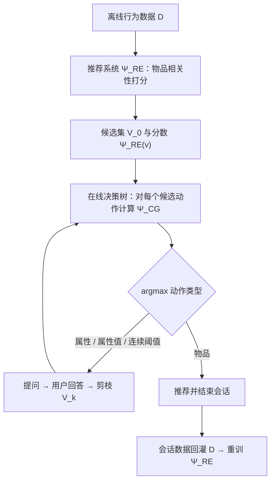
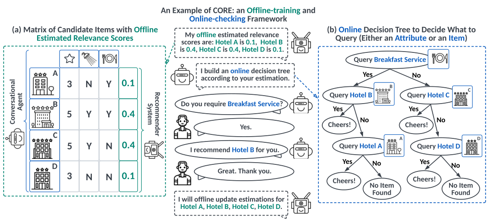

# Lending Interaction Wings to Recommender Systems with Conversational Agents (为推荐系统插上对话交互之翼)

- **会议/期刊**: NeurIPS 2023
- **作者与机构**: Jiarui Jin, Xianyu Chen, Weinan Zhang, Yong Yu (上海交通大学)；Fanghua Ye, Mengyue Yang, Yue Feng, Jun Wang (University College London)
- **推荐链路定位**: 重排/交互层（在既有 RS 之上做在线校验与主动追问）
- **研究方向**: 对话推荐与智能体仿真 / 冷启动与长尾推荐
- **论文原文**: [https://arxiv.org/abs/2310.04230v1](https://arxiv.org/abs/2310.04230v1)
- **开源代码**: 暂未开源

## TL;DR (1分钟核心速览)

现有对话推荐（CRM/EAR）把对话与推荐捆进强化学习框架联合训练，数据不足、部署困难，且属性值动作空间一大策略就崩。本文提出 CORE：把 RS 视为**离线相关性打分器** $\Psi_{RE}$，把对话智能体视为**在线分数校验器**$\Psi_{CO}$，用「未校验分数之和」定义不确定性$U_k$，推导每个物品/属性（值）的期望确定性增益$\Psi_{CG}$，以 argmax 增益构建在线决策树。无需 RL、无需训练、即插即用；在 8 个工业数据集、9 种 RS 上，冷启动场景 Amazon S@5 从 0.23 提到 0.65（+183%）、Yelp 从 0.13 到 0.65（+400%）。

## Background & Motivation (背景与核心矛盾)

- **主流范式**: 对话推荐以 RL 系统性联合建模对话模块与推荐模块（CRM 单轮 belief tracker + FM；EAR 的 Estimation-Action-Reflection 三阶段），由策略网络决定"何时问属性、何时推物品"。
- **前人局限**: ① RL 策略依赖大量在线标注交互，而工业平台几乎全是监督学习管线，数据与部署双重不匹配；② 一旦把查询粒度从属性 ID 细化到属性值，动作空间从 $|\mathcal{X}|$膨胀到$\sum_x |\mathcal{W}_x|$，策略网络直接崩溃（Amazon 上 CRM/EAR 的 S@3 从 0.98/0.99 跌到 0.28/0.32）。
- **核心洞察 (Key Insight)**: 对话的价值不在于"学一个新策略"，而在于**核销** RS 已经给出的分数——每得到一次用户反馈，就有一批物品被确定性排除，其分数不再"欠核查"。因此对话智能体的目标可完全写成不确定性最小化，且最优查询可由 RS 分数**闭式**推出。
- **本文切入点**: 把 RL 的可学习策略替换为基于 $\Psi_{CG}$ 的确定性在线决策树，使 RS 保持冻结即可获得交互增益。

## Method (核心方法设计)

### 1. 整体框架 (Overall Architecture)

离线阶段训练任意 RS 得到 $\Psi_{RE}$，为$M$个候选物品打相关性分并初始化未校验集$V_0=\mathcal{V}$；在线每一轮，智能体在动作空间$\mathcal{A}=\mathcal{V}_{k-1}\cup\mathcal{X}_{k-1}$（或属性值空间）上对每个候选动作计算期望确定性增益$\Psi_{CG}$，取 argmax 提问，收到回答后按值匹配剪枝$V_{k-1}\to V_k$并更新未校验属性集；一旦命中目标物品或超过$K_{MAX}$即终止。会话日志回灌训练集后重训$\Psi_{RE}$，形成「离线训练—在线校验」闭环，整个过程中$\Psi_{CO}$ **无参数、无损失、无梯度**。

<figure class="paper-figure" markdown="span">
  <figcaption>图1：CORE 的一个图示示例，CORE 是一个离线训练与在线检查框架，其中推荐系统作为离线相关性分数估计器（绿色），而对话代理作为在线相关性分数检查器（蓝色）。具体而言，如图(a)所示，给定候选物品矩阵，推荐系统可离线为每个物品分配估计的相关性分数，随后对话代理将如图(b)所示，通过查询物品或属性来在线检查这些分数。</figcaption>
</figure>

### 2. 关键设计拆解 (Key Designs)

1. **不确定性最小化与期望确定性增益**：痛点是把"该问什么"交给 RL 黑箱；本文改为显式优化 $U_k=\sum_{v_m\in V_k}\Psi_{RE}(v_m)$。查询物品$a$时，命中情形一次性核销全部剩余分数、未命中只核销$a$自身，故$\Psi_{CG}(a)=\big(\sum_{v_m\in V_{k-1}}\Psi_{RE}(v_m)\big)\cdot\Pr(a\in V^*)+\Psi_{RE}(a)\cdot\Pr(a\notin V^*)$，其中$\Pr(a\in V^*)=\Psi_{RE}(a)/\sum_{v_m\in V_{k-1}}\Psi_{RE}(v_m)$。查询属性$a$时，$\Psi_{CG}(\text{query}(a))=\sum_{w_a\in\mathcal{W}_a}\Psi_{CG}(w_a=w_a^*)\cdot\Pr(w_a=w_a^*)$，其中$\Psi_{CG}(w_a=w_a^*)=\sum_{v_m\in V_{k-1}\cap V_a^{\text{value}\neq w_a}}\Psi_{RE}(v_m)$，且$\Pr(w_a=w_a^*)$同样用分数质量占比估计。直觉：$\Psi_{RE}$ 充当"自适应 Huffman 权重"，增益最大者恰是信息增益最大的划分。
2. **从查属性到查属性值（含连续属性阈值查询）**：痛点是用户对属性 ID 无清晰偏好、且答案可能落在 $\mathcal{W}_a$之外（如 Hotel Level = 3.5）。改为闭式 Yes/No 查询：$\Psi_{CG}(\text{query}(x)=w_x)=\Psi_{CG}(w_x=w_x^*)\Pr(w_x=w_x^*)+\Psi_{CG}(w_x\neq w_x^*)\Pr(w_x\neq w_x^*)$。**Proposition 2** 证明最优$w_x$必把剩余分数**均分两半**，增益恰为$R/2$；**Lemma 1** 在冷启动均匀分下给出$\frac{\log M+1}{2}\le \hat{K}\le\frac{M+1}{2}$的轮次界。连续属性无法枚举，故生成阈值$w_x=\mathrm{AVERAGE}(\{\Psi_{RE}(v_m)\cdot w_{v_m}\})$（分数加权均值，逼近理想二分点），改问"是否$\ge w_x$"。**Proposition 1** 证明属性 ID 查询增益$\ge$ 任一属性值查询，故二者不能作用于同一属性，实践中按属性语义分工。
3. **属性依赖、LM 接口与推理开销**：为建模 $x$与$x'$的相关性，将增益替换为$\Psi_{CG}^{D}(\text{query}(a))=\sum_{a'}\Psi_{CG}(\text{query}(a'))\cdot\Pr(\text{query}(a')\,|\,\text{query}(a))$，FM 系 backbone 直接取学到的二阶权重$\langle v_n,v_{n'}\rangle$，非 FM 模型用候选集条件频率$|V_{(a=w_a)\wedge(a'=w_{a'})}|/|V_{a=w_a}|$估计。总损失：无（$\Psi_{CO}$免训练，只复用$\Psi_{RE}$分数）；负采样：无（沿用各 backbone 原训练策略）；在线推理每轮需在$|V_k|\times|\mathcal{X}|\times|\mathcal{W}|$上排序$\Psi_{CG}$，复杂度$O(|V_k|\cdot|\mathcal{X}|\cdot|\mathcal{W}|)$。LM（gpt-3.5-turbo）只负责话术生成与答案抽取，不进入决策，避免不可导问题。

## Experimental Setup & Evaluation Protocol (实验设置与评估协议)

- **数据集与预处理**: 过滤交互数 $<10$ 的用户；每个 session 采样 1 个用户及其浏览日志中 30 个物品（不足则补未浏览物品作负例），控制正负比在 1:10–1:30；连续属性走阈值查询分支。

| 数据集 | #Users | #Items | #Interactions | 类型/属性数 |
| :--- | :---: | :---: | :---: | :--- |
| Amazon | 133,960 | 431,827 | 1,114,563 | 表格 / 6 |
| LastFM | 1,801 | 7,432 | 76,693 | 表格 / 33 |
| Yelp | 27,675 | 70,311 | 1,368,606 | 表格 / 29（由 590 归并） |
| Taobao | 987,994 | 4,162,024 | 100,150,807 | 序列（均长 101）/ 4 |
| Tmall | 424,170 | 1,090,390 | 54,925,331 | 序列（均长 129）/ 9 |
| Alipay | 498,308 | 2,200,191 | 35,179,371 | 序列（均长 70）/ 6 |
| Douban Movie | 2,712 | 34,893 | 1,278,401 | 图 / 4 |
| Douban Book | 2,110 | 6,777 | 96,041 | 图 / 5 |

- **数据划分与防穿越**: 按用户浏览日志**逐用户构造 session**（非全局时间戳切分），目标物品定义为该 session 内获得正反馈（点击）的全部物品。
- **排名评测协议**: 不走 Full-Ranking / Sampled Ranking，而是自建 Human-AI Simulator：属性查询时，若所有目标物品在该属性上取值一致则返回该值，否则返回 `Not Care`；属性值（阈值）查询时，若至少一个目标物品持有该值则 `Yes`，否则 `No`。指标为 `T@K_MAX`（成功则返回成功轮次，否则强制第 $K_{MAX}+1$轮推荐物品，失败记$K_{MAX}+3$）与 `S@K_MAX`（$K_{MAX}$内成功率），取$K_{MAX}\in\{1,3,5,7,9\}$。
- **对比基线与超参**: 9 种 $\Psi_{RE}$（FM / DeepFM / PNN / DIN / GRU / LSTM / MMOE / GCN / GAT）+ COLD-START 均匀打分；对话侧基线 AG（只推物品，等价于裸 RS）、ME（最大熵划分）、CRM、EAR。Embedding$d=64$，lr$10^{-2}\to10^{-6}$，batch 100，L2$4\times10^{-5}$，dropout 0.5。

## Key Experimental Results (实验关键数据)

### 1. 主实验对比 (Main Results)

**表 1：查询物品 + 属性（Amazon），T/S 越高/越低越好**

| $\Psi_{RE}$|$\Psi_{CO}$ | T@3 | S@3 | T@5 | S@5 |
| :--- | :--- | :---: | :---: | :---: | :---: |
| COLD | AG | 6.47 | 0.12 | 7.83 | 0.23 |
| COLD | ME | 3.04 | 0.98 | 5.00 | 1.00 |
| COLD | **CORE** | **2.88** (‑55.5%) | **1.00** | **2.87** | 1.00 |
| FM | AG | 2.76 | 0.74 | 2.97 | 0.83 |
| FM | CRM | 3.07 | 0.98 | 3.37 | 0.83 |
| FM | EAR | 2.98 | 0.99 | 3.13 | 1.00 |
| FM | **CORE** | **2.17** (‑21.4% vs AG) | **1.00** | **2.16** | 1.00 |
| FM | CORE+D | 2.14 | 1.00 | 2.14 | **1.00** |
| DeepFM | AG | 3.07 | 0.71 | 3.27 | 0.82 |
| DeepFM | CRM | 2.68 | 0.99 | 2.99 | 0.99 |
| DeepFM | **CORE** | **2.07** (‑32.6%) | **1.00** | **2.06** | **1.00** |

**表 2：查询物品 + 属性值（Amazon / Yelp）**

| 数据集 | $\Psi_{RE}$|$\Psi_{CO}$ | T@3 | S@3 | T@5 | S@5 |
| :--- | :--- | :--- | :---: | :---: | :---: | :---: |
| Amazon | COLD | AG | 6.47 | 0.12 | 7.83 | 0.23 |
| Amazon | COLD | ME | 6.50 | 0.12 | 8.34 | 0.16 |
| Amazon | COLD | **CORE** | **6.02** | **0.25** | **6.18** | **0.65** (+183%) |
| Amazon | FM | AG | 2.76 | 0.74 | 2.97 | 0.83 |
| Amazon | FM | CRM | 4.58 | 0.28 | 6.42 | 0.38 |
| Amazon | FM | EAR | 4.13 | 0.32 | 6.32 | 0.42 |
| Amazon | FM | **CORE** | 3.26 | **0.83** | 3.19 | **0.99** |
| Amazon | FM | CORE+D | **3.16** | **0.85** | 3.22 | **1.00** |
| Amazon | DeepFM | AG | 3.07 | 0.71 | 3.27 | 0.82 |
| Amazon | DeepFM | **CORE** | 3.23 | **0.85** | **3.22** | **0.99** |
| Yelp | COLD | AG | 6.65 | 0.08 | 8.29 | 0.13 |
| Yelp | COLD | **CORE** | **5.25** | **0.19** | **6.23** | **0.65** (+400%) |
| Yelp | FM | AG | 3.29 | 0.70 | 3.39 | 0.81 |
| Yelp | FM | **CORE** | **3.14** | **0.84** | **3.20** | **0.99** |

### 2. 消融实验 (Ablation Study)

| 变体（Amazon / FM） | 语义 | S@3 | S@5 |
| :--- | :--- | :---: | :---: |
| AG | w/o 属性值查询（仅物品） | 0.74 | 0.83 |
| ME | w/o RS 分数引导（纯最大熵） | 0.12 | 0.16 |
| CORE | 完整模型 | 0.83 | 0.99 |
| CORE+D | + 属性依赖 $\Psi_{CG}^{D}$ | **0.85** | **1.00** |
| CORE（属性查询版） | 查属性 ID 而非属性值 | **1.00** | 1.00 |

### 3. 关键实验发现 (Key Findings)

1. **动作空间膨胀是 RL 对话推荐的死穴**：同一 Amazon/FM 条件下，CRM/EAR 从属性查询的 S@3 0.98/0.99 崩到属性值查询的 0.28/0.32，而 CORE 仍有 0.83 且 S@5 达 0.99——证明闭式增益决策不随动作空间线性退化，也解释了"RL 只在属性 ID 上可用"。
2. **冷启动是收益放大器**：$\Psi_{RE}$退化为$1/M$ 均匀分时，Amazon S@5 0.23→0.65（+183%）、Yelp 0.13→0.65（+400%），T@3 分别 6.47→6.02 与 6.65→5.25；冷启动 CORE 已与部分热启动基线（AG 0.83 / 0.81）同量级，说明交互可部分替代离线先验。
3. **属性依赖与轮次预算双重增益**：CORE+D 在 Amazon FM 把 S@3 由 0.83 抬到 0.85、S@5 达到 1.00（LastFM 0.72→0.74），且 Fig 2 显示随 $K_{MAX}=1\to9$ 增大，CORE 与 AG 的成功率差距在 hot/cold 两种设置下持续扩大，验证了决策树的分层剪枝确实在收敛。

## Highlights & Limitations (亮点、对比与审稿批判)

- **与代表作对比**: vs **EAR/CRM**（RL 三阶段/信念追踪）：本文取消策略学习，把"何时问"变成一次 argmax，可直接叠在任何监督式 RS 上；vs **ME / 经典决策树（Golbandi 等冷启动 bootstrapping）**：经典树用样本熵构建一次静态树，本文用**相关性分数为权重**在线重建树，且把物品推荐与属性追问统一在同一增益尺度上比较；vs **主动学习式推荐**：不问"标哪个样本最贵"，而问"哪个划分能核销最多已估分数质量"。
- **可迁移亮点**: ① 把「模型输出分数的剩余质量」作为主动查询的统一货币，可无缝搬到 bandit 的阈值查询与冷启动用户画像采集；② Proposition 2 的"均分即最优"为任何二分式提问策略提供了可解析的最优性判据与近似构造（分数加权均值）。
- **审稿级局限批判**: ① 强依赖 $\Psi_{RE}$的**概率校准**——若分数系统性偏高/偏低，$U_k$语义漂移，增益排序也会失真，文中未做校准实验；② 评测完全基于自建 simulator，用户代理规则化（`Not Care` 仅在目标物品取值不一致时触发），缺少真人 A/B 与噪声答案鲁棒性分析；③ 每轮需在$|V_k|\times|\mathcal{X}|\times|\mathcal{W}|$上重复排序，工业级百万候选池下在线延迟未被量化，论文亦未开源代码；④$K_{MAX}$、属性/属性值的分工（Prop. 1 后的人工特征工程）偏启发式，跨数据集迁移需重调。

## Rating (四维评分)

- **方法创新性 (Novelty)**: ⭐⭐⭐⭐ （把对话推荐从 RL 策略学习重构为不确定性最小化的闭式决策树，Proposition 1/2 与 Lemma 1 给出可证明的最优划分与轮次界，视角新颖）
- **评估协议与实验扎实度 (Protocol & Experiments)**: ⭐⭐⭐⭐ （8 个工业数据集 × 9 种 RS × 2 种查询粒度覆盖极广，消融与 $K_{MAX}$ 曲线完整；扣分在于全为 simulator、无真人实验与显著性检验）
- **写作与数学规范度 (Clarity & Rigor)**: ⭐⭐⭐⭐ （增益推导链完整、附录给出 Prop 1 的完整证明与决策树可视化；属性/属性值不可作用于同一属性的讨论清晰，但公式符号在正文与附录间存在轻微不一致，如 Eq.(6) 与 Eq.(19)）
- **工业落地与复现价值 (Industrial & Practical Value)**: ⭐⭐⭐⭐ （即插即用、无需 RL 训练管线，对现有监督式推荐平台改造成本极低；扣分于未开源、候选池规模下的在线延迟与分数校准两项工程前提未验证）

