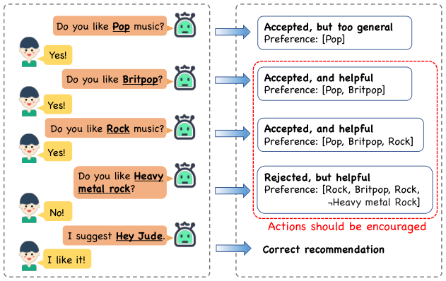
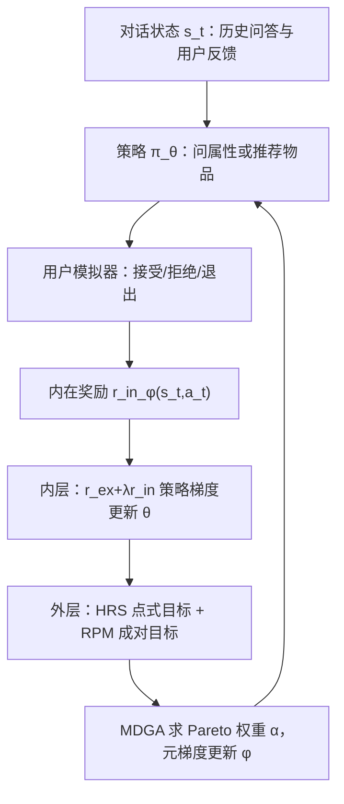
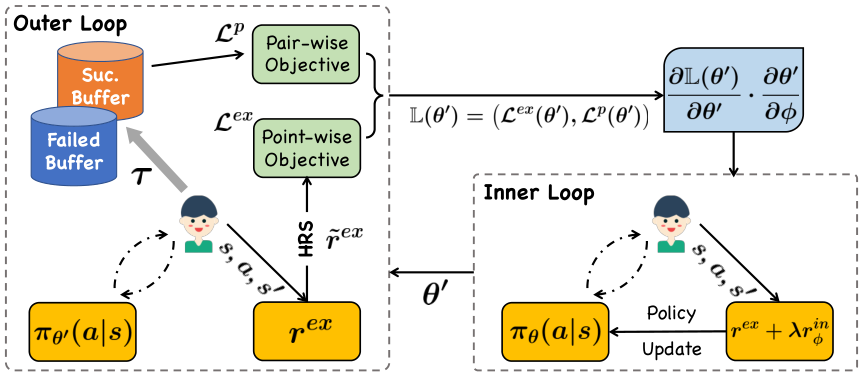

# Multi-Objective Intrinsic Reward Learning for Conversational Recommender Systems（面向对话推荐系统的多目标内在奖励学习）

- **会议/期刊**: NeurIPS 2023
- **作者与机构**: Zhendong Chu、Nan Wang、Hongning Wang；University of Virginia / Netflix
- **推荐链路定位**: 对话交互式策略决策 / 端到端会话推荐
- **研究方向**: 对话推荐与智能体仿真 / 强化学习与动态探索推荐
- **论文原文**: [论文原文链接](https://arxiv.org/abs/2310.20109v1)
- **开源代码**: 暂未开源

## TL;DR (1分钟核心速览)

针对对话推荐手工奖励粗粒度、成功信号极度稀疏的痛点，CRSIRL 将内在奖励学习建模为双层多目标优化：内层用学习奖励训练策略，外层以 HRS 点式目标与 RPM 成对偏好目标经元梯度和 MDGA 更新奖励函数。在 LastFM、LastFM\*、Yelp\* 用户模拟器评测中，SR@15 相对最强基线提升 15.9%–22.5%，平均轮数下降 0.4%–10.4%。

## Background & Motivation (背景与核心矛盾)

- **主流范式**: 多轮 CRS 通常建模为 MDP，RL 策略在“询问属性”与“推荐物品”之间决策，依赖手工奖励（接受属性给正、拒绝给负、成功推荐给大正）。
- **前人局限**: 手工奖励对所有接受/拒绝动作给同一信用，无法区分“拒绝但有助于排除”与“接受但过于宽泛”；且唯一明确的外在奖励只在会话结束时出现，中间动作的贡献完全无监督。
- **核心洞察 (Key Insight)**: 有效奖励应促进“更快锁定目标物品”的动作，即便是否定反馈也可能有用；同时 CRS 需同时优化成功率与轮数，单一标量奖励难以平衡。
- **本文切入点**: 把每步奖励本身作为可学习函数，用外层多目标元优化反推“什么样的中间动作值得鼓励”。

<figure class="paper-figure" markdown="span">
  <figcaption>图1：内在奖励学习的动机示例。</figcaption>
</figure>

## Method (核心方法设计)

### 1. 整体框架 (Overall Architecture)

CRSIRL 将对话推荐视为 MDP：状态编码历史问答与用户反馈，策略 $\pi_\theta$每轮选择询问属性或推荐物品；用户模拟器返回接受/拒绝/退出，并给出稀疏外在奖励。核心是在策略之上增加内在奖励函数$r^{in}_\phi(s,a)$：内层用$r_{ex}+\lambda r^{in}_\phi$更新策略，外层根据更新后策略在成功率与轮数上的表现，通过元梯度反传更新$\phi$。训练在线 rollout，推理仅执行策略网络。

<figure class="paper-figure" markdown="span">
  <figcaption>图2：CRSIRL 概览，其包含两个模块：一个由 θ 参数化的策略和一个由 ϕ 参数化的内在奖励函数。CRSIRL 的优化分为两个层级。在内层，训练策略以最大化由内在奖励和外在奖励共同定义的回报。在外层，训练内在奖励函数以优化由所学策略行为实现的两个 CRS 特定目标。</figcaption>
</figure>

### 2. 关键设计拆解 (Key Designs)

1. **Hindsight Reward Shaping (HRS)：把稀疏终局奖励变成可回传的排序势能**。CRS 只在会话末给 0/±1，中间动作无信用；HRS 在命中目标物品后回填 $\tilde{r}_{ex}(s_t,a_t)=r_{ex}(s_t,a_t)+\gamma w(s_{t+1},v)-w(s_t,v)$，其中$w=\log(\rho(s_t,v)+1)$ 为目标物品当前排名势能。该形式满足 PBRS，理论上不改变最优策略，只加速信用分配，鼓励“尽快抬高目标物品排名”的动作。

2. **Recommendation Preference Matching (RPM)：用成功/失败轨迹对比学习细粒度奖励**。点式奖励仍难区分“成功但绕远”与“失败但接近”的轨迹；RPM 令成功轨迹优先于失败轨迹（成功中更短者优先），用 Bradley-Terry 模型 $P_\theta(\tau^0\succ\tau^1)=\frac{\exp(\sum_{t\in\tau^0}\log\pi_\theta(a_t|s_t))}{\exp(\sum_{t\in\tau^0}\log\pi_\theta(a_t|s_t))+\exp(\sum_{t\in\tau^1}\log\pi_\theta(a_t|s_t))}$建模，损失$\mathcal{L}_p=-\mathbb{E}\log P_\theta(\tau^0\succ\tau^1)$。这使内在奖励被推向“让正确策略更可能产生成功轨迹”的方向。

3. **双层多目标优化、训练目标与推理效率**。内层 $\theta'=\theta-\eta\nabla_\theta\mathcal{L}_{ex+in}(\theta,\phi)$用加权奖励$r_{ex}+\lambda r^{in}_\phi$更新策略；外层$\min_\phi(\mathcal{L}_{ex}(\theta'),\mathcal{L}_p(\theta'))$通过元梯度$g(\phi)=\alpha\frac{\partial\mathcal{L}_{ex}}{\partial\theta'}\frac{\partial\theta'}{\partial\phi}+(1-\alpha)\frac{\partial\mathcal{L}_p}{\partial\theta'}\frac{\partial\theta'}{\partial\phi}$更新$\phi$，并用 MDGA 解析求$\alpha$做 Pareto 权衡。训练使用在线 rollout 与轨迹缓冲区，无需负采样；推理只执行$\pi_\theta$，$\phi$ 仅训练期开销。

## Experimental Setup & Evaluation Protocol (实验设置与评估协议)

- **数据集与预处理**: 三个多轮 CRS 基准，统计如下；未额外做 `5-core` 过滤，沿用原基准划分。

| 数据集 | #Users | #Items | #Attributes | #Interactions | 稀疏度/密度 | 特征/场景说明 |
| :--- | :---: | :---: | :---: | :---: | :---: | :--- |
| LastFM | 1,801 | 7,432 | 33 | 76,693 | 0.573% | 音乐艺术家；33 个粗粒度流派 |
| LastFM\* | 1,801 | 7,432 | 8,438 | 76,693 | 0.573% | 音乐艺术家；未分组细粒度属性 |
| Yelp\* | 27,675 | 70,311 | 590 | 1,368,606 | 0.070% | 本地商户推荐 |

- **数据划分与防穿越 (Splitting Strategy)**: 按 7:1.5:1.5 比例划分训练/验证/测试；TransE 仅在训练集预训练；在线策略学习在验证集模拟器上进行，测试集独立评估，避免测试会话泄漏。
- **排名评测协议 (Ranking Protocol)**: 非 Full-Ranking 或 Sampled Ranking；采用用户模拟器逐轮交互，每轮推荐列表 $K=10$，成功由目标物品是否被接受决定；报告 SR@15、平均轮数 AT、hDCG@(15,10)。
- **对比基线与超参设置**: 对比 Abs Greedy、Max Entropy、CRM、EAR、SCPR、FPAN、UNICORN；Transformer 状态编码器，Adam，学习率 $\{1e^{-5},5e^{-5},1e^{-4}\}$，$\lambda\in\{0.05,0.1,0.5,1.0\}$，$\gamma=0.999$，$T=15$，$K=10$；提升显著性$p<0.01$。

## Key Experimental Results (实验关键数据)

### 1. 主实验对比 (Main Results)

| Method | LastFM SR@15 | LastFM AT | LastFM hDCG | LastFM\* SR@15 | LastFM\* AT | LastFM\* hDCG | Yelp\* SR@15 | Yelp\* AT | Yelp\* hDCG |
| :--- | :---: | :---: | :---: | :---: | :---: | :---: | :---: | :---: | :---: |
| Abs Greedy | 0.222 | 13.48 | 0.073 | 0.635 | 8.66 | 0.267 | 0.189 | 13.43 | 0.089 |
| Max Entropy | 0.283 | 13.91 | 0.083 | 0.669 | 9.33 | 0.269 | 0.398 | 13.42 | 0.121 |
| CRM | 0.325 | 13.75 | 0.092 | 0.580 | 10.79 | 0.224 | 0.177 | 13.69 | 0.070 |
| EAR | 0.429 | 12.88 | 0.136 | 0.595 | 10.51 | 0.230 | 0.182 | 13.63 | 0.079 |
| SCPR | 0.465 | 12.86 | 0.139 | 0.709 | 8.43 | 0.317 | 0.489 | 12.62 | 0.159 |
| FPAN | 0.630 | 10.16 | 0.224 | 0.667 | 7.82 | 0.407 | 0.236 | 12.77 | 0.116 |
| UNICORN | 0.535 | 11.82 | 0.175 | 0.788 | 7.58 | 0.349 | 0.520 | 11.31 | 0.203 |
| **CRSIRL** | **0.772†** | **10.12†** | **0.231†** | **0.913†** | **6.79†** | **0.431†** | **0.622†** | **10.61†** | **0.228†** |
| *Improv.%* | +22.5% | -0.4% | +3.1% | +15.9% | -10.4% | +5.9% | +19.6% | -6.2% | +12.3% |

注：Improv.% 相对各数据集最强基线；AT 为负表示轮数下降。

### 2. 消融实验 (Ablation Study)

| Variant | LastFM SR@15 | LastFM AT | LastFM hDCG | LastFM\* SR@15 | LastFM\* AT | LastFM\* hDCG | Yelp\* SR@15 | Yelp\* AT | Yelp\* hDCG |
| :--- | :---: | :---: | :---: | :---: | :---: | :---: | :---: | :---: | :---: |
| PG（仅外奖励策略梯度） | 0.724 | 10.42 | 0.217 | 0.882 | 7.41 | 0.401 | 0.598 | 10.95 | 0.186 |
| ¬HRS | 0.732 | 10.58 | 0.219 | 0.898 | 7.16 | 0.401 | 0.602 | 11.21 | 0.196 |
| ¬RPM | 0.754 | 10.14 | 0.227 | 0.904 | 6.89 | 0.415 | 0.606 | 10.81 | 0.213 |
| MTL（等权多任务） | 0.768 | **10.09** | 0.224 | 0.908 | 6.92 | 0.426 | 0.613 | 10.73 | 0.207 |
| **CRSIRL** | **0.772** | 10.12 | **0.231** | **0.913** | **6.79** | **0.431** | **0.622** | **10.61** | **0.228** |

### 3. 关键实验发现 (Key Findings)

1. **成功率与效率双赢**：相对最强基线，LastFM SR@15 0.772 vs FPAN 0.630（+22.5%），LastFM\* 0.913 vs UNICORN 0.788（+15.9%），Yelp\* 0.622 vs UNICORN 0.520（+19.6%）；同期 AT 为 10.12 vs 10.16、6.79 vs 7.58、10.61 vs 11.31，说明内在奖励并非以更多轮次换成功率。
2. **消融归因清晰**：去掉 HRS 后 AT 恶化最明显（10.58、7.16、11.21），去掉 RPM 后 SR/hDCG 下降（LastFM 0.754/0.227，LastFM\* 0.904/0.415，Yelp\* 0.606/0.213）。HRS 主要负责“快”，RPM 主要负责“准”。
3. **奖励信号可解释且非二元**：LastFM 案例中，用户接受泛化属性 pop 但内在奖励为 -0.082；拒绝 vocalist 仍有 0.022 正奖励；Indie/Punk 分别为 0.167/0.224。奖励与目标物品排名贡献对齐，而非简单按接受/拒绝给分。

## Highlights & Limitations (亮点、对比与审稿批判)

- **与代表作对比 (vs. Prior Work)**: EAR/UNICORN 依赖手工奖励或启发式预选，CRSIRL 把奖励函数本身作为学习对象，能对“被拒绝但有用”的动作给正信用；FPAN/SCPR 侧重图结构或监督预训练，CRSIRL 以在线 RL + 双层 MOO 直接优化成功率与轮数；相较 LIRPG 等单任务内在奖励学习，本文扩展到 CRS 的双目标 Pareto 学习。
- **可迁移亮点**: PBRS 形式的“目标物品排名势能”可迁移到任何带稀疏成功信号的交互式推荐；Bradley-Terry 轨迹偏好可把“成功/失败会话”转成成对监督。
- **审稿级局限批判**: 评测依赖用户模拟器与模板化语言，真实用户噪声、语言多样性和满意度未验证；在线双层元梯度存在二阶开销与方差，$\lambda$ 过大时内在奖励估计误差会压过稀疏外奖励，且仅优化成功率与轮数两个目标，公平性、可解释性等未覆盖。

## Rating (四维评分)

- **方法创新性 (Novelty)**: ⭐⭐⭐⭐ （把 CRS 奖励设计显式建模为双层多目标学习，并用 PBRS 与 Bradley-Terry 两种目标互补，机制新颖）
- **评估协议与实验扎实度 (Protocol & Experiments)**: ⭐⭐⭐⭐ （三个基准、七个 SOTA、显著性 $p<0.01$、消融与$\lambda$ 分析完整；但评测依赖模拟器而非真实用户）
- **写作与数学规范度 (Clarity & Rigor)**: ⭐⭐⭐⭐ （MDP、PBRS、RPM 与元梯度链条清晰，MOO 的 MDGA 权重有解析式；部分实现细节留于附录）
- **工业落地与复现价值 (Industrial & Practical Value)**: ⭐⭐⭐ （训练期在线 rollout 与二阶元梯度成本较高，且暂未开源；但推理仅用策略网络，奖励学习框架可复用）

