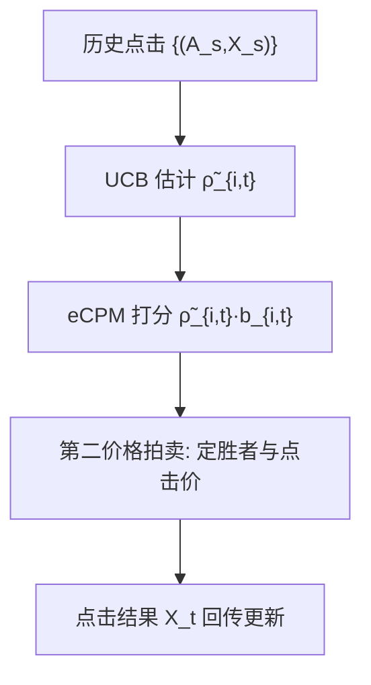

# Improved Online Learning Algorithms for CTR Prediction in Ad Auctions (广告拍卖中点击率预测的改进在线学习算法)

- **会议/期刊**: ICML 2023
- **作者与机构**: Zhe Feng, Christopher Liaw (Google Research), Zixin Zhou (Stanford University)
- **推荐链路定位**: 机制设计 / 拍卖定价（点击付费精排与计费环节，非典型召回—精排链路）
- **研究方向**: CTR预估与特征交叉 / 强化学习与 Bandit 探索
- **论文原文**: [论文原文链接](https://arxiv.org/abs/2403.00845v1)
- **开源代码**: 暂未开源

## TL;DR (1分钟核心速览)

本文针对“按点击付费(PPC)广告拍卖中真实点击率 $\rho_i$未知、卖方需在线学习并定价”这一收入最大化问题。作者将广告主分为短视(myopic)与远视(non-myopic)两类：短视下设计基于 UCB 的打分机制，对抗性估价最坏情况达紧致$\tilde{O}(\sqrt{T})$遗憾，静态估价且存在恒定 eCPM 间隔时更获$-\Omega(T)$**负遗憾**；远视下用 explore-then-commit+UCB 实现 global-IC 与同样$-\Omega(T)$负遗憾，彻底改写了此前对抗估价下固有$\Theta(T^{2/3})$ 的认知。

## Background & Motivation (背景与核心矛盾)

- **主流范式**: PPC 拍卖（如 VCG/第二价格）以已知 CTR 给广告打分 $eCPM=\rho_i v_{i,t}$，胜者按点击价$\text{季军分数}/\rho_i$付费；现实中$\rho_i$ 未知，需从曝光点击反馈中边学边卖。
- **前人局限**: (1) Devanur & Kakade (2009) 在 global-IC 约束下给出 $\Theta(T^{2/3})$ 遗憾，且未针对“购物广告价格长期固定”这一静态估价场景收紧界；(2) 标准 UCB bandit 无法直接套用——基准（已知 CTR 的 VCG 收入）每轮随估价漂移，且**即便选对广告**，CTR 估计误差本身仍会造成收入损失。
- **核心洞察 (Key Insight)**: UCB 对亚军广告的乐观估计天然高于其真实 CTR（因展示次数少、置信半径大）；当最优广告胜出时，这个“被高估的准亚军”报价反而抬高了每次点击价，使收入超过已知真实 CTR 的 VCG 基准，从而产生**负遗憾**。
- **本文切入点**: 把 CTR 在线学习与机制 IC 性质耦合，分别对短视/远视广告主证明更紧的界，并辅以下界构造验证最优性。

## Method (核心方法设计)

### 1. 整体框架 (Overall Architecture)

每轮先以历史点击经验更新各广告的 UCB 估计，以其作为 eCPM 打分跑第二价格拍卖、按点击计费；点击发生后仅更新胜者的经验均值与置信半径。短视设定下该机制被证明是 stage-IC（真实报价逐轮占优）；远视设定下则先 round-robin 免费探索，直至出现“明确冠军”，再固定估计进入利用阶段以获 global-IC。

### 2. 关键设计拆解 (Key Designs)

1. **UCB 打分与点击付费定价**：痛点——CTR 未知导致选错广告或定价失准。核心算子 $\tilde{\rho}_{i,t}=\hat{\rho}_{i,t}+\sqrt{\tfrac{3\log T}{2N_{i,t}}}$，胜者$A_t=\arg\max_i\tilde{\rho}_{i,t}b_{i,t}$、点击时收$\tilde{\rho}_{B_t,t}b_{B_t,t}/\tilde{\rho}_{A_t,t}$。直觉——乐观估计驱使探索次优广告；因$\tilde{\rho}$ 独立于本轮报价，机制自然满足 stage-IC。
2. **负遗憾的定价机理**：痛点——传统 UCB 分析只关心是否选对广告。核心——将遗憾拆为“选错广告”项（$O(\log T/\Delta_i^2)$级探索成本）与“选对广告”项；证明亚军 UCB 至少高估$0.08\Delta_s$，抬升每次点击价，最终$R_T\le -0.05\zeta T+O(\log(nT))$，其中$\zeta=\max_i\rho_i v_i-\mathrm{smax}_i\rho_i v_i>0$。直觉——亚军的高估置信上界充当额外竞争，成为抬价杠杆。
3. **远视广告的 explore-then-commit**：痛点——远视广告会前期策略性低报以操纵 CTR 估计。核心——先轮询免费展示，直到某 $i^*$满足$v_{i^*}L_{i^*}>v_j\tilde{\rho}_j,\forall j\neq i^*$，随后固定$L/C$跑第二价格拍卖。直觉——探索期结果不受报价影响、利用期各轮独立，故机制 global-IC 且因固定估计的间隔取得$-\Omega(T)$。

### 3. 优化目标、下界与计算开销

- **优化目标 (Regret)**: $R_T=\text{OPT}-\text{REV}_T(\mathcal{A})$，其中$\text{OPT}=\sum_t\mathrm{smax}_i\rho_i v_{i,t}$（已知 CTR 的第二价格收入）。
- **下界**: 构造 4 广告、两组仅在高 eCPM 广告 CTR 上差 $\varepsilon$的实例，$\mathrm{KL}\le 8T\varepsilon^2$，取$\varepsilon=1/(8\sqrt{T})$得任意 stage-IC+IR 机制下$\Omega(\sqrt{T})$，证明上界紧致。
- **计算开销**: 每轮仅需 $O(n)$更新置信区间与$O(n\log n)$ 排序，无神经网络前向，线上开销可忽略。

## Experimental Setup & Evaluation Protocol (实验设置与评估协议)

本文为**纯理论/机制设计**工作，不含实证数据集与离线实验，其“评估”由**定理保证 + 下界构造**构成。为便于对照，下表列出核心理论结果及其参照基线：

| 设定 / 工作 | 估价生成 | IC 概念 | 机制 | Regret 保证 |
| :--- | :--- | :---: | :--- | :--- |
| 本文·短视 | 对抗性 | Stage-IC | UCB+VCG (Alg.1) | $\tilde{O}(\sqrt{T})$ |
| 本文·短视 | 静态+正间隔 | Stage-IC | UCB+VCG (Alg.1) | $-\Omega(T)$ |
| 本文·远视 | 静态+正间隔 | Global-IC | Explore-then-Commit (Alg.2) | $-\Omega(T)$ |
| 下界 (Thm.13) | 静态 (间隔 $O(1/\sqrt T)$) | Stage-IC+IR | 任意机制 |$\Omega(\sqrt{T})$ |
| Devanur & Kakade (2009) | 对抗性 | Global-IC | Explore-then-Commit | $\Theta(T^{2/3})$ |
| Babaioff et al. (2015) | 随机 | Global-IC (随机化) | MAB 黑盒归约 | $O(\sqrt{T})$ (福利目标) |

**协议要点**：所有结果为**期望遗憾**，假设 T 已知（可用 doubling trick 扩展）；单槽位、CTR 静态且跨轮固定；支付规则由 Myerson 引理保证 stage-IC 等价于分配单调 + 支付 $\int_0^{b_i}x_i(z,b_{-i})dz$。

## Key Experimental Results (实验关键数据)

### 1. 主理论结果对比 (Main Theorems)

| 结果 | 关键常数 / 界 | 与最佳前人对比 |
| :--- | :--- | :--- |
| 对抗性 (Thm.9) | $R_T\le M\sum_i\sqrt{24T\log(2nT)}/\rho_i+MT$| 由$\Theta(T^{2/3})$收紧至$\tilde{O}(\sqrt{T})$（短视 stage-IC） |
| 静态负遗憾 (Thm.10) | $R_T\le -0.05\zeta T+O(\log(nT))$ | 前人无此结论；本文首次证明收入可**线性超过**已知 CTR 的 VCG |
| 远视负遗憾 (Thm.15) | $R_T=-\Omega(T)$| 补全 D&K 的对抗性$\Theta(T^{2/3})$ 之外的静态乐观面 |
| 下界 (Thm.13) | $R_T=\Omega(\sqrt{T})$ | 匹配 Thm.9，说明上界**紧致** |

### 2. 拆解分析 (Regret Decomposition)

| 遗憾分量 | 来源 | 界 |
| :--- | :--- | :--- |
| 选错广告 (Eq.8) | 探索次优臂的成本 | $2/T+\sum_{i=2}^n 12\rho_s v_s\log(2nT)/(\rho_1\Delta_i)+O(1/(n^2T))$ |
| 选对广告 (Eq.9) | 亚军 UCB 过估计抬价 | $\le -0.05\Delta_s v_s T+O(\log(nT))$ |
| 合计 | — | $-0.05\zeta T+O(\log(nT))$ |

### 3. 关键实验发现 (Key Findings)

1. **负遗憾的量级来自“选对广告”项而非选错项**：拆解表显示“选错”项仅为 $O(\log T)$量级，真正贡献$-0.05\zeta T$线性收益的是亚军 UCB 至少$0.08\Delta_s$的系统性高估，这要求$\zeta>0$ 为时间无关常数。
2. **间隔是负遗憾的命门**：下界实例刻意令间隔收缩至 $\zeta=O(1/\sqrt{T})$，此时负遗憾退化为$\Omega(\sqrt{T})$，说明 Thm.10 的$-\Omega(T)$ 不能无条件推广。
3. **IC 强度决定算法形态**：短视只需逐轮 stage-IC 即可让确定性 UCB 机制成立；远视则因存在“前期低报操纵 CTR 估计”的套利，必须采用 global-IC 的两阶段 explore-then-commit，否则负遗憾不成立。

## Highlights & Limitations (亮点、对比与审稿批判)

- **与代表作对比**: 相较 Devanur & Kakade (2009) 的 $\Theta(T^{2/3})$（global-IC、对抗估价），本文在短视下用确定性 stage-IC 机制拿到紧致$\tilde{O}(\sqrt{T})$ 并在静态场景翻转为负遗憾；相较 Babaioff et al. (2015) 的随机化 global-IC 与福利目标，本文坚持确定性机制与 **revenue** 目标，且覆盖对抗估价。
- **可迁移亮点**: (1) “利用 UCB 对次优臂的系统性高估充当抬价杠杆”这一副作用正效应，可迁移到任何需在线定价的机制设计；(2) “选错 + 选对”双分量拆分的遗憾分析模板，可复用于带基准漂移的在线学习问题。
- **审稿级局限批判**: (1) 负遗憾强依赖“时间无关正间隔”假设，间隔随 T 收缩即退化为 $\sqrt{T}$ 级，现实长尾广告难满足；(2) 单槽位、CTR 静态固定假设忽略了上下文、位置偏差与 CTR 漂移，离真实广告系统仍有距离；(3) 只在理论上刻画，缺乏数值仿真或半合成实验验证常数因子与有限 T 表现。

## Rating (四维评分)

- **方法创新性 (Novelty)**: ⭐⭐⭐⭐⭐ （首次证明 CTR 未知下静态估价可实现 $-\Omega(T)$ 负遗憾，颠覆“学习必然损失收入”直觉）
- **评估协议与实验扎实度 (Protocol & Experiments)**: ⭐⭐⭐ （上下界匹配、下界构造严谨，但为纯理论无实证，有限 T 与常数因子未验证）
- **写作与数学规范度 (Clarity & Rigor)**: ⭐⭐⭐⭐ （定理—引理—证明链条清晰，Myerson 引理与 Hoeffding 工具使用规范，符号略密）
- **工业落地与复现价值 (Industrial & Practical Value)**: ⭐⭐⭐ （机制简洁可落地，但单槽/静态 CTR/恒间隔假设需大幅扩展才适配真实 PPC 系统）

