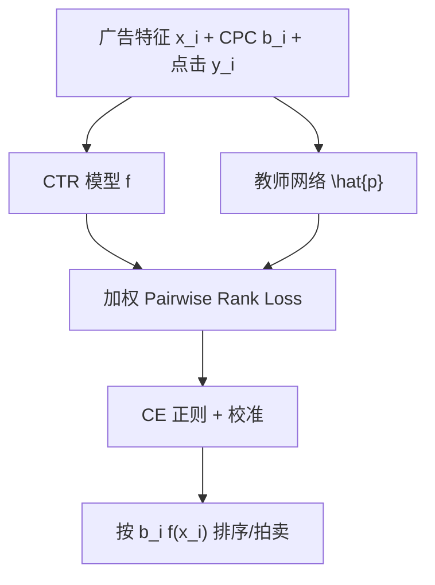
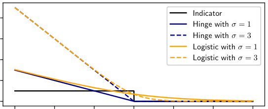

# Pairwise Ranking Losses of Click-Through Rates Prediction for Welfare Maximization in Ad Auctions (广告拍卖中面向福利最大化的CTR成对排序损失)

- **会议/期刊**: ICML 2023
- **作者与机构**: Boxiang Lyu (Chicago Booth)、Zhe Feng (Google Research)、Zachary Robertson、Sanmi Koyejo (Stanford/Google)
- **推荐链路定位**: 精排（CTR 预估与拍卖排序）
- **研究方向**: CTR/CVR 预估与特征交叉 / 多任务与列表级重排
- **论文原文**: [https://arxiv.org/abs/2306.01799v1](https://arxiv.org/abs/2306.01799v1)
- **开源代码**: 暂未开源

## TL;DR (1分钟核心速览)

本文指出常规 CTR 分类损失与广告拍卖的福利目标脱节，且已有福利驱动损失依赖“竞争 eCPM 分布已知”的强假设。作者将福利最大化归约为按真实 eCPM $b_i p_i$ 排序，提出加权 pairwise ranking loss，并给出可微 logistic/hinge 代理与教师网络校准版。在 Criteo/DeepFM 上，welfare 从 1.4448 提升至 1.4660（+1.47%），AUC loss 仅小幅波动。

## Background & Motivation (背景与核心矛盾)

- **主流范式**: CTR 模型多用交叉熵训练 DeepFM/DCN 等结构，只优化点击概率；广告拍卖则用预测 eCPM 排序分配曝光，福利取决于真实 eCPM。
- **前人局限**: Chapelle、Vasile、Hummel-McAfee 等福利损失依赖已知 eCPM 分布或启发式加权，缺少可证明保证；直接套用 learning-to-rank 又会把随机观测 $b_i y_i$ 当作真实 eCPM 排序信号。
- **核心洞察 (Key Insight)**: 福利最大化只需正确排序真实 eCPM；加权 pairwise 风险对观测 eCPM 是线性的，期望后等于真实 eCPM 差，从而避免 $b_i y_i$ 的排序偏差（Prop. 3.5）。
- **本文切入点**: 将福利目标写成可优化的 pairwise rank loss，并用教师网络软标签同时降噪与校准。

## Method (核心方法设计)

### 1. 整体框架 (Overall Architecture)

输入每轮拍卖的广告特征 $x_i$、CPC 出价$b_i$与点击标签$y_i$；CTR 模型$f$输出 pCTR，拍卖按$b_i f(x_i)$排序。训练时在 batch 内构造全 pair 加权排序损失，并叠加交叉熵正则；进一步用已训练教师网络$\hat{p}$替换$y_i$，构造校准版损失。推理仍为普通 CTR 前向，不增加线上排序开销。

### 2. 关键设计拆解 (Key Designs)

1. **福利-排序归约与加权 rank loss**：分类损失不直接优化福利，而直接 LTR 受随机 $y_i$ 干扰。作者定义
$\ell(f;D)=\sum_{i,j}(b_i y_i-b_j y_j)\mathbb{I}\{b_i f(x_i)\le b_j f(x_j)\}$，
其条件风险 $R(f;D)$ 最小化等价于按真实 eCPM 正确排序；Thm. 3.2 给出福利下界，且无 eCPM 分布假设。直觉是线性权重使期望差无偏，避免经验 eCPM 排序陷阱。

2. **可微代理与边界控制**：指示函数不可导，改用
$\ell_{\log}^{\sigma}=\sum_{i,j}(b_i y_i-b_j y_j)\log(1+e^{-\sigma(b_i f(x_i)-b_j f(x_j))})$及 hinge 版；当$\sigma=2/B$时，代理与原始风险差被$\Delta$控制。$\sigma$ 控制小 eCPM 边界的惩罚强度。

<figure class="paper-figure" markdown="span">
  <figcaption>图 1. 1tbifpxiq ď bjfpxjqu 的代理模型可视化</figcaption>
</figure>
图1：indicator、hinge 与 logistic 代理随预测 eCPM 差的变化；$\sigma$ 越大，小边界惩罚越强。

3. **教师校准与训练目标**：rank loss 只保序不保校准，且方差随 $b_i^2$ 放大。用教师输出替换标签：
$\hat{\ell}=\sum_{i,j}(b_i\hat{p}_i-b_j\hat{p}_j)\mathbb{I}\{b_i f(x_i)\le b_j f(x_j)\}$；
校准版为
$\hat{\ell}_{\text{hinge},+}^{\sigma}=\sum_{i,j}(b_i\hat{p}_i-b_j\hat{p}_j)_+(-\sigma(b_i f(x_i)-b_j f(x_j)))_+$。
Thm. 4.4 仅假设教师有有界 $\ell_2$误差，即可得$O(\sqrt{\epsilon})$近似校准。总损失为$\mathcal{L}=\ell_{\text{rank}}+\lambda\mathcal{L}_{\text{CE}}$，$\lambda=3$；训练内全 pair，复杂度$O(n^2)$，推理无额外负采样。

## Experimental Setup & Evaluation Protocol (实验设置与评估协议)

- **数据集与预处理**:

| 数据集 | 规模/样本 | 特征 | 划分/测试 | 说明 |
| :--- | :---: | :---: | :---: | :--- |
| Synthetic | 10,000 训练广告；2,000 场×50 广告 | 50 维高斯特征 | 30 次重复 | CTR 由 logistic 模型生成，CPC 服从对数正态 |
| Criteo | 匿名广告曝光 | 13 数值+26 类别 | 8:1:1 | 数值 $>2$取$\log_2$，类别频次$<10$ 归为特殊值；CPC 由随机 DeepFM 生成 |

- **数据划分与防穿越 (Splitting Strategy)**: Criteo 采用 8-1-1 训练/验证/测试；测试集再切成每场 256 个 bidder 的拍卖。合成数据固定生成过程，重复 30 次训练/评估。
- **排名评测协议 (Ranking Protocol)**: 非负采样排序；AUC 在完整测试集计算，welfare 对每场拍卖全量候选按预测 eCPM 选最高者，记录真实/实现的 $b_i y_i$。Criteo 缺真实 CTR，welfare 用 realized eCPM 代理。
- **对比基线与超参设置**: 合成数据对比 LL、按 $b_i$/$\sqrt{b_i}$加权 LL 及 3 个提出损失；真实数据对比 DeepFM 与 DCN 上的 LL、$\ell_{\log}^{\sigma=3}$、$\hat{\ell}_{\log}^{\sigma=3}$。DeepFM：embedding 10、3×400、dropout 0.5、Adam、batch 256、3 epochs；DCN：6 个 cross layer、2×1024、batch 512、150k steps。$\lambda$网格$\{0.1,1,3,5,10\}$选 3；结果报均值±标准误，未给显著性$p$ 值。

## Key Experimental Results (实验关键数据)

### 1. 主实验对比 (Main Results)

受原文公开数值限制，Criteo/DeepFM 主表保留核心对照；合成数据另含 6 个方法（图2），DCN 趋势见图3。

| 方法（Criteo/DeepFM） | Welfare ↑ | AUC Loss ↓ | Welfare 相对 LL |
| :--- | :---: | :---: | :---: |
| LL (baseline) | 1.4448±0.0025 | 0.2200±0.0004 | — |
| $\ell_{\log}^{\sigma=3}$ | 1.4622±0.0021 | **0.2169±0.0003** | +1.20% |
| $\hat{\ell}_{\log}^{\sigma=3}$ (+teacher) | **1.4660±0.0022** | 0.2229±0.0004 | **+1.47%** |

### 2. 消融实验 (Ablation Study)

| 变体（Criteo/DeepFM） | Welfare ↑ | AUC Loss ↓ | 归因 |
| :--- | :---: | :---: | :--- |
| w/o rank loss（仅 LL） | 1.4448 | 0.2200 | 分类目标基线 |
| w/o teacher（$\ell_{\log}$） | 1.4622 | **0.2169** | rank loss 提升福利并改善 AUC |
| + teacher（$\hat{\ell}_{\log}$） | **1.4660** | 0.2229 | 软标签再提福利，AUC 略降 |

### 3. 关键实验发现 (Key Findings)

1. Criteo/DeepFM 上最佳 welfare 提升 +1.47%（1.4448→1.4660），但 AUC loss 从 0.2200 升至 0.2229；说明福利与 AUC 并非完全同向，排序损失可用少量分类指标换取拍卖效率。
2. 教师网络带来稳定增益：welfare 从 1.4622 再升至 1.4660（+0.26%），合成数据同样显示 student-teacher 有益，验证软标签降低 $b_i y_i$ 噪声的作用。
3. 合成数据中三种提出损失均高于 LL 与两种启发式加权 LL，说明“无 eCPM 分布假设的加权 pairwise”比加权交叉熵更贴近福利；hinge 因非光滑，在深度 CTR 上收益弱于 logistic 版。

## Highlights & Limitations (亮点、对比与审稿批判)

- **与代表作对比 (vs. Prior Work)**: 相比 Chapelle/Vasile/Hummel-McAfee 依赖已知 eCPM 分布或启发式权重，本文无分布假设且给福利/校准保证；相比标准 LTR，本文用线性加权避免随机经验 eCPM 排序失败。
- **可迁移亮点**: 将业务指标（福利、收入、GMV）写成“加权 pairwise 风险 + CE 正则”，并用教师软标签校准，可迁移到广告/电商精排。
- **审稿级局限批判**: 训练需 batch 内 $O(n^2)$pair 与额外教师模型，工业大 batch 成本高；Criteo 缺 CPC、slot、真实 auction 标签，CPC 由随机 DeepFM 合成、welfare 用 realized eCPM 代理，外部效度有限；$\sigma$、$\lambda$ 与 pair 权重含启发式，未系统调参或做架构搜索。

## Rating (四维评分)

- **方法创新性 (Novelty)**: ⭐⭐⭐⭐ （将福利最大化严格归约为加权 pairwise 排序，并给出无分布假设的福利界与教师校准界，机制新颖）
- **评估协议与实验扎实度 (Protocol & Experiments)**: ⭐⭐⭐ （合成+真实数据双验证，但 Criteo 缺关键拍卖变量、无显著性检验、公开数值有限）
- **写作与数学规范度 (Clarity & Rigor)**: ⭐⭐⭐⭐ （命题/定理链条完整，归约与代理误差证明清晰；部分权重设计偏启发式）
- **工业落地与复现价值 (Industrial & Practical Value)**: ⭐⭐⭐ （推理零额外开销、易嵌入现有 CTR 模型，但训练 $O(n^2)$、依赖教师且未开源）

