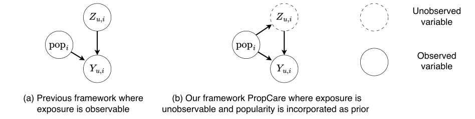
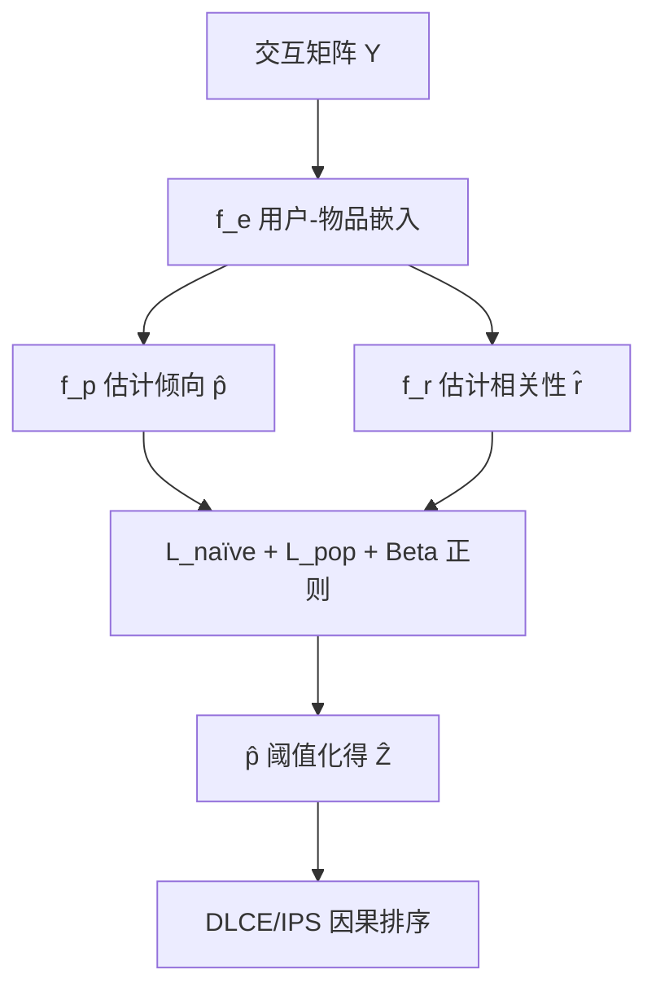

# Estimating Propensity for Causality-based Recommendation without Exposure Data (无需曝光数据的因果推荐倾向估计)

- **会议/期刊**: NeurIPS 2023 (Poster)
- **作者与机构**: Zhongzhou Liu, Yuan Fang (Singapore Management University); Min Wu (A*STAR)
- **推荐链路定位**: 精排（因果效应排序）
- **研究方向**: 去偏公平、可信隐私与工业架构（因果去偏）
- **论文原文**: [论文原文链接](https://arxiv.org/abs/2310.20388v2)
- **开源代码**: [开源代码仓库链接](https://github.com/Zziwei/Unbiased-Propensity-and-Recommendation)

## TL;DR (1分钟核心速览)

现有因果推荐依赖曝光数据或倾向得分 $p_{u,i}=P(Z_{u,i}=1)$，但真实平台常因隐私/日志缺失无法获得。本文提出 PropCare：仅用交互数据，通过“控制交互概率相似时，高流行度物品更易曝光”的成对假设约束倾向函数，并用 Beta 分布正则化倾向分布，进而估计曝光与倾向，替代 DLCE 中的真值。在 DH_original、DH_personalized、ML 三个半模拟基准上，PropCare 的 CP@10/CDCG 显著优于 Random、POP、CJBPR、EM，在 DH_personalized 上仅比使用真值的上界平均低 6.6%。

## Background & Motivation (背景与核心矛盾)

- **主流范式**: 传统推荐按交互概率 $y_{u,i}=P(Y_{u,i}=1)$排序；因果推荐则按曝光带来的 uplift$\tau_{u,i}=Y^1_{u,i}-Y^0_{u,i}$ 排序，常用 IPS 估计因果效应。
- **前人局限**: IPS/DLCE 需要可观测的曝光 $Z_{u,i}$或倾向$p_{u,i}$；现有倾向估计器（CJBPR、EM 等）仍依赖曝光标签或已知倾向，且点式估计缺少先验约束。现实电商日志往往只能记录购买/点击，无法区分是否由曝光导致。
- **核心洞察 (Key Insight)**: 在控制用户对两物品交互概率相近时，物品流行度排序可提供曝光倾向的成对信号；该信号可从交互矩阵直接计算，无需外部数据。
- **本文切入点**: 将流行度作为倾向估计的先验，成对解耦倾向与相关性函数，再用 Beta 正则稳定 IPS 所需的倾向分布。

<figure class="paper-figure" markdown="span">
  <figcaption>图 1：不同框架下的因果图。pop_i 为物品 i 的流行度（先验）。Y_{u,i} 表示用户 u 是否与物品 i 交互。Z_{u,i} 表示物品 i 是否曝光给用户 u。</figcaption>
</figure>
*图1：不同框架下的因果图；本文无需观测曝光，仅以流行度作先验。*

## Method (核心方法设计)

### 1. 整体框架 (Overall Architecture)

输入仅交互矩阵 $Y$。嵌入函数$f_e$生成用户-物品表示，两个 MLP 分别输出倾向$\hat{p}_{u,i}=f_p(x_{u,i})$与相关性$\hat{r}_{u,i}=f_r(x_{u,i})$，交互模型为$\hat{y}_{u,i}=\hat{p}_{u,i}\hat{r}_{u,i}$。训练由三部分组成：点式交互损失$\mathcal{L}_{\text{naïve}}$、基于 Assumption 1 的成对流行度损失$\mathcal{L}_{\text{pop}}$、倾向分布 Beta 正则。收敛后由$\hat{p}_{u,i}$阈值化得到$\hat{Z}_{u,i}$，替换 DLCE 中的真值曝光/倾向训练 IPS 排序器，推理时对全库物品打分排序。

### 2. 关键设计拆解 (Key Designs)

1. **成对流行度先验 $\mathcal{L}_{\text{pop}}$（解耦 p/r 并注入曝光先验）**：朴素损失中$p$与$r$仅以乘积出现，二者可塌缩为一个交互函数，无法识别。本文对物品对$(i,j)$约束：若$pop_i>pop_j$且$y_{u,i}\approx y_{u,j}$，则$p_{u,i}>p_{u,j}$。核心损失为  
$\mathcal{L}_{\text{pop}}=-\kappa_{u,i,j}\log[\sigma(\operatorname{sgn}_{i,j}(f_p(x_{u,i})-f_p(x_{u,j})))+\sigma(\operatorname{sgn}_{i,j}(f_r(x_{u,j})-f_r(x_{u,i})))]$，  
其中 $\kappa_{u,i,j}=e^{\eta(y_{u,i}-y_{u,j})^2},\eta<0$对交互概率更接近的对子加权；第二项利用$y=p r$固定时$p$升则$r$ 降的关系进一步约束。这样既解耦两函数，又避免倾向预测全部挤在 0/1 附近。

2. **Beta 分布正则与曝光阈值化（稳定 IPS 方差）**：倾向通常长尾，极端 $\hat{p}$会放大 IPS 方差。令$Q$ 为所有估计倾向的经验分布，加入  
$\mu KL(Q\|\operatorname{Beta}(\alpha,\beta))$，$\alpha=0.2,\beta=1.0$模拟长尾。曝光由$\hat{Z}_{u,i}=1[\operatorname{Norm}(\hat{p}_{u,i})\ge\epsilon]$得到，$\epsilon$ 在验证集网格搜索。

3. **训练目标、负采样与推理效率**：总损失  
$\mathcal{L}=\sum_{u,i,j}(\mathcal{L}_{\text{naïve}}+\lambda\mathcal{L}_{\text{pop}})+\mu KL(Q\|\operatorname{Beta}(\alpha,\beta))$，  
$\lambda=10,\mu=0.4$。每个正/负交互对均匀采样一个物品$j$构成成对项；DLCE 阶段按三元组$(u,i,j)$训练。训练复杂度对交互数$|D|$ 线性；推理沿用 DLCE 全库排序，PropCare 仅增加倾向估计开销。

**理论性质**：Proposition 1 给出用 $\hat{p},\hat{Z}$替代真值后的偏差，受$p/\hat{p}$、$(1-p)/(1-\hat{p})$与$E[\hat{Z}-Z]$三因素影响；若$\hat{p}$ 极端接近 0/1，偏差可能很大，这直接支撑 Beta 正则与阈值化设计。

## Experimental Setup & Evaluation Protocol (实验设置与评估协议)

- **数据集与预处理**: 三个因果推荐半模拟基准；DH 两版来自 DunnHumby 购买/促销日志，ML 为 MovieLens 100K。真值曝光/倾向仅用于评估，不参与 PropCare 训练。

| 数据集 | #Users | #Items | 平均交互 $\bar{Y}$| 平均曝光$\bar{Z}$| 平均因果$\bar{\tau}$| 平均倾向$\bar{p}$ |
| :--- | :---: | :---: | :---: | :---: | :---: | :---: |
| DH_original | 2,309 | 1,372 | .0438 | .6064 | .0175 | .2894 |
| DH_personalized | 2,309 | 1,372 | .0503 | .6265 | .0178 | .4589 |
| ML | 943 | 1,682 | .0676 | .0593 | .0733 | .0594 |

- **数据划分与防穿越**: DH 按原工作生成 10 周训练、1 周验证、10 周测试；ML 生成一次训练/验证/测试。曝光、倾向、因果效应均由模拟过程生成，训练阶段不使用真值。
- **排名评测协议**: 为每个用户对全库物品排序，即 `Full-Ranking`；指标为 CP@10、CP@100、CDCG，仅奖励由曝光带来的正因果交互。倾向估计用 KLD、Kendall's Tau，曝光估计用 F1。
- **对比基线与超参**: Ground-truth（上界）、Random、POP、CJBPR、EM；附录另比 MF/BPR/LightGCN。嵌入维度 128，MLP 隐层 64/32/16/8，batch 5096，报告 5 次均值±标准差。

## Key Experimental Results (实验关键数据)

### 1. 主实验对比 (Main Results)

| 方法 | DH_o CP@10 | DH_p CP@10 | ML CP@10 | DH_o CDCG | DH_p CDCG | ML CDCG |
| :--- | :---: | :---: | :---: | :---: | :---: | :---: |
| Ground-truth | **.0658** | **.1304** | **.2471** | **1.068** | **1.469** | **16.29** |
| Random | .0154 | .0479 | .0124 | .7390 | .8316 | 13.16 |
| POP | .0200 | .0457 | -.142 | .7877 | .8491 | 11.43 |
| CJBPR | .0263 | .0564 | -.410 | .7769 | .8528 | 9.953 |
| EM | .0118 | .0507 | -.437 | .7247 | .8779 | 10.21 |
| **PropCare** | **.0351** | **.1270** | **.0182** | **.9268** | **1.426** | **13.80** |

注：Ground-truth 为不可用上界；其余方法中加粗为最佳。PropCare 相对各数据集最强非 Ground 基线的提升：DH_o CP@10 +33.5%（vs CJBPR）、CDCG +17.7%（vs POP）；DH_p CP@10 +125.2%（vs CJBPR）、CDCG +62.4%（vs EM）；ML CP@10 由负转正并较 Random +46.8%，CDCG +4.9%（vs Random）。

### 2. 消融实验 (Ablation Study)

| 变体 | 改动 | CDCG 趋势 |
| :--- | :--- | :---: |
| Full | 完整 PropCare | 基准最佳 |
| NO_P | 去掉 $\hat{p}$ 成对约束 | 小降 |
| NO_R | 去掉 $\hat{r}$ 成对约束 | 小降 |
| $\kappa=1$ | 所有对子等权 | 中降 |
| NO_P_R | 完全去掉 $\mathcal{L}_{\text{pop}}$ | 大降 |
| NEG | 反转流行度假设 | 最大降 |

### 3. 关键实验发现 (Key Findings)

1. **逼近真值上界**：DH_personalized 上 PropCare 三项因果指标平均仅比 Ground-truth 低 6.6%，而次优 EM 低 56.6%；说明成对先验比点式估计更能恢复 IPS 所需倾向。
2. **成对假设是命门**：消融中去掉 $\mathcal{L}_{\text{pop}}$的 NO_P_R 大幅下降，反转假设的 NEG 最差；$\kappa=1$ 的下降证明“交互概率相似”加权不可省。
3. **估计质量是多指标折中**：DH_original 上 F1 从 CJBPR 的 .2853 升至 .5846，DH_p 从 .2825 升至 .6059；但 ML 上 F1 .4847 略低于 CJBPR .5189，Tau 也非始终最优，表明分布校准与曝光二分类比单一排序相关性更影响因果指标。

## Highlights & Limitations (亮点、对比与审稿批判)

- **与代表作对比**: DLCE 需要真值曝光/倾向；CJBPR/EM 点式估计且依赖曝光标签；PropCare 仅用交互数据，以成对流行度先验 + Beta 正则实现可部署的倾向估计，且可插拔到 DLCE/CausE。
- **可迁移亮点**: 成对流行度约束可用于曝光去偏、Uplift 建模与 MNAR 场景；Beta 正则 + 阈值化可稳定任何 IPS 类排序器的倾向输入。
- **审稿级局限批判**: 实验基于半模拟数据，真值由模拟过程生成，真实工业日志验证不足；$\epsilon,c,\lambda,\mu$ 需验证集调参，极端倾向与真实曝光机制漂移下理论偏差仍可能放大。

## Rating (四维评分)

- **方法创新性 (Novelty)**: ⭐⭐⭐⭐ （首次在无曝光/无倾向真值下用流行度成对先验解耦倾向与相关性，并给出偏差分析）
- **评估协议与实验扎实度 (Protocol & Experiments)**: ⭐⭐⭐⭐ （三个基准、全库排序、5 次重复与多指标估计评估较完整，但依赖半模拟真值）
- **写作与数学规范度 (Clarity & Rigor)**: ⭐⭐⭐⭐ （交互模型、成对损失与 Proposition 1 链条清晰，符号统一）
- **工业落地与复现价值 (Industrial & Practical Value)**: ⭐⭐⭐ （代码开源、训练线性扩展，但阈值/缩放因子调参和真实曝光不可验证限制落地）

