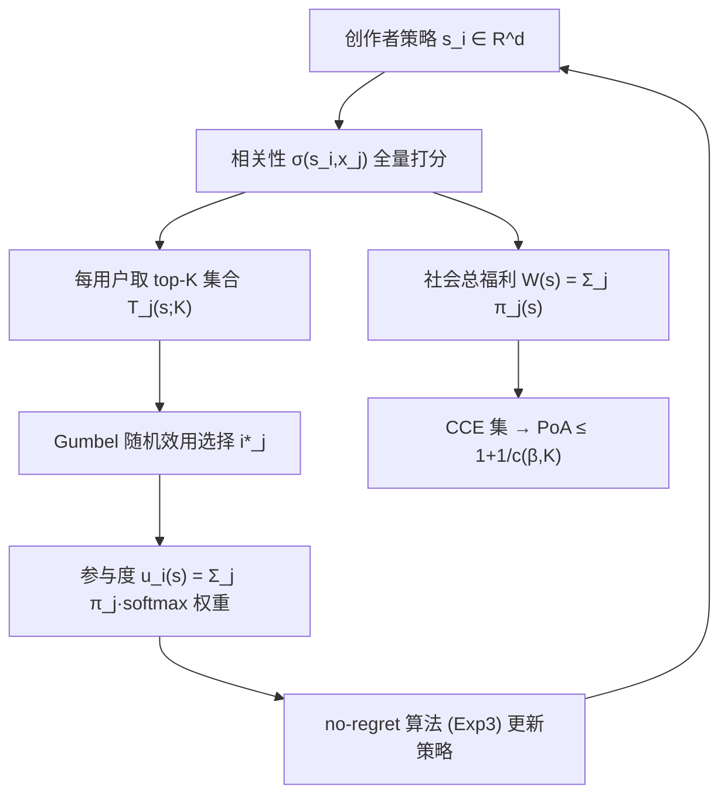

# How Bad is Top-$K$Recommendation under Competing Content Creators? (创作者博弈下的 Top-$K$ 推荐究竟有多差？)

- **会议/期刊**: ICML 2023 (Oral, 论文排版为 JMLR 模板)
- **作者与机构**: Fan Yao, Chuanhao Li, Denis Nekipelov, Hongning Wang (University of Virginia); Haifeng Xu (University of Chicago)
- **推荐链路定位**: 召回 / 推荐策略（Top-$K$ 曝光机制）的长期福利分析
- **研究方向**: 去偏公平与工业架构 / 强化学习与动态探索
- **论文原文**: [https://arxiv.org/abs/2302.01971v2](https://arxiv.org/abs/2302.01971v2)
- **开源代码**: 暂未开源

## TL;DR (1分钟核心速览)

针对创作者为争夺 Top-$K$曝光而策略性调整内容、进而可能扭曲用户福利这一长期争议，本文提出 **Competing Content Creation Game**，在 (i) 平台采用相关性 Top-$K$推荐、(ii) 用户遵循 Gumbel 随机效用 (RU) 模型、(iii) 创作者以 bandit 反馈运行任意 no-regret 算法 三个假设下，通过 Price of Anarchy (PoA) 证明福利损失恒满足$\mathrm{PoA} < 1 + \frac{1}{(1+\beta)\log K} < 2$且该上界紧。合成数据与 MovieLens-1M 仿真一致验证：$K=5$、$n\geq 5$时 PotA 仅约 1.10，$n=100$ 时逼近 1.02。

## Background & Motivation (背景与核心矛盾)

- **主流范式**: 工业界与学术界数十年来把 "按预测相关性取 Top-$K$ 曝光" 当作提升用户满意度的金科玉律 (BPR、NCF、LightGCN 等排序器都服务于此)。
- **前人局限 (悲观结论)**: (1) Ben-Porat & Tennenholtz (2018) 证明 Shapley mediator 下社会总福利 PoA 无界；(2) Ben-Porat et al. (2019) 在 1 维 Hotelling 空间 + 确定性用户选择下，top-$1$ 的 PoA 高达常数 2；(3) Hron et al. (2022) / Jagadeesan et al. (2022) 只讨论供给端竞争，不考虑推荐器干预，且需 NE 存在性保证。
- **核心洞察 (Key Insight)**: 前人的悲观结论共同源于 **确定性用户选择** 或 **以"曝光量"而非"参与度"作为创作者激励** 两个非平凡假设。作者发现：只要用户选择带微量 Gumbel 随机性（$\beta>0$），且创作者按用户期望效用（含$\sigma(s,x)+\varepsilon$部分）而非仅匹配概率领赏，策略博弈的负面外部性就会被 **smoothness 常数** 压到$O(1/\log K)$。
- **本文切入点**: 用 Roughgarden (2015) 的 smoothness 框架，对这个对抗性博弈证明紧的 PoA 上界（含 CCE 与 no-regret 动态情形），揭露 Top-$K$ 推荐的"看不见的手"效应。

## Method (核心方法设计)

### 1. 整体框架 (Overall Architecture)

博弈 $\mathcal{G}=(\{S_i\}_{i=1}^n, X, \sigma, \beta, K)$：$n$个创作者策略$s_i\in S_i\subset\mathbb{R}^d$，$m$个用户$x_j\in X\subset\mathbb{R}^d$，相关性函数$\sigma:S\times X\to[0,1]$。平台对每个用户取 top-$K$集合$T_j(s;K)$；用户按 RU 模型$\arg\max_{s_i\in T_j(s;K)}\{\sigma(s_i,x_j)+\varepsilon_i\}$（$\varepsilon_i\sim\mathrm{Gumbel}(-\beta\gamma,\beta)$）选一条消费；平台以用户参与度$u_i(s)$ 回馈创作者；创作者在 bandit 反馈下用任意 no-regret 算法（如 Exp3）迭代更新。核心分析对象是 CCE 集合下的 PoA 与 no-regret 轨迹下的 PotA。

### 2. 关键设计拆解 (Key Designs)

1. **Gumbel 假设下用户效用与创作者效用的闭式解**：前人工作或对 $\sigma$离散化，或只能求数值解，无法做平滑性分析。作者利用 Gumbel 极值分布性质推导出两个关键闭式：用户期望效用$\pi_j(s)=\beta\log\!\big[\sum_{s_k\in T_j(s;K)}\exp(\beta^{-1}\sigma(s_k,x_j))\big]$；创作者效用$u_i(s)=\sum_j \pi_j(s)\cdot\mathbb{I}[s_i\in T_j(s;K)]\cdot\frac{\exp(\beta^{-1}\sigma(s_i,x_j))}{\sum_{s_k\in T_j(s;K)}\exp(\beta^{-1}\sigma(s_k,x_j))}$。**物理直觉**：$\pi_j$是 log-sum-exp（"选择权溢价"），$u_i$ 是"参与度 × softmax 概率"，继承 RU 模型下"更广的候选集本身即为用户创造价值"的性质。

2. **激励指标的致命差异 (Prop. 1)**：若创作者只按曝光量 $\sum_j \Pr[x_j\to s_i]$领赏，Popa 可 > 2，且在$K=1$或$\beta\to 0$时可任意大。反例族构造两群用户：分散群对任何内容都"尚可"（低分），聚焦群只认高质量细分内容。纯曝光激励会诱导"专精创作者"放弃高质内容转投泛众低质内容，聚焦群被完全忽视。**直觉**：参与度把用户条件期望$\sigma+\varepsilon$ 计入，等于对"高质量匹配"额外奖励；曝光只奖励"被点击"，容易滋生"标题党/蹭热点"。

3. **PoA 紧界与平滑性论证**：PoA 上界 $< 1+1/c(\beta,K)$，其中$c(\beta,K)=\frac{(b+1)\log(b+K)}{(b+K)\log(1+K/b)}$、$b=e^{1/\beta}-1$。关键中间引理：(i) **次模性**$W(S\cup\{s_x\})-W(S)\geq W(S\cup\{s_x,s_y\})-W(S\cup\{s_y\})$（新创作者边际福利递减）；(ii) **平滑性**$W(s)-W(s_{-i})\leq c^{-1}(\beta,K)\,u_i(s)$（任一创作者加入对总福利的贡献 ≤ 其自身效用 × 收缩因子）。由此证明博弈是$(c^{-1},c^{-1})$-smooth，Roughgarden 界直接得 PoA$\leq 1+\mu/\lambda=1+1/c$。**为什么需要 Gumbel**：只有 Gumbel 才能给出利普希茨友好的 log-sum-exp 闭式，使$\sigma$的扰动对$\pi_j$的影响可被$\beta$ 压制。

## Experimental Setup & Evaluation Protocol (实验设置与评估协议)

- **数据集与预处理**: 无真实交互，纯仿真——策略空间合成或从 MovieLens 电影嵌入中抽样：

| 数据集 | #Users | #Creators/Policies | 策略空间 | 稀疏度/特征说明 |
| :--- | :---: | :---: | :---: | :--- |
| Syn-1 | $m$（$n$簇） |$n$，共享无差异动作集 | 二元$\sigma\in\{0,1\}$| 最大簇占$m/2$，模拟极端兴趣不均衡 |
| Syn-2 | $m$（$n$簇） |$n+1$（多一"安全"动作$s_0$） |$\sigma(s_0,\cdot)=\delta$ | 模拟"蹭热点低质内容"与"专精高质内容"权衡 |
| MovieLens-1M | 6,040 | $n$个创作者，每个从 3,883 部电影中独立采样 500 个策略 |$\sigma=\mathbb{I}[\langle s,x\rangle\geq 4]$| 深度矩阵分解训练，$d=32$，5-fold 平均 RMSE=0.883 |

- **数据划分与防穿越**: 无监督学习意义上的划分；MovieLens 仅用 5-fold 验证表示质量，后在全量数据上训练嵌入（离线策略评估性质，无时序泄漏风险）。
- **排名评测协议**: 本文评测的不是传统 top-$K$排序指标，而是 **博弈均衡福利**——用模拟退火求$\max_s W(s)$，用 LP 求小规模下的 CCE$\min_\alpha W$，得到 PoA；用 Exp3（$\epsilon$-greedy bandit）跑$T=5000$（合成）/$T=1000$（MovieLens）轮，得 PotA（price of total anarchy）以刻画动态演化。
- **对比基线与超参设置**: 无 baseline 网络模型，对照的是 **理论紧界** 与 **不同 $(\beta, K, n)$设定**；MovieLens 上$\beta\in\{0.1,0.5\}$、$K\in\{1,3,5,7\}$、$\epsilon\in\{0.003,0.01,0.03,0.1,0.3,0.9\}$、$n\in\{5,10,30,100\}$（合成数据（1）（2）中$n$与$\delta$ 亦作为扫描轴）。

## Key Experimental Results (实验关键数据)

### 1. 主实验对比 (Main Results): 合成数据 PoA（上界 = 1+1/c(β,K) 的理论值）

| $\beta$|$K$| 理论界$1+\frac{1}{c}$| PoA ($n=2$) | PoA ($n=3$) | PoA ($n=4$) | PoA ($n=5$) |
| :---: | :---: | :---: | :---: | :---: | :---: | :---: |
| 0.1 | 1 | 2.00 | 1.33 | 1.54 | 1.66 | 1.72 |
| 0.1 | 3 | 1.89 | — | 1.42 | 1.47 | 1.51 |
| 0.1 | 5 | 1.84 | — | — | 1.42 | **1.42** |
| 0.5 | 1 | 2.00 | 1.33 | 1.54 | 1.66 | 1.72 |
| 0.5 | 3 | 1.65 | — | 1.08 | 1.13 | 1.18 |
| 0.5 | 5 | 1.52 | — | — | 1.08 | **1.02** |

**MovieLens-1M PotA**（$\beta=0.1, K=5$，不同探索率$\epsilon$）：

| $n\backslash\epsilon$ | .003 | .01 | .03 | **.1** | .3 | .9 |
| :---: | :---: | :---: | :---: | :---: | :---: | :---: |
| 5 | 1.51 | 1.32 | 1.18 | **1.10** | 1.12 | 1.51 |
| 10 | 1.15 | 1.14 | 1.08 | **1.03** | 1.05 | 1.25 |
| 30 | 1.06 | 1.05 | 1.04 | **1.02** | 1.03 | 1.07 |
| 100 | 1.02 | 1.02 | 1.02 | **1.02** | 1.02 | 1.03 |

> 注：理论界随 $K$、$\beta$减小（即 PoA 约束更紧），$\beta$越大或$K$ 越大 PoA 越接近 1，仿真趋势与 Theorem 1 完全一致。

### 2. 消融实验 (Ablation Study): 激励指标由"参与度"换成"曝光量"

| 对比项 | $n=5$|$n=10$|$n=20$|$n=50$ | 备注 |
| :--- | :---: | :---: | :---: | :---: | :--- |
| 参与度 PotA ($\delta=0.1$) | 1.35 | 1.30 | 1.28 | 1.26 | 稳定 ≤ 1.4 |
| 曝光量 PotA ($\delta=0.1$) | 1.39 | 1.44 | 1.52 | **1.68** | 与参与度差距扩大 |
| 参与度 PotA ($\delta=0.5$) | 1.33 | 1.28 | 1.25 | 1.22 |$\delta$ 大时差距收窄 |
| 曝光量 PotA ($\delta=0.5$) | 1.36 | 1.38 | 1.40 | 1.43 | 仍显著劣于参与度 |

> $n \geq 10$且$\delta$ 小时曝光量的 PotA 已越过 2.0 阈值（与 Prop. 1 的理论警告吻合）。

### 3. 关键实验发现 (Key Findings)

- **发现 1（机制性）**: 在 Syn-1 上，固定 $n$时 PoA 单调下降于$K$：$K=1\to 5$时 PoA 从 2.00 降至 1.84（$\beta=0.1$）/ 1.52（$\beta=0.5$）；固定$K$时 PoA 随$\beta$ 增大进一步下降。这证明"多给候选 + 用户轻度随机"两个条件才是福利保证的关键，而非单纯更准的相关性估计。
- **发现 2（激励设计）**: 换成 MovieLens-1M 仿真（$n=5, K=5$），参与度奖励下最佳 PotA 仅 1.10，而$n=100$时 1.02；同条件下用曝光量奖励，$n=10$时 PotA 升至 1.44，$n=50$ 时 1.68，直接验证 Prop. 1 的"曝光激励可能比理论界更差"。
- **发现 3（动态收敛与多样性）**: 探索率 $\epsilon=0.1$时$K=5$下 MovieLens 平均福利最高，$\epsilon$过大或过小时福利均下降（印证 Corollary 1：$R(T)/T$主导项）；随着$n$ 从 5 增至 100，最优策略的 genre 分布逐渐"扁平化"，经验轨迹与最优分布趋向一致，说明 no-regret 创作者寿终会向多样化方向收敛。

## Highlights & Limitations (亮点、对比与审稿批判)

- **与代表作对比 (vs. Prior Work)**:
  - vs. Ben-Porat & Tennenholtz (2018)：其 Shapley mediator PoA 无界；本文用"参与度激励 + Gumbel 噪声 + Top-$K$"三件套给出有界且$\to 1$ 的保证。
  - vs. Ben-Porat et al. (2019) 1 维 Hotelling + top-$1$：其常数 2 的 PoA 是本文$K=1$情形的特例，本文在$K>1$时 O($1/\log K$) 推翻其悲观结论。
  - vs. Hron et al. (2022)：其需 NE 存在性（连续策略空间下不保证）；本文只用 CCE + smoothness，回避了 NE 稳定性与计算复杂度纠缠。
- **可迁移亮点**:
  1. **参与度 (engagement) 而非曝光量 (exposure) 作为创作者激励**——可直接迁移到短视频/电商平台的创作者分成机制设计。
  2. **$O(1/\log K)$刻画 top-$K$而非 top-$1$ 的福利效应**——为推荐列表长度提供理论依据（虽提升速率很慢）。
- **审稿级局限批判**:
  1. **模型假设偏强**：Gumbel 噪声下所有闭式成立，若换成 Gaussian 或多项式 probit，$\pi_j$ 无解析式，smoothness 常数需重新推导甚至可能不紧；作者亦在 Open Question 1 中自承。
  2. **仿真规模与评估偏差**：MovieLens 仿真中"最优福利 $W^*$"只能用模拟退火近似，$n$增大时近似误差放大导致 PotA 被低估（作者亦在脚注承认），使得$n=100$ 的 1.02 不能作为线上结论。
  3. **不考虑冷启动和内容预算**：策略空间是静态嵌入，不建模创作者的创造成本与生命周期，与真实 UGC 平台的演化模型存在 gap。

## Rating (四维评分)

- **方法创新性 (Novelty)**: ⭐⭐⭐⭐⭐ （首次在 Gumbel-RU + no-regret 内容创作博弈下给出紧的 PoA $1+\frac{1}{(1+\beta)\log K}$，理论框架"平滑性 + 次模性 + 闭式"三件套组合新颖）
- **评估协议与实验扎实度 (Protocol & Experiments)**: ⭐⭐⭐⭐ （三套仿真覆盖极端合成 + 真实 MovieLens，PoA/PotA 双指标 10 次独立实验，但没有传统 top-$K$排序指标对照，且模拟退火近似误差在$n$ 大时放大）
- **写作与数学规范度 (Clarity & Rigor)**: ⭐⭐⭐⭐⭐ （Lemma-Theorem-Corollary 层级清晰，每条定理后附 4 条性质解读与 $O(1/\log K)$ 渐近式，证明技巧在附录 A 完整展开，smoothness 常数推导严谨）
- **工业落地与复现价值 (Industrial & Practical Value)**: ⭐⭐⭐⭐ （"参与度而非曝光量做创作者激励" 可直接迁移工业营收分成机制；Top-$K$的$O(1/\log K)$ 证明为多样性 policy 提供理论落脚点；但闭式解依赖 Gumbel 假设，线上部署前需重新验证理论界）

