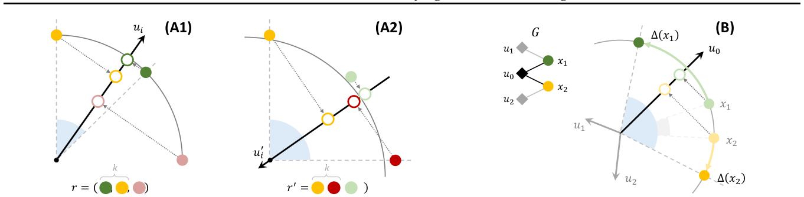
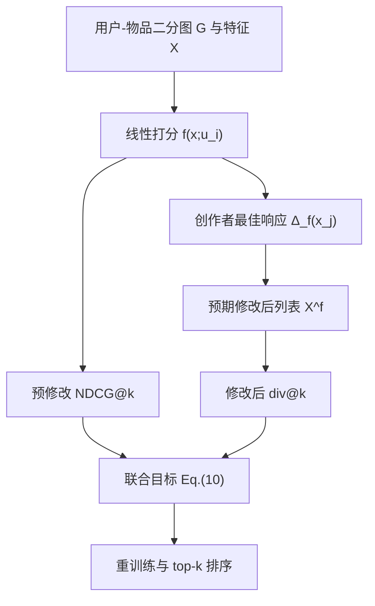

# Performative Recommendation: Diversifying Content via Strategic Incentives (通过战略激励实现内容多样化的表演式推荐)

- **会议/期刊**: ICML 2023
- **作者与机构**: Itay Eilat, Nir Rosenfeld（Technion – Israel Institute of Technology）
- **推荐链路定位**: 排序/重排（生态激励）
- **研究方向**: 去偏公平、可信隐私与工业架构 / 图推荐
- **论文原文**: [论文原文链接](https://arxiv.org/abs/2302.04336v3)
- **开源代码**: [开源代码仓库链接](https://github.com/itayeilat/Performative-Recommendation)

## TL;DR (1分钟核心速览)

重排只改变“展示哪些物品”，不改变内容池，长期仍会同质化。本文把内容创作者建模为对打分进行战略修改的智能体，用可微最佳响应把“修改后多样性”纳入排序目标。在 Yelp 半合成动态重训练中，NDCG 损失约 13% 时多样性约翻倍并持续；baseline 十轮多样性降约 40%，MMR 仅微增。

## Background & Motivation (背景与核心矛盾)

- **主流范式**: 准确率排序 + 后处理重排（如 MMR）提升列表内多样性。
- **前人局限**: 只改展示不改内容池；静态单轮评估，忽略创作者会策略性修改内容，导致长期同质化。
- **核心洞察 (Key Insight)**: 创作者效用是曝光，即其物品在相关用户上的平均得分；系统可通过打分规则塑造修改方向。多样化潜力受用户-物品二分图重叠结构约束。
- **本文切入点**: 将推荐视为 performative prediction，在重训练目标中预测创作者最佳响应，并用多样性正则激励内容分化。

<figure class="paper-figure" markdown="span">
  <figcaption>图1. (A) 准确率与多样性之间的权衡：考虑三个相关性分别为高（•）、中（•）、低（•）的项目。学习到的</figcaption>
</figure>

## Method (核心方法设计)

### 1. 整体框架 (Overall Architecture)

平台用线性打分 $f(x;u_i)=u_i^\top x$，用户/物品特征均在单位球上。物品$j$的创作者看到球面平均用户$\tilde v_j$给出的平均得分$s(x_j)=\tilde v_j^\top x_j$，并据此修改物品。每轮系统先用当前模型诱导最佳响应$\Delta_f$，得到预期修改后物品$X^f$；再在预修改标签上优化 NDCG，同时在预期修改后列表上最大化多样性，端到端重训练后输出 top-$k$。

### 2. 关键设计拆解 (Key Designs)

1. **战略响应闭式（把创作者行为变成可微算子）**：创作者在单位球上最大化 $s(x')-\alpha\|x'-x\|_2^2$，KKT 得$\Delta_f(x_j)=\frac{\tilde v_j+2\alpha x_j}{\|\tilde v_j+2\alpha x_j\|}$。不同物品的平均用户$\tilde v_j$不同，因此线性打分也能诱导不同方向移动；$\alpha$ 控制修改步长。
2. **前瞻多样性正则（从“展示多样”转为“激励创作多样”）**：目标为 $\max_{\{u_i\}}\frac{1}{m}\sum_i[\mathrm{NDCG}@k(y_i,r_i)+\lambda\mathrm{div}@k(X_i^f,r_i^f)]$，其中$\mathrm{div}@k=\frac{1}{k(k-1)}\sum_{j,\ell=1}^k(1-\cos(x_{r(j)},x_{r(\ell)}))$。只对预修改 NDCG 负责，却对修改后列表多样性负责，从而主动诱导内容分化。
3. **可微排序与训练/推理**：NDCG 的排序算子用 soft permutation $\hat P$松弛，top-$k$用$\mathbb{I}\{r\le k\}\approx\sigma_\tau(k-\hat r)$，成对多样性同样用软指示；总损失为$\mathcal{L}=-\frac{1}{m}\sum_i[\mathrm{NDCG}@k(y_i,r_i)+\lambda\mathrm{div}@k(X_i^f,r_i^f)]$。训练使用每轮候选列表内相关性标签，负例由地理近邻未评餐馆构造；推理仅线性内积 top-$k$，开销低，但训练需对每个物品算$\Delta_f$ 并做可微排序。

## Experimental Setup & Evaluation Protocol (实验设置与评估协议)

- **数据集与预处理**:

| 数据集 | #Users | #Items | #Interactions | 稀疏度/密度 | 特征/场景说明 |
| :--- | :---: | :---: | :---: | :---: | :--- |
| Synthetic | 50 | 200 | 500 候选边 | 5% | $d=2$，单位圆可视化；$k=10$ |
| Yelp-Restaurants | 236 | 1,520 | 9,440 候选边 | 2.63% | 43 维餐馆属性；活跃用户≥100 评论，每用户 40 个最热门候选 |

- **数据划分与防穿越**: 非 Leave-One-Out，采用动态重训练式在线划分：共 10 轮；每轮每用户随机取 30 个候选，其中 20 训练、10 验证，测试用全部 40 候选；下一轮标签由修改后物品经 $f^*$ 生成。
- **排名评测协议**: 候选列表内 Full-Ranking（每用户 40 候选）取 top-10，非全库；指标 NDCG@10 与 cosine div@10；λ 调到目标 NDCG（base/0.95/0.9/0.85，容差 0.01）。
- **对比基线与超参**: accuracy-only（λ=0）、MMR 重排、non-strategic（Eq.7）、strategic（Eq.10）、hybrid@5；线性打分维度 $d=43$（Yelp）/2（合成）；合成 100 次重复，Yelp 未报告显著性检验。

## Key Experimental Results (实验关键数据)

### 1. 主实验对比 (Main Results)

Yelp，$\alpha=0.1$，$T=10$；数值为原文图4读图近似，仅用于趋势比较。

| 方法 | NDCG@10（相对最优） | Div@10（相对 baseline） | Div 提升 |
| :--- | :---: | :---: | :---: |
| Baseline（λ=0） | ≈0% | 1.0×（十轮降约 40%） | — |
| MMR | -≈1% | ~1.1× | — |
| Non-strategic λ_base | ≈0% | ~1.15× | — |
| Non-strategic λ0.9 | -13% | ~1.4× | — |
| Strategic λ_base | ≈0% | ~1.5× | — |
| **Strategic λ0.9** | -13% | **~2.0×** | **+43% vs non-strat λ0.9** |
| Hybrid@5 | -13% | ~1.1×（关闭后回落） | — |

### 2. 消融实验 (Ablation Study)

| 变体 | Div@10 | NDCG@10 | 观察 |
| :--- | :---: | :---: | :--- |
| w/o 战略前瞻（Eq.7） | ~1.4× | -13% | 反应式，低于 Eq.10 |
| w/o 多样性正则（λ=0） | →0 | ≈0% | 战略更新致同质化 |
| Hybrid@5 | 关闭后回落 | -13% | 需全程正则 |
| 低成本 $\alpha<1$ | →0 | 波动 | 大步修改无法稳定多样化 |
| 高成本 $\alpha\ge1$ | 高 | 略降/更平滑 | 可形成持续多样性 |
| 全重叠图 $N=0$ | 0 | — | 与 Prop.1 一致 |
| 轻度打乱 $N=100$ | 显著上升 | 轻微降 | 图容量释放 |

### 3. 关键实验发现 (Key Findings)

- 合成实验中，用户完全重叠（$N=0$）时任何 λ 下多样性均为 0；仅打乱约 100 条边，$\lambda=1$ 时多样性即显著上升，验证图结构决定激励上限。
- 无正则（λ=0）时战略更新使多样性降至 0；$\lambda=0.05$ 的轻正则即可显著挽回，说明“预测响应 + 轻多样性惩罚”是有效组合。
- Yelp 上 baseline 十轮多样性降约 40%，MMR 仅微增；strategic λ0.9 在约 13% NDCG 损失下使多样性约翻倍并持续，而 hybrid 关闭正则后立即回落，证明需持续激励。

## Highlights & Limitations (亮点、对比与审稿批判)

- **与代表作对比**: 相较 MMR/后处理重排，本文改变内容创作激励而非仅改展示顺序；相较 non-strategic 多样性正则，本文预测创作者响应，避免“正则一停就同质化”；相较创作者博弈/均衡研究，本文聚焦学习侧间接激励而非直接分配。
- **可迁移亮点**: 将战略最佳响应闭式嵌入排序目标；用 soft top-$k$ 把列表级多样性做成可端到端优化的正则。
- **审稿级局限批判**: Yelp 为半合成，$f^*$与$\alpha$ 已知且响应模型正确，真实平台存在响应误设；线性打分、单位球与 cosine 多样性假设较强，且每轮重训练/可微排序带来额外训练开销，缺少线上 A/B 与显著性检验。

## Rating (四维评分)

- **方法创新性 (Novelty)**: ⭐⭐⭐⭐ （将创作者战略响应与表演式预测引入多样性学习，机制新颖且有图结构分析支撑）
- **评估协议与实验扎实度 (Protocol & Experiments)**: ⭐⭐⭐ （合成实验充分、Yelp 动态重训练合理，但半合成、无显著性检验且绝对数值多为读图近似）
- **写作与数学规范度 (Clarity & Rigor)**: ⭐⭐⭐⭐ （响应闭式、可微排序与命题证明清晰，假设边界交代较明确）
- **工业落地与复现价值 (Industrial & Practical Value)**: ⭐⭐⭐ （推理为线性打分、开销低且有开源代码，但依赖创作者响应模型与多轮重训练，线上部署需谨慎校准）

