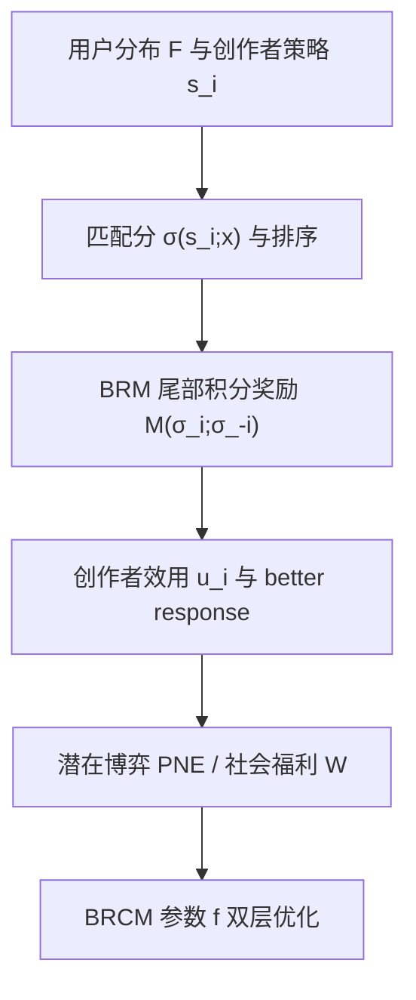
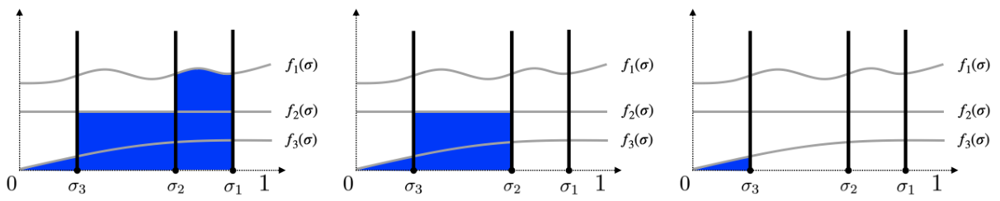
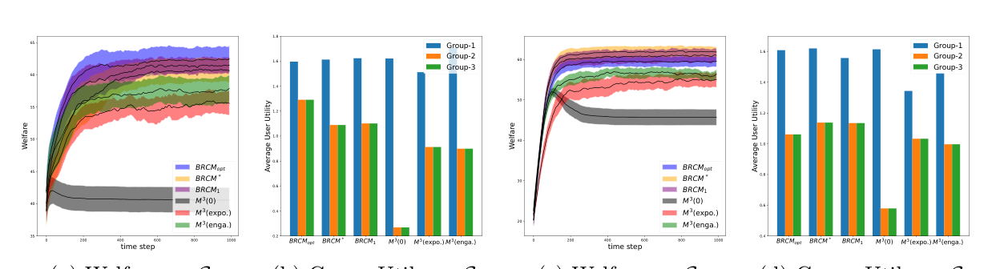

# Rethinking Incentives in Recommender Systems: Are Monotone Rewards Always Beneficial? (重新审视推荐系统中的激励：单调奖励总是有益吗？)

- **会议/期刊**: ICML 2023
- **作者与机构**: Fan Yao 等；University of Virginia、University of Chicago、Meta、Google
- **推荐链路定位**: 平台激励与生态治理（非传统召回/精排链路）
- **研究方向**: 去偏公平、可信隐私与工业架构
- **论文原文**: [论文原文链接](https://arxiv.org/abs/2306.07893v2)
- **开源代码**: 暂未开源

## TL;DR (1分钟核心速览)

本文质疑平台普遍采用的“功绩制+单调”奖励 M3：在 Trend-vs-Niche 用户分布下，创作者会扎堆最大群体，均衡福利最多仅为最优的 $K/(K+1)$，$K=1$时损失一半。作者提出 BRM，放弃总奖励单调性、保留 merit-based，用“尾部积分”奖励使 C3 博弈成为潜在博弈；令$f_i=r_i$ 时势函数恰为社会福利。BRCM 子类可参数化并做双层优化。合成数据与 MovieLens-1m 模拟中，BRCM 福利与少数群体效用优于曝光/互动型 M3 基线。

## Background & Motivation (背景与核心矛盾)

- **主流范式**: 平台按曝光、点击、互动时长等用户满意度指标奖励创作者，典型机制满足“功绩制”与“总奖励单调性”，即内容越相关奖励越高，任一创作者提升相关性会提高总奖励。
- **前人局限**: M3 在用户群体大小不均时，会激励所有创作者挤向多数群体；同时，单调性无法惩罚“过度扎堆”造成的拥塞，导致小众内容供给不足。作者证明任意 M3 在 TvN 环境中唯一均衡福利至多为最优的 $K/(K+1)+O(1/n)$。
- **核心洞察 (Key Insight)**: 单调性并非必要。若奖励依赖“排名低于自己的创作者分数”，下游追赶会侵蚀上游奖励，形成拥塞负外部性，从而抑制过度集中。
- **本文切入点**: 保留 merit-based、放弃单调性，设计 BRM 使创作者竞争成为潜在博弈，并让势函数与任意福利指标对齐。

## Method (核心方法设计)

### 1. 整体框架 (Overall Architecture)

C3 游戏由用户分布 $F$、创作者策略$s_i$、匹配分$\sigma(s_i;x)$、奖励机制$M$、用户注意力权重$\{r_k\}$构成。用户效用为 top-$K$加权匹配分$W(s;x)=\sum_{k=1}^n r_k\sigma_{l(k)}(x)$；社会福利为$W(s)=\mathbb{E}_{x\sim F}[W(s;x)]-\sum_i c_i(s_i)$，平台奖励在用户与创作者间转移，故相互抵消。平台选择$M$改变创作者效用，创作者通过 better response 动态趋于纯纳什均衡 PNE；BRM 的尾部积分结构保证 PNE 存在，BRCM 进一步把$f_i$ 参数化，用模拟响应做双层优化。

### 2. 关键设计拆解 (Key Designs)

1. **BRM 尾部积分奖励（抑制扎堆）**：M3 的单调性使上游创作者即使面对拥挤也不断提高分数；BRM 将第 $i$ 名奖励定义为从自身分数到下游分数的加权面积：
   $M(\sigma_i;\sigma_{-i})=\sum_{k=i}^n\int_{\sigma_{k+1}}^{\sigma_k}f_k(t)dt$，其中$f_1(t)\ge\cdots\ge f_n(t)\ge0$，$\sigma_{n+1}=0$。直觉是第$i$名只“占有”自己领先下游的尾部区间，下游追赶会直接削减其奖励，从而鼓励差异化供给；同时$f_i$ 递减保证仍满足 merit-based。

   <figure class="paper-figure" markdown="span">
  <figcaption>图1：由有序函数 {f1, f2, f3} 参数化的 BRM 示意图。3个创作者的匹配分数满足 1 ≥ σ1 ≥ σ2 ≥ σ3 ≥ 0。各图中蓝色区域的面积精确给出相应创作者在 BRM 中的奖励。</figcaption>
</figure>
   图1：BRM 将创作者奖励刻画为排序分数间的尾部面积，下游追赶会压缩上游奖励。

2. **势函数对齐社会福利（福利最大化）**：任意 BRM 下 C3 为潜在博弈，势函数可写为
   $P(s)=\mathbb{E}_{x\sim F}\left[\sum_i\int_0^{\sigma_{l(i)}(x)}f_i(t)dt\right]-\sum_i c_i(s_i)$。
   当取 $f_i(t)=r_i$时，$P(s)=W(s)$，于是 PNE 的势函数最大化即社会福利最大化。TvN 环境下可全局最优；一般 C3 只保证局部最优或近似，但 better response 会单调提升$W$。

3. **BRCM 双层优化与推理**：当平台只知道黑盒福利时，求解
   $\max_{M\in BRCM}W(s^*(M))$，s.t.$s^*(M)=\arg\max_s P(s;M)$。
   内层用随机 better response 模拟创作者策略演化；外层对 $f=(f_1,\dots,f_n)$ 做坐标扰动与有限差分，因排序操作不可微。该过程无需负采样，平台只需发布奖励函数；主要开销在离线模拟与参数搜索。

## Experimental Setup & Evaluation Protocol (实验设置与评估协议)

- **数据集与预处理**: 本文不是传统交互推荐，评估的是模拟 C3 博弈；MovieLens-1m 仅用于构造用户/电影嵌入与策略空间。

| 环境 | #Users $m$| #Items/Strategies | #Creators$n$ | #Groups | 说明 |
| :--- | :---: | :---: | :---: | :---: | :--- |
| 合成数据 | 52 | 连续单位球 $S^{d-1}$| 10 | 8 簇 |$d=10$，簇大小$(20,10,8,5,3,3,2,1)$ |
| MovieLens-1m | 2550 | 1783 部电影 | 10 | 未显式分组 | 原始 6040 用户/3883 电影/1M ratings；过滤高活跃用户与超热门电影，$d=32$ |

- **数据划分与防穿越 (Splitting Strategy)**: 无传统 train/test 划分。MovieLens 嵌入用 deep matrix factorization 做 5 折交叉验证，RMSE $=0.739$，再用全量数据训练；模拟环境分 G1（零成本、初始扎堆最大群体）与 G2（非零成本、创作者从成本中心冷启动）。
- **排名评测协议 (Ranking Protocol)**: 非 Full-Ranking / Sampled Ranking。以创作者随机 better response 动态收敛后的社会福利曲线与分组平均用户效用评估；10 次随机实例/独立运行，误差条为 $0.5\sigma$或$0.2\sigma$。
- **对比基线与超参设置**: 基线含 BRCM opt、BRCM*、BRCM1、M3(0)、M3(expo.)、M3(enga.)；$K=5$，$\beta=0.05$。合成环境$T=1000,L_1=200,L_2=5,\eta_1=\eta_2=0.1$；MovieLens 环境$T=500,L_1=100,L_2=5,\eta_1=0.5,\eta_2=0.1$。原文以图 2/3 呈现曲线，未给单点数值表，下表为趋势性整理。

## Key Experimental Results (实验关键数据)

### 1. 主实验对比 (Main Results)

| 机制 | 类别 | 合成 G1 | 合成 G2 | ML-1m G1 | ML-1m G2 | 分组效用趋势 |
| :--- | :--- | :---: | :---: | :---: | :---: | :--- |
| BRCM opt | BRCM+优化 | 最高 | 高 | 最高 | 高 | 提升少数/小众组 |
| BRCM* | 理论最优 BRCM | 高 | 最高 | 高 | 最高 | 分组更均衡 |
| BRCM1 | 固定 $[1,1/2,\dots]$ | 中高 | 中高 | 中高 | 中高 | 优于 M3 |
| M3(expo.) | M3 | 中 | 中 | 中 | 中 | 多数组仍占优 |
| M3(enga.) | M3 | 中 | 中 | 中 | 中 | 多数组仍占优 |
| M3(0) | M3 | 低/无改善 | 低 | 低/无改善 | 低 | 扎堆不缓解 |

<figure class="paper-figure" markdown="span">
  <figcaption>图2：社会福利曲线及各组平均用户效用。误差条表示半个标准差范围（0.5σ），由10个随机采样的博弈实例上的模拟生成。</figcaption>
</figure>
图2：合成数据上 G1/G2 的社会福利曲线与分组平均用户效用（原文图2）。

### 2. 消融实验 (Ablation Study)

| 变体/环境改动 | 福利变化 | 解释 |
| :--- | :--- | :--- |
| BRCM* → BRCM1（参数偏离最优） | 下降但仍高于 M3 | 放弃单调性本身带来主要收益，参数精度次要 |
| BRCM* → BRCMopt（经验优化） | 合成 G1 反超，G2 略低 | 随机响应未必收敛到最优 PNE，优化可补偿 |
| M3(0) → M3(expo./enga.) | 提升但不及 BRCM | 引入 top-$K$ 竞争仍保留单调扎堆 |
| G1 → G2（加入创作成本） | BRCM 优势收窄 | 成本锚定降低创作者对激励的敏感度 |

### 3. 关键实验发现 (Key Findings)

1. 定理 1 给出 $K/(K+1)$的常数福利损失；当$K=1$时上界为$1/2$，即用户只看首位时 M3 可损失近半福利。实验中 M3(0) 在 G1 初始已扎堆时几乎无改善，印证单调机制无法自行脱离次优均衡。
2. BRCM1 参数明显偏离理论最优，却仍稳定优于 M3(expo.) 与 M3(enga.)，说明“尾部积分+潜在博弈”的结构性收益大于参数精调；BRCMopt 在合成 G1 甚至超过 BRCM*，反映随机 better response 下经验优化能缓解未收敛问题。
3. 分组效用显示 BRCM 的福利增益主要来自 minority/niche 组，同时保持多数组效用；但在 G2 有成本时优势减弱，MovieLens 用户效用分布更宽，说明真实成本与嵌入噪声会削弱机制效果。

## Highlights & Limitations (亮点、对比与审稿批判)

- **与代表作对比 (vs. Prior Work)**: 相比 Ben-Porat & Tennenholtz 的 Shapley mediator，本文将其识别为 BRM 特例 $M[1,1/2,\dots]$，并推广到可优化 BRCM；相比 Yao et al. 的 top-$K$曝光机制上界$O(1/\log K)$，本文证明任意 M3 至少$1/K$ 分数损失，负结果更强；相比 VCG/Arrow 式机制设计，本文首次用潜在函数做推荐系统福利最大化。
- **可迁移亮点**: 用“尾部积分”制造拥塞负外部性以抑制供给同质化；用势函数把平台福利目标嵌入创作者局部效用，使分布式 better response 自发优化全局指标。
- **审稿级局限批判**: 匹配分 $\sigma$ 被视为完美已知，未处理估计噪声、偏差与策略性刷分；实验仅模拟，无线上 A/B，且 BRCM 外层优化依赖模拟创作者响应，真实反馈周期长、计算与调参成本不低。理论全局最优主要限于 TvN，一般 C3 仅保证局部/近似。

## Rating (四维评分)

- **方法创新性 (Novelty)**: ⭐⭐⭐⭐⭐ （用尾部积分+潜在博弈重构创作者激励，负结果与正结果均有机制设计理论支撑）
- **评估协议与实验扎实度 (Protocol & Experiments)**: ⭐⭐⭐ （合成与 MovieLens 模拟较完整，但无真实线上实验、无标准推荐指标与显著性检验）
- **写作与数学规范度 (Clarity & Rigor)**: ⭐⭐⭐⭐⭐ （M3 公理化、BRM 定义、势函数构造与定理证明链条清晰）
- **工业落地与复现价值 (Industrial & Practical Value)**: ⭐⭐⭐ （机制可解释、可参数化，但需解决评分噪声、预算约束与长期反馈落地）

