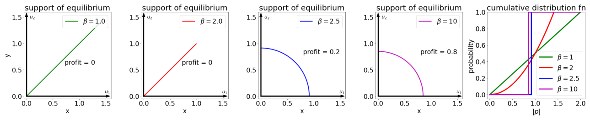
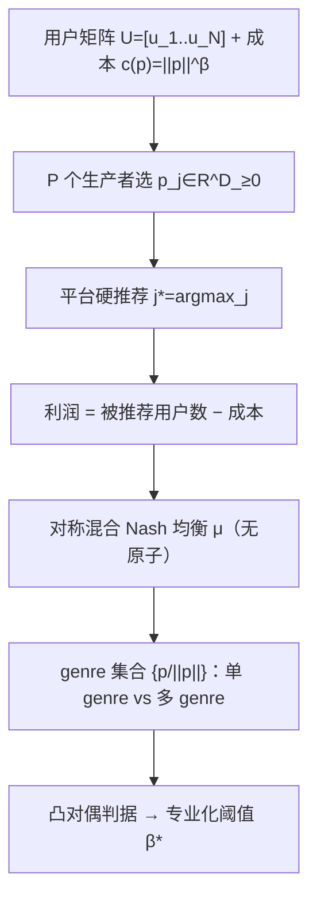

# Supply-Side Equilibria in Recommender Systems (推荐系统中的供给侧均衡)

- **会议/期刊**: NeurIPS 2023
- **作者与机构**: Meena Jagadeesan (UC Berkeley), Nikhil Garg (Cornell Tech), Jacob Steinhardt (UC Berkeley)
- **推荐链路定位**: 平台生态/市场机制设计（非召回、精排链路本身，研究算法对内容生产端的塑造）
- **研究方向**: 去偏公平与工业架构 / 理论分析与市场均衡
- **论文原文**: [arXiv:2206.13489v3](https://arxiv.org/abs/2206.13489v3)
- **开源代码**: [mjagadeesan/supply-side-equilibria](https://github.com/mjagadeesan/supply-side-equilibria)

## TL;DR (1分钟核心速览)

本文研究推荐算法如何反向塑造内容生产端的"供给侧均衡"。模型将用户与内容均建模为 $D$维非负向量，平台按内积硬推荐（hardmax），生产者以成本$\|\mathbf{p}\|^\beta$最大化"被推荐用户数 − 生产成本"。作者用凸优化中的**极小极大强对偶性**给出了"专业化（specialization，即多个 genre 共存）是否发生"的充要几何条件，并证明专业化会让生产者获得正利润、降低市场竞争力。核心结论是阈值$\beta^*$随用户异质性和成本凸性显式变化（两用户情形$\beta^*=\frac{2}{1-\cos\theta^*}$），并在 MovieLens-100K 上用 NMF 嵌入计算验证：嵌入维度$D$ 越大，专业化越容易发生。

## Background & Motivation (背景与核心矛盾)

- **主流范式**: 推荐系统研究绝大多数聚焦需求侧（用户偏好建模、排序优化），而算法对供给端（生产者做什么内容）的影响缺少可分析的理论工具。
- **前人局限**: (1) 经典空间/价格竞争模型（Hotelling、Bertrand）中生产者只决策**一维**（方向或价格），无法刻画数字内容在多维属性空间里"联合选择 genre 与 quality"；(2) 已有的 ML 供给侧博弈工作把生产者限制在**有限 topic 集合**里选，无法产生 genre 的自发涌现。
- **核心洞察 (Key Insight)**: 内容其实无法被干净地聚类成离散类别，而常是多维属性的混合（一部电影可同时是剧情+喜剧）。作者据此把用户/内容嵌入高维连续空间，用内积刻画匹配价值，从而让"专业化"这一非对称现象可以被对称混合均衡的**支撑方向集合**（genre）精确刻画。
- **本文切入点**: 用"范数幂"成本 $c(\mathbf{p})=\|\mathbf{p}\|^\beta$ 保留成本在多维上的非凸权衡，再借对偶/极小极大理论把"单 genre 均衡是否存在"转化为几何判据，从而绕开无闭式解的困难。

<figure class="paper-figure" markdown="span">
  <figcaption>图1：对于位于标准基向量 e1 和 e2 的 2 个用户、P = 2 个生产者以及生产者成本函数 c(p) = ∥p∥β，不同 β 设置下的对称均衡。</figcaption>
</figure>

## Method (核心方法设计)

### 1. 整体框架 (Overall Architecture)

博弈在 $P$个生产者间展开：用户向量$\mathbf{u}_i\in\mathbb{R}^D_{\ge0}$固定，每个生产者$j$一次性选择内容$\mathbf{p}_j\in\mathbb{R}^D_{\ge0}$；平台把用户$i$分配给内积最大者$j^*(i)=\arg\max_j\langle\mathbf{u}_i,\mathbf{p}_j\rangle$（并列随机）。生产者利润为

$$P(\mathbf{p}_j;\mathbf{p}_{-j})=\mathbb{E}\Big[\sum_{i=1}^N\mathbb{I}[j^*(i)=j]\Big]-\|\mathbf{p}_j\|^\beta .$$

由于 argmax 引起的跳跃，纯策略均衡不存在（Prop 1），但对称混合均衡存在且无原子（Prop 2–3）。作者把均衡研究转化为：分布 $\mu$的**支撑方向集合**$\mathrm{Genre}(\mu)=\{\mathbf{p}/\|\mathbf{p}\|:\mathbf{p}\in\mathrm{supp}(\mu)\}$是否含多个方向。整个分析闭环由"用户几何 + 成本参数 → 对偶判据 → 阈值$\beta^*$ → 均衡/利润结构"组成。

### 2. 关键设计拆解 (Key Designs)

1. **单/多 genre 的充要几何判据（Theorem 1 + Lemma 1）**：痛点是无闭式均衡、无法直接判断专业化。作者定义单位球像 $S=\{U\mathbf{p}:\|\mathbf{p}\|\le1,\ \mathbf{p}\in\mathbb{R}^D_{\ge0}\}$，令$S^\beta$为其逐坐标幂像、$\bar{S}^\beta$ 为凸包。核心结论：

$$\max_{y\in S^\beta}\prod_{i=1}^N y_i=\max_{y\in\bar{S}^\beta}\prod_{i=1}^N y_i \iff \exists\,\mu,\ |\mathrm{Genre}(\mu)|=1 .$$

背后等价于一个 minmax 问题的强对偶：$\inf_{y\in S^\beta}\sup_{y'\in S^\beta}\sum_i y'_i/y_i=\sup_{y'\in S^\beta}\inf_{y\in S^\beta}\sum_i y'_i/y_i$。直觉是：$S^\beta$越"凸"，单个向量$\mathbf{p}$越容易同时低成本满足所有用户；当$\beta$大到使成本超线性、$S^\beta$非凸时，生产者被迫专精，专业化发生。关键点是该条件与生产者数量$P$ 无关。

2. **专业化形式与相变阈值（Theorem 2 / Prop 5–6）**：在两等大用户群、$c(\mathbf{p})=\|\mathbf{p}\|_2^\beta$下，$\beta^*=\dfrac{2}{1-\cos\theta^*}$，$\theta^*$为两用户向量夹角，用户越接近（$\theta^*$小）阈值越大、越难专业化。$\beta>\beta^*$时有限 genre 均衡不存在，只有无穷多 genre（或$P=\infty$极限下退化回两 genre）。$P=2$、用户在$\mathbf{e}_1,\mathbf{e}_2$时，均衡支撑在半径$(2^{\beta-1})^{1/\beta}$的四分之一圆上，角度密度$f(\theta)=2\cos\theta\sin\theta$；$P$ 增大时支撑由凹曲线收敛为直线段再变凸。

3. **单 genre 的福利/利润性质（Cor 6 / Prop 7–8）**：单 genre 均衡方向最大化用户的 Nash 社会福利 $\arg\max_{\|\mathbf{p}\|=1}\sum_i\log\langle\mathbf{p},\mathbf{u}_i\rangle$（公平与效率的折中）。利润方面：单 genre 均衡利润恒为$0$（Prop 8），而多 genre 均衡在$\max_{\|\mathbf{p}\|\le1}\min_i\langle\mathbf{p},\mathbf{u}_i/\|\mathbf{u}_i\|\rangle<N^{-P/\beta}$时可正（Prop 7，$P=2$时恰为$1-2/\beta$）。专业化削弱每个 genre 内的竞争，形成"局部垄断"。

## Experimental Setup & Evaluation Protocol (实验设置与评估协议)

- **数据集与预处理**: 本文为**理论论文**，实验仅用于对理论预测做**定性数值验证**，无传统推荐训练/测试流程。

| 数据集 | #Users | #Items | #Interactions | 稀疏度 | 特征/场景说明 |
| :--- | :---: | :---: | :---: | :---: | :--- |
| MovieLens-100K | 943 | 1682 | 100,000 | ~93.7% 稀疏 | NMF 得 $D$ 维用户嵌入，对应矩阵分解因子数 |
| 子集（阈值估计）| 20/30/40 (随机抽样) | 1682 | — | — | 专用于 $\beta^*$ 二分搜索估计 |

- **数据划分与防穿越 (Splitting Strategy)**: 无 `Leave-One-Out` 或比例划分；直接在全量评分上用 NMF 得到用户嵌入，不存在训练/测试穿越问题（非预测任务）。
- **排名评测协议 (Ranking Protocol)**: 无 `Full-Ranking`/`Sampled Ranking`；评价指标不是 Recall/NDCG，而是均衡方向 $\mathbf{p}^*$的坐标结构与阈值估计$\beta_e$、$\beta_u$ 的单调趋势。
- **对比基线与超参设置**: 无传统 baseline；"对照组"为不同成本函数参数（权重 $\alpha$、范数$q$、指数$\beta$、维度$D$）。$\mathbf{p}^*$用 `cvxpy`（$q=2$）或投影梯度下降（$q\neq2$）求解；$\beta_u$由 Corollary 5 的闭式上界给出，$\beta_e$ 由二分搜索条件 (4) 估计，显著性检验不适用。

## Key Experimental Results (实验关键数据)

### 1. 主实验对比 (Main Results)

本文无 SOTA 基线表；下表据图 5 归纳不同成本设置下均衡方向 $\mathbf{p}^*$与阈值$\beta^*$ 的变化趋势。

| 设置 | 参数 | 观测趋势 | 与理论对应 |
| :--- | :---: | :--- | :--- |
| 单 genre 方向 $\mathbf{p}^*$（$D=2$） | 变$\alpha$| 维度$i$越便宜（$\alpha_i$ 小），该维分量越大 | 生产者向低成本维度投资 |
| 单 genre 方向 $\mathbf{p}^*$| 变$q$（固定$\alpha$） | 方向变化**不显著** | 范数形状不主导方向 |
| $\mathbf{p}^*$ vs 算术平均 | — | 二者**不一致**，非简单平均 | 高维权衡非线性 |
| 阈值估计 $\beta_e$（$N=\{20,30,40\}$） |$D$增大 |$\beta_e$ **下降** | 高维放大用户异质性 |
| 上界 $\beta_u$（$N$固定） |$D$增大 |$\beta_u$ **下降** | 同上 |
| 上界 $\beta_u$|$q$增大 |$\beta_u$ **上升** | 范数越"平均"越难专业化 |

### 2. 消融实验 (Ablation Study)

以参数敏感性替代组件消融（理论模型中无模块可拆），下表为各因素对"专业化发生"的影响：

| 移除/改变因素 | 均衡结构变化 | 结论 |
| :--- | :--- | :--- |
| $\beta\to1$（成本退化为范数） | 恒有单 genre 均衡（Cor 2） | 范数激励"取平均"而非专业化 |
| $\beta$ 增大（超线性） | 从单 genre 相变到无限多 genre | 成本凸性是专业化的扳机 |
| 用户夹角 $\theta^*\downarrow$|$\beta^*=\frac{2}{1-\cos\theta^*}$ 增大 | 用户越同质越难专业化 |
| $P\to\infty$| 均衡回归两 genre、支撑退化为坐标轴并集 | 有限$P$ 下多 genre 不存在，极限下重现 |
| 成本范数改为 $\ell_\infty$ | 恒有单 genre | 只按最高坐标收费则永不专业化 |

### 3. 关键实验发现 (Key Findings)

1. **嵌入维度 $D$是专业化的"旋钮"**：MovieLens-100K 上$D$从 2 增到 40 时$\beta_e$与$\beta_u$系统性下降，说明矩阵分解因子数越多、用户异质性越被放大，越易触发多 genre 均衡——这为平台通过调节$D$ 影响内容多样性提供了理论依据。
2. **单 genre 均衡方向不等于用户均值且显著受成本权重支配**：$\alpha$变化改变$\mathbf{p}^*$各维配比（便宜维度被加权），而$q$ 几乎不改变方向，表明"生产者往哪投"由成本的不对称结构决定，而非范数形状。
3. **专业化直接关联正利润与市场非竞争性**：$P=2$时多 genre 均衡利润为$1-2/\beta>0$（$\beta\ge2$恒正），而单 genre 均衡利润恒为$0$，定量印证"专业化→局部垄断→竞争力下降"的理论链条。

## Highlights & Limitations (亮点、对比与审稿批判)

- **与代表作对比 (vs. Prior Work)**: 相比 Ben-Porat & Tennenholtz (2018) 的**有限 topic** 供给侧博弈，本文用**无限多维连续**决策空间首次让 genre 自发涌现；相比同期 Hron et al. (2022) 把内容约束在 $\ell_2$ 单位球并采用 softmax，本文聚焦**范数幂成本**与 **hardmax**，从而把"成本凸性"而非"推荐环境随机性"作为专业化主因；相比 Hotelling/Bertrand 等经典一维竞争模型，本文联合刻画 genre 与 quality 的二维选择。
- **可迁移亮点**: (1) "单 genre 存在 ⇔ minmax 强对偶"的转化技巧，可用于分析其他"离散分类结果由连续约束凸性决定"的平台问题；(2) 用对称混合均衡支撑刻画非对称现象（专业化）的方法，可复用于卖家策略、创作者生态等建模。
- **审稿级局限批判**: (1) 模型假设平台**完全信息 + hardmax + 用户必从推荐**，与现实中的探索、噪声、用户自主选择差距较大；(2) 主结论多依赖两等大用户群 + $\ell_2$幂成本的特例，一般用户几何下仅给上界$\beta_u$，且$P=\infty$ 极限的均衡定义较重；(3) 实验仅为定性验证，无真实线上 A/B 或与传统推荐指标（多样性/公平性）的定量对照。

## Rating (四维评分)

- **方法创新性 (Novelty)**: ⭐⭐⭐⭐⭐ （首次用凸对偶/强对偶性刻画推荐供给侧专业化相变，理论视角新颖且给出充要条件）
- **评估协议与实验扎实度 (Protocol & Experiments)**: ⭐⭐⭐ （理论推导严谨，但实证仅 MovieLens-100K 上的定性验证，缺真实系统与定量基线）
- **写作与数学规范度 (Clarity & Rigor)**: ⭐⭐⭐⭐⭐ （模型定义、引理与证明链条清晰，$\beta^*$、$\mathbf{p}^*$ 均有闭式或可计算表达）
- **工业落地与复现价值 (Industrial & Practical Value)**: ⭐⭐⭐ （代码开源、可计算 $\beta^*$ 作为平台设计参考，但强假设使其短期难直接部署）

