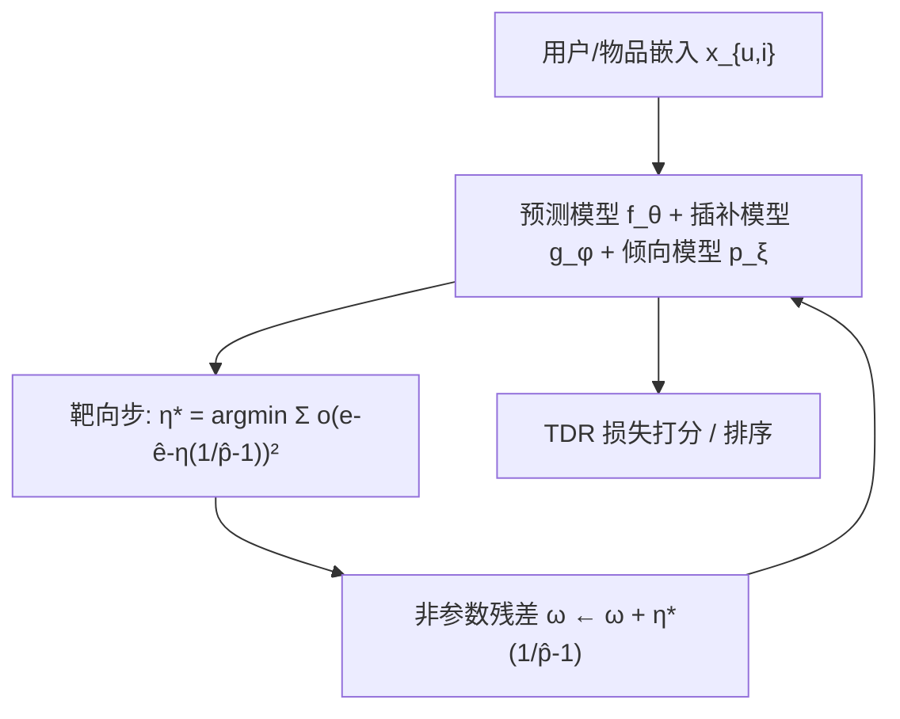
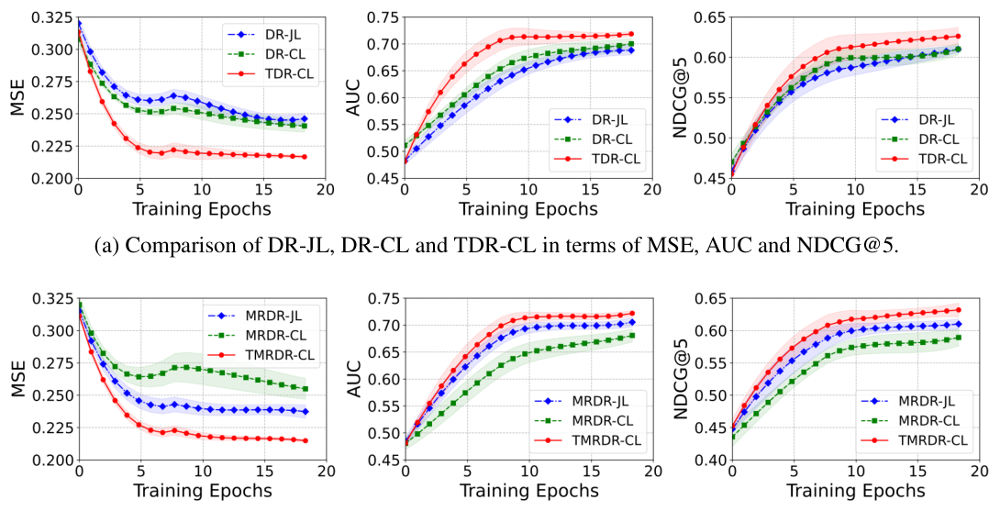
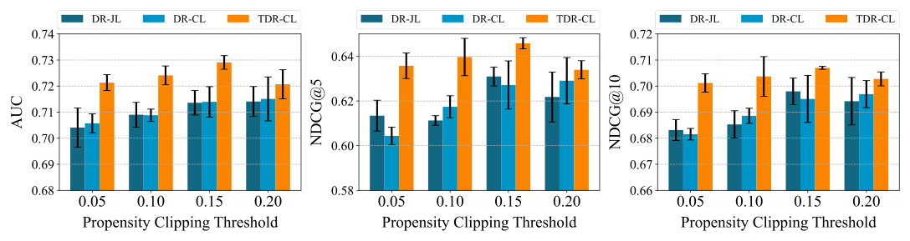

# TDR-CL: Targeted Doubly Robust Collaborative Learning for Debiased Recommendations (面向去偏推荐的靶向双重稳健协同学习)

- **会议/期刊**: ICLR 2023
- **作者与机构**: Haoxuan Li, Yan Lyu, Chunyuan Zheng, Peng Wu（北京大学 / UCSD / 北京工商大学）
- **推荐链路定位**: 精排（评分预测 / 点击反馈预估的去偏训练）
- **研究方向**: 去偏公平、可信隐私与工业架构 / 协同过滤
- **论文原文**: [https://arxiv.org/abs/2203.10258v3](https://arxiv.org/abs/2203.10258v3)
- **开源代码**: 暂未开源（论文声明代码在补充材料中）

## TL;DR (1分钟核心速览)

DR（双重稳健）估计器虽具备双稳健性，但在倾向性 $\hat p_{u,i}$偏小时方差爆炸，且插补误差$\hat e_{u,i}$失配时偏差与泛化同时恶化。本文用靶向学习（targeted learning）对插补误差做单参数扩展$\tilde e=\hat e+\eta(1/\hat p-1)$，强制校正项经验均值为 0，从而**同时**降偏差与方差；再提出免 uniform 数据的半参数协同学习 TDR-CL，把误差拆为参数化$g_\phi$与非参数$\omega$ 协同更新。在 Coat / Music 的 MAR 测试集（含 AUC、NDCG@5/10）上相对 DR-JL、MRDR-CL 提升 NDCG@5 约 1.5%–6.0%，半合成数据上 RE 降至 DR 的 1/3。

## Background & Motivation (背景与核心矛盾)

- **主流范式**: 以潜在结果框架建模 $E(r_{u,i}(1)|x_{u,i})$，用 IPS / SNIPS / EIB / DR 及其变体（DR-JL、MRDR、DR-MSE）逼近理想损失。
- **前人局限**: ① 命题 1 证明 $\mathrm{Var}(\mathcal{L}_{\text{EIB}})\le \mathrm{Var}(\mathcal{L}_{\text{DR}})\le \mathrm{Var}(\mathcal{L}_{\text{IPS}})$，$p_{u,i}\to0$时 DR 方差发散；② 实践中$\hat e$与$\hat p$ 常双双失配，DR 会同时吃到"大偏差 + 差泛化"，此时甚至不如 EIB。
- **核心洞察 (Key Insight)**: DR 可精确重写为 $\mathcal{L}_{\text{DR}}=\mathcal{L}_{\text{EIB}}+\text{校正项}$；校正项是"降偏差"的功臣，也是"抬方差"的元凶。若能让校正项的经验均值恰为 0，则 EIB 的小偏差与 DR 的小方差可同时获得。
- **本文切入点**: 不把该等式当硬约束（会压缩插补模型假设空间），而是对已有 $\hat e$ 做一步"靶向"线性修正，使其自然满足归零条件。

## Method (核心方法设计)

### 1. 整体框架 (Overall Architecture)

模型以 MF 为基座：用户/物品嵌入拼接得 $x_{u,i}$，分别送入预测模型$f_\theta$、误差插补模型$g_\phi$与倾向性模型$p_\xi$（logistic 回归初始化，摆脱 Naive Bayes 对 uniform 数据的需求）。训练采用交替式协同循环：先按 TDR 损失 + 倾向性 BCE 更新$\theta,\xi$；再在曝光样本上更新$\phi$；最后执行一步靶向，用闭式最小二乘解$\eta^*$累加到非参数项$\omega_{u,i}$。推理只需$f_\theta$ 一次打分，倾向性仅训练期使用，服务开销与普通 MF 相同。

### 2. 关键设计拆解 (Key Designs)

1. **靶向双重稳健估计器 (TDR)**：先看 DR 的分解 $\mathcal{L}_{\text{DR}}=\mathcal{L}_{\text{EIB}}+\frac{1}{|\mathcal{D}|}\sum o_{u,i}(e_{u,i}-\hat e_{u,i})\frac{1-\hat p_{u,i}}{\hat p_{u,i}}$。取单参数扩展$\tilde e_{u,i}(\eta)=\hat e_{u,i}+\eta(1/\hat p_{u,i}-1)$，在曝光事件上最小化$\sum o_{u,i}(e_{u,i}-\tilde e_{u,i}(\eta))^2$得$\eta^*$，再代入$\mathcal{L}_{\text{TDR}}=|\mathcal{D}|^{-1}\sum[\tilde e_{u,i}+o_{u,i}(e_{u,i}-\tilde e_{u,i})/\hat p_{u,i}]$。直觉：$1/\hat p-1$正是校正项的方向向量，沿此方向最小二乘即令校正项经验均值为 0（定理 1 validity），故 TDR 可视作 EIB，继承低方差与小倾向鲁棒；且当$\hat e$本已合格时$\eta^*\to0$（preservation），"无害"。定理 2 进一步保证：只要$\hat p$准，即便$\hat e$ 有偏（此时 EIB 有偏），TDR 仍无偏。
2. **半参数协同学习 (TDR-CL)**：令 $\tilde e_{u,i}=g_\phi(x_{u,i})+\omega_{u,i}$，参数项负责可泛化的全局拟合，非参数项$\omega$逐轮累加$\eta^*(1/\hat p_{u,i}-1)$修正其残差——前者管偏差、后者管残差。关键细节是用$\bot$算子阻断$\omega$对$\theta$的梯度（$\nabla_\theta\bot(f_\theta)=0$），否则预测模型会把误差"自我实现"式吸收，靶向失效。总损失为$\mathcal{L}_{\text{TDR-CL}}(\theta,\xi,\phi)=\mathcal{L}_{\text{TDR}}+\frac{1}{|\mathcal{D}|}\sum[-o\log\hat p-(1-o)\log(1-\hat p)]$。
3. **训练目标、负采样与推理效率**：插补模型损失 $\mathcal{L}_e=|\mathcal{D}|^{-1}\sum o_{u,i}(\tilde e_{u,i}-e_{u,i})^2/\hat p_{u,i}$；交替更新（预测/倾向若干步、插补+靶向若干步）而非联合反传，避免$\hat e$与$f_\theta$共谋。**免负采样**：全部在$|\mathcal{D}|$全库对上做 IPS 加权，无采样偏差；靶向步为闭式一维线搜索，单轮开销仅$O(|\mathcal{D}|)$ 的向量内积。

## Experimental Setup & Evaluation Protocol (实验设置与评估协议)

| 数据集 | #Users | #Items | #Interactions | 稀疏度/密度 | 特征/场景说明 |
| :--- | :---: | :---: | :---: | :---: | :--- |
| ML-100K (半合成) | 943 | 1,682 | 100,000 | 6.3% | MNAR 评分，MF 补全后按 $p_{u,i}=p_{\max}(1,5-R_{u,i})^\alpha$ 再伯努利采样 |
| ML-1M (半合成) | 6,040 | 3,952 | 1,000,209 | 4.2% | 同上，规模更大 |
| Coat | 290 | 300 | 4,640 MAR + 6,960 MNAR | 5.3% | 含 MAR 测试集的购物场景 |
| Music | 15,400 | 1,000 | 54,000 MAR + 311,704 MNAR | 0.35% | 含 MAR 测试集的音乐评分 |

- **数据划分与防穿越**: 半合成与真实实验均采用**给定的 MAR 测试集**评估（Coat/Music 自带 MAR 划分），训练仅用 MNAR 曝光数据，评估时用 MAR 标签，从而将"训练分布 ≠ 测试分布"的偏差暴露出来。
- **排名评测协议**: `Full-Ranking`（对 MAR 测试集内全部未交互物品排序），额外报告 MSE 与 AUC；半合成实验以**相对误差 RE**$=\frac{|\mathcal{L}_{\text{ideal}}-\mathcal{L}_{\text{est}}|}{\mathcal{L}_{\text{ideal}}}$衡量估计精度，重复采样 20 次，配对 t 检验$p\le0.001$。
- **对比基线与超参**: 基座统一为 MF（维度按原文附录 D）；对比 Base、IPS、SNIPS、IPS-AT、CVIB、DIB、DR、DR-JL、DR-CL、MRDR-JL、MRDR-CL，以及 TDR 的单步版（$^*$）与协同版（$^\dagger$）。倾向性用裁剪阈值调节，最优裁剪阈值 0.15。

## Key Experimental Results (实验关键数据)

### 1. 主实验对比 (Main Results)

| Method | Coat MSE↓ | Coat AUC↑ | Coat N@5↑ | Coat N@10↑ | Music MSE↓ | Music AUC↑ | Music N@5↑ | Music N@10↑ |
| :--- | :---: | :---: | :---: | :---: | :---: | :---: | :---: | :---: |
| Base (MF) | 0.2448 | 0.7047 | 0.5912 | 0.6667 | 0.2494 | 0.6795 | 0.6353 | 0.7644 |
| + IPS | 0.2389 | 0.7041 | 0.6170 | 0.6852 | 0.2496 | 0.6824 | 0.6409 | 0.7674 |
| + IPS-AT | 0.2344 | 0.7320 | 0.6102 | 0.6784 | 0.2480 | 0.6816 | 0.6409 | 0.7667 |
| + CVIB | 0.2201 | 0.7234 | 0.6221 | 0.6991 | 0.2638 | 0.6823 | 0.6483 | 0.7719 |
| + DR | 0.2359 | 0.7031 | 0.6213 | 0.6967 | 0.2420 | 0.6867 | 0.6613 | 0.7791 |
| + DR-JL | 0.2352 | 0.7155 | 0.6183 | 0.6925 | 0.2496 | 0.6853 | 0.6536 | 0.7738 |
| + MRDR-CL | 0.2155 | 0.7200 | 0.6427 | 0.7047 | 0.2494 | 0.6805 | 0.6345 | 0.7623 |
| **TDR$^*$** | 0.2268 | 0.7109 | 0.6300 | 0.7006 | **0.2115** | 0.7044 | **0.7008** | **0.8016** |
| **TDR-CL$^\dagger$** | **0.2119** | **0.7339** | **0.6526** | **0.7112** | 0.2472 | 0.7057 | 0.6758 | 0.7871 |
| **TMRDR-CL$^\dagger$** | **0.2114** | 0.7316 | 0.6428 | 0.7088 | 0.2473 | **0.7060** | 0.6803 | 0.7902 |
| **Improv.** | -1.9% | +0.26% | +1.54% | +0.92% | -12.6% | +2.8% | +5.97% | +2.89% |

（Improv. 相对各数据集最强 DR 家族基线：Coat 对 MRDR-CL / IPS-AT，Music 对 DR。）

半合成 ML-100K 的相对误差（越小越好）：DR 在 ONE/THREE/FIVE/ROTATE/SKEW/CRS 上为 0.0140 / 0.0180 / 0.0150 / 0.0401 / 0.0101 / 0.0237，TDR 降至 **0.0053 / 0.0035 / 0.0066 / 0.0325 / 0.0029 / 0.0193**（全部 $p\le0.001$），且标准差显著低于 IPS/DR，与命题 1 一致；EIB 的 RE 高达 0.54–0.62，甚至劣于 Naive。

### 2. 消融实验 (Ablation Study)

| 变体 | Coat AUC | Coat N@5 | Coat N@10 | Music AUC | Music N@5 |
| :--- | :---: | :---: | :---: | :---: | :---: |
| DR-JL（无协同、无靶向） | 0.7155 | 0.6183 | 0.6925 | 0.6853 | 0.6536 |
| DR-CL（有协同、无靶向） | 0.7183 | 0.6261 | 0.6927 | 0.6808 | 0.6334 |
| TDR-JL（有靶向、无协同） | 0.7236 | 0.6388 | 0.7047 | 0.7036 | 0.6786 |
| **TDR-CL（协同+靶向）** | **0.7339** | **0.6526** | **0.7112** | **0.7057** | **0.6758** |

<figure class="paper-figure" markdown="span">
  <figcaption>图1：DR 方法（上）和 MRDR 方法（下）的消融研究，其中 DR-CL 和 MRDR-CL 跳过 TDR-CL 和 TMRDR-CL 中的目标化步骤。</figcaption>
</figure>

### 3. 关键实验发现 (Key Findings)

1. **增益来自靶向项而非额外参数**：DR-CL 与 DR-JL 在 Coat 上 AUC 仅差 +0.28pt（0.7183 vs 0.7155），说明"只加协同、不加靶向"几乎无效；而 TDR-JL 一步靶向即把 AUC 从 0.7155 抬到 0.7236，TDR-CL 再叠加协同到 0.7339——增量全部由非参数残差项 $\omega$ 贡献。
2. **单步靶向已足够，协同进一步降 MSE**：Music 上 TDR$^*$ 一次性靶向就把 N@10 从 DR 的 0.7791 拉到 0.8016（+2.9%）、MSE 降 12.6%；但协同版 TDR-CL 在 Music 的 MSE（0.2472 vs 0.2115）反而不如单步版，说明协同循环对稀疏度极高（0.35%）的场景存在过拟合风险。
3. **对倾向性裁剪稳定但需调参**：图 2 显示裁剪阈值从 0.05 扫到 0.3，TDR-CL 的 AUC / N@5 / N@10 曲线始终高于 DR-JL、DR-CL，最优阈值约 0.15——即"信息利用 vs 小倾向鲁棒"的最佳折中，阈值过低会让 $1/\hat p-1$ 爆炸。

<figure class="paper-figure" markdown="span">
  <figcaption>图2：在不同倾向性裁剪阈值水平下，在 MAR 测试集上的学习性能：AUC（左）、NDCG@5（中）和 NDCG@10（右）。</figcaption>
</figure>

## Highlights & Limitations (亮点、对比与审稿批判)

- **与代表作对比 (vs. Prior Work)**: 与 DR-JL（联合学习偏差-方差折中）、MRDR（多任务 DR）相比，本文不追求"更好的折中曲线"，而是用靶向约束把校正项归零，理论上**同时**降低偏差与方差；与依赖额外 uniform 数据的一类 DR 工作（Chen et al. 2021 等）相比，TDR-CL 完全免 uniform 数据，仅靠 logistic 倾向模型即可闭环，工程成本更低。
- **可迁移亮点**: ① "把估计器分解为 EIB + 校正项，再用一步线搜索令校正项经验均值为 0"这一靶向模板可直接搬到 IPS 型纠偏的 CTR/CVR 与列表排序损失；② $\bot$ 阻断梯度防止非参数修正项被主模型吸收的技巧，可用于任何"主模型 + 残差修正器"的交替训练架构。
- **审稿级局限批判**: ① 真实实验仍停留在 MF + 评分预测，未验证在工业级深度 CTR 模型（DCN/多任务）与千万级候选上的可扩展性，且 Collaborative 循环需多轮交替，训练成本约为单步靶向的 2–3 倍；② Music 上协同版 MSE 反而回退、且全篇仅有 Coat/Music 两个 MAR 基准，缺乏时序切分与冷启动场景下的评估，泛化结论偏窄。

## Rating (四维评分)

- **方法创新性 (Novelty)**: ⭐⭐⭐⭐ （把因果推断中的 targeted learning 首次引入去偏推荐，并以命题 1/定理 1-2 给出偏差-方差双重保证，机制干净且模型无关）
- **评估协议与实验扎实度 (Protocol & Experiments)**: ⭐⭐⭐ （半合成 6 种失配矩阵 + 真实 MAR 全库排序 + 显著性检验齐备，但仅 2 个真实数据集、无时序/冷启动切分）
- **写作与数学规范度 (Clarity & Rigor)**: ⭐⭐⭐⭐ （DR 与 EIB 的等价重写与 $\eta^*$ 闭式解推导清晰，附录给全证明；协同循环的梯度阻断解释到位）
- **工业落地与复现价值 (Industrial & Practical Value)**: ⭐⭐⭐ （免 uniform 数据、推理零额外开销是加分项，但代码未正式开源、交替训练与倾向裁剪阈值需线上调参）

