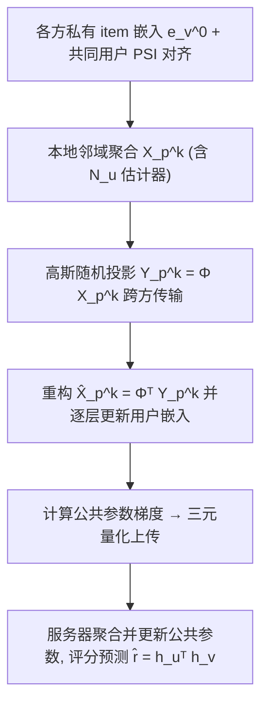
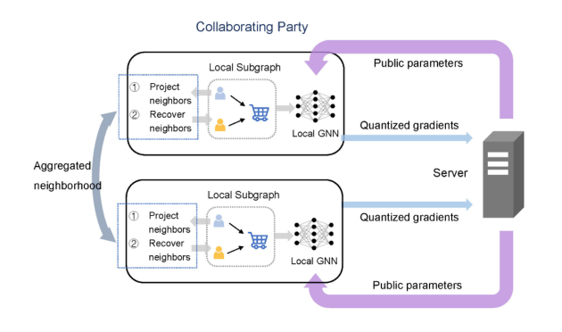

# Vertical Federated Graph Neural Network for Recommender System (面向推荐系统的纵向联邦图神经网络)

- **会议/期刊**: ICML 2023 (PMLR 202)
- **作者与机构**: Peihua Mai, Yan Pang (新加坡国立大学 分析与运营系)
- **推荐链路定位**: 召回 / 表征学习 (基于 ID Embedding 的评分预测)
- **研究方向**: 去偏公平、可信隐私与工业架构 / 图神经网络与知识图谱推荐
- **论文原文**: [https://arxiv.org/abs/2303.05786v3](https://arxiv.org/abs/2303.05786v3)
- **开源代码**: [https://github.com/maiph123/VerticalGNN](https://github.com/maiph123/VerticalGNN)

## TL;DR (1分钟核心速览)

多方推荐场景下（同一批用户、互不重叠的商品），GNN 的高阶邻域传播必须跨机构进行，但直接交换邻居 item 表征会泄露用户交互史。本文提出首个**纵向联邦** GNN 推荐框架 VerFedGNN：各方本地聚合邻居嵌入后仅上传**随机投影降维后的聚合矩阵**，公共参数梯度则以**三元量化**机制扰动（满足 $(0,1/r)$-DP）。在 ML-1M / BookCrossing 上，RMSE 相比 MF 平均降低 4.7% / 18.7%，与集中式 GNN 差距 ≤1.8%，而去匿名攻击 F1 由 FedPerGNN 的 0.90 降至 0.02。

## Background & Motivation (背景与核心矛盾)

- **主流范式**: GNN 通过多层邻域聚合建模用户-商品高阶连通性（NGCF/LightGCN/PinSage），已成为推荐表征学习主干；联邦学习则用于缓解多方数据孤岛。
- **前人局限**: 现有联邦 GNN 代表作 FedPerGNN 只处理**横向**联邦（同商品、异用户），且依赖"匿名邻居扩展"——把其他机构的匿名用户节点并入本地子图做传播；FedSage+ 用缺失邻居生成器补全子图。二者本质上都需要**逐条**跨图个体表征。
- **核心洞察 (Key Insight)**: 泄露的根源不是"是否共享"，而是"共享的粒度"。作者构造去匿名攻击：A 方注册一批只对 B 方单个商品打分的**对抗用户**，再以 $\ell_1$距离匹配对抗用户与诚实用户的 item 嵌入，即可反推 B 方交互记录：$\hat{v}_i=\arg\min_{v'\in N_{adv}}\|e_{v'}^{0}-e_{v_i}^{0}\|_1$。只要传出**单体**嵌入，攻击就几乎必成。
- **本文切入点**: 把跨机构传输对象从"逐 item 向量"上移到"用户级邻域聚合矩阵"，再叠加随机投影与梯度量化，使泄露信息在数学上不可逆。

## Method (核心方法设计)

### 1. 整体框架 (Overall Architecture)

服务器持有全部公共参数（GNN 权重 $W^k$、层权重$a_k$）并广播随机投影矩阵的种子；各 client 私有保存本地 item 嵌入$e_v^0$。每轮：① 服务器下发公共参数 → ② 各 client 用 PSI 完成共同用户对齐后，本地计算本机构视角的邻居聚合$X_p^k$（$N\times D$矩阵）→ ③ 用共享$\Phi$投影成$Y_p^k=\Phi X_p^k$发给其他参与方 → ④ 接收方重构$\hat{X}_p^k=\Phi^{\top}Y_p^k$、按层更新用户嵌入并本地更新 item 嵌入 → ⑤ 公共参数梯度经三元量化后上传服务器聚合并更新。整体属于"本地私有 item 嵌入 + 服务器公共参数"的纵向联邦范式。

<figure class="paper-figure" markdown="span">
  <figcaption>图 1. VerFedGNN 的整体框架</figcaption>
</figure>

### 2. 关键设计拆解 (Key Designs)

1. **聚合级传输 + 度数隐隐私估计器**：痛点是把 $N_u$或个体嵌入传出去既泄露交互数量又便于匹配。本文让各方只传$\sum_{v\in N_p(u)}(\cdot)e_v^k$，并把 GCN 归一化系数中的全局度数替换为无偏估计$E_p(N_u)=\frac{\sum_i M_i}{M_p}N_u^p$，得到$E_p(n_u^k)=\sum_{v\in N_p(u)}\frac{1}{\sqrt{E_p(N_u)N_v}}e_v^k$；GAT 的注意力分母同样乘$\sum_i M_i/M_p$校正，GGNN 则退化为$1/N_u^p$ 均值。直觉：聚合量把"哪几个商品"糊成"平均兴趣方向"，攻击者面对的是欠定方程组。
2. **高斯随机投影降维（可重构 + 距离保持）**：即便聚合后，交互极稀疏的用户仍可能被反演。取 $\Phi\in\mathbb{R}^{q\times N_u}$，元素独立采样$\mathcal{N}(0,1/q)$，$q\ll N_u$；由 Theorem 5.3，当$2q\le m+1$时$\Phi$为$l$-secure，$y=\Phi x$欠定不可解；重构误差有界$\mathbb{E}_\Phi[\|\Phi^{\top}\Phi X-X\|_F^2]=\frac{m+1}{q}\|X\|_F^2$，即精度损失可控且顺带降通信。
3. **三元量化梯度扰动与部分参与估计**：高斯/Laplace 噪声尺度受高维敏感度支配，会直接扭曲梯度方向。改为 $q_i=r\,\mathrm{sign}(x_i)b_i$，$b_i\sim\text{Bernoulli}(|x_i|/r)$，保证**符号不被翻转**、期望无偏且满足$(0,1/r)$-DP；上传的仅是稀疏二值索引。当仅部分 client 参与（集合$A_t$）时，用$E(C)=\frac{\sum_i M_i}{\sum_{i\in A_t}M_i}\sum_i c_i$校正求和偏差。总损失仍为 MSE + L2 正则，无负采样（显式评分回归），推理时仅需内积$\hat{r}_{uv}=h_u^{\top}h_v$。

## Experimental Setup & Evaluation Protocol (实验设置与评估协议)

- **数据集与预处理**:

| 数据集 | #Users | #Items | #Interactions | 稀疏度/密度 | 特征/场景说明 |
| :--- | :---: | :---: | :---: | :---: | :--- |
| ML-1M | 6,040 | 3,706 | ~1,000,209 | 密度 ≈4.47% | 显式评分，按 item 不重叠切分给 $P$ 方 |
| BookCrossing | 6,000 (抽样) | 3,000 (抽样) | ~1.1M | 稀疏 | 图书评分，模拟纵向联邦子图切分 |
| Yelp (扩展) | 1,987,929 | 150,346 | 6,990,280 | 极稀疏 | 可扩展性验证 |

- **数据划分与防穿越**: 采用 60%/20%/20% 训练-验证-测试**比例划分** + 交叉验证调参，每实验重复 5 次取均值±标准差；未采用时间戳切分（评分预测任务，非时序推荐）。
- **排名评测协议**: 本文是**评分预测 (Rating Prediction)** 任务，指标为 **RMSE**，不使用 Full-Ranking / Sampled Ranking 协议，因此不存在负采样与候选集偏差问题；这也意味着结论不能直接迁移到 Top-N 排序。
- **对比基线与超参**: MF（集中式）、CentralGNN（集中式 GCN/GAT/GGNN 上界）、FedPerGNN、FedSage、FedSage+；统一 embedding 维度 $D=6$、传播层数$K=2$、lr=0.05、Adagrad、sigmoid 激活；隐私参数$r\in[2,50]$，逆降维比$N_u/q\in[1,100]$，参与率$\alpha\in[0.2,1]$。

## Key Experimental Results (实验关键数据)

### 1. 主实验对比 (Main Results)

| 方法 | Backbone | ML-1M RMSE ↓ | BookCrossing RMSE ↓ |
| :--- | :---: | :---: | :---: |
| MF | – | 0.9578 ± 0.0016 | 1.9972 ± 0.0063 |
| CentralGNN (上界) | GCN / GAT / GGNN | 0.9108 / **0.9062** / 0.9046 | 1.5820 / **1.5478** / 1.6562 |
| FedPerGNN | GCN / GAT / GGNN | 0.9282 / 0.9282 / 0.9236 | 1.6892 / 1.6256 / 1.6962 |
| FedSage | GCN / GAT / GGNN | 0.9268 / 0.9242 / 0.9268 | 1.6916 / 1.6256 / 2.6596 |
| FedSage+ | GCN / GAT / GGNN | 0.9194 / 0.9146 / 0.9180 | 1.6335 / 1.6078 / 1.8788 |
| **VerFedGNN** | GCN / GAT / GGNN | 0.9152 / 0.9146 / **0.9076** | 1.5906 / 1.5830 / 1.6962 |
| Improv. vs MF | – | **+4.7%** (均值) | **+18.7%** (均值) |
| 与 CentralGNN 差距 | – | ≤1.8% | ≤1.8% |

### 2. 消融与鲁棒性实验 (Ablation & Sensitivity)

| 移除/替换组件 | 配置 | ML-1M | BookCrossing | 结论 |
| :--- | :--- | :---: | :---: | :--- |
| w/o 随机投影（攻击 F1） | GCN / GGNN | 0.0150 / 0.0228 | 0.0127 / 0.0305 | 投影为主要隐私来源 |
| w/ 随机投影（攻击 F1） | GCN / GGNN | **0.0132 / 0.0160** | **0.0037 / 0.0044** | BookCrossing F1 降 >70% |
| 三元量化 → Laplace ($\epsilon=1$) | GCN / GAT / GGNN | 0.9594 / 0.9318 / 0.9304 | 1.7360 / 1.6936 / 1.7042 | 量化显著优于加噪 |
| 三元量化（本文） | GCN / GAT / GGNN | **0.9152 / 0.9146 / 0.9076** | **1.5906 / 1.5830 / 1.6962** | 精度几乎无损 |
| 参与率 $\alpha=0.5$ | GCN | 差距 ≤0.15% | 差距 ≤0.7% | 部分参与可接受 |
| 逆降维比 $N_u/q=100$ | GCN / GAT | +0.5% | +1.5% | 强降维仍稳健 |

### 3. 关键实验发现 (Key Findings)

1. **隐私收益几乎"免费"**：VerFedGNN 在 ML-1M 上 RMSE 0.9076 反超部分 FedSage+ 配置（0.9180），与集中式 GAT 差距仅 0.9%；而同一 GCN 骨干下攻击 F1 从 FedPerGNN 的 **0.90（$p_{ad}=0.8$）** 骤降至 **0.02**，说明"聚合级传输"才是隐私-精度权衡的杠杆点，而非加噪幅度。
2. **量化优于经典 DP 加噪**：同等隐私强度下，Laplace 机制使 GCN 的 RMSE 从 0.9152 恶化到 0.9594（ML-1M）、1.5906 → 1.7360（BookCrossing），而三元量化只翻转幅度不翻转符号，保住了梯度方向，是高维 GNN 参数更合适的扰动算子。
3. **通信与精度可解耦**：取 $q=N_u/5$配合量化，单轮通信比特数下降 **50.6%**；当$N_u/q\ge4$ 时量化额外节省 >30%。Yelp 规模（699 万评分）上 RMSE 1.312 vs 集中式 1.302、MF 1.41，单 epoch 客户端 18s / 服务器 5s，说明框架在百万级用户上仍可跑通，但通信时间（89s/轮）是真实瓶颈。

## Highlights & Limitations (亮点、对比与审稿批判)

- **与代表作对比 (vs. Prior Work)**: FedPerGNN 走**横向**联邦 + 匿名邻居扩展，必须传个体嵌入，因此本文的攻击对其 F1 高达 0.90；FedSage+ 走缺失邻居**生成**，攻击 F1 降到 0.05–0.14 但 BookCrossing 精度严重退化（GGNN 1.8788）。VerFedGNN 首次处理**纵向**联邦（同用户、异商品）这一更贴近"多平台同一用户"的工业形态，并同时提供隐私、效用与通信三方面理论界。
- **可迁移亮点**: ①"上传聚合量而非个体量 + 无偏度数估计器"可迁移到任何需要跨域传邻居信息的场景（跨域序列推荐、多场景图召回）；②三元量化（保号 + 稀疏索引）可作为高维嵌入梯度上传的通用轻量 DP 方案。
- **审稿级局限批判**: 第一，评测仅用 RMSE 的**评分预测**协议，未做 Full-Ranking / Top-N 排序，也未检验排序质量与流行度偏差，与当下推荐主流评测脱节；第二，维度 $D=6$、层数$K=2$异常小，缺少对深层传播、$D$增大后隐私-精度曲线的讨论；第三，通信成本随用户数$N_u$ 线性增长（Yelp 上 660.9 MB/方/轮），论文仅提出"每轮采样 1/20 用户"的设想而未做实验，实际部署仍需用户采样与异步机制。

## Rating (四维评分)

- **方法创新性 (Novelty)**: ⭐⭐⭐⭐ （首个纵向联邦 GNN 推荐框架，"聚合级传输 + 随机投影 + 保号量化"组合新颖，且有 $l$-secure、重构 MSE 界、$(0,1/r)$-DP 与收敛性四重理论支撑）
- **评估协议与实验扎实度 (Protocol & Experiments)**: ⭐⭐⭐ （对比基线充分、攻击模拟与超参敏感性完整，但仅有 RMSE 评分预测、无 Top-N 排序协议、无显著性检验，$D=6$ 的设定偏弱）
- **写作与数学规范度 (Clarity & Rigor)**: ⭐⭐⭐⭐ （三类 GNN 的聚合式改写逐条给出，隐私/效用/通信分析闭环，附录给出 NP-hard 归约与收敛证明；但主文与附录符号偶有混用，重构图示略简）
- **工业落地与复现价值 (Industrial & Practical Value)**: ⭐⭐⭐ （代码已开源、Yelp 级规模可跑通，但每轮数百 MB 通信与全用户同步开销较大，缺乏用户采样实验与端到端延迟优化，距线上部署仍有距离）

