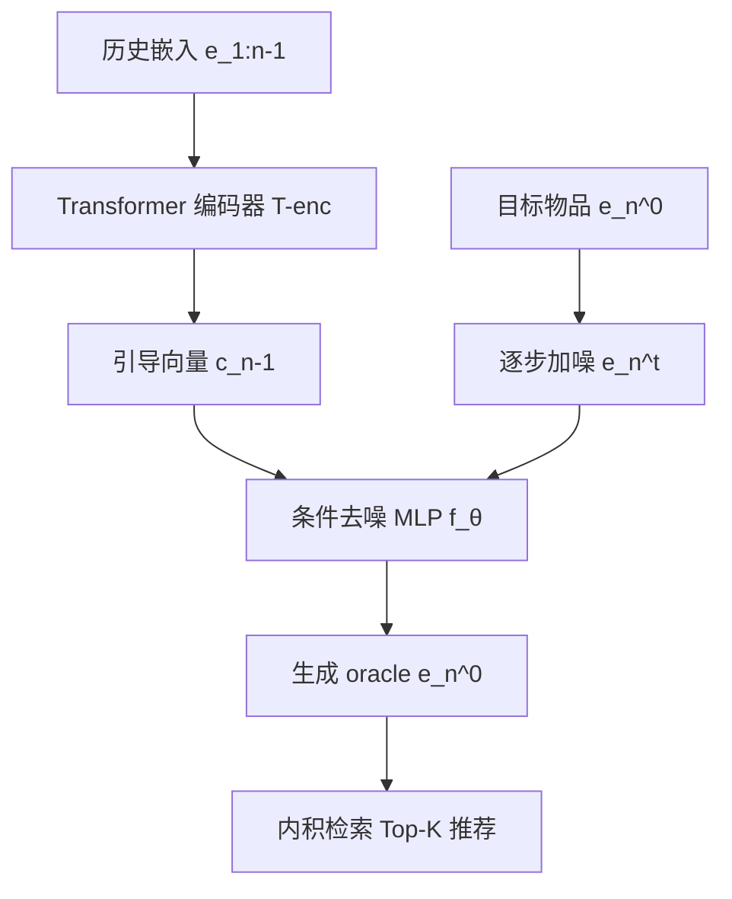
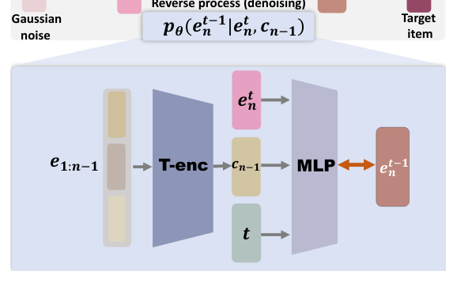
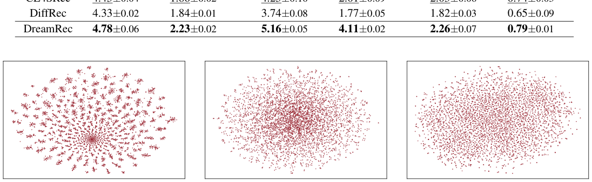

# Generate What You Prefer: Reshaping Sequential Recommendation via Guided Diffusion (通过引导扩散重塑序列推荐：生成你所偏好之物)

- **会议/期刊**: NeurIPS 2023
- **作者与机构**: Zhengyi Yang, Jiancan Wu, Zhicai Wang, Yancheng Yuan, Xiang Wang, Xiangnan He（中国科学技术大学 / 香港理工大学）
- **推荐链路定位**: 端到端生成式（Next-Item 检索）
- **研究方向**: 生成式推荐与语义ID / 序列与会话推荐
- **论文原文**: [论文原文链接](https://arxiv.org/abs/2310.20453v1)
- **开源代码**: [开源代码仓库链接](https://github.com/YangZhengyi98/DreamRec)

## TL;DR (1分钟核心速览)

现有序列推荐几乎都遵循「学习分类」范式：给定正样本做负采样，再训练分类器区分偏好。作者指出其两处硬伤：用户在脑中先构想一个"理想物品 (oracle item)"再从候选集折中挑选，分类式建模偏离此过程；且负采样候选池小、易/难负例含噪，稀释了对 oracle 的偏好信号。本文把 生成建模为条件，用 Transformer 编码历史 + 无分类器引导扩散直接生成 oracle 物品嵌入，训练全程无需负采样。在 YooChoose/KuaiRec/Zhihu 三数据集上，HR@20 相对最优基线提升 7%–21%，KuaiRec 的 NDCG@20 更翻倍（2.01→4.11）。

## Background & Motivation (背景与核心矛盾)

- **主流范式**: 以 GRU4Rec/SASRec/Caser 为代表，均为「学习分类」——编码历史序列后，把正例与采样负例做 softmax/BCE 二分类，用分类边界刻画用户偏好。
- **前人局限**: (1) 候选集有限的分类无法建模"理想物品"，语义上偏离用户先构思后折中的真实行为；(2) 负例质量不可控——过易负例监督不足、过难负例易成假阴性注入噪声，且嵌入空间被压在局部区域。
- **核心洞察 (Key Insight)**: 若假设观测物品与 oracle 物品同源于一个潜在数据生成分布 $p_\theta(\mathbf{e}_n|\mathbf{e}_{1:n-1})$，则可直接生成软性代表偏好的 oracle，绕开一分类问题与负采样。
- **本文切入点**: 用扩散模型直接学习该条件生成分布，并以历史序列作为引导，使生成个性化。

## Method (核心方法设计)

### 1. 整体框架 (Overall Architecture)

给定历史嵌入序列 $\mathbf{e}_{1:n-1}$，先用 Transformer 编码器 T-enc 生成引导向量$\mathbf{c}_{n-1}$；训练阶段对目标物品$\mathbf{e}_n^0$逐步加高斯噪声得$\mathbf{e}_n^t$，再让 MLP 去噪器在网络预测目标$\mathbf{e}_n^0$（而非噪声$\epsilon$）的条件下回归；生成阶段（推理）从纯高斯噪声$\mathbf{e}_n^T$出发，经$T$ 步条件去噪得到 oracle 嵌入，最后用内积在候选集检索 Top-K。

<figure class="paper-figure" markdown="span">
  <figcaption>图 2：DreamRec 的框架。为实现个性化去噪，DreamRec 使用 Transformer 编码器 T-enc 将历史交互 e1:n−1 编码为引导信号 cn−1，随后利用 cn−1 引导逆向过程。</figcaption>
</figure>

### 2. 关键设计拆解 (Key Designs)

1. **历史引导的条件扩散 (History-Guided Diffusion)**：原始 DDPM 去噪无条件，生成物品不个性化。作者以 $\mathbf{c}_{n-1}=\text{T-enc}(\mathbf{e}_{1:n-1})$为条件改写反向转移$p_\theta(\mathbf{e}_n^{t-1}|\mathbf{e}_n^t,\mathbf{c}_{n-1})$，将 DDPM 的 KL 下界重参数化为预测$\mathbf{e}_n^0$ 的回归：
$\mathcal{L}_{t-1}=\mathbb{E}_{\mathbf{e}_n^0,\boldsymbol{\epsilon}}\!\left[\frac{\bar{\alpha}_{t-1}}{2\tilde{\beta}_t}\left\|\mathbf{e}_n^0-f_\theta(\sqrt{\bar{\alpha}_t}\mathbf{e}_n^0+\sqrt{1-\bar{\alpha}_t}\boldsymbol{\epsilon},\mathbf{c}_{n-1},t)\right\|^2\right]$
该目标仅需恢复序列内的真实目标物品，**天然免去负采样**，直接建模偏好生成分布。

2. **无分类器引导 (Classifier-Free Guidance)**：为摆脱额外训练无条件模型的开销，训练时以概率 $p_u$将$\mathbf{c}_{n-1}$替换为占位符$\Phi$，使同一个网络兼顾条件/无条件；推理时用$\tilde f_\theta=(1+w)f_\theta(\mathbf{e}_n^t,\mathbf{c}_{n-1},t)-w f_\theta(\mathbf{e}_n^t,\Phi,t)$调节引导强度$w$——$w$ 过小个性化不足、过大则损害扩散泛化质量。该技巧把"个性化程度"变为可调旋钮，是本文工程价值的关键。

3. **训练目标与推理开销**：总损失即各步 $\mathcal{L}_{t-1}$之和，负采样策略为**免负采样**；推理需$T$步完整去噪（本文$T$ 搜索至 50–2000），单序列生成较分类式模型慢，作者在结论中亦承认慢采样与训练耗时是主要短板。

## Experimental Setup & Evaluation Protocol (实验设置与评估协议)

- **数据集与预处理**（统计量原文置于附录 B，此处按正文过滤规则归纳）：

| 数据集 | 场景来源 | 过滤规则 | 序列/历史 | 说明 |
| :--- | :--- | :--- | :--- | :--- |
| YooChoose | RecSys Challenge 2015 购买序列 | 物品≥5 次交互，序列≥3 | 保留最后 10 交互，短者 pad | 电商 |
| KuaiRec | 短视频 App 推荐日志 | 同上 | 同上 | 短视频 |
| Zhihu | 知识社区 Q&A 阅读 | 同上 | 同上 | 内容社区 |

- **数据划分与防穿越**: 每条序列按**时间顺序排序**后按 **8:1:1** 划分训练/验证/测试（比例划分）。
- **排名评测协议**: 记录 Top-K 指标 HR@20、NDCG@20；分类基线用 logits 选 Top-K，DreamRec 先由算法 2 生成 oracle 嵌入再在候选中做**内积检索**（K 近邻仅用于评估、不入训练）。文中未声明 Full-Ranking 或采样负例规模，**建议审稿时追问候选集是否全库**。
- **对比基线与超参**: 7 个基线（GRU4Rec、Caser、SASRec、S-IPS、AdaRanker、CL4SRec、DiffRec），嵌入维度 $d=64$，AdamW，学习率网格 [1e-2,…,5e-5]，基线统一 1:1 均匀负采样，DreamRec 设$p_u=0.1$，$T\in\{50,100,200,500,1000,2000\}$，$w\in\{0,2,4,6,8,10\}$，均 5 次取均值。

## Key Experimental Results (实验关键数据)

### 1. 主实验对比 (Main Results)

| 模型 (范式) | YooChoose HR@20 | NDCG@20 | KuaiRec HR@20 | NDCG@20 | Zhihu HR@20 | NDCG@20 |
| :--- | :---: | :---: | :---: | :---: | :---: | :---: |
| GRU4Rec (分类) | 3.89 | 1.62 | 3.32 | 1.23 | 1.78 | 0.67 |
| Caser (分类) | 4.06 | 1.88 | 2.88 | 1.07 | 1.57 | 0.59 |
| SASRec (分类) | 3.68 | 1.63 | 3.92 | 1.53 | 1.62 | 0.60 |
| S-IPS (分类去偏) | 3.81 | 1.73 | 3.73 | 1.40 | 1.66 | 0.64 |
| AdaRanker (分类) | 3.74 | 1.67 | 4.14 | 1.89 | 1.70 | 0.61 |
| CL4SRec (分类+对比) | 4.45 | 1.86 | 4.25 | 2.01 | 2.03 | 0.74 |
| DiffRec (扩散+分类) | 4.33 | 1.84 | 3.74 | 1.77 | 1.82 | 0.65 |
| **DreamRec (生成)** | **4.78** | **2.23** | **5.16** | **4.11** | **2.26** | **0.79** |
| **Improv.%** | +7.4% | +18.6% | +21.4% | +104.5% | +11.3% | +6.8% |

### 2. 消融与可视化分析 (Ablation & Visualization)

| 分析对象 | 设定/结果 | 结论 |
| :--- | :--- | :--- |
| 引导强度 $w$扫描 (图 4) |$w$从 0 增大，HR@20 先升后降，峰值约$w=4$–6 | 需权衡个性化与扩散泛化，支持"可调引导"设计 |
| 无条件概率 $p_u$ | 固定 0.1（沿用 CFG 推荐） | 影响条件/无条件平衡 |
| T-SNE (图 3，Zhihu) | SASRec 无负采样→嵌入挤在离散区；有负采样→仅占部分空间；DreamRec→覆盖大部分空间 | 生成式免负采样即可探索广阔物品空间 |

<figure class="paper-figure" markdown="span">
  <figcaption>图 3：使用 T-SNE 在 Zhihu 数据集上对学习到的物品嵌入进行可视化，其中红点表示物品。图 3a 表明，在没有负采样时，SASRec 的物品嵌入拥挤在有限的离散区域。图 3b 表明，在有负采样时，SASRec 的物品嵌入仅集中在物品空间的一部分。图 3c 表明，DreamRec 无需负采样即可探索大部分物品空间。</figcaption>
</figure>

### 3. 关键实验发现 (Key Findings)

1. **范式切换带来一致增益，且与"是否需要负采样"解耦**：DreamRec 在三个数据集全指标领先，最佳分类式基线 CL4SRec（额外对比损失）在 KuaiRec 上 NDCG@20 为 2.01，而 DreamRec 达 4.11（+104.5%），说明免负采样的生成范式在排序质量上有量级优势。
2. **扩散优于"扩散套分类"**：同为扩散的 DiffRec 在 KuaiRec 上 HR@20 仅 3.74，落后 DreamRec 1.42 个点，证明关键在于**把扩散用于生成 oracle** 而非用其加噪后仍走分类损失。
3. **引导强度是主要敏感超参**：图 4 显示 $w$过大时性能回落，说明历史引导过强会损害扩散泛化，工程上须将$w$ 作为关键调参项。

## Highlights & Limitations (亮点、对比与审稿批判)

- **与代表作对比**: 相较 SASRec/CL4SRec 等仍以分类边界定义偏好，DreamRec 直接生成软性 oracle 并据此检索，天然摆脱候选集与负例质量约束；相较 DiffRec 将扩散用于多热向量加噪，本文把扩散用作"物品生成器"，目标从分类转为分布拟合。
- **可迁移亮点**: (1) 无分类器引导把"个性化强度"做成可调旋钮 $w$，可迁移到任意条件生成式召回；(2) 用生成嵌入做近邻检索、训练与检索解耦，天然兼容 ANN 与语义 ID 场景。
- **审稿级局限批判**: (1) 推理需 $T$步完整去噪，慢采样与训练耗时是明显短板，未见推理时延/吞吐对比；(2) 评测协议未明确候选集是否 Full-Ranking、仅报 HR@20/NDCG@20，缺少采样排序下的稳健性验证，且$w$、$T$敏感性高，统计显著性检验（如$p<0.05$）缺位。

## Rating (四维评分)

- **方法创新性 (Novelty)**: ⭐⭐⭐⭐ （把序列推荐从"学习分类"重塑为"学习生成"，免负采样 + 无分类器引导的 oracle 生成思路清晰新颖，虽属扩散套用但范式转换有洞察）
- **评估协议与实验扎实度 (Protocol & Experiments)**: ⭐⭐⭐ （三数据集、7 基线覆盖全面且给出方差，但未明示 Full-Ranking/采样协议、缺显著性检验与效率分析）
- **写作与数学规范度 (Clarity & Rigor)**: ⭐⭐⭐⭐ （DDPM 推导到条件重参数化链条完整，算法 1/2 清晰，公式与直觉衔接好）
- **工业落地与复现价值 (Industrial & Practical Value)**: ⭐⭐⭐ （代码开源、思路易复现，但多步去噪推理开销大，线上部署需一致性模型/蒸馏加速）

