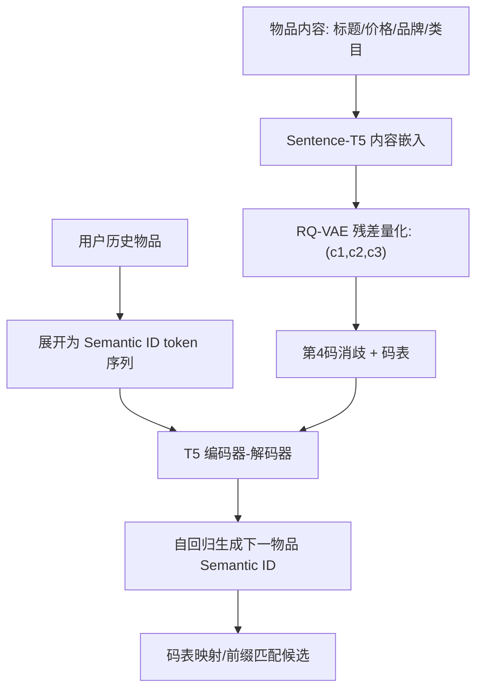
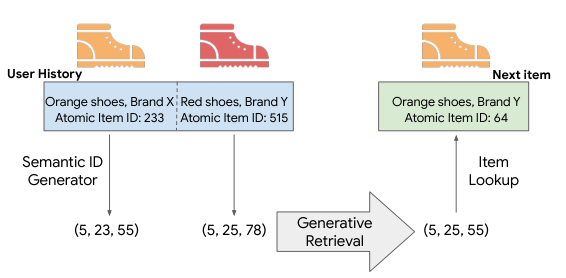

# Recommender Systems with Generative Retrieval (基于生成式检索的推荐系统)

- **会议/期刊**: NeurIPS 2023
- **作者与机构**: Shashank Rajput, Nikhil Mehta, Anima Singh 等；University of Wisconsin-Madison / Google DeepMind / Google
- **推荐链路定位**: 召回（生成式端到端）
- **研究方向**: 生成式推荐与离散语义ID / 序列与会话推荐
- **论文原文**: [论文原文链接](https://arxiv.org/abs/2305.05065v3)
- **开源代码**: 暂未开源（原文检测链接为 S3-Rec 基线代码，非 TIGER 官方实现）

## TL;DR (1分钟核心速览)

针对双塔+ANN召回依赖原子随机ID、新物品难泛化的问题，TIGER 用 RQ-VAE 将物品内容嵌入量化为层次 Semantic ID，并以 Transformer 自回归生成下一物品 ID。在 Amazon 三类的 Leave-One-Out Full-Ranking 协议下，Beauty NDCG@5 相对最佳基线提升 29.0%，并展示冷启动与温度控多样性能力。

## Background & Motivation (背景与核心矛盾)

- **主流范式**: 序列推荐多以 SASRec/BERT4Rec/S3-Rec 为代表：学习原子物品ID的高维向量，用双塔内积+ANN/MIPS 召回下一物品。
- **前人局限**: 原子随机ID不携带内容语义，新物品无交互记录时几乎无法被召回；物品嵌入表随语料线性增长，长尾与冷启动场景代价高。
- **核心洞察 (Key Insight)**: 若物品由内容语义码字表示，相似物品共享前缀码，则生成模型可在“类别/语义前缀”层面泛化，而非死记原子ID。
- **本文切入点**: 用 RQ-VAE 生成层次化 Semantic ID，把序列推荐改写为“给定历史 Semantic ID，自回归生成下一物品 Semantic ID”的生成式检索任务。

## Method (核心方法设计)

### 1. 整体框架 (Overall Architecture)

TIGER 先将物品内容（标题、价格、品牌、类目）经 Sentence-T5 编码为 768 维向量，再用三层 RQ-VAE 量化为 4 元组 Semantic ID；用户历史按时间展开为 Semantic ID token 序列，输入 T5 编码器-解码器，自回归输出下一物品码字，最后用码表还原候选。训练为逐码字交叉熵，推理用 beam search；无需构造 ANN 索引，Transformer 参数即隐式索引。

<figure class="paper-figure" markdown="span">
  <figcaption>图 1：用于生成式推荐器的 Transformer 索引（TIGER）框架概览。TIGER 将序列推荐表示为生成式检索任务，通过将每个项目表示为离散语义 token 的元组。</figcaption>
</figure>

### 2. 关键设计拆解 (Key Designs)

1. **层次化 RQ-VAE Semantic ID**：原子ID无共享，RQ-VAE 逐级量化残差：$r_0=z$，$c_d=\arg\min_k\|r_d-e_{d,k}\|_2$，$r_{d+1}=r_d-e_{d,c_d}$，得到$(c_0,\dots,c_{m-1})$。前缀对应粗粒度类目、后续码对应细粒度语义，相似物品码字重叠，因而可跨物品共享统计量并泛化到冷启动物品。
2. **生成式检索目标**：将历史序列展平为 $S_{\le n}=(c_{1,0},\dots,c_{n,m-1})$，建模$p(S_{n+1}|S_{\le n})=\prod_{j=0}^{m-1}p(c_{n+1,j}|S_{\le n},c_{n+1,<j})$。直接生成目标码字，避免 query-item 内积检索；码本空间$K^m$ 可覆盖远大于物品表的组合空间，且无需逐物品 embedding。
3. **训练目标、负采样与推理效率**：总损失为下一 Semantic ID 各码字的交叉熵，免负采样；用户ID经哈希映射到 2000 个 token 以注入个性化；碰撞时追加第 4 码消歧。推理用 beam search 并过滤非法 ID，top-10 非法率仅 0.1%–1.6%；代价是自回归解码延迟高于 ANN，但省去全库索引与线性增长的嵌入表。

## Experimental Setup & Evaluation Protocol (实验设置与评估协议)

- **数据集与预处理**: 沿用 S3-Rec 的 Amazon Product Reviews 三类目预处理（5-core 过滤）：

| 数据集 | #Users | #Items | #Interactions | 稀疏度/密度 | 特征/场景说明 |
| :--- | :---: | :---: | :---: | :---: | :--- |
| Beauty | 22,363 | 12,101 | 198,502 | 99.93% / 7.3e-4 | 美妆个护，含标题/价格/品牌/类目 |
| Sports & Outdoors | 35,598 | 18,357 | 296,337 | 99.95% / 4.5e-4 | 运动户外 |
| Toys & Games | 19,412 | 11,924 | 167,597 | 99.93% / 7.2e-4 | 玩具游戏 |

- **数据划分与防穿越 (Splitting Strategy)**: `Leave-One-Out`：每用户最后一件为测试、倒数第二件为验证、其余训练；冷启动实验额外从训练集移除 5% 测试物品，确保无泄漏。
- **排名评测协议 (Ranking Protocol)**: 无偏 `Full-Ranking`：对全库未交互物品排序，报告 Recall@5/10、NDCG@5/10。
- **对比基线与超参设置**: 对比 GRU4Rec、Caser、HGN、SASRec、BERT4Rec、FDSA、S3-Rec、P5。RQ-VAE 隐维 32、3 层码本×256、第 4 码消歧；TIGER 为 4 层编码器+4 层解码器、6 头×64 维、约 13M 参数，batch 256，lr 0.01。原文以标准误差说明稳定性，未报告显式 $p$ 值。

## Key Experimental Results (实验关键数据)

### 1. 主实验对比 (Main Results)

| 方法 | Beauty R@5 | Beauty N@5 | Sports R@5 | Sports N@5 | Toys R@5 | Toys N@5 |
| :--- | ---: | ---: | ---: | ---: | ---: | ---: |
| P5 | 0.0163 | 0.0107 | 0.0061 | 0.0041 | 0.0070 | 0.0050 |
| Caser | 0.0205 | 0.0131 | 0.0116 | 0.0072 | 0.0166 | 0.0107 |
| HGN | 0.0325 | 0.0206 | 0.0189 | 0.0120 | 0.0321 | 0.0221 |
| GRU4Rec | 0.0164 | 0.0099 | 0.0129 | 0.0086 | 0.0097 | 0.0059 |
| BERT4Rec | 0.0203 | 0.0124 | 0.0115 | 0.0075 | 0.0116 | 0.0071 |
| FDSA | 0.0267 | 0.0163 | 0.0182 | 0.0122 | 0.0228 | 0.0140 |
| SASRec | 0.0387 | 0.0249 | 0.0233 | 0.0154 | 0.0463 | 0.0306 |
| S3-Rec | 0.0387 | 0.0244 | 0.0251 | 0.0161 | 0.0443 | 0.0294 |
| **TIGER** | **0.0454** | **0.0321** | **0.0264** | **0.0181** | **0.0521** | **0.0371** |
| **Improv.%** | **+17.31** | **+29.04** | **+5.22** | **+12.55** | **+12.53** | **+21.24** |

### 2. 消融实验 (Ablation Study)

| ID 方案 | Beauty R@5 | Beauty N@5 | Sports R@5 | Sports N@5 | Toys R@5 | Toys N@5 |
| :--- | ---: | ---: | ---: | ---: | ---: | ---: |
| Random ID | 0.0296 | 0.0205 | 0.0070 | 0.0050 | 0.0362 | 0.0270 |
| LSH SID | 0.0379 | 0.0259 | 0.0215 | 0.0146 | 0.0412 | 0.0299 |
| **RQ-VAE SID** | **0.0454** | **0.0321** | **0.0264** | **0.0181** | **0.0521** | **0.0371** |

### 3. 关键实验发现 (Key Findings)

1. **语义ID是主要收益源**：Beauty 上 Random ID→RQ-VAE 的 R@5 从 0.0296 升至 0.0454（+53.4%），NDCG@5 从 0.0205 升至 0.0321（+56.6%）；LSH→RQ-VAE 再提升约 19.8%/23.9%，说明“内容可微量化”优于仅做码本化。
2. **生成式检索在内容可分场景增益最大**：Beauty NDCG@5 比 SASRec 提升 29.0%，Toys 提升 21.2%；但 Sports R@10 仅提升 3.9%，表明收益依赖内容特征对下一物品的可预测性。
3. **层次码字带来冷启动与多样性**：移除 5% 测试物品后，$\epsilon=0.1$ 的 TIGER 在 Recall@K 上仍优于 Semantic_KNN；温度从 1.0 升至 2.0，Entropy@10 由 0.76 升至 1.38、Entropy@50 由 1.70 升至 2.28，同时 top-10 非法 ID 仅 0.1%–1.6%。

## Highlights & Limitations (亮点、对比与审稿批判)

- **与代表作对比 (vs. Prior Work)**: SASRec/S3-Rec 仍以原子ID+ANN/MIPS 做判别式召回；P5 将物品随机ID交给 LLM tokenizer，语义弱且码字不可解释；VQ-Rec 用内容码但未做生成式检索。TIGER 的本质差异是“层次语义ID + 端到端生成式索引”。
- **可迁移亮点**: 语义ID前缀可直接用于冷启动物品前缀召回；在码字层级做温度采样可分别控制粗类目与细类目多样性；碰撞消歧码是低成本工程技巧。
- **审稿级局限批判**: 其一，Semantic ID 强依赖内容编码器与码本质量，弱内容/多模态物品上可能退化；其二，自回归 beam search 的线上延迟与大语料扩展性未验证，且仅三类 Amazon 离线 Full-Ranking，缺少 A/B 与更大规模工业评测。

## Rating (四维评分)

- **方法创新性 (Novelty)**: ⭐⭐⭐⭐⭐ （首次把 RQ-VAE 层次语义ID与生成式检索端到端结合到序列推荐，范式新颖）
- **评估协议与实验扎实度 (Protocol & Experiments)**: ⭐⭐⭐⭐ （三类 Amazon Full-Ranking、8 个基线、消融与冷启动/多样性分析完整，但缺线上验证）
- **写作与数学规范度 (Clarity & Rigor)**: ⭐⭐⭐⭐⭐ （RQ-VAE 量化、生成目标与码表消歧定义清晰，复杂度与非法ID讨论充分）
- **工业落地与复现价值 (Industrial & Practical Value)**: ⭐⭐⭐⭐ （省去 ANN 索引与线性物品表，语义前缀利于冷启动；但自回归推理延迟与码本维护仍需工程权衡）

