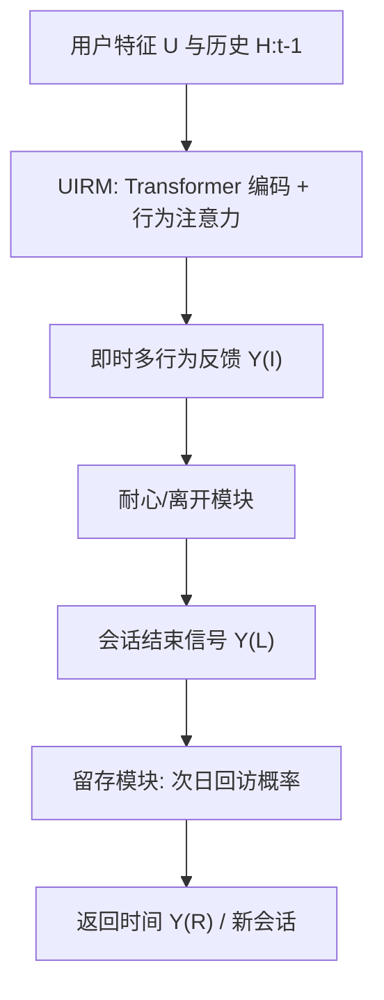
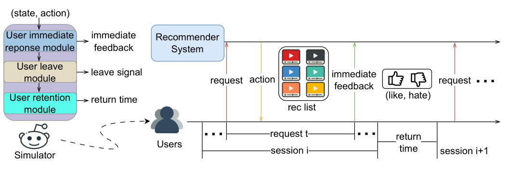

# KuaiSim: A Comprehensive Simulator for Recommender Systems (面向推荐系统的综合用户模拟器)

- **会议/期刊**: NeurIPS 2023
- **作者与机构**: Kesen Zhao, Shuchang Liu, Qingpeng Cai, Xiangyu Zhao, Ziru Liu, Dong Zheng, Peng Jiang, Kun Gai；香港城市大学、快手
- **推荐链路定位**: 重排/端到端 RL 策略训练与仿真评估（请求级列表、整会话、跨会话留存）
- **研究方向**: 强化学习与动态探索推荐 / 序列与会话推荐
- **论文原文**: [https://arxiv.org/abs/2309.12645v2](https://arxiv.org/abs/2309.12645v2)
- **开源代码**: [https://github.com/Applied-Machine-Learning-Lab/KuaiSim](https://github.com/Applied-Machine-Learning-Lab/KuaiSim)

## TL;DR (1分钟核心速览)

针对 RL 推荐器在线 A/B 成本高、离线反事实评估缺失、现有模拟器仅支持单行为/单任务的问题，KuaiSim 用“即时多行为响应 + 用户离开 + 跨会话留存”三模块构建统一用户环境，支持请求级列表重排、整会话序列决策与跨会话留存优化。在 KuaiRand-Pure/ML-1m 上以模拟 rollout、5 次重复评估，KuaiSim 的 AUC 0.7234、整会话平均奖励 0.679、总奖励 10.081，显著优于 RL4RS/RecSim 等；跨会话 RLUR 取得 return day 3.481、retention 0.607 的基准最优。

## Background & Motivation (背景与核心矛盾)

- **主流范式**: 将推荐建模为 agent 与用户的多轮 MDP，用 RL 最大化点击、观看、留存等长期收益；但直接在线训练风险高，模拟器成为预上线验证的替代方案。
- **前人局限**: RecoGym/RecSim 多为规则驱动或单一点击反馈；RL4RS/VirtualTaobao 虽用真实日志，却缺少多行为、离开信号与跨会话留存，且难以迁移到新数据。
- **核心洞察**: 真实推荐反馈是分层的：请求内有多行为即时反馈，会话内有耐心衰减与离开，会话间有返回时间/留存；三者共同决定 DAU 类长期指标。
- **本文切入点**: 用日志预训练用户即时响应模型，再以“耐心因子 + 几何分布回访”衔接会话内外，形成可配置、可迁移的三级模拟器与基准。

## Method (核心方法设计)

### 1. 整体框架 (Overall Architecture)

输入用户静态特征 $U$与历史$H_{:t-1}$，系统在候选集$C$上输出长度为$K$的列表$A_t\in C^K$。UIRM 先用 Transformer 编码历史，拼接用户特征得到隐状态$s_t$，再经行为注意力生成多行为即时反馈；离开模块把即时奖励转化为耐心消耗，决定是否结束会话；留存模块在会话结束时预测次日回访概率并采样返回时间，随后采样新用户或开启新会话。

<figure class="paper-figure" markdown="span">
  <figcaption>图1：模拟器的工作流程与用户-系统交互的常见MDP设置。</figcaption>
</figure>

### 2. 关键设计拆解 (Key Designs)

1. **多行为即时响应 UIRM（从单一点击到行为向量）**：痛点是对点击、点赞、转发、讨厌等联合建模不足。核心算子为 $p(y|s_t)=w_t\odot A_t-\rho\,\mathrm{item\_correlation}(A_t)$，其中$w_t=\mathrm{DNN}(s_t)$给每个物品的行为倾向，第二项惩罚列表内高相关物品以模拟多样性需求；再用各行为 BCE 预训练：$\mathcal{L}_{\mathrm{UIRM}}=\sum_b \mathrm{BCE}(\hat y_b,y_b)$。直觉是“行为注意力 + 列表相关性惩罚”同时刻画偏好与列表级互补性。
2. **耐心离开与几何留存（把会话边界变成可学习信号）**：痛点在于现有模拟器不会自然结束会话。KuaiSim 维护耐心值，$\text{temper}_{t+1}=\text{temper}_t-r_t$，当$\text{temper}_{t+1}\le T$时$Y_t^{(L)}=1$；留存侧令$p_{\mathrm{ret}}=b_u+\lambda_1 r_t+\lambda_2 b$，$Y^{(R)}\sim\mathrm{Geometric}(p_{\mathrm{ret}})$，分别刻画用户活跃度、推荐满意度和全局回访偏置。
3. **训练目标、负采样与推理开销**：模拟器本身以日志监督预训练 UIRM，不依赖额外负采样；RL 基线在各自动作空间内采样列表。在线模拟每步需一次 Transformer 历史编码与行为打分，开销随会话长度和列表大小 $K$线性增长；返回时间限制在$1\ldots D$天，论文设$D=10$。

## Experimental Setup & Evaluation Protocol (实验设置与评估协议)

- **数据集与预处理**: KuaiRand-Pure 做 50-core 过滤，按天切分会话；ML-1m 将评分 $>3$ 视为 like。

| 数据集 | #Users | #Items | #Interactions | #Sessions | 稀疏度/说明 |
| :--- | :---: | :---: | :---: | :---: | :--- |
| KuaiRand-Pure | 27,077 | 7,551 | 1,436,609 | 246,738 | 0.70%；6 正 2 负反馈 |
| ML-1m | 6,400 | 3,706 | 1,000,208 | 16,629 | 4.22%；评分二值化 |

- **数据划分与防穿越**: 原文未报告显式 train/valid/test 比例；UIRM 用日志预训练，模拟时从数据采样用户初始观测。需注意：预训练日志与模拟用户来自同一数据分布，存在信息泄漏风险。
- **排名评测协议**: 非传统 Full-Ranking/Sampled Ranking，而是模拟器 rollout 评估：请求级用 Avg/Max L-reward、Coverage、ILD；整会话用 Depth、Avg/Total reward、Coverage、ILD；跨会话用 Return day、User retention；模拟器保真度另用点击 AUC。
- **对比基线与超参设置**: 请求级对比 CF、ListCVAE、PRM；整会话对比 A2C、SA2C、DDPG、TD3、HAC；跨会话对比 CEM、TD3、RLUR；模拟器对比 RecoGym、RecSim、RL4RS、VirtualTaobao。主结果取 5 次重复均值 $\pm$标准差，模拟器对比用双侧 t 检验$p<0.05$。

## Key Experimental Results (实验关键数据)

### 1. 主实验对比 (Main Results)

| 任务 | 算法 | 核心指标（Avg/Max 或 Depth/AvgR/TotalR 或 ReturnDay/Retention） |
| :--- | :--- | :--- |
| 请求级 | CF | **2.253** / 4.039 / Cov 100.969 / ILD 0.543 |
| 请求级 | ListCVAE | 2.075 / **4.042** / **Cov 446.100** / **ILD 0.565** |
| 请求级 | PRM | 2.174 / 3.811 / Cov 27.520 / ILD 0.538 |
| 整会话 | A2C | 14.02 / 0.5950 / 8.3905 |
| 整会话 | SA2C | 14.34 / 0.6251 / 8.9547 |
| 整会话 | DDPG | 14.89 / 0.6841 / 10.0873 |
| 整会话 | TD3 | 14.63 / 0.6476 / 9.4326 |
| 整会话 | HAC | **14.98 / 0.6895 / 10.1742** |
| 跨会话 | CEM | 3.573 / 0.572 |
| 跨会话 | TD3 | 3.556 / 0.581 |
| 跨会话 | RLUR | **3.481 / 0.607** |

### 2. 消融实验 (Ablation Study)

原文未做组件消融；以“模拟器保真度 + 下游 agent 训练”替代对比（表 3），可视为环境级消融。

| 模拟器 | Depth ↑ | AvgR ↑ | TotalR ↑ | AUC ↑ |
| :--- | :---: | :---: | :---: | :---: |
| RL4RS | 14.39 | 0.640 | 9.235 | 0.6929 |
| RecoGym | 13.55 | 0.535 | 7.194 | 0.6729 |
| RecSim | 14.05 | 0.588 | 9.347 | 0.6842 |
| VirtualTaobao | 14.45 | 0.646 | 9.570 | 0.6866 |
| KuaiSim | **14.86** | **0.679** | **10.081** | **0.7234** |

### 3. 关键实验发现 (Key Findings)

1. **多行为 + 跨会话建模提升环境保真度**：KuaiSim 的 AUC 0.7234，较最强基线 RL4RS 0.6929 提升约 4.4%；Depth 14.86 对 14.45 提升 2.8%，AvgR 0.679 对 0.646 提升 5.1%，说明离开/留存信号不是“装饰”，而是影响 agent 长期行为的关键。
2. **HAC 在整会话长期收益上最优**：HAC TotalR 10.1742，较 A2C 8.3905 提升 21.3%；Depth 14.98 对 14.02 提升 6.8%，Coverage 35.70 也高于 DDPG 的 20.95，体现 hyper-action 分解对列表组合空间与长期奖励的平衡。
3. **留存优化仍处早期但收益明确**：RLUR Return day 3.481，较 TD3 3.556 降低 2.1%，Retention 0.607 对 0.581 提升 4.5%；迁移到 ML-1m 后 HAC TotalR 7.5791 仍最优，DDPG Coverage 61.03 最高，说明框架可迁移但算法排序会随数据变化。

## Highlights & Limitations (亮点、对比与审稿批判)

- **与代表作对比**: 相比 RecoGym/RecSim 的规则化单反馈，KuaiSim 用日志监督学习多行为并显式建模离开/留存；相比 RL4RS/VirtualTaobao，它不额外拟合用户状态，直接从数据采样用户，减少二级误差，并首次统一三级任务。
- **可迁移亮点**: “即时行为 + 耐心离开 + 几何回访”三模块可迁移到短视频、新闻、电商等会话型推荐；两平面评估（AUC 拟合 + 下游 agent 指标）也适合作为模拟器验收范式。
- **审稿级局限批判**: 其一，未报告严格时间切分与防穿越细节，日志预训练可能高估模拟器一致性；其二，留存服从几何分布、$D=10$ 等假设较强，且未覆盖公平性/多样性/可解释性，线上部署仍需校准。

## Rating (四维评分)

- **方法创新性 (Novelty)**: ⭐⭐⭐⭐ （首个统一多行为、离开与跨会话留存的三级推荐模拟器，机制组合新颖，但 RL 算法本身非新提出）
- **评估协议与实验扎实度 (Protocol & Experiments)**: ⭐⭐⭐⭐ （5 次重复、AUC+rollout 双平面、多模拟器对比较完整；但缺显式切分与部分显著性检验）
- **写作与数学规范度 (Clarity & Rigor)**: ⭐⭐⭐⭐ （算法流程与三模块公式清晰；item_correlation、超参与数据构造细节多放附录）
- **工业落地与复现价值 (Industrial & Practical Value)**: ⭐⭐⭐⭐⭐ （开源、快手真实数据、支持 ML-1m 迁移，可直接作为 RL 推荐预上线沙盒）

