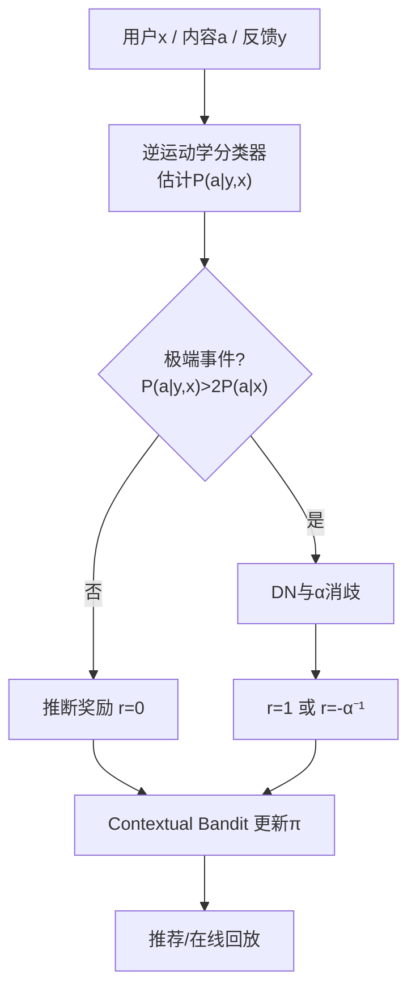
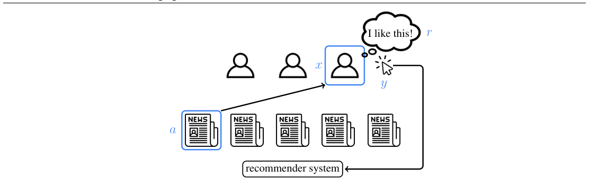

# Personalized Reward Learning with Interaction-Grounded Learning (IGL) (基于交互接地学习的个性化奖励学习)

- **会议/期刊**: ICLR 2023
- **作者与机构**: Jessica Maghakian (Stony Brook)、Paul Mineiro、Akanksha Saran、Cheng Tan (Microsoft Research NYC)、Kishan Panaganti (Texas A&M)、Mark Rucker (UVA)
- **推荐链路定位**: 在线策略 / 召回-排序决策（Contextual Bandit）
- **研究方向**: 强化学习与动态探索推荐 / 去偏公平、可信隐私与工业架构
- **论文原文**: [https://arxiv.org/abs/2211.15823v2](https://arxiv.org/abs/2211.15823v2)
- **开源代码**: [https://github.com/asaran/IGL-P](https://github.com/asaran/IGL-P)

## TL;DR (1分钟核心速览)

针对隐式反馈被统一固定奖励加权、点击≠满意且不同用户表达习惯不同的问题，本文把 Interaction-Grounded Learning 引入推荐，提出 IGL-P：用逆运动学从 $(x,y)$ 反推动作，构造3状态奖励解码器，把反馈转为推断奖励后交给 Contextual Bandit 优化。仿真、Facebook 新闻与生产图像推荐显示，IGL-P(3) 在公平性和抑制“踩”上优于 CTR/emoji/comment 基线。

## Background & Motivation (背景与核心矛盾)

- **主流范式**: 推荐系统普遍把点击、停留、赞踩等隐式信号手工组合成固定奖励，再用 CTR/CVR 或 Contextual Bandit 优化。
- **前人局限**: 点击可能被标题党利用，15% 新闻点击来自用户明知不喜欢的文章；不同年龄/性别/用户群对同一反馈信号的使用习惯不同，统一奖励会放大群体间效用差异。
- **核心洞察**: 反馈 $y$不是奖励$r$，但$y$由用户$x$与潜在满意度$r$ 共同决定；且推荐至少需要“满意/漠不关心/主动不满”三状态，二状态会把“不操作”和“讨厌”混为一谈。
- **本文切入点**: 放弃手工奖励，学习个性化奖励解码器，再把解码出的 $\hat r$ 交给标准 CB 算法。

## Method (核心方法设计)

### 1. 整体框架 (Overall Architecture)

输入用户/上下文 $x$、候选内容$a$与反馈$y$；逆运动学模块估计“在已知$x,y$时动作$a$的后验”$\hat P(a|y,x)$，并与先验$P(a|x)$比较以检测极端事件；极端事件再经“确定负例”$DN$与负例倾向$\alpha$消歧，输出推断奖励$\hat r\in\{-1,0,1\}$；最后把$(x,a,\hat r)$流交给 CB 策略$\pi$ 更新。在线推理需一次 IK 前向与一次 CB 打分；离线回放用重要性权重模拟均匀动作分布。

<figure class="paper-figure" markdown="span">
  <figcaption>图 1：推荐系统环境中的 IGL。学习器观察上下文 x，执行动作 a，然后观察到依赖潜在奖励 r 的反馈 y，但观察不到 r 本身。</figcaption>
</figure>

### 2. 关键设计拆解 (Key Designs)

1. **个性化反馈依赖假设（Personalized Feedback Assumption）**：前人假设 $y\perp x,a|r$或$y\perp x|a,r$，意味着所有用户用同一方式表达偏好；本文改为$y\perp a|x,r$，即同一用户对满意/不满/漠不关心的表达方式稳定，但不同用户可不同。该假设使学习可按样本独立进行，避免跨用户对比失效。
2. **逆运动学奖励解码（Inverse Kinematics）**：由贝叶斯与总概率得
   $P(a|y,x)=\sum_r P(r|y,x)\frac{P(r|a,x)P(a|x)}{\sum_{a'}P(r|a',x)P(a'|x)}$。
   当 $P(a|y,x)>2P(a|x)$时判定$r\neq0$：反馈若与动作强相关，只能通过潜在奖励影响动作。该“极端事件检测”把弱监督反馈转成可训练的奖励信号。
3. **3状态奖励与单边负例消歧**：二状态无法区分 $r=0$与$r=-1$；本文用$DN(x,y)=-1$表示“确定负例”，负例倾向$\alpha$ 为超参：
   $\rho=0$若$P(a|y,x)\le2P(a|x)$；$\rho=-\alpha^{-1}$若极端且$DN=-1$；否则$\rho=1$。训练目标为加权多类交叉熵
   $\mathcal{L}_{\mathrm{IK}}=-\sum_t w_t\log\hat P(a_t|y_t,x_t)$，$w_t=1/(K P(a_t|x_t))$；CB 侧最小化式(1)的 regret。无需负采样，反馈为 one-hot；$\alpha=1$ 退化为二状态。

## Experimental Setup & Evaluation Protocol (实验设置与评估协议)

- **数据集与预处理**:

| 数据集 | #Users | #Items | #Interactions | 稀疏度/密度 | 特征/场景说明 |
| :--- | :---: | :---: | :---: | :---: | :--- |
| Covertype 仿真 | 100 个模拟用户ID | 7 类动作；100 个反馈词 | 约 581k 样本 | 未报告 | 54 维特征；original/shifted 两种通信风格 |
| Facebook News | 5 类读者/5 新闻页 | 2016.5–11 帖子 | 未披露 | 未报告 | 文本嵌入+帖子类型；emoji/comment 反馈 |
| Production | 数百万用户 | 图像库（未披露） | 数百万 | 未报告 | 点击/赞/踩/无反馈；在线回放 |

- **数据划分与防穿越**: 无 Leave-One-Out/比例切分；采用在线仿真或日志回放，每轮只观察当前 $(x_t,a_t,y_t)$，潜在$r_t$ 不暴露给算法。
- **排名评测协议**: 非 Full-Ranking；每轮从动作集 $K$ 中选一个内容，观察互斥 one-hot 反馈，评估累计奖励、分组公平性与生产指标 lift。
- **对比基线与超参**: CB-emoji、CB-comment、CB-Click、生产手工多任务奖励基线；IK 仿真嵌入维 $d=2$，$\alpha$ 为负例倾向超参；生产结果报告 bootstrap 95% 置信区间。

## Key Experimental Results (实验关键数据)

### 1. 主实验对比 (Main Results)

**生产图像推荐（原文表1，相对生产基线；括号为95% CI）**

| 方法 | Clicks↑ | Likes↑ | Dislikes↓ |
| :--- | :---: | :---: | :---: |
| **IGL-P(3)** | **1.067** [0.999,1.152] | **1.029** [0.985,1.054] | **1.072** [0.751,1.274] |
| IGL-P(2) | 1.005 [0.926,1.091] | 0.949 [0.914,0.988] | 1.337 [1.141,1.557] |
| Production baseline | 1.000 | 1.000 | 1.000 |

IGL-P(3) 相对基线：点击 **+6.7%**、赞 **+2.9%**、踩 +7.2%（CI 跨1，未显著变差）。

**与 CB-Click 对比（原文表2点估计）**

| 方法 | Clicks↑ | Likes↑ | Dislikes↓ |
| :--- | :---: | :---: | :---: |
| **IGL-P(3)** | **1.010** | **1.026** | **0.918** |
| CB-Click | 0.979 | 0.959 | 1.311 |

按点估计，IGL-P(3) 相对 CB-Click：点击 **+3.2%**、赞 **+7.0%**、踩 **-30.0%**。

### 2. 消融实验 (Ablation Study)

| 配置 | 生产 Dislikes↓ | 关键结论 |
| :--- | :---: | :--- |
| IGL-P(2)（二状态） | 1.337 [1.141,1.557] | 无法区分漠不关心与主动不满，显著放大“踩” |
| IGL-P(3)（三状态） | **1.072** [0.751,1.274] | 与手工奖励基线大致持平，避免二状态病理 |
| 去掉 $DN$消歧 | 原文未单独消融 | 三状态实现依赖$DN$，属方法必要组件 |

### 3. 关键实验发现 (Key Findings)

1. 二状态在生产中把 dislikes 抬到 **1.337**，显著差于基线的 1.000；三状态降到 **1.072**，说明“漠不关心/主动不满”分离是工业可用的必要条件。
2. IGL-P(3) 不仅 dislikes 低于 CB-Click（**0.918 vs. 1.311**），点击与赞也更高，表明学习潜在满意度不必牺牲 CTR，甚至能反哺点击指标。
3. Facebook 新闻中 CB-emoji/CB-comment 在 ABC、CBS、CNN、Fox、NYT 读者间波动明显，comment 目标还让 3/5 群体不满上升；IGL-P(3) 的分组奖励更稳定，验证个性化奖励可缓解子群不公平。

## Highlights & Limitations (亮点、对比与审稿批判)

- **与代表作对比**: 相比 Xie et al. 2021/2022 的 IGL，本文首次处理上下文相关反馈、首次用逆运动学作 IGL 目标、首次支持超过二 latent states；相比 CTR/emoji/comment 手工奖励，本文不依赖领域专家调权。
- **可迁移亮点**: “极端后验检测+单边负例消歧”可迁移到任何只有弱隐式反馈的推荐场景；重要性权重合成均匀动作分布可用于离线日志回放。
- **审稿级局限批判**: 假设 $y\perp a|x,r$仍可能过强——内容本身会改变用户表达方式；三状态是否足够、$DN$与$\alpha$ 的敏感性缺少系统分析；生产评估依赖点击/赞/踩代理，缺少标准全库排序与多域复现。

## Rating (四维评分)

- **方法创新性 (Novelty)**: ⭐⭐⭐⭐ （把 IGL 扩展到个性化反馈与三状态奖励，逆运动学推导有新意）
- **评估协议与实验扎实度 (Protocol & Experiments)**: ⭐⭐⭐⭐ （仿真+Facebook+生产三层次验证，并报告 bootstrap CI；但缺标准离线全库排序）
- **写作与数学规范度 (Clarity & Rigor)**: ⭐⭐⭐⭐ （假设、后验推导与奖励提取式清晰；部分实现细节留在附录）
- **工业落地与复现价值 (Industrial & Practical Value)**: ⭐⭐⭐⭐ （代码开源，生产百万级验证；IK 在线训练与 $DN$ 依赖需工程配套）

