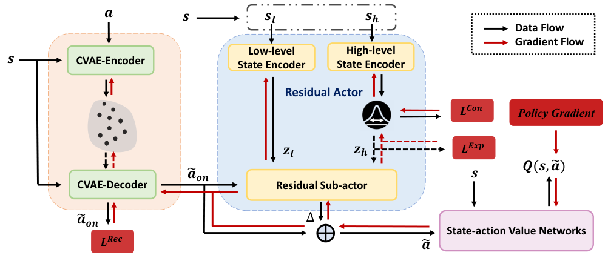
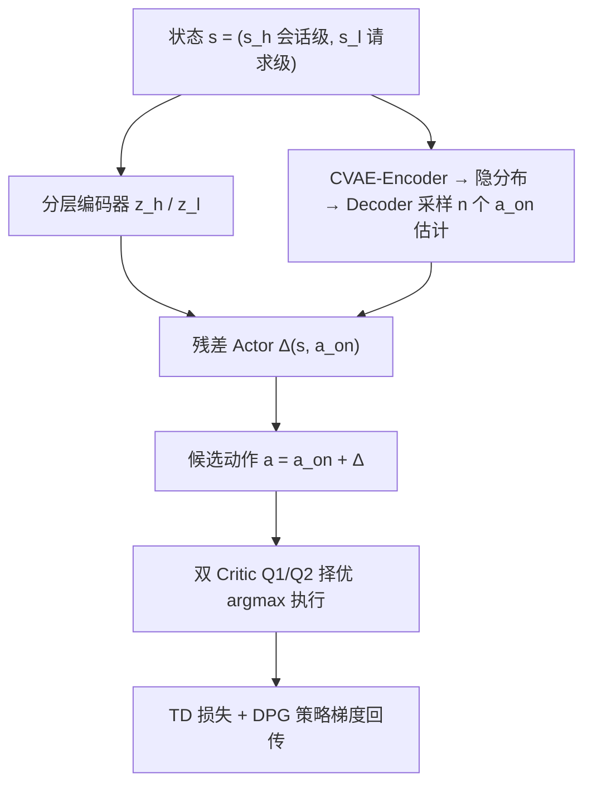

# ResAct: Reinforcing Long-term Engagement in Sequential Recommendation with Residual Actor (以残差 Actor 强化序列推荐中的长期留存)

- **会议/期刊**: ICLR 2023
- **作者与机构**: Wanqi Xue, Qingpeng Cai, Ruohan Zhan, Dong Zheng, Peng Jiang, Kun Gai, Bo An（南洋理工大学、快手、香港科技大学）
- **推荐链路定位**: 端到端策略层（作用于召回向量的连续动作空间，离线训练、线上直接推演）
- **研究方向**: 强化学习与动态探索推荐 / 序列与会话推荐
- **论文原文**: [https://arxiv.org/abs/2206.02620v2](https://arxiv.org/abs/2206.02620v2)
- **开源代码**: 暂未开源（论文正文给出 Dropbox 数据与代码链接，非标准仓库）

## TL;DR (1分钟核心速览)

序列推荐优化长期留存（回访时间 + 会话长度）时，直接在全策略空间做 RL 面临价值估计难、在线探索昂贵、奖励稀疏三大痛点。ResAct 转而学习「贴近但优于」线上服务策略的局部改进：先用 CVAE 重构线上行为、采样 $n$个动作估计，再由残差 Actor 预测偏移量$\Delta$，最后用 Critic 择优执行；并设计表达性/简洁性双信息论正则强化会话级表征。在 NCIS 离线评估下，MovieLensL-1m 回报 1.8123 超最强基线 BCQ 约 1.3%，工业集 RecL-25m 的 Session Length 达 0.5433，相对最优基线 TD3 提升 **35.3%**。

## Background & Motivation (背景与核心矛盾)

- **主流范式**: 序列推荐（GRU4Rec/BERT4Rec 等）以 CTR/即时消费概率为目标；少量长期留存工作（如 FeedRec）依赖「多样性 $\Rightarrow$ 留存」的强假设，缺直接因果优化。
- **前人局限①（价值估计不可靠）**: 留存演化跨度以天/月计，跨会话回报极稀疏，从 logged data 学 $Q^\pi$ 时外推误差（extrapolation error）爆炸。
- **前人局限②（探索代价与表征缺失）**: 探索未知动作需真实在线实验、直接损伤用户体验；且奖励只在会话首尾出现，请求级状态表征几乎不含长期信号。
- **核心洞察 (Key Insight)**: 只需在线上策略的「近邻邻域」内做局部改进（局部策略改进理论，Kakade & Langford / Achiam），即可同时保证数据覆盖充分（$Q$ 可估）与线上分布偏移可控，且无需在线交互。
- **本文切入点**: 将动作分解为 $a = a_{on} + \Delta(s,a_{on})$，把「学最优策略」降维为「重构 + 残差修正」两个更易解的子任务。

## Method (核心方法设计)

### 1. 整体框架 (Overall Architecture)

输入为分层状态：会话级（高层）$s_h$含性别、年龄与历史 like/forward 率等长期统计，请求级（低层）$s_l$为当前会话内交互。CVAE-Encoder 以$(s,a_{on})$为条件输出高斯隐分布，Decoder 从先验采样隐向量并解码出$n$个线上动作估计$\{\tilde{a}_{on}^i\}$；对每个估计，分层状态编码器$z_h=f_h(s_h), z_l=f_l(s_l)$与动作拼接后送入残差子 Actor 输出$\Delta$；$Q_1$对$n$个候选$\tilde{a}^i$ 打分择优作为最终推荐向量（与视频 embedding 内积检索）。训练端到端：CVAE 重构损失 + 双 Q 的 TD 损失 + DPG 策略梯度 + 两个信息论正则。

<figure class="paper-figure" markdown="span">
  <figcaption>图3：我们方法的示意图。CVAE-Encoder 生成动作嵌入分布，并从中采样潜在向量供 CVAE-Decoder 重构动作。重构动作 \tilde{a}_{on} 与高层、低层状态编码器提取的状态特征一起输入残差 actor，以预测残差 ∆。加入残差后，动作与状态被送入状态-动作价值网络，从而生成策略梯度。该框架可端到端训练。</figcaption>
</figure>

### 2. 关键设计拆解 (Key Designs)

1. **CVAE 行为重构（一动作变多估计，抗重构偏差）**：若用确定性网络 $D(a|s)$回归$a_{on}$，单一估计不准就全盘皆输。改将$a_{on}$编码为条件高斯$C(s,a_{on})$，解码采样得多个估计，并用 KL 约束到$\mathcal{N}(0,1)$ 以保证未知状态下可先验采样：
$\mathcal{L}_{Rec}=\mathbb{E}_{s,a_{on},c}\big[(D(a|s,c;\theta_d)-a_{on})^2+\mathrm{KL}(C(s,a_{on};\theta_e)\|\mathcal{N}(0,1))\big]$
直觉：把「点估计」换成「分布采样」，等价于在动作空间做局部集成，后续可并行打分选优。
2. **残差 Actor + Critic 择优（局部策略改进）**：直接回归动作难（经典 DDPG/TD3 表现最差），改只学偏移：
$\hat\pi(a|s,c)=D(\tilde a_{on}|s,c;\theta_d)+f(\Delta|s,\tilde a_{on};\theta_f)$，$\nabla_{\theta_f}J=\mathbb{E}_{s,c}[\nabla_aQ(s,a)|_{a=\hat\pi}\nabla_{\theta_f}f]$，最终$\hat\pi(a|s)=\hat\pi(a|s,c^*),\ c^*=\arg\max_{c}Q_1(s,\hat\pi(a|s,c))$。直觉：残差幅度小，学到的策略天然靠近行为策略，$Q$ 的支撑域（support）被覆盖，外推误差受控。
3. **双信息论正则（让会话级表征既含长期信号又不冗余）**：表达性用变分下界最大化 $I(z_h;r)$，落地为交叉熵$\mathcal{L}_{Exp}=\mathbb{E}_{s,z_h}[H(p(r|s)\|o(r|z_h;\theta_o))]$；简洁性用变分上界最小化$I(z_h;s_h)$，落地为$\mathcal{L}_{Con}=\mathbb{E}_{s}[\mathrm{KL}(p_{\theta_h}(z_h|s_h)\|m(z_h))]$，$m=\mathcal{N}(0,1)$。直觉：只有表达性会退化为恒等映射$z_h=s_h$，KL 项强制$z_h$成为$s_h$ 关于奖励的最小充分统计量。
4. **训练目标、负采样与推理开销**：总损失 $\mathcal{L}=\mathcal{L}_{TD}(\text{Clipped Double Q})+\mathcal{L}_{Rec}-\alpha\mathcal{L}_{Exp}+\beta\mathcal{L}_{Con}-\lambda J(\hat\pi)$；无负采样概念（连续动作空间回归 + TD），奖励由回访时间$r(\delta)$、会话长度$r(\eta)$及其凸组合（权重 0.7/0.3）定义。推理时$n$次采样相互独立、可并行，$n$增大时性能单调上升（$n=5\!\to\!25$），代价是$n$ 倍前向（工业可接受）。

## Experimental Setup & Evaluation Protocol (实验设置与评估协议)

| 数据集 | #Users | #Items | #Interactions | 稀疏度/密度 | 特征/场景说明 |
| :--- | :---: | :---: | :---: | :---: | :--- |
| MovieLensL-1m（合成） | 6,040 | ~3,900 | 1,000,209 | 密度 ~4.2% | 用 5 星评分按比例合成长期留存信号；5,000 用户训练/50 验证/其余测试 |
| RecL-25m（工业） | 99,899 | 未披露 | 25,921,753 requests / 6,126,583 sessions | 平均会话长 4.04、平均 61.3 会话 | 快手短视频数月日志；80%/20% 按用户切分，500 用户做验证 |

- **数据划分与防穿越**: 按**用户**划分（非时间戳切分），保证测试用户轨迹完全不可见于训练；同一用户跨会话的长期回报需完整观测窗口。
- **排名评测协议**: 非 Full-Ranking / 非采样排序，采用 **NCIS（Normalised Capped Importance Sampling）离线策略评估**：$\tilde J^{NCIS}(\pi)=\frac{1}{|T|}\sum_{\xi}\frac{\sum\tilde\rho_{\pi,\pi_\beta}(s,a)r}{\sum\tilde\rho_{\pi,\pi_\beta}(s,a)}$，$\tilde\rho=\min(c,\phi_\pi(s)(a)/\phi_{\pi_\beta}(s)(a))$，以高斯行为策略密度比加截断$c$ 控制方差。**这是 RL 策略价值估计而非 Top-N 排序指标，需特别注意可比性边界。**
- **对比基线与超参**: 经典 RL（DDPG、TD3）、离线 RL（TD3_BC、BCQ、IQL）、模仿学习（IL、IL_CVAE）共 7 个基线；动作/状态为连续 embedding，未给出统一维度 $d$；报告 95% 置信区间（多次运行），未做显式$p$ 值假设检验。

## Key Experimental Results (实验关键数据)

### 1. 主实验对比 (Main Results)

**MovieLensL-1m（NCIS 估计回报，越高越好）**

| 方法 | 类别 | Return |
| :--- | :--- | :---: |
| DDPG | 经典 RL | 1.7429 ±0.0545 |
| TD3 | 经典 RL | 1.7363 ±0.0546 |
| TD3_BC | 离线 RL | 1.7135 ±0.0541 |
| BCQ | 离线 RL | 1.7898 ±0.0320 |
| IQL | 离线 RL | 1.7360 ±0.0546 |
| IL | 模仿学习 | 1.7485 ±0.0310 |
| IL_CVAE | 模仿学习 | 1.7344 ±0.0316 |
| **ResAct (Ours)** | 残差策略 | **1.8123 ±0.0319** |
| Improv. vs 最强基线 | — | **+1.26%**（vs BCQ）/ +3.6%（vs IL） |

**RecL-25m（三种奖励模式）**

| 方法 | Return Time | Session Length | Both |
| :--- | :---: | :---: | :---: |
| DDPG | 0.6375 ±0.0059 | 0.3290 ±0.0056 | 0.5908 ±0.0092 |
| TD3 | 0.6756 ±0.0133 | 0.4015 ±0.0073 | 0.5498 ±0.0103 |
| TD3_BC | 0.6436 ±0.0059 | 0.3671 ±0.0037 | 0.5563 ±0.0050 |
| BCQ | 0.6837 ±0.0061 | 0.3836 ±0.0033 | 0.5915 ±0.0049 |
| IQL | 0.6296 ±0.0094 | 0.3430 ±0.0057 | 0.5579 ±0.0067 |
| IL | 0.6404 ±0.0058 | 0.3186 ±0.0032 | 0.5345 ±0.0048 |
| IL_CVAE | 0.6410 ±0.0058 | 0.3178 ±0.0031 | 0.5346 ±0.0047 |
| **ResAct (Ours)** | **0.7980 ±0.0067** | **0.5433 ±0.0045** | **0.6675 ±0.0053** |
| Improv. vs 最优基线 | **+16.7%** (vs BCQ) | **+35.3%** (vs TD3) | **+12.8%** (vs BCQ) |

### 2. 消融实验 (Ablation Study)

**RecL-25m 上双信息论正则的消融（表 4）**

| 变体 | Return Time | Session Length | Both |
| :--- | :---: | :---: | :---: |
| ResAct 完整 | **0.7980** | **0.5433** | **0.6675** |
| w/o $\mathcal{L}_{Exp}$ | 0.6610 (-17.2%) | 0.3895 (-28.3%) | 0.6074 (-9.0%) |
| w/o $\mathcal{L}_{Con}$ | 0.6944 (-13.0%) | 0.4542 (-16.4%) | 0.6041 (-9.5%) |
| w/o 两者 | 0.7368 (-7.7%) | 0.3854 (-29.1%) | 0.6348 (-4.9%) |

**组件级消融（曲线类证据，原文未给数值）**：w/o CVAE（换确定性重构器）后三类任务曲线显著下滑且选择阶段失效（仅 1 个候选）；估计器数量 $n$ 从 5 增至 25 时三种任务回报单调上升；t-SNE（图 7）显示残差后动作（蓝点）围绕初始动作但覆盖更宽邻域。

### 3. 关键实验发现 (Key Findings)

1. **分解动作是主要收益来源**：经典 RL（DDPG 0.6375 / TD3 0.6756）在 Return Time 上全面落后，而 ResAct 达 0.7980；同源的模仿学习 IL/IL_CVAE（0.6404/0.6410）仅做重构即回落到基线水平，说明「重构保证支撑域 + 残差提供改进」两者缺一不可，收益并非来自更强的网络结构。
2. **离线 RL 的正则并不够**：BCQ（0.6837）虽专为受限动作设计，仍比 ResAct 低 16.7%；说明在长期稀疏奖励下，约束动作范围不足，必须把策略显式锚定在行为策略邻域内。
3. **表达性与简洁性必须联合**：单独移除任一正则分别掉 17.2%/13.0%（Return Time），但两者同时移除（0.7368）反而好于单独移除——证明二者互补，只保留表达性会退化为恒等编码、只保留简洁性会丢失留存信号，作者对此的解释与 §3.3 的理论动机一致。

## Highlights & Limitations (亮点、对比与审稿批判)

- **与代表作对比 (vs. Prior Work)**: 对比 BCQ/IQL 等离线 RL——它们约束的是「动作值保守性」，ResAct 约束的是「策略与行为策略的偏差」并把动作显式参数化为 $a_{on}+\Delta$；对比 IL/IL_CVAE——它们止步于模仿、无 Critic 提供改进方向；对比 FeedRec——后者以多样性为代理假设，ResAct 直接优化留存奖励。
- **可迁移亮点**: ①「连续动作 = 行为策略采样 + 小残差」的范式可迁移到生成式推荐的重排/打分微调，天然限制分布漂移；②表达性 + 简洁性的变分双正则可作为任意会话级表征（如用户生命周期 embedding）的通用训练插件。
- **审稿级局限批判**: ① **评估协议脆弱**：NCIS 依赖行为策略密度比与截断常数 $c$，在$n$候选/高斯策略假设下方差敏感，且全文未报告任何 Top-N 排序指标（HR/NDCG）、无显式显著性检验，与主流序列推荐基准不可直接比较；② **超参与工程开销**：奖励权重 0.7/0.3 为人工设定（仅附录做敏感性分析），推理需$n$倍前向 + 双 Q 打分，MovieLens 上相对 BCQ 仅 +1.26%，收益在合成数据上并不稳健；③ CVAE、$n$ 的消融仅以学习曲线呈现，缺少数值表；伦理声明亦自承可能加剧用户沉迷。

## Rating (四维评分)

- **方法创新性 (Novelty)**: ⭐⭐⭐⭐ （用 CVAE 重构 + 残差 Actor 把全策略空间优化降维为近端局部改进，思路干净且有局部策略改进理论支撑）
- **评估协议与实验扎实度 (Protocol & Experiments)**: ⭐⭐⭐ （工业级 2,600 万请求数据亮眼、含 95% CI，但 NCIS 离线评估缺排序指标与显著性检验，合成集提升仅 1.3%）
- **写作与数学规范度 (Clarity & Rigor)**: ⭐⭐⭐⭐ （DPG 梯度与两条互信息界的推导完整、附录给全推导，三层流程表述清晰）
- **工业落地与复现价值 (Industrial & Practical Value)**: ⭐⭐⭐⭐ （离线训练免在线探索、残差幅度可控便于灰度，采样并行易加速；但代码非标准仓库、CVAE 与奖励权重调参成本需评估）

