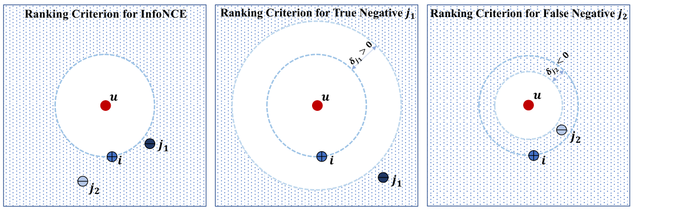
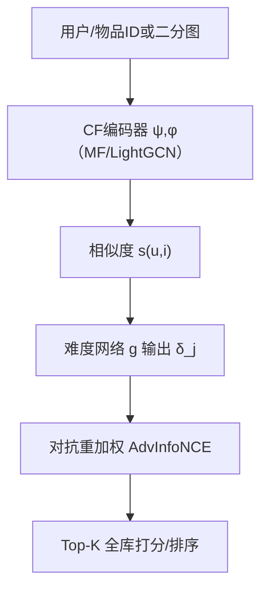

# Empowering Collaborative Filtering with Principled Adversarial Contrastive Loss（以原则化对抗对比损失赋能协同过滤）

- **会议/期刊**: NeurIPS 2023
- **作者与机构**: An Zhang, Leheng Sheng, Zhibo Cai, Xiang Wang, Tat-Seng Chua；NUS、清华、人大、中科大
- **推荐链路定位**: 召回/精排（Top-K CF 表征学习）
- **研究方向**: 自监督对比学习与交互去噪 / 协同过滤与双塔召回
- **论文原文**: [论文原文链接](https://arxiv.org/abs/2310.18700v1)
- **开源代码**: [开源代码仓库链接](https://github.com/LehengTHU/AdvInfoNCE)

## TL;DR (1分钟核心速览)

针对 InfoNCE 将未交互全视为负样本、假阴性污染与 OOD 泛化弱，本文提出 AdvInfoNCE：为每个负样本学习难度 $\delta_j$，构造细粒度排序准则并用对抗负采样重加权，理论上等价于 KL 约束 DRO。四个 Top-K 基准全库排序下，KuaiRec Recall@20 较 InfoNCE 提升 9.94%，Tencent$\gamma=2$ 的 Recall/NDCG@20 提升 21.90%/24.14%。

## Background & Motivation (背景与核心矛盾)

- **主流范式**: CL-based CF 用图增广或 InfoNCE 在用户-物品二分图上做半监督 Top-K 推荐，通常把未观测交互一律当负样本。
- **前人局限**: 未观测交互中混有大量假阴性，InfoNCE 的粗粒度约束会错误惩罚它们；同时 Top-K 评估关注排序质量，均匀负采样难以提供信息量高的硬负样本。
- **核心洞察 (Key Insight)**: 应为每个负样本学习一个相对难度 $\delta_j$：$\delta_j>0$收缩硬负样本可行域，$\delta_j<0$放松潜在假阴性；InfoNCE 只是$\delta_j=0$ 的特例。
- **本文切入点**: 把难度学习写成对抗 min-max，并证明其等价于负采样分布上的 KL-DRO，从而兼顾硬负样本挖掘、假阴性降权与 OOD 鲁棒性。

<figure class="paper-figure" markdown="span">
  <figcaption>图1：基于相似度度量 s(·, ·) 的排序准则几何解释对比：InfoNCE（1a）与本文提出的 AdvInfoNCE（1b-1c）。图中用户 u 为红点，物品 i（正样本）、j1（真负样本）和 j2（假负样本）为不同深浅蓝色的点。颜色渐变反映用户 u 与物品之间的潜在相似度，阴影区域表示其对应负样本的可行区域。</figcaption>
</figure>
图1：InfoNCE（1a）与 AdvInfoNCE（1b-1c）的可行域对比；$\delta>0$收紧硬负样本，$\delta<0$ 放松假阴性。

## Method (核心方法设计)

### 1. 整体框架 (Overall Architecture)

输入用户/物品 ID 或二分图，经 MF/LightGCN 编码器 $\psi,\phi$得到表示并计算$s(u,i)$。主模型参数$\theta$与难度网络$\theta_{\mathrm{adv}}$ 交替：前者最小化 AdvInfoNCE 排序损失，后者最大化同损失以给负样本分配难度；推理时只保留主编码器做全库打分。

### 2. 关键设计拆解 (Key Designs)

1. **细粒度排序准则**：InfoNCE 只要求 $\forall j,\ s(u,j)-s(u,i)\le0$，对假阴性过严；本文改为$\forall j\in N_u,\ s(u,j)-s(u,i)+\delta_j<0$。$\delta_j>0$时负样本$j$被当作硬负样本，$\delta_j<0$时约束放松以吸收假阴性，$\delta_j=0$ 退化为 InfoNCE。
2. **对抗难度与 DRO 等价**：令 $\delta_j=\log(|N_u|p(j|(u,i)))$，$p$由难度网络$g$的 softmax 给出，训练为$\min_\theta\max_{\delta\in C(\eta)}\mathcal{L}_{\mathrm{AdvInfoNCE}}$。Theorem 3.1 证明其等价于$\min_\theta\max_{P:D_{\mathrm{KL}}(P_0\Vert P)\le\eta}\mathbb{E}_P[\exp(s(u,j)-s(u,i))]$，即在均匀负采样附近搜索最坏分布；负样本梯度权重为$\exp(\delta_j)$，实现硬负样本挖掘与假阴性降权。
3. **训练目标、负采样与推理效率**：$\mathcal{L}_{\mathrm{AdvInfoNCE}}=-\sum_{(u,i)\in\mathcal{O}^{+}}\log\frac{\exp(s(u,i))}{\exp(s(u,i))+\sum_{j=1}^{|N_u|}\exp(\delta_j)\exp(s(u,j))}$。每个正样本均匀采$N$个负样本，用权重$K$近似全负集；$\theta$与$\theta_{\mathrm{adv}}$每$T_{\mathrm{adv}}$交替更新，$E_{\mathrm{adv}}$ 控制偏离均匀的程度。推理只保留主 CF 编码器，复杂度与 InfoNCE 同阶。

## Experimental Setup & Evaluation Protocol (实验设置与评估协议)

表1 数据集统计与预处理：

| 数据集 | #Users | #Items | #Interactions | 密度 | 过滤/场景说明 |
| :--- | :---: | :---: | :---: | :---: | :--- |
| KuaiRec | 7,176 | 10,728 | 1,304,453 | 0.0169 | 短视频；观看时长 > 2 倍视频长度为正 |
| Yahoo!R3 | 14,382 | 1,000 | 129,748 | 0.0090 | 歌曲评分；评分 ≥4 为正 |
| Coat | 290 | 295 | 2,776 | 0.0324 | 外套购买；评分 ≥4 为正 |
| Tencent | 95,709 | 41,602 | 2,937,228 | 0.0007 | 短视频；按流行度分 50 组构造 OOD 测试 |

- **数据划分与防穿越**: 无偏数据集用有偏训练观测、随机曝光测试；Tencent 剩余交互按 60:10 划分 train/val，测试按 $\gamma$ 构造不同 OOD 程度，不泄漏测试侧信息。
- **排名评测协议**: 采用无偏 `Full-Ranking`（全库未交互排序）；例外是 KuaiRec 仅排序 3327 个全曝光物品。指标为 HR@20、Recall@20、NDCG@20。
- **对比基线与超参**: 基线含 BPR、InfoNCE、增广型 SGL/NCL/XSimGCL、损失型 CCL/BC Loss/Adap-τ；backbone 为 MF/LightGCN，附加 UltraGCN/VGAE。嵌入维度随 backbone 默认，显著性 $p \ll 0.05$。

## Key Experimental Results (实验关键数据)

### 1. 主实验对比 (Main Results)

表2 LightGCN 主实验（R=Recall@20，N=NDCG@20；加粗为最优）：

| 方法 | KuaiRec R/N | Yahoo!R3 R/N | Coat R/N | Tencent $\gamma=2$ R/N |
| :--- | :---: | :---: | :---: | :---: |
| BPR | 0.1652/0.3905 | 0.1487/0.0697 | 0.2737/0.1707 | 0.0186/0.0109 |
| InfoNCE | 0.1800/0.4529 | 0.1475/0.0698 | 0.2689/0.1882 | 0.0242/0.0145 |
| SGL | 0.1829/0.4583 | 0.1474/0.0692 | 0.2737/0.1716 | 0.0198/0.0113 |
| NCL | 0.1764/0.4478 | 0.1407/0.0669 | 0.2778/0.1739 | 0.0189/0.0123 |
| XSimGCL | 0.1907/0.4531 | 0.1503/0.0708 | 0.2729/0.1655 | 0.0203/0.0110 |
| CCL | 0.1776/0.4497 | 0.1453/0.0676 | 0.2732/0.1941 | 0.0266/0.0170 |
| BC Loss | 0.1799/0.4417 | 0.1498/0.0703 | 0.2719/0.1921 | 0.0260/0.0164 |
| Adap-τ | 0.1717/0.4323 | 0.1516/0.0704 | 0.2700/0.1957 | 0.0239/0.0143 |
| **AdvInfoNCE** | **0.1979/0.4697** | **0.1527/0.0718** | **0.2846/0.2026** | **0.0295/0.0180** |
| Improv. vs InfoNCE | +9.94%/+3.71% | +3.53%/+2.87% | +5.84%/+7.65% | +21.90%/+24.14% |

### 2. 消融实验 (Ablation Study)

表3 难度策略消融（Tencent $\gamma=10$，LightGCN）：

| 设置 | HR@20 | Recall@20 | NDCG@20 | 结论 |
| :--- | :---: | :---: | :---: | :--- |
| AdvInfoNCE | **0.1087** | **0.0403** | **0.0243** | 细粒度 $\delta$ + 对抗训练 |
| InfoNCE ($\delta=0$) | 0.0924 | 0.0332 | 0.0195 | 粗排序、均匀负采样 |
| 均匀随机 $\delta$ | — | — | — | 图2b 曲线低于 Full |
| 反转 $\delta$ | — | — | — | 低于 InfoNCE，图2c 均匀性下降 |

原文图2b仅给曲线未列数值；反转难度会破坏表示均匀性，说明难度方向至关重要。

### 3. 关键实验发现 (Key Findings)

1. **全曝光 KuaiRec 上 Recall/NDCG 分别提升 9.94%/3.71%**，该数据集接近理想离线 A/B，说明 $\delta_j$ 对曝光偏差与假阴性更稳健。
2. **分布偏移越强收益越大**：Tencent $\gamma=2$ 时 Recall/NDCG 较 InfoNCE 提升 21.90%/24.14%，验证 KL-DRO 的 worst-case 负采样视角并非只在平均分布上有效。
3. **训练开销几乎不变**：LightGCN 上 AdvInfoNCE 为 44.6 s/epoch，InfoNCE 为 41.2 s/epoch；梯度权重 $\exp(\delta_j)$ 使模型偏向流行硬负样本、压低冷门假阴性，反转难度则显著损害 uniformity。

## Highlights & Limitations (亮点、对比与审稿批判)

- **与代表作对比**: SGL/NCL/XSimGCL 重在图增广，仍把未观测交互当负样本；CCL/BC Loss/Adap-τ 只调 margin 或 temperature，缺少样本级假阴性区分；AdvInfoNCE 直接改排序准则，并给出 DRO 等价与 DCG 对齐解释。
- **可迁移亮点**: $\delta_j$ 可作为可学习 margin/权重插入任意对比损失；DRO 视角可用于解释和设计鲁棒负采样。
- **审稿级局限批判**: 对抗训练存在不稳定性，$E_{\mathrm{adv}}$/$\epsilon$ 过大会损伤 in-distribution 性能；评估以离线 OOD 基准为主，缺少线上 A/B，且额外难度网络增加内存与调参成本。

## Rating (四维评分)

- **方法创新性 (Novelty)**: ⭐⭐⭐⭐ （把样本级难度、细粒度排序与 KL-DRO 严格对应，理论增量清晰，但仍是 InfoNCE 重加权框架。）
- **评估协议与实验扎实度 (Protocol & Experiments)**: ⭐⭐⭐⭐ （四个数据集覆盖无偏与 OOD，双 backbone 且 $p \ll 0.05$，但部分消融仅给曲线。）
- **写作与数学规范度 (Clarity & Rigor)**: ⭐⭐⭐⭐ （推导完整、定理与梯度分析清楚，附录依赖较多。）
- **工业落地与复现价值 (Industrial & Practical Value)**: ⭐⭐⭐⭐ （代码开源，复杂度与 InfoNCE 同阶，可直接替换损失；对抗训练调参成本需工程权衡。）

