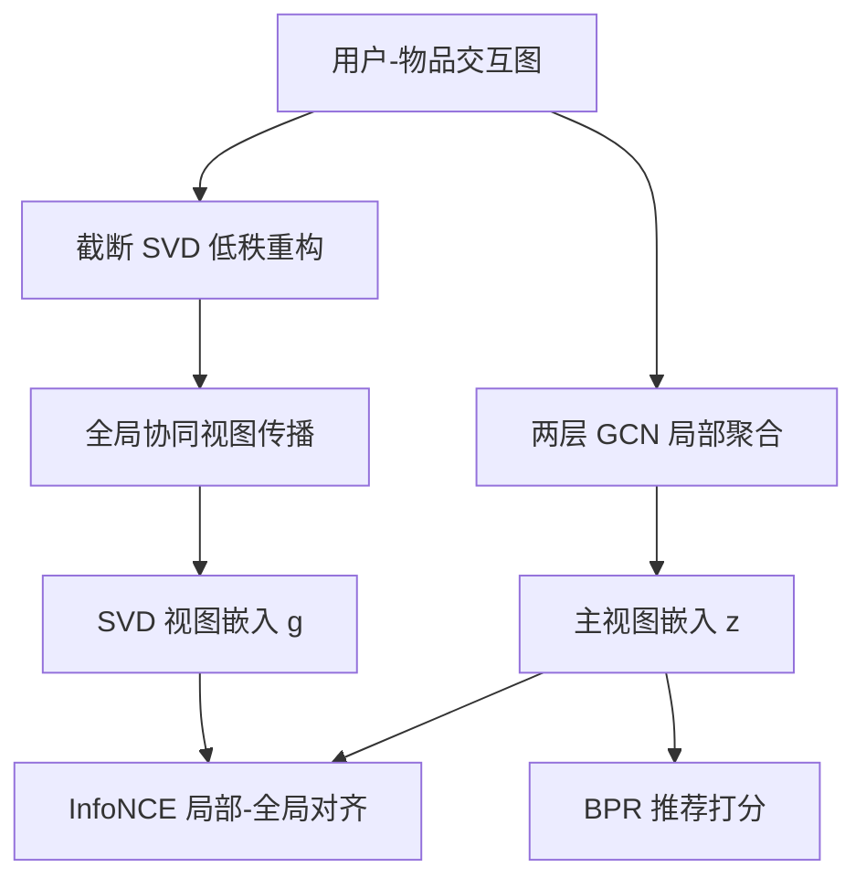
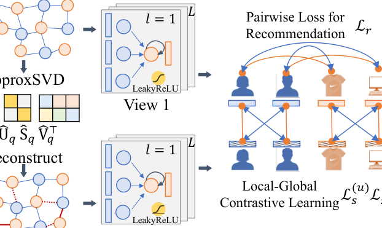

# LightGCL: Simple Yet Effective Graph Contrastive Learning for Recommendation（轻量图对比学习推荐）

- **会议/期刊**: ICLR 2023
- **作者与机构**: Xuheng Cai, Chao Huang, Lianghao Xia, Xubin Ren；香港大学
- **推荐链路定位**: 召回
- **研究方向**: 自监督对比学习与交互去噪 / 图神经网络与知识图谱推荐
- **论文原文**: [https://arxiv.org/abs/2302.08191v3](https://arxiv.org/abs/2302.08191v3)
- **开源代码**: [https://github.com/HKUDS/LightGCL](https://github.com/HKUDS/LightGCL)

## TL;DR (1分钟核心速览)

针对随机扰动或启发式图增强易丢失结构语义、受噪声偏置的问题，LightGCL 用截断 SVD 重构交互图生成全局协同视图，并与主视图直接做 InfoNCE；在 Yelp/Gowalla/ML-10M/Amazon/Tmall 的 Full-Ranking 评测中，Recall@20 较最强基线提升 10%–23%。

## Background & Motivation (背景与核心矛盾)

- **主流范式**: GNN 召回以 LightGCN 式邻域聚合建模高阶协同信号；近期用图对比学习（SGL、SimGCL、HCCF）构造自监督视图，缓解交互稀疏。
- **前人局限**: 随机节点/边丢弃或嵌入噪声会破坏重要结构，且易被噪声交互误导；HCCF/NCL 依赖聚类、超边等启发式视图生成器，跨数据分布泛化弱。另一矛盾是 GNN 过平滑与对比学习过均匀化并存，嵌入判别性不足。
- **核心洞察 (Key Insight)**: 交互图的主成分承载可靠全局协同关系；截断 SVD 的低秩重构可视为去噪后的全局视图，比随机扰动更保语义。
- **本文切入点**: 用 SVD 引导的图增强替代手工增强，并将主视图与 SVD 视图直接对比，避免三视图冗余。

## Method (核心方法设计)

### 1. 整体框架 (Overall Architecture)

输入归一化用户-物品图：主分支用两层 GCN 聚合局部邻域；辅助分支对邻接矩阵做随机化截断 SVD，得到低秩重构图并传播全局协同信号；两分支同维嵌入直接进入 InfoNCE，推荐分支用 BPR 优化；推理仅保留主分支内积打分。SVD 因子在预处理阶段一次计算，训练时反复复用。

<figure class="paper-figure" markdown="span">
  <figcaption>图1：LightGCL 的整体结构。</figcaption>
</figure>

### 2. 关键设计拆解 (Key Designs)

1. **SVD 全局协同视图**：随机扰动会丢边、噪声视图会误导对比；LightGCL 对 $\tilde{\mathbf{A}}$做截断分解并重构$\hat{\mathbf{A}}_{\mathrm{SVD}}=\hat{\mathbf{U}}_q\hat{\mathbf{S}}_q\hat{\mathbf{V}}_q^{\top}$，再传播$\mathbf{G}_l^{(u)}=\sigma(\hat{\mathbf{A}}_{\mathrm{SVD}}\mathbf{E}_{l-1}^{(v)})$。只保留前$q$ 个主成分等价于滤除长尾噪声、注入跨用户全局依赖；分解后只存低秩因子，不显式构造稠密矩阵。

2. **双视图直接对比**：传统 GCL 常构造两个增强视图再对比，主视图不进入 InfoNCE；本文因 SVD 视图语义可靠，直接对齐主视图与 SVD 视图：
$\mathcal{L}_s^{(u)}=\sum_i\sum_l-\log\frac{\exp(s(\mathbf{z}_{i,l}^{(u)},\mathbf{g}_{i,l}^{(u)})/\tau)}{\sum_{i'}\exp(s(\mathbf{z}_{i,l}^{(u)},\mathbf{g}_{i',l}^{(u)})/\tau)}$。
这样既保留局部协同，又用全局关系约束表示，且训练时随机 node dropout 防止过拟合。

3. **训练目标、负采样与推理效率**：总损失为 $\mathcal{L}=\mathcal{L}_r+\lambda_1(\mathcal{L}_s^{(u)}+\mathcal{L}_s^{(v)})+\lambda_2\|\Theta\|_2^2$，其中$\mathcal{L}_r=\sum_i\sum_s\max(0,1-\hat{y}_{i,p}+\hat{y}_{i,n})$。推荐分支采用 BPR 随机负采样；对比学习以 batch 内其他节点为负例。预处理 SVD 为$O(qE)$且只做一次；每 batch 图卷积约$O[2ELd+2q(I+J)Ld]$，当$2q(I+J)<E$ 时低于 SimGCL 的三视图开销。

## Experimental Setup & Evaluation Protocol (实验设置与评估协议)

- **数据集与预处理**: 五个公开基准，正文未突出 k-core 细节，沿用公开过滤后数据；密度按交互数/(用户数×物品数) 估算。

| 数据集 | #Users | #Items | #Interactions | 密度 | 场景 |
| :--- | :---: | :---: | :---: | :---: | :--- |
| Yelp | 29,601 | 24,734 | 1,069,128 | 0.146% | 本地商户 |
| Gowalla | 50,821 | 57,440 | 1,172,425 | 0.040% | 签到兴趣点 |
| ML-10M | 69,878 | 10,195 | 6,999,171 | 0.983% | 电影评分 |
| Amazon-book | 78,578 | 77,801 | 2,240,156 | 0.037% | 图书电商 |
| Tmall | 47,939 | 41,390 | 2,357,450 | 0.119% | 电商购买 |

- **数据划分与防穿越**: 采用 Leave-One-Out：每用户末次交互作 test、次末作 valid，其余训练；未设冷启动划分。
- **排名评测协议**: Full-Ranking，对全部未交互物品排序，报告 Recall@20/40、NDCG@20/40；训练 BPR 随机负采样，CL 用 batch 内负例。
- **对比基线与超参**: 对比 16 个基线，含 LightGCN、SGL、SimGCL、HCCF、SHT 等；嵌入维度 32、batch 256、2 层 GCN、SVD 秩 $q=5$；表中$p$-value 均远小于 0.05。

## Key Experimental Results (实验关键数据)

### 1. 主实验对比 (Main Results)

表中 Yelp/Gowalla 为 R@20/N@20，其余列为 R@20；加粗为最优。

| 方法 | Yelp | Gowalla | ML-10M | Amazon | Tmall |
| :--- | :---: | :---: | :---: | :---: | :---: |
| LightGCN | 0.0482/0.0409 | 0.0985/0.0593 | 0.1789 | 0.0319 | 0.0225 |
| SGL | 0.0526/0.0444 | 0.1030/0.0623 | 0.1833 | 0.0327 | 0.0268 |
| GCA | 0.0621/0.0530 | 0.0896/0.0537 | 0.2145 | 0.0309 | 0.0373 |
| HCCF | 0.0626/0.0527 | 0.1070/0.0644 | 0.2219 | 0.0322 | 0.0314 |
| SHT | 0.0651/0.0546 | 0.1232/0.0731 | 0.2173 | 0.0441 | 0.0387 |
| SimGCL | 0.0718/0.0615 | 0.1357/0.0818 | 0.2265 | 0.0474 | 0.0473 |
| **LightGCL** | **0.0793/0.0668** | **0.1578/0.0935** | **0.2613** | **0.0585** | **0.0528** |
| Improv. | +10%/+8% | +16%/+14% | +15% | +23% | +11% |

### 2. 消融实验 (Ablation Study)

以不同矩阵分解替代近似 SVD 视图：

| 变体 | Yelp R@20 | Yelp N@20 | Gowalla R@20 | Gowalla N@20 |
| :--- | :---: | :---: | :---: | :---: |
| CL-MF（预训练 MF 视图） | 0.0781 | 0.0659 | 0.1561 | 0.0929 |
| CL-SVD++（SVD++ 视图） | 0.0788 | 0.0666 | 0.1568 | 0.0932 |
| **LightGCL** | **0.0793** | **0.0668** | **0.1578** | **0.0935** |

### 3. 关键实验发现 (Key Findings)

1. SVD 视图带来稳定增益：Yelp 上 R@20 达 0.0793，较最强基线 SimGCL 的 0.0718 提升约 10%；Amazon 从 0.0474 升至 0.0585，提升 23%，说明全局低秩关系比随机扰动更能补足稀疏交互。
2. 稀疏与长尾鲁棒性更强：交互数 <15 的极稀疏用户在 Gowalla 上相对 Recall 甚至不低于整体，长尾物品分组上优于 HCCF/SimGCL；SVD 重构为不可见链接分配全局权重，缓解流行度偏置。
3. 效率与表示分布兼顾：预处理 SVD 仅 $O(qE)$，训练每 batch 低于 SimGCL 的三视图开销；MAD 为 0.9657/0.9721，介于 LightGCN 与 SGL/SimGCL 之间，t-SNE 显示“社群清晰、社群内适度分散”，同时缓解过平滑与过均匀。$q=5$、$\lambda_1=10^{-7}$ 已足够。

## Highlights & Limitations (亮点、对比与审稿批判)

- **与代表作对比 (vs. Prior Work)**: SGL 随机丢弃边、SimGCL 加噪声、HCCF 依赖超边/聚类；LightGCL 用确定性 SVD 全局视图，且只对比主视图与增强视图，避免三视图冗余和启发式依赖。
- **可迁移亮点**: 将截断 SVD 作为“全局视图生成器”可迁移到序列/多模态图推荐；低秩因子预计算可显著降低对比学习训练开销。
- **审稿级局限批判**: SVD 预处理对动态图需重算，工业增量更新成本未讨论；固定低秩 $q=5$ 可能丢失细粒度局部偏好，且实验仅离线 Full-Ranking，缺少线上 A/B 与冷启动物品验证。

## Rating (四维评分)

- **方法创新性 (Novelty)**: ⭐⭐⭐⭐ （用 SVD 主成分替代随机/启发式增强，思路简洁且有全局协同解释）
- **评估协议与实验扎实度 (Protocol & Experiments)**: ⭐⭐⭐⭐ （五个数据集、16 基线、显著性检验、稀疏/流行度/效率分析齐全）
- **写作与数学规范度 (Clarity & Rigor)**: ⭐⭐⭐⭐ （框架与公式清晰，复杂度分析明确；数据集过滤细节略简）
- **工业落地与复现价值 (Industrial & Practical Value)**: ⭐⭐⭐⭐ （代码开源，预计算 SVD 可落地；动态图更新与在线延迟仍需验证）

