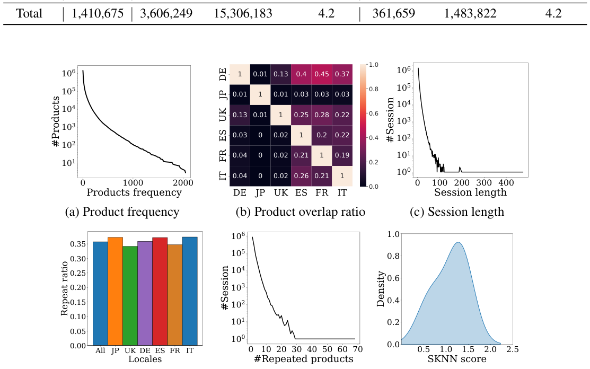
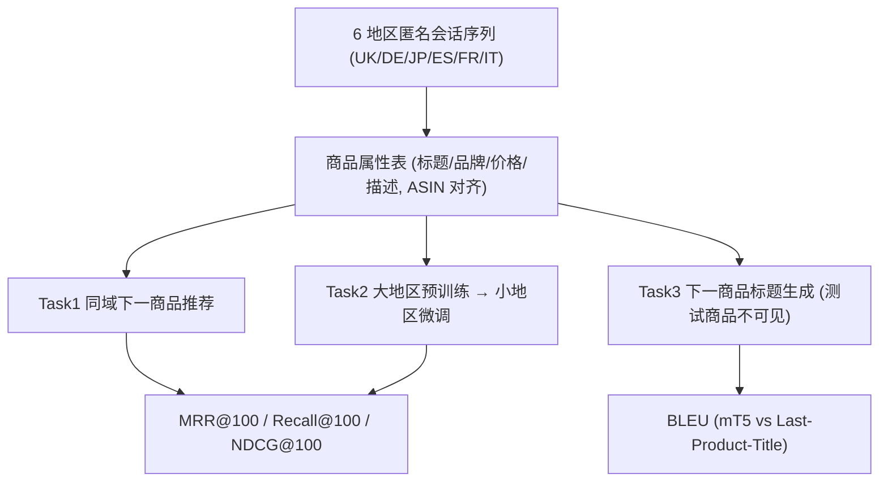

# Amazon-M2: A Multilingual Multi-locale Shopping Session Dataset for Recommendation and Text Generation (亚马逊多语言多地区购物会话数据集)

- **会议/期刊**: NeurIPS 2023, Track on Datasets and Benchmarks（KDD Cup 2023 官方赛题数据）
- **作者与机构**: Wei Jin, Haitao Mao 等（Amazon + Emory / MSU / PSU / UCLA）
- **推荐链路定位**: 召回（会话级 Next-Item 检索）+ 端到端文本生成
- **研究方向**: 序列与会话推荐 / 跨域与多场景推荐
- **论文原文**: [arXiv:2307.09688](https://arxiv.org/abs/2307.09688v2)
- **开源代码**: [Amazon KDD Cup 2023 官方站](https://kddcup23.github.io/)（数据与榜单；基线代码基于 RecBole 与 HuggingFace Transformers）

## TL;DR (1分钟核心速览)

现有会话推荐数据集缺商品文本属性、缺用户/地区多样性、商品规模仅数万级。本文构建 Amazon-M2：6 个地区（UK/DE/JP/ES/FR/IT）、6 种语言、141 万商品、360 万训练会话，并定义三任务：同域下一商品推荐、跨域（大地区预训练 $\to$ 小地区微调）推荐、以及测试集商品不可见的下一商品标题生成。基准评测（MRR@100 / Recall@100 / BLEU）给出反直觉结论：Popularity 在 MRR 上优于全部深度会话模型，Last-Product-Title 在 BLEU 上优于微调 mT5。

## Background & Motivation (背景与核心矛盾)

- **主流范式**: 会话推荐（GRU4Rec、NARM、STAMP、SRGNN、CORE、MGS）以匿名会话内的物品 ID 序列建模短期意图，评测依赖 Yoochoose / Tmall / Diginetica / Dressipi 等公开数据集。
- **前人局限**: ① 现有数据集仅提供 ID 或类别型属性（最大 Tmall 40,728 商品），无法研究文本/属性驱动的语义推荐与冷启动物品；② 全部为单地区单语言，用户多样性不足，也无法研究跨语言跨地区迁移与分布偏移。
- **核心洞察 (Key Insight)**: 真实电商场景同时存在「巨大商品库 + 多语言文本 + 地区间不均衡数据」；数据侧的长尾、约 35% 会话含重复点击、小地区与大地区商品重叠率最高可达 0.4，这三点共同决定了任务设计应包含流行度偏置、重复模式与迁移性检验。
- **本文切入点**: 用一个带完整商品属性表的多语言多地区会话数据集，把「会话推荐」从单一 ID 预测扩展为「推荐 + 迁移 + 文本生成」的统一评测床。

<figure class="paper-figure" markdown="span">
  <figcaption>图 2：Amazon-M2 上的数据分析。(a)(c)(e) 分别展示产品频率、会话长度分布以及单个会话中重复产品数量的长尾现象。(b) 展示不同地区之间的产品重叠率。(d) 展示不同地区中具有重复模式的会话比例。(f) 展示大多数会话都能找到具有高 SKNN 分数的相关产品。</figcaption>
</figure>

## Method (核心方法设计)

### 1. 整体框架 (Overall Architecture)

数据侧由两部分构成：用户会话序列（按时间排序的商品 ID 列表，来自 6 个 locale）与商品属性表（标题、品牌、颜色、价格、描述等，通过 ASIN 关联）。围绕该数据定义三个任务并统一评测：Task 1 在同分布大地区（UK/DE/JP）内做 Next-Product 预测；Task 2 先在大地区预训练、再在小地区（ES/FR/IT）微调，考察跨域知识迁移；Task 3 以最近 $K$ 个商品标题为输入，生成训练集中从未出现过的下一商品标题。所有模型在统一 MRR@100 / Recall@100 / BLEU 协议下对比。

### 2. 关键设计拆解 (Key Designs)

1. **多语言多地区会话构造与迁移性度量**：前人数据集无法量化「迁移是否有物质基础」。本文用商品集合重叠率刻画地区间可迁移性：$r_{a,b}=|\mathcal{V}_a\cap\mathcal{V}_b|/|\mathcal{V}_a|$，其中$\mathcal{V}_a$为地区$a$的商品集合。测得小地区与 DE 的重叠率可达约 0.4，而 UK 与 JP 之间仅 0.13，直接支撑了 Task 2「大地区$\to$ 小地区」的单向迁移设定，并说明多语言文本带来的形态学/分词差异是残余分布偏移源。

2. **Session-KNN 数据充分性诊断**：大商品库下协同信号是否还存在？作者用 SKNN 检索相似会话检验：$\mathrm{sim}(s,s_j)=|s\cap s_j|/\sqrt{|s||s_j|}$，候选打分$\mathrm{score}(e,s)=\sum_{n\in\mathcal{N}(s)}\mathrm{sim}(s,n)\mathbb{I}_n(e)$，并统计每个会话第 10 高分数。结果显示绝大多数会话第 10 高分接近 1，说明即使 141 万商品规模下仍能检索到 ≥10 个相关商品，CF 类增广依然可行。

3. **任务与训练目标设计**：Task 1/2 采用标准会话推荐损失（BPR/CE，由 RecBole 实现），Task 2 形式化为 $\theta^{*}=\arg\min_{\theta}\mathcal{L}_{\text{pre}}(\mathcal{D}_{\text{UK,DE,JP}})$后在$\mathcal{D}_{\text{ES,FR,IT}}$上微调；Task 3 用序列到序列目标$\max_{\theta}\sum_{t}\log p_{\theta}(\text{title}_{t+1}\mid \text{title}_{t-K+1:t})$ 微调 mT5。文本消融中尝试用 Multilingual Sentence-BERT 编码标题初始化物品向量，即 SRGNNF / GRU4RecF。

<figure class="paper-figure" markdown="span">
  <figcaption>图 1：所提出的 Amazon-M2 数据集示例。(a) 一个用户会话包含用户此前交互过的产品列表以及用户接下来将要交互的产品。用户会话来自多个地区，如 UK、ES、JP 等。需要注意的是，一个产品可以出现在多个地区。(b) 产品属性公开可用，并可在 Amazon.com 上访问。用户可通过产品的 ASIN 编号查找特定产品的信息。</figcaption>
</figure>

## Experimental Setup & Evaluation Protocol (实验设置与评估协议)

- **数据集与预处理**: 官方已划好 train/test，会话长度未见 5-core 过滤，保留长尾与短会话（均值 4.2）。

| 地区 | #Products | #Train Sessions | #Interactions | 平均长度 | #Test Sessions |
| :--- | :---: | :---: | :---: | :---: | :---: |
| UK | 500,180 | 1,182,181 | 4,872,506 | 4.1 | 115,936 |
| DE | 518,327 | 1,111,416 | 4,836,983 | 4.4 | 104,568 |
| JP | 395,009 | 979,119 | 4,388,790 | 4.5 | 96,467 |
| ES | 42,503 | 89,047 | 326,256 | 3.7 | 8,176 |
| FR | 44,577 | 117,561 | 416,797 | 3.5 | 12,520 |
| IT | 50,461 | 126,925 | 464,851 | 3.7 | 13,992 |
| 合计 | 1,410,675 | 3,606,249 | 15,306,183 | 4.2 | 361,659 |

- **数据划分与防穿越 (Splitting Strategy)**: 会话级独立 train/test 划分（KDD Cup 官方切分，测试会话与训练会话不重叠）；Task 3 额外从训练集随机取 10% 作验证集，且**测试集商品 ID 不出现在训练集**，属严格冷启动物品设定。
- **排名评测协议 (Ranking Protocol)**: Task 1/2 报告 MRR@100 与 Recall@100（附录补充 NDCG@100），基于 RecBole 默认的全候选排序流程；Task 3 报告 BLEU。无显著性检验，仅单次运行。
- **对比基线与超参设置**: Popularity 启发式 + GRU4Rec++ / NARM / STAMP / SRGNN / CORE / MGS（MGS 仅能吃类别属性，价格被离散化）；Task 3 为 mT5-small/base，$K=1,2,3$，对比 Last-Product-Title 启发式。

## Key Experimental Results (实验关键数据)

### 1. 主实验对比 (Main Results)

Task 1（同域下一商品推荐，Overall 为三地区平均）：

| 方法 | UK MRR | DE MRR | JP MRR | Overall MRR@100 | Overall Recall@100 |
| :--- | :---: | :---: | :---: | :---: | :---: |
| Popularity | 0.2302 | 0.2259 | 0.2766 | **0.2426** | 0.4243 |
| GRU4Rec++ | 0.1656 | 0.1578 | 0.2080 | 0.1757 | 0.3808 |
| NARM | 0.1801 | 0.1716 | 0.2255 | 0.1908 | 0.4180 |
| STAMP | 0.2050 | 0.1955 | 0.2521 | 0.2159 | 0.3512 |
| SRGNN | 0.1841 | 0.1767 | 0.2282 | 0.1948 | 0.4032 |
| CORE | 0.1510 | 0.1510 | 0.1846 | 0.1609 | **0.5591** |
| MGS | 0.1668 | 0.1739 | 0.2376 | 0.1907 | 0.5194 |

CORE 的 Recall@100 相对 Popularity 提升 **+31.8%**，但 MRR 反而低 33.7%；Popularity 的 MRR 相对最强深度模型 STAMP 提升 **+12.4%**。

Task 2（小地区，监督训练 vs 预训练+微调，Overall）：NARM 0.2632$\to$**0.2734**（MRR, +3.9%）、0.5920$\to$**0.6127**（Recall, +3.5%）；SRGNN 0.2640$\to$**0.2779**（+5.3%）、0.5429$\to$**0.5883**（+8.4%）；GRU4Rec++ 0.2564$\to$0.2646。CORE 在迁移下退化最严重（0.2045$\to$0.1720）。

### 2. 消融实验 (Ablation Study)

| 设置 | Overall MRR@100 | Overall Recall@100 | ΔMRR |
| :--- | :---: | :---: | :---: |
| SRGNN（随机初始化） | 0.2640 | 0.5429 | — |
| SRGNNF（SBERT 标题初始化） | 0.2303 | 0.4976 | −12.8% |
| GRU4Rec++ | 0.2564 | 0.5856 | — |
| GRU4RecF（SBERT 标题初始化） | 0.2427 | 0.5454 | −5.3% |
| SRGNN + 跨域预训练 | **0.2779** | 0.5883 | +5.3% |
| mT5-small, $K{=}1$ (BLEU) | 0.2265 | — | — |
| mT5-base, $K{=}1$ (BLEU) | 0.2251 | — | — |
| Last-Product-Title (BLEU) | **0.2677** | — | +18.2% |

### 3. 关键实验发现 (Key Findings)

1. **流行度偏置极强，排序与召回能力解耦**：Popularity 在 Overall MRR 上以 0.2426 胜过全部深度模型（次优 STAMP 0.2159），但 CORE 靠"会话向量=物品向量线性组合"的表示约束把 Recall@100 拉到 0.5591（较 Popularity +31.8%）——说明大商品库下深度模型能"捞到"正确物品却排不进前列，MRR 与 Recall 的鸿沟是本数据集最尖锐的开放问题。
2. **跨语言跨地区预训练确有正收益，但依赖商品重叠**：所有 RNN/GNN 基线在"大地区预训练 $\to$小地区微调"后 MRR 一致提升（NARM +3.9%、SRGNN +5.3%），与图中 ES/FR/IT 对 DE 约 0.4 的商品重叠率相互印证；而依赖全局物品嵌入结构的 CORE 在域偏移下退化（0.2045$\to$0.1720），暴露其对齐方式对非重叠商品不鲁棒。
3. **通用多语种文本编码器即插即用是负收益，"复制上一商品"是强基线**：SBERT 标题初始化使 SRGNN 掉 12.8% MRR、GRU4Rec++ 掉 5.3%；Task 3 中 mT5-small（0.2265 BLEU）与 mT5-base（0.2251）均低于 Last-Product-Title（0.2677），且增大 $K$（1$\to$3）反而降到 0.2142——表明产品标题域与预训练语料严重错配，且下一商品与最近一次点击高度相关。

## Highlights & Limitations (亮点、对比与审稿批判)

- **与代表作对比 (vs. Prior Work)**: 相对 Yoochoose/Tmall/Diginetica/Dressipi，本文是首个同时具备文本属性、多语言、多地区、百万级商品（1.41M vs 3–4 万）的会话数据集；相对 Task 2 相关跨域推荐工作，本文提供的是同一平台内真实 locale 分布偏移，而非人工构造的域对；相对 LLM4Rec 工作，额外提供"测试商品不可见"的标题生成任务作为冷启动代理评测。
- **可迁移亮点**: ① 用 SKNN 第 10 高分分布做"协同信号充分性"体检，可低成本判断新场景是否值得上 GNN/CF 增广；② 用地区间商品重叠率 $r_{a,b}$ 预估迁移收益上限，可迁移到多业务线/多国家站的跨域建模前置分析。
- **审稿级局限批判**: ① 评测仅单次运行、无显著性检验，且候选打分是否 Full-Ranking 与负采样比例未在正文明确交代，MRR@100 的绝对可比性存疑；② 只 benchmark 了 2020 年前的会话模型，缺 SASRec/BERT4Rec/浅层线性与图对比学习等现代基线，也未给出工业级训练开销与在线延迟分析；③ Task 3 的 BLEU 无法反映标题的"可推荐/可搜索"质量，且未探索多语种领域内继续预训练。

## Rating (四维评分)

- **方法创新性 (Novelty)**: ⭐⭐⭐ （数据集与任务定义新颖——首个多语言多地区会话集与"不可见商品标题生成"任务，但建模层面未提出新算法）
- **评估协议与实验扎实度 (Protocol & Experiments)**: ⭐⭐⭐⭐ （三任务 + 6 地区 + 文本消融与迁移对照完整，扣分在缺显著性检验与现代基线）
- **写作与数学规范度 (Clarity & Rigor)**: ⭐⭐⭐⭐ （SKNN、重叠率、迁移目标公式清晰，数据分析图信息密度高；但候选打分协议与超参细节下放附录）
- **工业落地与复现价值 (Industrial & Practical Value)**: ⭐⭐⭐⭐⭐ （百万级真实商品 + 多语言文本 + KDD Cup 公开榜单，直接对标跨境电商冷启动与跨站迁移，落地与复现门槛低）

