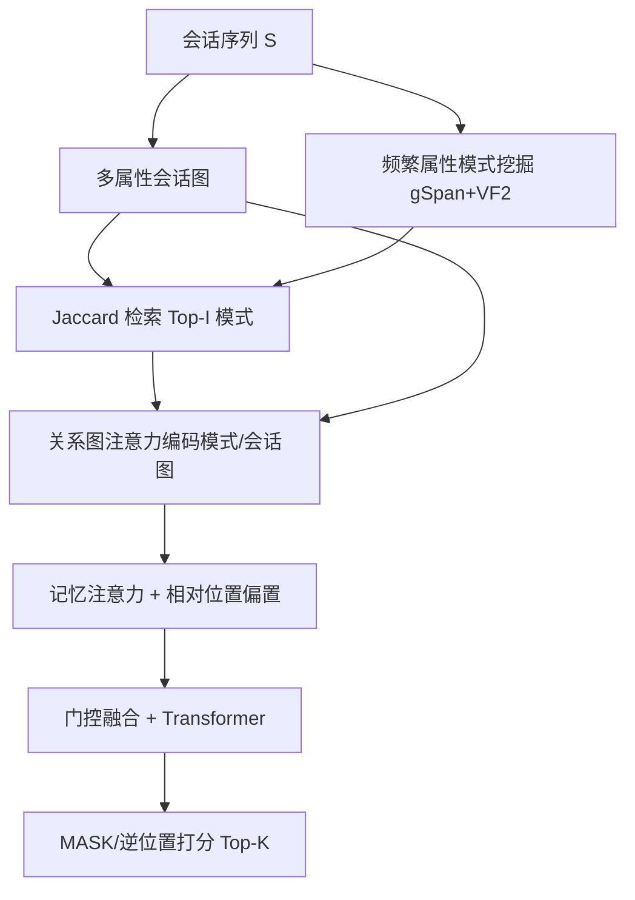
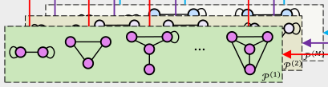

# Enhancing User Intent Capture in Session-Based Recommendation with Attribute Patterns (基于属性模式的会话推荐用户意图增强)

- **会议/期刊**: NeurIPS 2023
- **作者与机构**: Xin Liu, Zheng Li, Yifan Gao, Jingfeng Yang, Tianyu Cao, Zhengyang Wang, Bing Yin, Yangqiu Song；HKUST & Amazon
- **推荐链路定位**: 召回/排序（Next-Item Prediction）
- **研究方向**: 序列与会话推荐 / 图神经网络与知识图谱推荐
- **论文原文**: [论文原文链接](https://arxiv.org/abs/2312.16199v1)
- **开源代码**: [开源代码仓库链接](https://github.com/HKUST-KnowComp/FAPAT)

## TL;DR (1分钟核心速览)

针对会话图丢失时序、全局转移图噪声与过平滑，FAPAT 用频繁属性图模式作记忆增强 Transformer 会话编码。在 diginetica/Tmall 与约1亿点击工业数据上，Hits/NDCG/MRR 平均提升约4.5%，Tmall Hits@10 相对提升14.19%。

## Background & Motivation (背景与核心矛盾)

- **主流范式**: 序列模型（GRU4Rec/STAMP）建模会话内时序依赖；图模型（SR-GNN/GCE-GNN）引入局部或全局 item 转移图补足协同信号。
- **前人局限**: 序列模型难捕捉非相邻 item 关联；全局转移图易受随机点击噪声影响，且图过密导致过平滑；序列转图还会抹掉时序，不同会话可能得到相同会话图。
- **核心洞察 (Key Insight)**: 属性侧知识不应只作为 item 辅助特征，而应组织为多路属性图；高频、紧凑的属性 graphlet 可作为“意图超边”，比全图更抗噪、更稀疏。
- **本文切入点**: 挖掘频繁属性图模式，经 Jaccard 检索后作为外部记忆，回注到保留时序的 Transformer 会话编码中。

## Method (核心方法设计)

### 1. 整体框架 (Overall Architecture)

FAPAT 先把会话序列按不同属性拆成多路属性会话图，离线用 gSpan 挖掘高频属性 graphlet，并以 VF2 去除被包含的松散子图；在线对每条会话按 Jaccard 相似度检索 Top-I 模式，用关系图注意力编码模式与属性会话图，再把这些图表征映射回序列位置。随后将模式 token、CLS、会话 item token、MASK 拼接，经带 T5 相对位置偏置的单向记忆注意力与门控融合多属性信息，最后由 Transformer block 聚合全局会话并做内积 top-K 预测。

<figure class="paper-figure" markdown="span">
  <figcaption>图3：FAPAT 概览。</figcaption>
</figure>

### 2. 关键设计拆解 (Key Designs)

1. **频繁属性模式挖掘与检索**：全图属性关联过密且噪声大，本文只保留≤4节点、含环或三角的20类 graphlet，并用子图同构过滤冗余模式；检索按 $J(V_S^{(m)},V_P^{(m)})=\frac{|V_S^{(m)}\cap V_P^{(m)}|}{|V_S^{(m)}|+|V_P^{(m)}|-|V_S^{(m)}\cap V_P^{(m)}|}$ 取 Top-I。直觉是把“高频意图团”压缩成稀疏记忆，降低图密度与过平滑。
2. **图嵌套记忆增强**：痛点在于图表征缺少时序、序列表征缺少高阶关联。本文用多关系图注意力编码模式与各属性会话图，平均池化为模式向量 $p^{(m)}$，再与序列 token 拼接做单向 memory attention；门控融合为$\hat{\mathbf{h}}_i=\sum_{m=1}^{M}\beta_i^{(m)}\hat{\mathbf{h}}_i^{(m)}+\mathbf{h}_i$，其中$\beta_i^{(m)}=\mathrm{softmax}(\mathbf{W}_\beta^{(m)}\mathbf{h}_i^{(m)}+\mathbf{b}_\beta^{(m)})$。这样既保留最近意图，又注入属性模式。
3. **训练目标、负采样与推理效率**：采用 BPR 式相似度目标 $\mathcal{L}_{\mathrm{BPR}}=-\log\sigma(\mathbf{u}^\top\mathbf{e}_{v^+}-\mathbf{u}^\top\mathbf{e}_{v^-})$（或交叉熵），预测为$\hat{y}=\arg\max_v\mathbf{u}^\top\mathbf{e}_v$。正文未强调难负采样设计；模式检索因$|V_P|\le4$ 近似线性，推理为全库内积 top-K。

## Experimental Setup & Evaluation Protocol (实验设置与评估协议)

- **数据集与预处理**: 公开集为 diginetica/Tmall；工业集含 Beauty、Books、Electronics 三域，按最近成功购买前后20分钟切会话并去长尾。

| 数据集 | #Users | #Items | #Interactions | 稀疏度/特征/场景说明 |
| :--- | :---: | :---: | :---: | :--- |
| diginetica | 未披露 | 未披露 | 未披露 | 电商浏览日志；正文统计见附录C |
| Tmall | 未披露 | 未披露 | 未披露 | 电商购物日志；正文统计见附录C |
| Beauty / Books / Electronics | 未披露 | 未披露 | 合计≈1亿点击 | 20分钟会话、去长尾、多属性工业数据 |

- **数据划分与防穿越 (Splitting Strategy)**: 公开集沿用官方 SBR 设置（末次行为为目标、前缀为输入，细节见附录）；工业集按时间窗口切会话，避免未来行为泄漏。
- **排名评测协议 (Ranking Protocol)**: 作为排序问题评测，采用 Full-Ranking（全库未交互排序），报告 Hits/NDCG/MRR@10/20；正文未报告采样负例比例。
- **对比基线与超参设置**: 对比7个序列基线（FPMC/GRU4Rec/NARM/STAMP/CSRM/S3-Rec/M2TRec）与6个图基线（SR-GNN/GC-SAN/S2-DHCN/GCE-GNN/LESSR/MSGIFSR）；公开集取2020–2024五种子均值，t 检验 $p<0.0001$；工业集固定种子，嵌入维度按官方实现。

## Key Experimental Results (实验关键数据)

### 1. 主实验对比 (Main Results)

| 模型 | digi H@10 | digi N@10 | digi M@10 | Tmall H@10 | Tmall N@10 | Tmall M@10 |
| :--- | ---: | ---: | ---: | ---: | ---: | ---: |
| GRU4Rec | 36.77 | 20.71 | 15.80 | 18.82 | 12.28 | 10.25 |
| STAMP | 33.59 | 18.89 | 14.41 | 24.32 | 16.55 | 14.12 |
| CSRM | 33.97 | 19.43 | 14.98 | 25.13 | 18.56 | 16.48 |
| S3-Rec‡ | 33.48 | 18.58 | 14.04 | 18.24 | 12.30 | 10.46 |
| SR-GNN | 35.21 | 19.68 | 14.94 | 18.21 | 12.11 | 10.20 |
| GCE-GNN | 36.32 | 20.77 | 16.02 | 28.33 | 20.01 | 17.32 |
| LESSR | 33.68 | 18.71 | 14.14 | 20.99 | 14.64 | 12.13 |
| MSGIFSR | 34.74 | 19.43 | 14.76 | 23.18 | 15.19 | 12.69 |
| **FAPAT‡** | **37.42** | **21.31** | **16.39** | **32.45** | **22.02** | **18.72** |
| **Improv.** | **3.03%** | **2.60%** | **2.31%** | **14.19%** | **10.04%** | **8.08%** |

### 2. 消融实验 (Ablation Study)

| 变体 | digi H@10 | digi MRR@10 | Tmall H@10 | Tmall MRR@10 | Beauty H@10 | Beauty MRR@10 |
| :--- | ---: | ---: | ---: | ---: | ---: | ---: |
| w/o Attr. | 36.82 | 16.29 | 31.53 | 18.86 | 88.70 | 67.11 |
| GraphFormer | 36.05 | 16.17 | 30.05 | 18.58 | 88.48 | 65.65 |
| Transformer | 36.30 | 16.02 | 28.83 | 18.30 | 88.10 | 65.90 |
| **FAPAT** | **37.42** | **16.39** | **32.45** | **18.72** | **92.72** | **76.29** |

### 3. 关键实验发现 (Key Findings)

- 公开集上 FAPAT 的 Hits@10 在 diginetica/Tmall 分别提升3.03%/14.19%；工业三域 Hits@10 提升2.82%–4.68%，说明属性模式在稀疏与富会话场景均有增益。
- 图密度是抗过平滑关键：局部会话图、GCE-GNN 全局图、LESSR 捷径图、MSGIFSR 异构图与 FAPAT 属性模式密度分别为3.658、114.910、25.447、2.598、1.117，FAPAT 以最稀疏关联保留高阶意图。
- 图嵌套注意力优于 GraphFormer/Transformer：Tmall Hits@10 为32.45，对比30.05/28.83；属性估计在 Books 上达90.77，且周期推荐 Recall/NDCG 最优，证明模式记忆能增强深层意图捕捉。

## Highlights & Limitations (亮点、对比与审稿批判)

- **与代表作对比 (vs. Prior Work)**: SR-GNN 用局部会话图但丢时序；GCE-GNN 引入全局图但图过密、噪声重；S3-Rec/M2TRec 依赖属性预训练或多任务，工业稀疏域不稳定。FAPAT 用稀疏高频 graphlet 作记忆，并把图信息回注序列，兼顾时序与高阶关联。
- **可迁移亮点**: Jaccard Top-I 模式检索可作即插即用记忆模块；graphlet 密度约束可迁移到知识图谱推荐与多模态属性图，缓解过平滑。
- **审稿级局限批判**: 频繁模式需离线挖掘与属性维护，冷启动物品或属性缺失时收益可能下降；实验以离线 top-K 为主，缺少线上 A/B 与推理延迟报告，周期推荐仍受自回归误差累积影响。

## Rating (四维评分)

- **方法创新性 (Novelty)**: ⭐⭐⭐⭐ （属性 graphlet 作记忆增强 Transformer，图-序列回注机制清晰且有密度分析支撑）
- **评估协议与实验扎实度 (Protocol & Experiments)**: ⭐⭐⭐⭐ （公开集多种子+t检验，工业三域约1亿点击，消融/属性估计/周期推荐较完整）
- **写作与数学规范度 (Clarity & Rigor)**: ⭐⭐⭐⭐ （公式与模块职责明确，检索与门控推导简洁；部分数据统计留在附录）
- **工业落地与复现价值 (Industrial & Practical Value)**: ⭐⭐⭐⭐ （代码开源，模式密度低、检索近线性；需权衡离线挖掘与属性质量维护成本）

