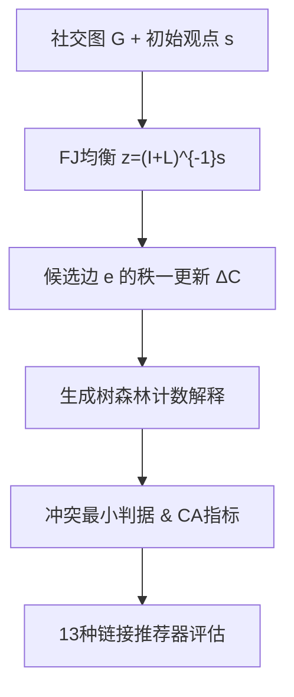
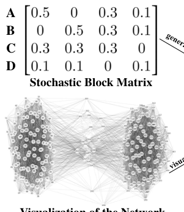

# On the Relationship Between Relevance and Conflict in Online Social Link Recommendations (在线社交链接推荐中相关性与冲突的关系)

- **会议/期刊**: NeurIPS 2023
- **作者与机构**: Yanbang Wang, Jon Kleinberg（Cornell University）
- **推荐链路定位**: 召回（社交好友/链接推荐）
- **研究方向**: 社交与群组推荐 / 去偏公平与可信推荐
- **论文原文**: [论文原文链接](https://arxiv.org/abs/2310.14076v4)
- **开源代码**: [开源代码仓库链接](https://github.com/Abel0828/NeurIPS23-Conflict-Relevance-in-FJ)

## TL;DR (1分钟核心速览)

本文首次用FJ观点动力学剖析社交链接推荐中“相关性”与“冲突减少”的关系：证明加边必不增冲突，给出闭式$\Delta C$与生成树森林解释，并提出冲突感知CA指标。在Reddit/Twitter上评估13种算法，R-GCN的CA≈0.95而Jaccard<0.2，说明部分高准确率算法更降冲突，二者部分对齐而非根本对立。

## Background & Motivation (背景与核心矛盾)

- **主流范式**: 社交链接推荐通常以链接预测/接受概率为目标；“过滤气泡”理论则担心推荐会强化同质连接、加剧极化与分歧。
- **前人局限**: 过滤气泡的经验证据并不一致；同时，链接预测长期只优化相关性，缺少“推荐链接如何改变网络冲突”的原则性刻画。
- **核心洞察 (Key Insight)**: 加边本质上是提升网络连通性，因此冲突未必上升；冲突最小链接同时受“全局簇位置差”和“局部连通性”约束，这与相关性偏好的近邻结构存在部分重叠。
- **本文切入点**: 基于FJ模型推导加边冲突变化的闭式表达，用生成树森林计数解释结构特征，再以冲突感知CA量化13种推荐算法的相关性与冲突减少对齐程度。

## Method (核心方法设计)

### 1. 整体框架 (Overall Architecture)

给定社交图$G$与初始观点$s$，FJ均衡给出表达观点$z=(I+L)^{-1}s$，冲突$C=s^{\top}(I+L)^{-1}s$。对候选边$e$用Sherman-Morrison做秩一更新，得到$\Delta C$闭式；再用生成树森林计数解释局部/全局距离，导出冲突最小链接判据。进一步定义CA：算法推荐链接的$\Delta C$与最优$\Delta C^*$之比，并以凸优化求$\Delta C^*$作上界。最后在Reddit/Twitter上把13种链接推荐器的CA与Recall/P@10对齐比较。

### 2. 关键设计拆解 (Key Designs)

1. **加边冲突变化的闭式表达**：前人只知“推荐可能加剧极化”，本文证明任意加边$e=(i,j)$的冲突变化为$\Delta_{+e}C=-\frac{(z_i-z_j)^2}{1+b_e^{\top}(I+L)^{-1}b_e}\le0$；对随机初始观点取期望亦有$\Delta_{+e}\mathbb{E}_s[C]=-\frac{\sigma^2\|(I+L)^{-1}b_e\|_2^2}{1+b_e^{\top}(I+L)^{-1}b_e}\le0$。直觉是加边提升连通性、压缩表达观点差异，故纯加边不会增加冲突。

2. **生成树森林距离解释冲突最小链接**：局部项可写为$b_e^{\top}(I+L)^{-1}b_e=N^{-1}(N_{ij}+N_{ji})$，全局项为$\sigma^2\|(I+L)^{-1}b_e\|_2^2=\sigma^2N^{-2}\sum_k(N_{ik}-N_{jk})^2$，其中$N$为生成根森林总数。由此得判据：单议题下两端点应“网络近、观点远”；随机议题下应“全局跨簇、局部仍较好连通”。图1的杠铃网络示例中，同簇Group1仅$-0.062$，跨桥Group2/3达$-0.410/-0.415$，直观验证全局簇差主导、局部连通略增益。

<figure class="paper-figure" markdown="span">
  <figcaption>图1：由随机块模型生成的具有簇和桥结构的杠铃状社交网络。不同链接组具有不同的结构特征，加入网络时会产生不同的预期冲突变化，如右图所示。样本均值及其95%区间基于重复模拟报告。注意，本示例为说明目的给出一个特殊网络，但我们对定理3、4和推论1的解释适用于任何网络。</figcaption>
</figure>

3. **冲突感知CA与凸优化基准**：定义$CA(f)=\Delta_f C/\Delta_{f^*}C$，将算法推荐链接的冲突减少量归一化到$[0,1]$；$\Delta_{f^*}C$是在预算$\beta$与Laplacian约束下的凸优化解。本文不训练统一推荐器，故无总损失；各算法打分按$w_h(e)=\beta s_h(e)/\sum_e s_h(e)$线性缩放使总权重为$\beta$。评估负采样率$\eta\in[1,10]$；凸优化基准可解但仅作离线上界，在线推理开销主要取决于各被评估推荐器。

## Experimental Setup & Evaluation Protocol (实验设置与评估协议)

- **数据集与预处理**: 两个真实社交网络均只保留最大强连通分量（SCC），初始观点由文本工具映射。

| 数据集 | #Users | #Items | #Interactions | 稀疏度/密度 | 特征/场景说明 |
| :--- | :---: | :---: | :---: | :---: | :--- |
| Reddit | 556 | — | 8969 | 5.81% | r/Politics，LIWC观点 |
| Twitter | 548 | — | 3638 | 2.43% | Delhi选举相关，情感工具观点 |

- **数据划分与防穿越 (Splitting Strategy)**: 预算式留出链接划分（非Leave-One-Out）：随机取$\beta=100$条正链接从图中移除作测试，再采样$\beta\eta$条负链接；重复10个随机种子。只有正链接可真正加入网络，负链接被推荐则无效。
- **排名评测协议 (Ranking Protocol)**: `Sampled Ranking`（非Full-Ranking），负采样率$\eta\in[1,10]$控制难度；报告Recall、Precision@10与CA。
- **对比基线与超参设置**: 13种方法分三类：无监督距离（PPR、Katz、Jaccard、Adamic-Adar、Common Neighbors、Preferential Attachment、Resource Allocation）、自监督图学习（Node2Vec+LR、GCN、R-GCN、Graph Transformer、SuperGAT）、冲突最小化凸优化器。典型超参：PPR $\alpha=0.85$，Katz$\alpha=0.5$，Node2Vec$d=64$、窗口10、$p=2,q=0.5$；GCN/R-GCN 2层32维+MLP；SuperGAT 2层64维；Graph Transformer 2层32维、4头。10种子取均值，主实验未报告$p$值。

## Key Experimental Results (实验关键数据)

### 1. 主实验对比 (Main Results)

原文以图2/图7呈现CA、Recall与P@10曲线，未给完整数值表；下表为可复原的关键读数与趋势，不虚构精确值；原文亦无统一`Improv.%`。

| 方法 | 类别 | CA（Reddit） | CA（Twitter） | Recall/P@10 | 读图结论 |
| :--- | :--- | :---: | :---: | :---: | :--- |
| PPR | 无监督距离 | 中 | 中 | 较高 | 经典近邻启发式 |
| Jaccard | 无监督距离 | **<0.2** | 低 | 中 | 冲突感知最弱之一 |
| Common Neighbors | 无监督距离 | 中 | 中 | 较高 | 局部邻近强 |
| Node2Vec+LR | 自监督图学习 | 中高 | 中 | 较高 | 表征优于纯启发式 |
| GCN | GNN | 高 | 较高 | 高 | 对$\eta$较稳健 |
| R-GCN | GNN | **≈0.95@$\eta=1$** | 较高 | 高 | 最优CA之一 |
| Graph Transformer | GNN | 高 | 较高 | 高 | 稳健 |
| Conflict-Min Solver | 凸优化 | **最高（多数）** | **最高（多数）** | **最低** | 相关性极差 |

### 2. 消融实验 (Ablation Study)

本文非模型组件消融，以下为分析性“替换/去除”检验：

| 分析设置 | 对比对象 | 结果 | 解释 |
| :--- | :--- | :---: | :--- |
| Thm1验证：六数据集逐对加边 | 原图 vs 加边 | $\Delta C$全为负 | 加边不增冲突 |
| 仅全局簇差：同簇Group1 | 跨桥Group2/3 | $-0.062$vs$-0.410/-0.415$ | 全局位置差主导 |
| 局部连通强弱：桥C vs 桥D | Group2 vs Group3 | $-0.410$vs$-0.415$ | 局部连通略增益 |
| 仅冲突最小化solver | 相关性算法 | CA最高/Recall最低 | 目标错位 |
| $\eta$从1增至10 | 多数算法 | CA/Recall下降，GNN较稳 | 难负样本下相关性重要 |

### 3. 关键实验发现 (Key Findings)

- Reddit上$\eta=1$时R-GCN的CA≈0.95，而Jaccard多数设置<0.2；算法准确率与CA并非单调关系，部分高准确率GNN确实更降冲突，但并非全部。
- 图1示例中同簇加边仅减少0.062冲突，跨簇桥接边减少约0.41；说明“全局跨簇”比“局部近邻”更决定冲突减少量，局部连通只提供次要增益。
- 冲突最小化solver的Recall几乎最差却多数时候CA最高；其少量命中的正链接冲突减少效率极高，证明相关性与冲突减少存在错位但非完全不可调和。

## Highlights & Limitations (亮点、对比与审稿批判)

- **与代表作对比 (vs. Prior Work)**: 相较“过滤气泡”的理论叙事，本文给出FJ模型下的闭式反例与量化CA；相较传统链接预测只优化接受概率，本文把冲突减少作为第二评价轴；相较GNN链接预测基线，本文不提出新模型，而是审计其社会后果。
- **可迁移亮点**: CA可迁移为社交推荐/关注推荐的社会责任离线指标；生成树森林距离可作冲突感知链接打分特征；秩一更新闭式适合动态图增量审计。
- **审稿级局限批判**: 数据仅两个数百节点网络，FJ线性观点与文本映射观点较理想化；主实验以采样排序和读图趋势为主，缺完整数值表与显著性检验；凸优化基准计算重，且“降冲突反增不开心”的悖论$C+U=s^{\top}s$尚未解决。

## Rating (四维评分)

- **方法创新性 (Novelty)**: ⭐⭐⭐⭐⭐ （首次把FJ冲突变化、生成树森林计数与链接推荐相关性系统连接，闭式结果新颖）
- **评估协议与实验扎实度 (Protocol & Experiments)**: ⭐⭐⭐ （真实网络+13基线有价值，但数据小、采样排序、缺完整表和$p$值）
- **写作与数学规范度 (Clarity & Rigor)**: ⭐⭐⭐⭐⭐ （定理链清晰，森林计数解释严谨，CA凸性有证明）
- **工业落地与复现价值 (Industrial & Practical Value)**: ⭐⭐⭐ （代码开源、CA可作审计指标，但规模验证与在线部署证据不足）

