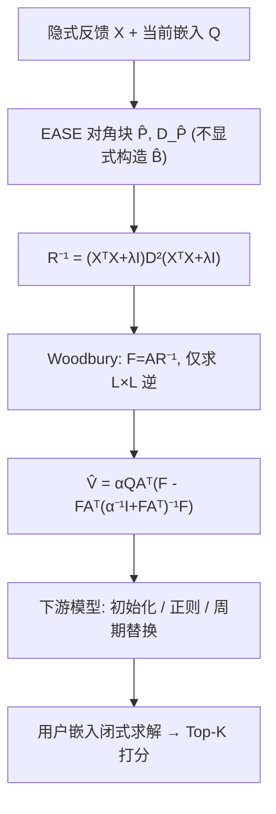
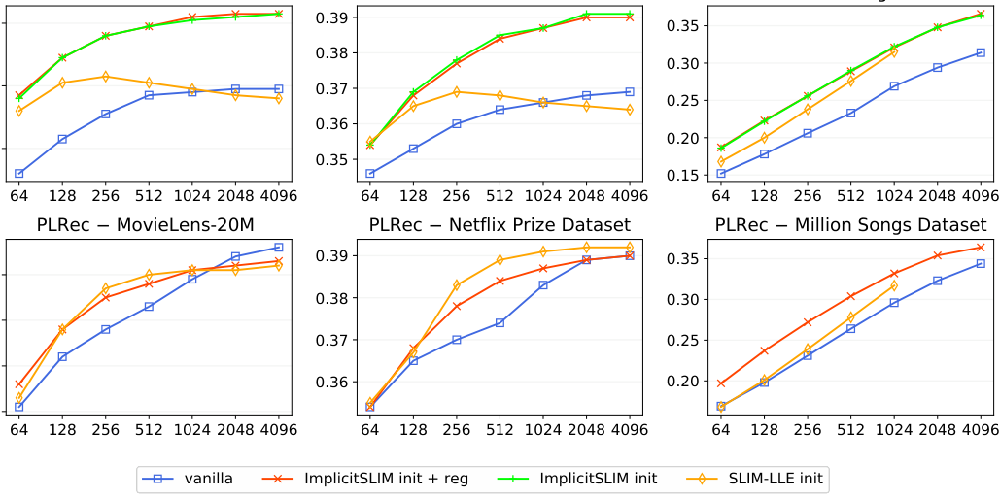
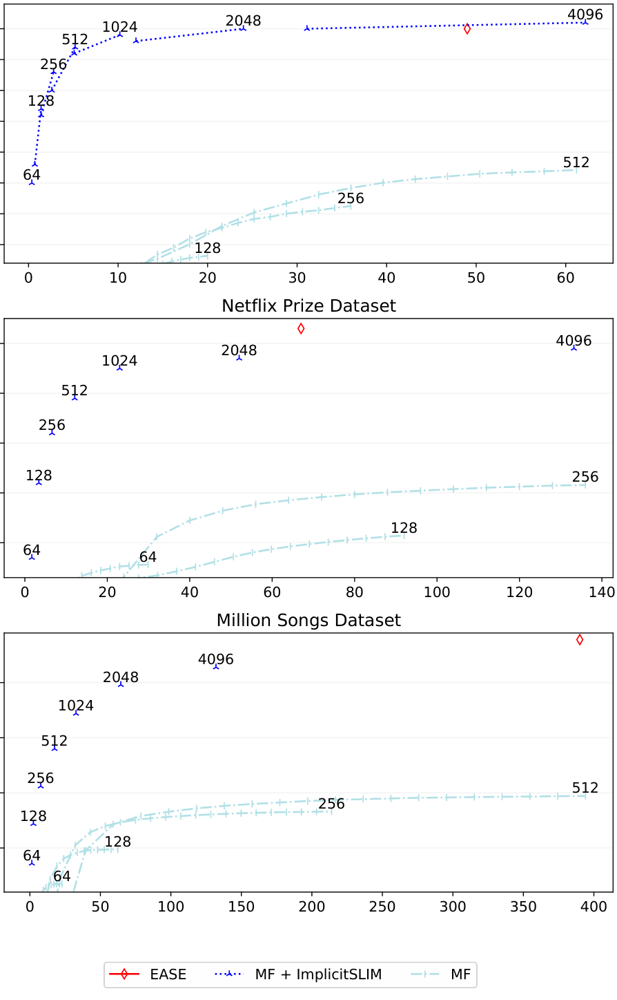

# ImplicitSLIM and How it Improves Embedding-based Collaborative Filtering (隐式 SLIM：如何提升基于嵌入的协同过滤)

- **会议/期刊**: ICLR 2024
- **作者与机构**: Ilya Shenbin, Sergey Nikolenko (Steklov 数学研究所, 圣彼得堡)
- **推荐链路定位**: 召回（嵌入学习 / 初始化与正则层，非独立打分模型）
- **研究方向**: 协同过滤与双塔召回 / 图神经网络与知识图谱推荐
- **论文原文**: [https://arxiv.org/abs/2406.00198v1](https://arxiv.org/abs/2406.00198v1)
- **开源代码**: [https://github.com/ilya-shenbin/ImplicitSLIM](https://github.com/ilya-shenbin/ImplicitSLIM)

## TL;DR (1分钟核心速览)

SLIM/EASE 类稀疏线性方法效果强，但需显式学习 $I\times I$物品相似度矩阵$\hat{B}$，空间$O(I^2)$、时间近$O(I^3)$，无法作为大模型的嵌入先验。本文发现 EASE 恰是 LLE 流形学习第一步的松弛形式，据此提出 ImplicitSLIM：把 LLE 两步压缩成单步闭式解，借助 Woodbury 恒等式让整个计算只涉及$L\times L$ 与小规模稀疏乘法，从"隐式 SLIM"中抽取嵌入，用于任意 CF 模型的初始化/正则。在 Full-Ranking 的强泛化协议下，MF Recall@20 提升 6.8%，RecVAE/H+Vamp 刷新 ML-20M 与 Netflix SOTA，并让深度模型收敛轮数减半。

## Background & Motivation (背景与核心矛盾)

- **主流范式**: 以可学习嵌入为核心的 CF——MF 内积、VAE 式自编码器、GCN 嵌入扩散；另一条线是 item-item 稀疏线性方法 (SLIM/EASE)，靠闭式解重建用户反馈。
- **前人局限**: (i) EASE 的 $\hat{B}$需对$I\times I$ 矩阵求逆并常驻内存，训练阶段即爆显存，且只能单独使用、无法注入其他模型；(ii) 已有的 item-item 正则（CoFactor、GRALS 图正则）要么依赖 word2vec 共现，要么构造稠密邻接，缺乏可扩展的闭式先验。
- **核心洞察 (Key Insight)**: EASE 的优化目标 $\|X-XB\|_F^2+\lambda\|B\|_F^2,\ \mathrm{diag}B=0$与 LLE 第一步仅差一个"列和为 1"约束，因此"SLIM 相似度"可以作为 LLE 的局部重建权重，进而用 LLE 第二步直接导出嵌入；而第二步的闭式解可以被代数化简，使$\hat{B}$ 从不落地。
- **本文切入点**: 把 LLE 第二步改写为"以已有嵌入 $Q$为先验的无约束优化"，用 Woodbury 恒等式绕开$I\times I$逆矩阵，得到$O(L\cdot\max(U,I))$ 的嵌入抽取算子。

## Method (核心方法设计)

### 1. 整体框架 (Overall Architecture)

输入隐式反馈矩阵 $X\in\{0,1\}^{U\times I}$与任意下游模型的当前物品嵌入$Q$（随机初始化或外部模型给出）。ImplicitSLIM 先以 EASE 形式得到$\hat{P}=(X^\top X+\lambda I)^{-1}$及其对角块$D_{\hat{P}}$，再将其代入 LLE 第二步的松弛目标，用 Woodbury 恒等式把$I\times I$求逆降为$L\times L$求逆，输出精炼嵌入$\hat{V}$。$\hat{V}$以三种方式回流：初始化$Q$、作为正则项与 CF 损失交替优化、或周期性直接替换$Q$（适用于 SGD 训练的 VAE/GCN/序列模型）。物品侧与用户侧（转置$X^\top$）对称可用。

### 2. 关键设计拆解 (Key Designs)

1. **SLIM-as-LLE 的桥接（SLIM-LLE）**：把 LLE 的邻域取为全体物品 $\{1..I\}\setminus\{i\}$并加回 Frobenius 正则，得到$\hat{B}=\arg\min_B\|X-XB\|_F^2+\lambda\|B\|_F^2$s.t.$\mathbf{1}^\top B=\mathbf{1},\ \mathrm{diag}B=0$——即"带列和约束的 EASE"。第二步按 LLE 求$\hat{V}=\arg\min_V\|V-V\hat{B}\|_F^2$s.t.$\frac{1}{n}VV^\top=I,\ V\mathbf{1}=0$。这条路径直觉清晰但仍是显式 SLIM（贵的部分没省），仅作为理论跳板与上界参照。

2. **ImplicitSLIM：把两步压成单步闭式解**：将第二步改成带先验的无约束问题 $\hat{V}=\arg\min_V\|V-V\hat{B}\|_F^2+\alpha\|(V-Q)A^\top\|_F^2$，解得$\hat{V}=\alpha QA^\top A\big((\hat{B}-I)(\hat{B}-I)^\top+\alpha A^\top A\big)^{-1}$。关键一步是代入$\hat{B}-I=-\hat{P}D_{\hat{P}}^{-1}\hat{P}$，记$R=\hat{P}D_{\hat{P}}^{-2}\hat{P}\hat{P}$且$R^{-1}=(X^\top X+\lambda I)D_{\hat{P}}^{2}(X^\top X+\lambda I)$，再对$A$做 Woodbury 展开，最终$\hat{V}=\alpha QA^\top\big(F-FA^\top(\alpha^{-1}I+FA^\top)^{-1}F\big),\ F\stackrel{def}{=}AR^{-1}$。由于$A$取$L\times I$（默认$A=Q$），中间量最大仅$L\times\max(U,I)$，且$D_{\hat{P}}$用$\mathrm{diagMat}(\mathbf{1}\oslash\mathrm{diag}(X^\top X+\lambda I))$近似避免任何$I\times I$求逆——物理直觉是：只用"对角缩放 + 稀疏 Gram 矩阵乘法"承载 item-item 结构，稠密相似度矩阵被彻底消去。正则项$\|(V-Q)A^\top\|_F^2$在$A=Q$时等价于近似的成对距离约束$VQ^\top\approx QQ^\top$。

3. **训练目标、负采样与推理效率**：总损失为 $\mathcal{L}=\mathcal{L}_{CF}(\Theta,Q)+\|V-V\hat{B}\|_F^2+\alpha\|(V-Q)A^\top\|_F^2$，对$(\Theta,Q)$与$V$交替优化；$V$ 的更新即一次 ImplicitSLIM 调用（VAE/GCN/序列模型每若干 epoch 调用一次）。全流程**免负采样**（EASE 家族以全矩阵重建代替采样），推理时用户嵌入用闭式最小二乘一次求得，在线仅需内积 ANN 检索，开销与普通双塔一致。

## Experimental Setup & Evaluation Protocol (实验设置与评估协议)

- **数据集与预处理**（沿用 Liang et al. 2018 / He et al. 2020 / Sun et al. 2019 三套公开划分）：

| 数据集 | #Users | #Items | #Interactions | 密度 | 特征/场景说明 |
| :--- | :---: | :---: | :---: | :---: | :--- |
| MovieLens-20M | 136,677 | 20,000 | ≈10.0M | ≈0.37% | 强泛化协议主干数据集 |
| Netflix Prize | 463,435 | 17,770 | ≈56.9M | ≈0.69% | 超大用户侧，验证可扩展性 |
| Million Songs | 571,355 | 41,328 | ≈49.4M | ≈0.21% | 极稀疏、长尾音频收藏 |
| Yelp2018 | 31,668 | 38,048 | ≈1.56M | ≈0.13% | LightGCN 式弱泛化评测 |
| MovieLens-1M | 6,040 | 3,706 | ≈1.00M | ≈4.5% | 弱泛化 + 序列评测 |

- **数据划分与防穿越 (Splitting Strategy)**: 三套并行协议——(1) **强泛化 Strong Generalization**（ML-20M/Netflix/MSD）：训练/验证/测试用户完全不相交，杜绝用户嵌入穿越；(2) **弱泛化比例划分**（Yelp2018/ML-1M）：按评分随机 8:1:1；(3) **Leave-One-Out**（BERT4Rec 协议）：每用户最后一条为测试、倒数第二条为验证。
- **排名评测协议 (Ranking Protocol)**: 协议 (1)(2) 为无偏 **Full-Ranking**（对全部未交互物品排序），报 Recall@{20,50}、NDCG@{100,20}；协议 (3) 为 **Sampled Ranking（1 正 : 100 负）**，仅报 Recall@{5,10}、NDCG@10，速度优先故数值偏高、跨表不可直接比较。
- **对比基线与超参设置**: 覆盖四族——MF/WMF(eALS)、item-item 正则类 CoFactor/GRALS、线性模型 SLIM/EASE/PLRec、非线性自编码器 CDAE/MultVAE/RaCT/RecVAE/H+Vamp(Gated)，另加 UltraGCN(图) 与 BERT4Rec(序列)。嵌入维度 $L$在$\{64,\dots,4096\}$上网格搜索，$\lambda,\alpha$与$L$由贝叶斯优化选取；显著性用单尾$t$ 检验（95% 置信）。

## Key Experimental Results (实验关键数据)

### 1. 主实验对比 (Main Results)

| 模型 | ML-20M R@20 | R@50 | N@100 | Netflix R@20 | R@50 | N@100 | MSD R@20 | N@100 |
| :--- | :---: | :---: | :---: | :---: | :---: | :---: | :---: | :---: |
| MF | 0.367 | 0.498 | 0.399 | 0.335 | 0.422 | 0.369 | 0.258 | 0.314 |
| MF + ImplicitSLIM | 0.392 | 0.524 | 0.423 | 0.362 | 0.445 | 0.390 | 0.309 | 0.366 |
| PLRec | 0.394 | 0.527 | 0.426 | 0.357 | 0.441 | 0.390 | 0.286 | 0.344 |
| PLRec + ImplicitSLIM | 0.391 | 0.522 | 0.423 | 0.358 | 0.440 | 0.390 | 0.310 | 0.364 |
| EASE | 0.391 | 0.521 | 0.420 | 0.362 | 0.445 | 0.393 | **0.333** | **0.389** |
| MultVAE | 0.395 | 0.537 | 0.426 | 0.351 | 0.444 | 0.386 | 0.266 | 0.316 |
| RaCT | 0.403 | 0.543 | 0.434 | 0.357 | 0.450 | 0.392 | 0.268 | 0.319 |
| RecVAE | 0.414 | 0.553 | 0.442 | 0.361 | 0.452 | 0.394 | 0.276 | 0.326 |
| RecVAE + ImplicitSLIM | **0.419** | **0.559** | 0.447 | 0.365 | 0.455 | 0.398 | 0.291 | 0.342 |
| H+Vamp(Gated) | 0.413 | 0.551 | 0.445 | 0.377 | 0.463 | 0.407 | 0.289 | 0.342 |
| H+Vamp(Gated) + ImplicitSLIM | 0.417 | 0.555 | **0.450** | **0.378** | **0.464** | **0.410** | 0.292 | 0.347 |
| **Improv.%（vs 对应骨干）** | +6.8% | +5.2% | +1.1% | +3.0% | +2.2% | +0.8% | +15.9% | +19.8% |

图 1 给出 MF/PLRec 在 $L=64\sim4096$ 上的 NDCG@100 曲线：`init+reg` 与纯 `init` 几乎重合，说明 ImplicitSLIM 抽出的嵌入本身已接近交替优化后的最优解。

<figure class="paper-figure" markdown="span">
  <figcaption>图 1：将 ImplicitSLIM 和 SLIM-LLE 应用于 MF 和 PLRec（设置见第 5 节）；X 轴为嵌入维度，Y 轴为 NDCG@100。</figcaption>
</figure>

### 2. 消融实验 (Ablation Study)

作者未设传统"删模块"表，而是以 **使用方式 × 骨干模型** 的交叉消融给出等价信息（下表为真实数值）：

| 骨干 / 变体 | 数据集 | Recall@20 | NDCG@20 | 说明 |
| :--- | :--- | :---: | :---: | :--- |
| LightGCN（参照） | Yelp2018 | 0.0649 | 0.0530 | 纯图扩散 |
| UltraGCN (w/o) | Yelp2018 | 0.0683 | 0.0561 | 强扩散基线 |
| + ImplicitSLIM (users) | Yelp2018 | 0.0689 | 0.0568 | 用户侧增益微弱 |
| + ImplicitSLIM (items) | Yelp2018 | **0.0692** | **0.0573** | 物品侧增益更大 |
| UltraGCN (w/o) | ML-1M | 0.2787 | 0.2642 | — |
| + ImplicitSLIM (items) | ML-1M | **0.2790** | **0.2659** | 边际但稳定 |
| BERT4Rec @30ep | ML-1M | 0.612 | 0.511 | 训练不足 |
| BERT4Rec+ISL @30ep | ML-1M | 0.660 | 0.549 | 同轮数大幅领先 |
| BERT4Rec @200ep | ML-1M | 0.645 | 0.545 | 充分训练 |
| BERT4Rec+ISL @200ep | ML-1M | **0.671** | **0.564** | 终局仍提升 |

此外 `SLIM-LLE init`（显式 SLIM 路径）在部分设置上可反超 ImplicitSLIM，但因 $O(I^2)$内存只能跑到很小的$L$，验证了"隐式化"是唯一可扩展选项。

### 3. 关键实验发现 (Key Findings)

1. **增益在稀疏与低维处最大**：MF 在 MSD（密度 0.21%）上 Recall@20 由 0.258→0.309（+15.9%）、NDCG@100 +19.8%，远高于 ML-20M 的 +6.8%/+1.1%；说明当用户-物品共现信号稀疏、单靠内积难以拟合 item-item 结构时，SLIM 先验的补位价值最高。
2. **"初始化即够用"**：图 1 中 `ImplicitSLIM init` 与 `init+reg` 曲线几乎重合，意味着抽取嵌入后甚至不必再用 ALS 更新；MF+IS 在高维已逼近 EASE（0.423 vs 0.420 NDCG@100），却只需 $O(L\cdot\max(U,I))$内存与$L\times L$ 求逆，是小显存场景下 EASE 的高性价比替代（图 3 给出 wall-clock 交叉点）。
3. **对深度/图/序列骨干同样有效且加速收敛**：RecVAE+IS 把 ML-20M NDCG@100 推到 0.447、H+Vamp+IS 推到 0.450，双双超过 EASE 的 0.420；BERT4Rec 在 30 epoch 即达 0.660/0.549，超过其原生 200 epoch 的 0.645/0.545——约一半训练成本换更高终局。

<figure class="paper-figure" markdown="span">
  <figcaption>图 3：MF、MF + ImplicitSLIM 和 EASE 的收敛图；X 轴为实际耗时（秒），Y 轴为 NDCG@100；MF 和 MF + ImplicitSLIM 使用图中所示的不同嵌入维度进行评估。</figcaption>
</figure>

## Highlights & Limitations (亮点、对比与审稿批判)

- **与代表作对比 (vs. Prior Work)**: 与 **EASE** 相比，本文不产出独立打分器，而是把 $\hat{B}$的结构"蒸馏"进任意嵌入模型，并把$I\times I$逆矩阵降为$L\times L$；与 **LRR**（先算相似度再做低秩近似）动机不同——LRR 求 top 特征向量做近似，本文直接改变算子结构绕开$\hat{B}$；与 **GRALS** 图正则相比，ImplicitSLIM 的正则等价于特定$\hat{B}$ 下的 Laplacian 正则，但正则矩阵由闭式解给出而非人工邻接，且无需稠密图存储。
- **可迁移亮点**: (i) "把强 item-item 模型当先验、用 Woodbury 把大逆矩阵降到低秩侧"这一代数技巧可迁移到任何需要 item-item 邻接的 GCN/对比学习正则；(ii) 周期性"嵌入替换"而非每步求导，是给 SGD 训练的重模型注入闭式先验的通用工程范式。
- **审稿级局限批判**: (i) 核心公式依赖 $D_{\hat{P}}$的对角近似（式 12），论文只给经验验证、无误差界，$X^\top X$病态时（超稀疏数据集）近似质量与收敛性缺乏保证；(ii) 超参由$(\lambda,\alpha,L,A,\text{更新频率})$ 五项联合贝叶斯搜索，而 EASE 仅 1 个超参，"更便宜"的结论只在特定显存/维度区间成立；用户侧嵌入在强泛化协议下几乎无收益，方法收益高度偏向物品侧，对双塔用户表征学习场景价值有限。

## Rating (四维评分)

- **方法创新性 (Novelty)**: ⭐⭐⭐⭐ （把 EASE 识别为 LLE 第一步的松弛形式并压成单步闭式解，属"结构性洞察 + 优雅代数"，但非全新学习范式）
- **评估协议与实验扎实度 (Protocol & Experiments)**: ⭐⭐⭐⭐ （三套划分、五个数据集、Full-Ranking 为主 + 单尾显著性检验，覆盖四族骨干；遗憾缺标准消融表与近似误差分析）
- **写作与数学规范度 (Clarity & Rigor)**: ⭐⭐⭐⭐ （推导链条完整、附录给出 LLE 对应关系与近似来源，复杂度分析清晰；但主文公式密集、符号 $D_{\hat{P}}$ 的近似动机略后置）
- **工业落地与复现价值 (Industrial & Practical Value)**: ⭐⭐⭐⭐ （代码开源、免负采样、内存线性于 $\max(U,I)$，可直接插入现有 MF/VAE/GCN 训练循环；扣分在于 5 个超参与周期性调用的工程调参成本）

