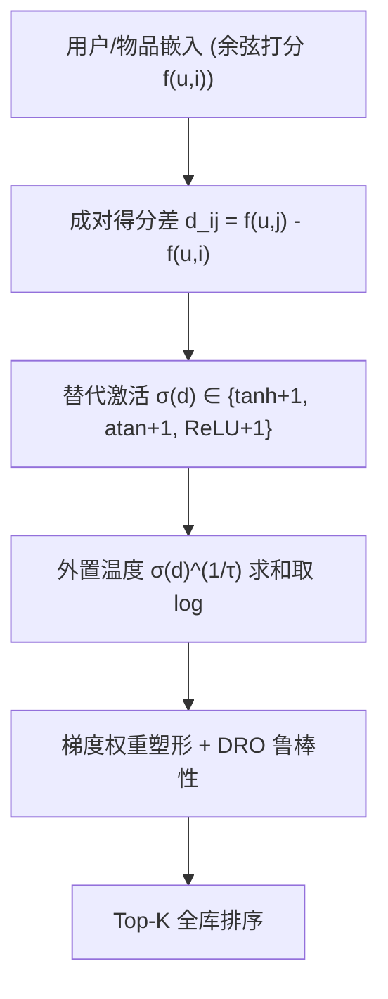
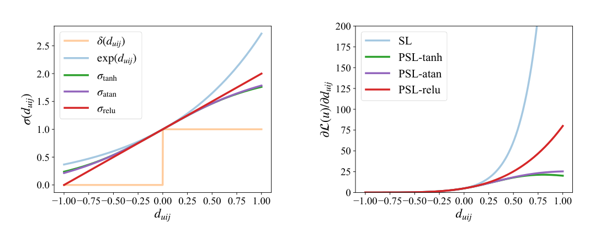
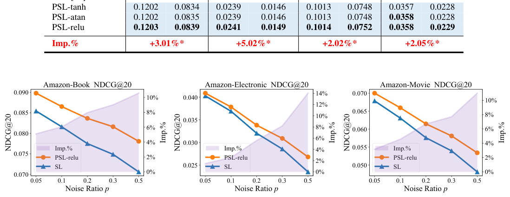

# PSL: Rethinking and Improving Softmax Loss from Pairwise Perspective for Recommendation (从成对视角重思并改进 Softmax 损失)

- **会议/期刊**: NeurIPS 2024
- **作者与机构**: Weiqin Yang, Jiawei Chen, Yan Feng, Chun Chen, Can Wang 等（浙江大学 / 山东大学 / 蚂蚁集团）
- **推荐链路定位**: 召回（CF 表征学习的训练目标层，端到端可插拔）
- **研究方向**: 协同过滤与双塔召回 / 自监督对比学习与交互去噪
- **论文原文**: [https://arxiv.org/abs/2411.00163v1](https://arxiv.org/abs/2411.00163v1)
- **开源代码**: [https://github.com/Tiny-Snow/IR-Benchmark](https://github.com/Tiny-Snow/IR-Benchmark)

## TL;DR (1分钟核心速览)

Softmax Loss (SL) 是当前 CF 召回的主流损失，但本文把它重写为成对形式后发现两处硬伤：exp 函数使 SL 与 DCG 的上界关系过松（τ<0.2 时更糟），且梯度权重正比于 $\exp(d_{uij}/\tau)$ 导致假负样本垄断训练。PSL 仅把 exp 替换为夹在阶跃函数与 exp 之间的有界激活（tanh/atan/ReLU），即获得"更紧 DCG 代理 + 可控权重分布 + KL-DRO 化 BPR"三重性质；在 6 个数据集、3 个骨干、三种测试场景（IID / OOD 热度漂移 / 假阴性注入）下，全库排序 NDCG@20 相对 SL 提升 1.1%–5.0%，噪声比 p=0.5 时提升超 10%。

## Background & Motivation (背景与核心矛盾)

- **主流范式**: 召回损失经历 pointwise（BCE/MSE）→ pairwise（BPR 及其 AUC 代理）→ listwise 的 Softmax Loss（采样 softmax / 对比学习范式），SL 现为 SOTA 并被广泛用于 LightGCN、XSimGCL 等骨干。
- **前人局限 1（代理不紧）**: DCG 中的排序位置等于阶跃函数之和 $\pi_u(i)=\sum_j \delta(d_{uij})$，SL 用$\exp(d_{uij}/\tau)$上界 δ；当$d_{uij}$ 偏大时二者差距爆炸（最优 τ 常小于 0.2），优化目标与 NDCG 脱节。
- **前人局限 2（噪声敏感）**: 曝光偏差造成大量假阴性（未交互≠不喜欢），这类物品得分高、$d_{uij}$大，梯度权重$\propto \exp(d_{uij}/\tau)$ 使其主导更新，训练震荡且精度下降。
- **核心洞察 (Key Insight)**: 上述两点根源都在 exp 而非 listwise 视角；且 BSL 宣称的 DRO 鲁棒性实为"放大难样本"，对假阴性反而更危险（其原文噪声实验增益并不增长）。
- **本文切入点**: 保持 listwise 归一化结构不变，仅将 exp 换成满足 $\delta(d)\le\sigma(d)\le\exp(d)$ 的替代激活，得到可解释、可证明、一行代码即改的 PSL 家族。

## Method (核心方法设计)

### 1. 整体框架 (Overall Architecture)

输入仍是用户/物品 $d$维嵌入（余弦相似度打分，缩放因子$1/2$可并入温度）。训练时每个正样本采样 1000 个负样本，按成对得分差$d_{uij}=f(u,j)-f(u,i)$ 计算 PSL，替换 SL 的 exp 后直接反传更新 MF / LightGCN / XSimGCL 的嵌入；推理时用最终嵌入做内积全库排序取 Top-K。整个替换不引入任何新参数，计算图结构与 SL 完全一致，仅激活算子与其温度位置改变。

### 2. 关键设计拆解 (Key Designs)

1. **成对重写与外置温度的 PSL 家族（更紧的 DCG 代理）**: SL 的 listwise 形式可等价写成 $\mathcal{L}_{\text{SL}}(u)=\sum_{i\in\mathcal{P}_u}\log\big(\sum_{j\in\mathcal{I}}\exp(d_{uij})^{1/\tau}\big)$，可见惩罚只依赖成对得分差。PSL 只替换底数：
$$\mathcal{L}_{\text{PSL}}(u)=\sum_{i\in\mathcal{P}_u}\log\Big(\sum_{j\in\mathcal{I}}\sigma(d_{uij})^{1/\tau}\Big),\quad \sigma_{\tanh}=\tanh(d)+1,\ \sigma_{\text{atan}}=\arctan(d)+1,\ \sigma_{\text{relu}}=\text{ReLU}(d+1)$$
温度必须外置（$\sigma(d)^{1/\tau}$而非$\sigma(d/\tau)$）：Lemma 4.1 表明只要$\delta(d)\le\sigma(d)\le\exp(d)$在$d\in[-1,1]$成立，PSL 就是比 SL 更紧的 DCG 上界；外置形式只需在$[-1,1]$ 上满足该夹逼，内置形式则要求在整个定义域成立，激活性状被严重约束，实验上性能亦受损。直觉：tanh/atan/ReLU 在正值区饱和，不会像 exp 那样把"已排对"的样本差无限放大。

<figure class="paper-figure" markdown="span">
  <figcaption>图1：(a) 不同替代激活函数的示意图。(b) 使用三种不同替代激活函数时，SL 与 PSL 的权重分布比较。此处设 τ = 0.2，该值在实践中通常能取得最优结果。</figcaption>
</figure>

2. **梯度权重塑形（抗假阴性）**: 对 $d_{uij}$求导得$\dfrac{\partial \mathcal{L}_{\text{PSL}}}{\partial d_{uij}}\propto \sigma'(d_{uij})\cdot\sigma(d_{uij})^{1/\tau-1}/\tau$，权重曲线的形状完全由$\sigma$决定。exp 的权重随$d$指数上升，假阴性被过度加权；而 ReLU 的权重在$d>0$ 后近常数、tanh/atan 则先升后饱和，形成"有界软难样本挖掘"。注意调 τ 只缩放不改形状（仍是指数族），故调参无法替代换激活，还会牺牲 OOD 鲁棒性。图 1(b) 直观显示 PSL 的权重分布在尾部被压平。

3. **DRO 等价性、总损失与效率**: Theorem 4.2 证明，以均匀分布 $\mathcal{P}$为基准、KL 半径$\eta$的不确定集$\mathcal{Q}$ 上做 DRO，等价于 PSL：
$$\min_\theta \mathcal{L}_{\text{PSL}}\iff \min_\theta \sup_{Q\in\mathcal{Q}}\mathbb{E}_{j\sim Q}\big[\log\sigma(d_{uij})\big],\quad \tau=\tau(\eta)$$
即 PSL = 在 KL-DRO 框架下鲁棒的 BPR；据此还能得到损失链 $-\log\text{DCG}\le\mathcal{L}_{\text{PSL}}\le\mathcal{L}_{\text{SL}}\le\mathcal{L}_{\text{AdvInfoNCE}}$与$\mathcal{L}_{\text{PSL}}\le\log\mathcal{L}_{\text{BPR}}$（AdvInfoNCE 相当于$\sigma=\exp(\exp(\cdot))$，是更松的上界）。总损失即上式在用户/正样本上的经验平均，负采样为每正样本 1000 个均匀负样本（免负采样不可行）；推理零额外开销，训练开销与 SL 同阶，主要成本仍是大量负样本前向。

## Experimental Setup & Evaluation Protocol (实验设置与评估协议)

- **数据集与预处理**: 全部按 `10-core` 过滤并剔除评分<3 的低质交互：

| 数据集 | #Users | #Items | #Interactions | 稀疏度 | 特征/场景说明 |
| :--- | :---: | :---: | :---: | :---: | :--- |
| Amazon-Book | 135,109 | 115,172 | 4,042,382 | 0.00026 | IID+噪声，超大规模 |
| Amazon-Electronic | 13,455 | 8,360 | 234,521 | 0.00208 | IID+OOD+噪声 |
| Amazon-Movie | 26,968 | 18,563 | 762,957 | 0.00152 | IID+噪声 |
| Gowalla | 29,858 | 40,988 | 1,027,464 | 0.00084 | 签到，IID+OOD+噪声 |
| Amazon-CD | 12,784 | 13,874 | 360,763 | 0.00203 | OOD（长尾→均匀） |
| Yelp2018 | 55,616 | 34,945 | 1,506,777 | 0.00078 | OOD（长尾→均匀） |

- **数据划分与防穿越**: 采用 `比例划分`——每用户正样本 80% 训练 / 20% 测试，训练集再切 10% 作验证（IID 与 Noise）。`OOD 划分`按物品均匀采样 20% 作测试、训练集保持长尾（模拟线上热度漂移），且不设验证集以避免测试分布泄漏。`Noise 划分`额外把训练集 10% 正样本标为假阴性，负采样以概率 $p\in\{0.05,0.1,0.2,0.3,0.5\}$ 命中它们。
- **排名评测协议**: 无偏 `Full-Ranking`——对每用户屏蔽训练集正样本后对全库打分排序，指标 `Recall@20` 与 `NDCG@20`（K=20）。
- **对比基线与超参**: 基线含 BPR(UAI'09)、LLPAUC(WWW'24)、SL(TOIS'24)、AdvInfoNCE(NeurIPS'23)、BSL(ICDE'24)，骨干为 MF / LightGCN(2 层) / XSimGCL(3 层)，嵌入维度 $d=64$，Adam + batch 1024 + 200 epoch，网格搜索 lr/weight decay/τ（τ 网格与 SL 完全一致），提升标注$p<0.05$ 显著性。

## Key Experimental Results (实验关键数据)

### 1. 主实验对比 (Main Results)

IID 场景、MF 骨干的 NDCG@20（Recall@20 见原文表 1）：

| Loss | Amazon-Book | Amazon-Electronic | Amazon-Movie | Gowalla | Imp.% vs SL |
| :--- | :---: | :---: | :---: | :---: | :---: |
| BPR | 0.0453 | 0.0527 | 0.0608 | 0.1111 | – |
| LLPAUC | 0.0811 | 0.0499 | 0.0883 | 0.1189 | – |
| SL | 0.1210 | 0.0529 | 0.0929 | 0.1624 | – |
| AdvInfoNCE | 0.1172 | 0.0527 | 0.0934 | 0.1627 | −3.1%~+0.5% |
| BSL | 0.1212 | 0.0530 | 0.0931 | 0.1630 | +0.1%~+0.5% |
| PSL-tanh | 0.1225 | 0.0535 | 0.0941 | 0.1646 | +1.0%~+1.4% |
| **PSL-relu** | **0.1227** | **0.0541** | **0.0945** | **0.1647** | **+1.40% / +2.31% / +1.72% / +1.42%*** |

OOD（热度漂移）场景、MF 骨干的 NDCG@20：

| Loss | Amazon-CD | Amazon-Electronic | Gowalla | Yelp2018 | Imp.% vs SL |
| :--- | :---: | :---: | :---: | :---: | :---: |
| BPR | 0.0318 | 0.0069 | 0.0273 | 0.0072 | – |
| LLPAUC | 0.0764 | 0.0134 | 0.0522 | 0.0210 | – |
| SL | 0.0815 | 0.0142 | 0.0737 | 0.0224 | – |
| AdvInfoNCE | 0.0818 | 0.0139 | 0.0676 | 0.0223 | −8.3%~+0.4% |
| BSL | 0.0815 | 0.0142 | 0.0738 | 0.0225 | ~0% |
| **PSL-relu** | **0.0839** | **0.0149** | **0.0752** | **0.0229** | **+3.01% / +5.02% / +2.02% / +2.05%*** |

换骨干后结论不变：LightGCN 上 PSL 相对 SL 的 NDCG@20 提升为 +1.12%~+1.98%，XSimGCL 上为 +1.48%~+3.42%（Amazon-Movie/XSimGCL 最高 +3.42%）。

### 2. 消融实验 (Ablation Study)

以「替代激活选择」为主轴（MF，NDCG@20；PSL-softplus 即 $\sigma=\exp(d)+1$，属"看似合理的失败激活"）：

| 变体 | Book | Electronic | Movie | Gowalla | OOD/Gowalla |
| :--- | :---: | :---: | :---: | :---: | :---: |
| SL（σ=exp，基线） | 0.1210 | 0.0529 | 0.0929 | 0.1624 | 0.0737 |
| PSL-softplus（σ=exp+1） | 0.1149 | 0.0522 | 0.0919 | 0.1613 | 0.0665 |
| PSL-tanh | 0.1225 | 0.0535 | 0.0941 | 0.1646 | 0.0748 |
| PSL-atan | 0.1226 | 0.0535 | 0.0941 | 0.1646 | 0.0748 |
| **PSL-relu** | **0.1227** | **0.0541** | **0.0945** | **0.1647** | **0.0752** |
| 温度内置形式 $\sigma(d/\tau)$ | 丧失紧致性、性能下降（附录 C.3） | — | — | — | — |

### 3. 关键实验发现 (Key Findings)

1. **NDCG 增益系统性大于 Recall 增益**：MF 上 NDCG 提升 +1.40%~+2.31%，而 Recall 仅 +0.6%~+2.1%。这与 Lemma 4.1 一致——PSL 压缩的是"头部排序"上界，直接作用于 DCG/NDCG 而非命中数量，也解释了 AdvInfoNCE/BSL 只在 Recall 层面徘徊的原因。
2. **分布漂移下增益被放大，但"过度 DRO"会反噬**：OOD 场景 PSL 相对 SL 的提升从 IID 的 +2.31% 升至 +5.02%（Amazon-Electronic）、+1.42%→+2.02%（Gowalla）；反观 AdvInfoNCE（$\sigma=\exp\circ\exp$）在 Gowalla OOD 上从 0.0737 掉到 0.0676（−8.3%），实证了"更松上界 + 过强难样本加权"在漂移下有害。
3. **激活必须夹在 δ 与 exp 之间**：换成 $\sigma=\exp(d)+1$ 的 softplus 变体，四个数据集全部劣于 SL（0.1210→0.1149、0.1624→0.1613），OOD Gowalla 更跌至 0.0665；而 tanh/atan/ReLU 三个满足夹逼条件的激活彼此差距小于 0.3%，说明**性质优先于具体形式**，鲁棒性来自权重形状而非调参。

<figure class="paper-figure" markdown="span">
  <figcaption>图2：在 MF 骨干网络上，不同假阴性噪声比下 SL 与 PSL 在 NDCG@20 上的性能比较。我们还展示了 PSL 相对于 SL 取得的相对提升（即 Imp.%）。其他基线的完整结果见附录 C.1。</figcaption>
</figure>

## Highlights & Limitations (亮点、对比与审稿批判)

- **与代表作对比 (vs. Prior Work)**: 与 SL(TOIS'24) 相比，PSL 不改动 listwise 归一化结构，只换底数，却同时修好"代理不紧"和"假阴性敏感"两个缺陷；与 BSL(ICDE'24) 相比，二者都自称 DRO，但 BSL 的 DRO 作用在**正样本分布**上且基于 pointwise 形式，本文则得到**KL-DRO 化的 BPR**（pairwise），并把 BSL/AdvInfoNCE 收编为 PSL 的特例/失败特例；与 LLPAUC(WWW'24) 这类需迭代 min-max 优化的代理损失相比，PSL 单步可解、无额外超参。
- **可迁移亮点**: (1) "把损失改写成成对差形式再做夹逼分析"可直接迁移到排序/检索的任一 softmax 类目标；(2) 温度外置（$\sigma^{1/\tau}$）而非内置，是保持激活选择自由度的通用技巧，对对比学习 InfoNCE 的温度-激活联合设计同样适用。
- **审稿级局限批判**: (1) **效率未解**：每正样本 1000 负样本、200 epoch，exp→ReLU 的算力节省有限，论文自陈"推理/训练效率"为遗留问题，缺少与采样近似（如 random negative 减量、hard-negative 挖掘）的联合评估；(2) **激活选择仍靠经验**：Lemma 4.1 只给区间约束，tanh/atan/ReLU 三者性能差异极小说明结论稳定但也意味着 `PSL-relu` 的最优性缺乏原则性判据；且仅在离线全库排序验证，无线上 A/B 与真实曝光噪声检验。

## Rating (四维评分)

- **方法创新性 (Novelty)**: ⭐⭐⭐⭐ （改动极小但理论密度高：DCG 上界紧致性、梯度权重塑形、KL-DRO 等价 BPR 三条独立论证互相印证）
- **评估协议与实验扎实度 (Protocol & Experiments)**: ⭐⭐⭐⭐ （6 数据集 × 3 骨干 × IID/OOD/Noise 三场景，全库排序 + $p<0.05$ 显著性，但缺线上验证）
- **写作与数学规范度 (Clarity & Rigor)**: ⭐⭐⭐⭐⭐ （Lemma/Theorem 与损失界链推导完整，温度位置的内外置对比论证严谨）
- **工业落地与复现价值 (Industrial & Practical Value)**: ⭐⭐⭐⭐ （一行替换 exp 即可上线、无新参数、代码开源；短板是负采样开销与 SL 同级）

