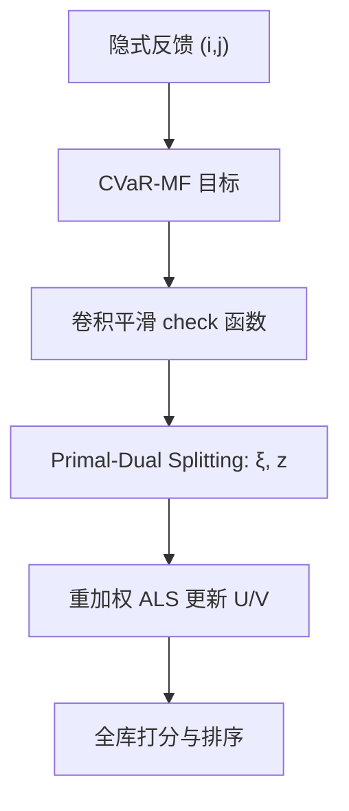
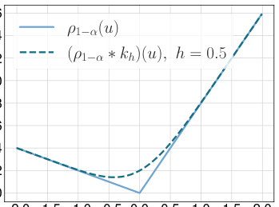

# Safe Collaborative Filtering (安全协同过滤)

- **会议/期刊**: ICLR 2024
- **作者与机构**: Riku Togashi, Tatsushi Oka, Naoto Ohsaka, Tetsuro Morimura (CyberAgent)
- **推荐链路定位**: 召回/矩阵分解训练（Full-Ranking 检索）
- **研究方向**: 协同过滤与双塔召回 / 去偏公平与可信推荐
- **论文原文**: [论文原文链接](https://arxiv.org/abs/2306.05292v2)
- **开源代码**: [开源代码仓库链接](https://github.com/riktor/safer2-recommender)

## TL;DR (1分钟核心速览)

针对传统 ERM-MF 只看平均损失、尾部低满意用户易流失的痛点，本文提出 SAFER2：用卷积型平滑将 CVaR 风险约束嵌入 iALS，并借 primal-dual splitting 恢复 item 侧可分性。在 ML-1M/20M/MSD 的 Full-Ranking、强泛化用户划分下，α=0.3 尾部 R@20 相对最佳基线最高提升约 7.6%，同时平均 Recall 接近或略优于 iALS。

## Background & Motivation (背景与核心矛盾)

- **主流范式**: iALS/ERM-MF 通过 pointwise 隐式反馈损失与 ALS 实现大规模矩阵分解，优化目标是用户平均风险。
- **前人局限**: 平均风险会忽略低满意用户；直接 CVaR-MF 因 $\max(0,\cdot)$ 非光滑、非可分，无法对 item 行并行求解，子梯度法收敛慢。
- **核心洞察 (Key Insight)**: 只需对 CVaR 的 check 函数做卷积型平滑，就能在保持 block multi-convex 的同时恢复用户/item 双维可分性。
- **本文切入点**: 将 quantile regression 的卷积平滑迁移到 CVaR-MF，并用 primal-dual splitting 设计可并行的重加权 ALS。

## Method (核心方法设计)

### 1. 整体框架 (Overall Architecture)

输入隐式反馈矩阵，先构造 CVaR-MF 目标；再用卷积核 $k_h$平滑 check 函数，得到可微的$\Psi_{1-\alpha}$。随后交替更新分位点$\xi$、对偶权重$z_i$、用户矩阵$\mathbf{U}$与物品矩阵$\mathbf{V}$；其中 U/V 步等价于按$z_i$重加权的 ERM，可用 Gramian trick 并行 ALS 求解。推理时固定$\mathbf{V}$，用用户交互拟合$\mathbf{u}_i$，对全库物品打分排序。

### 2. 关键设计拆解 (Key Designs)

1. **卷积型平滑 CVaR（把不可分风险目标变为可微可分）**：原始 CVaR-MF 为 $\min_{\mathbf{U},\mathbf{V},\xi}\xi+\frac{1}{\alpha|\mathcal{U}|}\sum_i\max(0,\ell_i-\xi)+\Omega$，其 ramp 函数破坏 item 可分性。本文改为$\min_{\mathbf{U},\mathbf{V},\xi}\xi+\frac{1}{\alpha|\mathcal{U}|}\sum_i(\rho_1\ast k_h)(\ell_i-\xi)+\Omega$，其中$\ell_i=\ell(\mathbf{V}\mathbf{u}_i,\mathcal{V}_i)$。平滑后函数非递减且严格凸，既保留 CVaR 尾部惩罚，又允许块坐标并行。

<figure class="paper-figure" markdown="span">
  <figcaption>图2：卷积型平滑。</figcaption>
</figure>
图2：卷积型平滑将不可微的 CVaR check 函数变为可微、可分的平滑损失。

2. **Primal-Dual Splitting 与闭式对偶（免显式共轭计算）**：利用 biconjugate 将平滑项写成鞍点形式，得到每个用户的对偶权重 $z_i=1-K_h(\xi-\ell_i)$，其中$K_h$为核 CDF。U/V 子问题变为$\min_{\mathbf{U},\mathbf{V}}\frac{1}{\alpha|\mathcal{U}|}\sum_i z_i\ell_i+\Omega$，即按“尾部风险”自适应重加权；失去拟合的用户获得更大$z_i$，从而被 ALS 重点修正。

3. **训练目标、负采样与推理效率**：总损失即 $\Psi_{1-\alpha}(\mathbf{U},\mathbf{V},\xi)+\Omega(\mathbf{U},\mathbf{V})$；无负采样，隐式正则项对全物品求和。训练复杂度为$O(|\mathcal{U}_b|L+|\mathcal{S}|d^2+(|\mathcal{U}|+|\mathcal{V}|)d^3)$，与 iALS 同阶；$\xi$步可用子采样牛顿法，$L=5$。Tikhonov 权重按条件数设计，仅引入一个基础超参$\lambda$。

## Experimental Setup & Evaluation Protocol (实验设置与评估协议)

- **数据集与预处理**: MovieLens 保留评分 $>4$ 的交互，MSD 使用全部交互：

| 数据集 | #Users | #Items | #Interactions | 密度 | 说明 |
| :--- | :---: | :---: | :---: | :---: | :--- |
| ML-1M | 6,168 | 2,811 | 0.56 M | 3.23% | 电影隐式反馈 |
| ML-20M | 136,677 | 20,108 | 9.54 M | 0.347% | 大规模电影 |
| MSD | 571,355 | 41,140 | 33.6 M | 0.143% | 音乐隐式反馈 |

- **数据划分与防穿越 (Splitting Strategy)**: 采用强泛化用户划分：80% 用户训练、10% 验证、10% 测试；评测时向模型披露每个用户 80% 交互，剩余 20% 计算排序指标。不是 Leave-One-Out。
- **排名评测协议 (Ranking Protocol)**: 无偏 Full-Ranking，对全物品打分排序；训练无负采样，隐式正则项覆盖全物品。尾部指标为 R@K 低于 α 分位用户的均值，主实验 α=0.3，α=1.0 为平均情况。
- **对比基线与超参设置**: 基线含 iALS、Mult-VAE、ERM-MF、CVaR-MF；$d=32/256/512$分别对应 ML-1M/20M/MSD；α=0.3，$L=5$，ML-20M/MSD 子采样比 0.1。未报告显著性检验。

## Key Experimental Results (实验关键数据)

### 1. 主实验对比 (Main Results)

| 数据集/指标 | iALS | Mult-VAE | ERM-MF | CVaR-MF | SAFER2 | SAFER2 vs 最佳 |
| :--- | :---: | :---: | :---: | :---: | :---: | :---: |
| ML-1M R@20 (α=1.0) | 0.3450 | 0.3329 | 0.3448 | 0.3318 | **0.3517** | +1.9% |
| ML-1M R@50 (α=1.0) | 0.4697 | 0.4539 | 0.4700 | 0.4495 | **0.4804** | +2.2% |
| ML-1M R@20 (α=0.3) | 0.1166 | 0.1106 | 0.1189 | 0.1061 | **0.1279** | +7.6% |
| ML-1M R@50 (α=0.3) | 0.2391 | 0.2245 | 0.2315 | 0.2257 | **0.2428** | +1.5% |
| ML-20M R@20 (α=1.0) | 0.5263 | **0.5313** | 0.5275 | 0.5031 | 0.5308 | -0.1% |
| ML-20M R@50 (α=1.0) | 0.6448 | **0.6565** | 0.6441 | 0.6277 | 0.6501 | -1.0% |
| ML-20M R@20 (α=0.3) | 0.2085 | 0.2091 | 0.2088 | 0.1975 | **0.2152** | +2.9% |
| ML-20M R@50 (α=0.3) | 0.3264 | **0.3376** | 0.3251 | 0.3187 | 0.3342 | -1.0% |
| MSD R@50 (α=1.0) | **0.3590** | 0.3482 | 0.3544 | 0.3234 | 0.3585 | -0.1% |
| MSD R@100 (α=1.0) | 0.4604 | 0.4347 | 0.4540 | 0.4121 | **0.4605** | +0.02% |
| MSD R@50 (α=0.3) | 0.0963 | 0.0854 | 0.0945 | 0.0781 | **0.0983** | +2.1% |
| MSD R@100 (α=0.3) | 0.1684 | 0.1485 | 0.1644 | 0.1412 | **0.1700** | +0.95% |

原文仅报告 4 个核心基线；SAFER2 在 ML-1M 全指标领先，在 ML-20M 尾部 R@20 与 MSD 尾部指标领先，平均指标与 iALS/Mult-VAE 基本持平。

### 2. 消融实验 (Ablation Study)

| ML-20M 变体 | R@20 (α=0.3) | R@50 (α=0.3) | 说明 |
| :--- | :---: | :---: | :--- |
| CVaR-MF（无平滑） | 0.1975 | 0.3187 | 子梯度优化慢，性能差 |
| ERM-MF（仅均值风险） | 0.2088 | 0.3251 | 去掉 CVaR，退化为平均优化 |
| SAFER2（平滑 CVaR） | **0.2152** | **0.3342** | 平滑后可分、稳定，尾部最优 |

带宽 $h$是核心敏感超参：$h=0.01/0.05$时残差震荡、收敛差；$h=1e16$退化为 ERM；$h\approx0.18$ 稳定且尾部最优。

### 3. 关键实验发现 (Key Findings)

1. **平滑是 CVaR 可用的关键**：ML-20M 尾部 R@20 从 CVaR-MF 的 0.1975 提升到 SAFER2 的 0.2152（+8.96%），说明卷积平滑把“不可优化”的风险目标变为可并行的重加权 ALS。
2. **尾部收益不以平均性能为代价**：ML-1M 平均 R@20 从 iALS 的 0.3450 提升到 0.3517（+1.9%）；MSD 平均 R@100 0.4605 略高于 iALS 的 0.4604，而尾部 R@50 提升 2.1%。
3. **风险重加权确实聚焦低满意用户**：ML-20M 尾部 R@20 比 Mult-VAE 高 2.9%，但平均 R@20 仅低 0.1%；ML-20M 尾部 R@50 略低于 Mult-VAE，说明 $z_i$ 重加权对 R@20 更敏感，R@50 仍受长尾物品覆盖限制。

## Highlights & Limitations (亮点、对比与审稿批判)

- **与代表作对比 (vs. Prior Work)**: 相比 iALS/ERM-MF，SAFER2 不换模型结构，只改损失与求解器，保留 iALS 级扩展性；相比 CVaR-MF，平滑+primal-dual splitting 解决了非可分与慢收敛；相比 Mult-VAE，线性 MF 更易工业化，但 ML-20M 平均/尾部 R@50 仍略逊。
- **可迁移亮点**: 卷积平滑可迁移到 quantile/风险敏感排序目标；闭式 $z_i=1-K_h(\xi-\ell_i)$ 可做“免对偶变量存储”的重加权训练；按条件数设 Tikhonov 权重可稳定 ALS 类求解。
- **审稿级局限批判**: 缺少理论收敛保证，依赖 $h$ 调参；仅评估 α=0.3 的半最坏情况，未覆盖更极端尾部；测试用户仍需 80% 交互拟合，非严格零样本冷启动；未报告显著性检验，且运行时有约 6–9% 额外开销（ML-20M 3.45s vs iALS 3.16s/epoch）。

## Rating (四维评分)

- **方法创新性 (Novelty)**: ⭐⭐⭐⭐ （首次把卷积型平滑用于 CVaR-MF，并用 primal-dual splitting 恢复 item 可分性）
- **评估协议与实验扎实度 (Protocol & Experiments)**: ⭐⭐⭐⭐ （三数据集、Full-Ranking、强泛化划分与 50 次 ML-1M 重划分较扎实，但缺少显著性检验）
- **写作与数学规范度 (Clarity & Rigor)**: ⭐⭐⭐⭐ （目标、平滑、对偶与复杂度链条清晰，附录推导完整；收敛性仅经验验证）
- **工业落地与复现价值 (Industrial & Practical Value)**: ⭐⭐⭐⭐ （与 iALS 同阶复杂度、C++ 多线程实现、代码开源，适合召回训练阶段落地）

