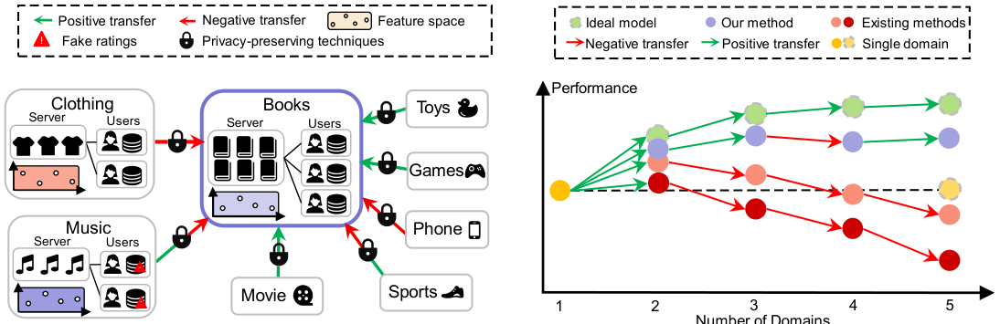
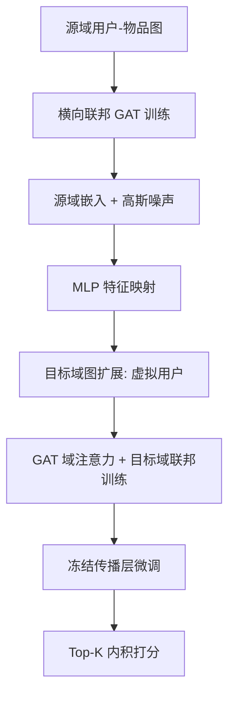
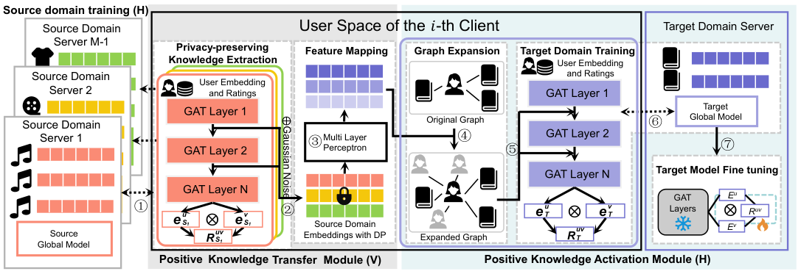

# Federated Graph Learning for Cross-Domain Recommendation (面向跨域推荐的联邦图学习)

- **会议/期刊**: NeurIPS 2024
- **作者与机构**: Ziqi Yang, Zhaopeng Peng, Zihui Wang, Jianzhong Qi, Chaochao Chen, Weike Pan, Chenglu Wen, Cheng Wang, Xiaoliang Fan；厦门大学、墨尔本大学、浙江大学、深圳大学
- **推荐链路定位**: 精排（Top-K 推荐）
- **研究方向**: 跨域与多场景推荐 / 图神经网络与知识图谱推荐
- **论文原文**: [论文原文链接](https://arxiv.org/abs/2410.08249v2)
- **开源代码**: 暂未开源（论文称补充材料含代码，但未给出公开 URL）

## TL;DR (1分钟核心速览)

针对广源跨域推荐（BS-CDR）中域内/域间隐私泄露与多源累积负迁移，FedGCDR 用 HVH 联邦图学习：源域 GAT 联邦训练后，对嵌入加高斯噪声并经 MLP 对齐迁移，再把源域嵌入作为虚拟用户扩展目标图，由 GAT 生成域注意力并冻结传播层微调。Amazon 16 域、Leave-One-Out+1:99 采样排序下，完整隐私版 FedGCDR-DP 的 Books HR@10 达 0.6510，较 FedCDR 的 0.5626 提升 15.7%。

## Background & Motivation (背景与核心矛盾)

- **主流范式**: 隐私保护 CDR 多采用双域联邦或嵌入映射（EMCDR、FedCT、FedCDR），以用户/物品嵌入作为跨域知识。
- **前人局限**: ① 仅覆盖单源-单目标，忽视 BS-CDR 中多源累积负迁移；② 只保一类隐私，且 DP/有损扰动会降低迁移知识质量，使多源性能反低于单域。
- **核心洞察 (Key Insight)**: 图 1 显示纯正向知识收益边际递减，而负迁移随源域数增加累积；需要“先净化再迁移、迁移后再过滤”。
- **本文切入点**: 用 HVH 联邦图学习，以 DP+MLP 对齐做隐私正迁移，再用虚拟用户图扩展生成域注意力并微调过滤负知识。

<figure class="paper-figure" markdown="span">
  <figcaption>图1：(a) 为在 Books 域中获得准确推荐，我们旨在利用用户偏好（即应充分利用外部域知识，例如 Movie、Toys 和 Games 域）。然而，受有损隐私保护技术影响，迁移结果可能为负（例如数据质量低的 Music 域）。(b) 在纯正向知识下，模型性能增长率的边际效应递减，而随着源域数量增加，NT 会累积。因此，现有</figcaption>
</figure>
*图 1：BS-CDR 中源域增多带来负迁移累积的动机示意。*

## Method (核心方法设计)

### 1. 整体框架 (Overall Architecture)

FedGCDR 按 Horizontal-Vertical-Horizontal 流水线运行：横向阶段各源域用 LightGCN 式 GAT 做联邦训练，保护域内隐私；纵向阶段在用户本地对源域各层嵌入加高斯噪声并经 MLP 映射到目标域特征空间，服务器不参与跨域传输；再次横向阶段把源域嵌入视作虚拟用户接入目标域图，GAT 为虚拟社交边生成域注意力，最后冻结消息传播层微调目标模型。

<figure class="paper-figure" markdown="span">
  <figcaption>图2：FedGCDR 概览。它由两个关键模块组成，并遵循 HVH 流程：(1) 源域训练（横向 FL）：1⃝ 每个源域维护其基于图注意力网络（GAT）的联邦模型。(2) 正向知识迁移模块（纵向 FL）：2⃝ 从 GAT 层提取源域嵌入，并用高斯噪声扰动。3⃝ 多层感知机对齐源域嵌入与目标域嵌入的特征空间。(3) 正向知识激活模块（横向 FL）：4⃝ 用源域嵌入扩展本地图。5</figcaption>
</figure>
*图 2：FedGCDR 的 HVH 流水线与两个核心模块。*

### 2. 关键设计拆解 (Key Designs)

1. **隐私保持的正向知识迁移**：前人直接共享嵌入，易被反演且域间特征空间不齐。对源域第 $l$层嵌入$x_{S_i}^l$加高斯噪声得$\hat{x}_{S_i}^l$，再用$\mathrm{MLP}_i$对齐，并以$\mathcal{L}_m=\sum_{i=1}^{M-1}\sum_{l=1}^{L}\|x_T^l-\mathrm{MLP}_i(\hat{x}_{S_i}^l)\|_2^2$ 约束。DP 使反演重建偏差有下界，MLP 吸收域间异构性。

2. **图扩展与域注意力**：多源下人工调迁移权重不可扩展。将 $M-1$个源域嵌入视为虚拟用户，与真实用户建虚拟社交边，目标域第$l$层嵌入变为$e_T^l=a_{uu}^l x_T^l+\sum_{v\in N_u}a_{uv}^l e_v^l+\sum_{i=1}^{M-1}a_i^l \mathrm{MLP}_i(\hat{x}_{S_i}^l)$，其中$a_i^l$即 GAT 生成的域注意力；再用$\mathcal{L}_s$ 约束虚拟社交相似性。模型由此自动压低冲突域权重。

3. **训练目标、负采样与推理效率**：总损失 $\mathcal{L}_{GAT}=\mathrm{BCE}(\hat{R}_{uv}^T,R_{uv}^T)+\frac{\alpha}{2}\mathcal{L}_m+\frac{\beta}{2}\mathcal{L}_s$；微调阶段冻结 GAT 传播层，仅用$\mathcal{L}_{ft}=\mathrm{BCE}$ 训练已注入知识的嵌入。训练以隐式 0/1 评分做 BCE，测试每用户留一正样本并随机采 99 个未交互负样本；跨域传输在本地完成，不增加额外通信。

## Experimental Setup & Evaluation Protocol (实验设置与评估协议)

- **数据集与预处理**: Amazon 2018 按数据量取 top-16 域，各域按 user/item core 过滤（Books 96/10，CDs 24/10），评分转隐式 0/1；Books 与 CDs 分别为目标域。

| 数据集 | #Users | 每域 #Items (min-med-max) | 每域 #Interactions (min-med-max) | 稀疏度 |
| :--- | :---: | :---: | :---: | :---: |
| Amazon-4 | 55,518 | 53,082-134,438-501,153 | 623,420-646,266-5,481,801 | 0.0802% |
| Amazon-8 | 99,506 | 53,082-106,985-501,153 | 186,016-618,539-5,481,801 | 0.0399% |
| Amazon-16 | 117,672 | 17,209-64,624-501,153 | 41,427-379,657-5,481,801 | 0.0928% |
| Amazon-Dual | 2,500 | 17,889-28,649-39,510 | 106,741-128,601-150,461 | 0.1955% |

- **数据划分与防穿越 (Splitting Strategy)**: `Leave-One-Out`：每用户最新交互为测试，其余训练。
- **排名评测协议 (Ranking Protocol)**: `Sampled Ranking`，测试阶段随机采 99 个未交互物品构造 1:99 候选，报告 HR@5/10 与 NDCG@5/10。
- **对比基线与超参设置**: FedGNN(Single Domain)、EMCDR、PriCDR、FedCT、FedCDR；$d=8$，GAT 2 层，MLP {16,4}，batch=256，lr=0.01，$\epsilon=8,\sigma=10^{-5},\alpha=\beta=0.01$，3 个随机种子平均。

## Key Experimental Results (实验关键数据)

### 1. 主实验对比 (Main Results)

| Model | Books HR@10 | Books NDCG@10 | CDs HR@10 | CDs NDCG@10 |
| :--- | :---: | :---: | :---: | :---: |
| Single Domain (FedGNN) | 0.6067 | 0.3634 | 0.5031 | 0.3040 |
| EMCDR | 0.4207 | 0.2348 | 0.5740 | 0.3937 |
| PriCDR | 0.4914 | 0.3042 | 0.5399 | 0.4011 |
| FedCT | 0.3580 | 0.2593 | 0.4326 | 0.3219 |
| FedCDR | 0.5626 | 0.3403 | 0.5808 | 0.4297 |
| FedGCDR-DP | 0.6510 | 0.3742 | 0.6135 | 0.4453 |
| **FedGCDR** | **0.6516** | **0.3854** | **0.6208** | **0.4684** |
| **Improv. vs FedCDR** | **+15.8%** | **+13.3%** | **+6.9%** | **+9.0%** |

注：FedGCDR-DP 为含 DP 的完整隐私版，FedGCDR 为不加高斯噪声版本；提升幅度按 FedGCDR 对最优基线 FedCDR 计。

### 2. 消融实验 (Ablation Study)

| 变体 | Books@16 | CDs@16 | 结论 |
| :--- | :---: | :---: | :--- |
| FedGCDR-T（去 MLP 映射） | 低于完整版，高于 FedGCDR-M | 低于完整版，低于 FedGCDR-M | Books 更怕负知识，过滤比映射重要 |
| FedGCDR-M（平均融合，无图扩展/微调） | 低于完整版，低于 FedGCDR-T | 低于完整版，高于 FedGCDR-T | CDs 信息稀疏，映射比过滤更重要 |
| FedGCDR | 最优 | 最优 | 两模块互补 |

### 3. 关键实验发现 (Key Findings)

1. Books 目标域上，Single Domain 的 HR@10 为 0.6067，FedCDR 在 Amazon-16 降至 0.5626，出现软负迁移；FedGCDR-DP 达 0.6510，FedGCDR 达 0.6516，较 FedCDR 提升 15.8%，说明图扩展+微调能压制多源负知识。
2. CDs 目标域从 Amazon-8 到 Amazon-16，FedCDR 的 HR@10 由 0.4620 升至 0.5808，FedGCDR 由 0.5270 升至 0.6208；稀疏域在特征对齐正确时能受益于更多源域，且消融中 FedGCDR-M > FedGCDR-T 印证映射更关键。
3. 加 DP 后，Books NDCG@10 由 0.3854 降至 0.3742，CDs 由 0.4684 降至 0.4453，相对损失约 2.9%/4.9%，但仍高于 FedCDR 的 0.3403/0.4297，隐私-精度折中可接受。

## Highlights & Limitations (亮点、对比与审稿批判)

- **与代表作对比 (vs. Prior Work)**: FedCT 仅覆盖双域且负迁移严重（Books HR@10 0.3580）；FedCDR 传嵌入但无域间 DP，Books 上反低于单域；EMCDR 只做映射、缺多源过滤。FedGCDR 将 DP、虚拟用户域注意力与冻结微调串成闭环。
- **可迁移亮点**: 用“虚拟用户+社交边”把源域嵌入转成可学习的域注意力，可迁移到多场景融合；冻结传播层微调可作为迁移后去噪的通用后处理。
- **审稿级局限批判**: 仅在 Amazon 上验证且依赖重叠用户，非重叠/跨平台场景未覆盖；评测为 1:99 采样排序而非全库排序，且仅 3 种子平均、缺少显著性检验；DP 在高源域数下噪声累积，$\epsilon$ 敏感。

## Rating (四维评分)

- **方法创新性 (Novelty)**: ⭐⭐⭐⭐ （HVH 联邦图学习与虚拟用户域注意力结合，针对 BS-CDR 负迁移有明确新意）
- **评估协议与实验扎实度 (Protocol & Experiments)**: ⭐⭐⭐ （16 域覆盖较广，但仅 Amazon、采样排序、无显著性检验）
- **写作与数学规范度 (Clarity & Rigor)**: ⭐⭐⭐⭐ （公式、隐私定理与复杂度分析较完整，符号略密）
- **工业落地与复现价值 (Industrial & Practical Value)**: ⭐⭐⭐ （联邦隐私链路有落地价值，但 DP 噪声、通信开销与代码未公开限制复现）

