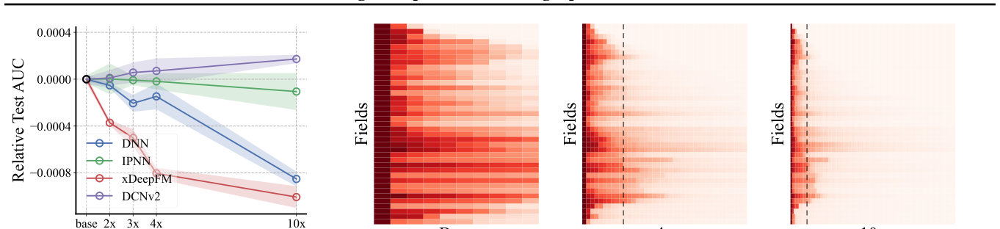
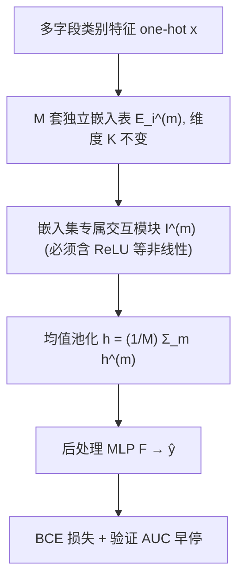
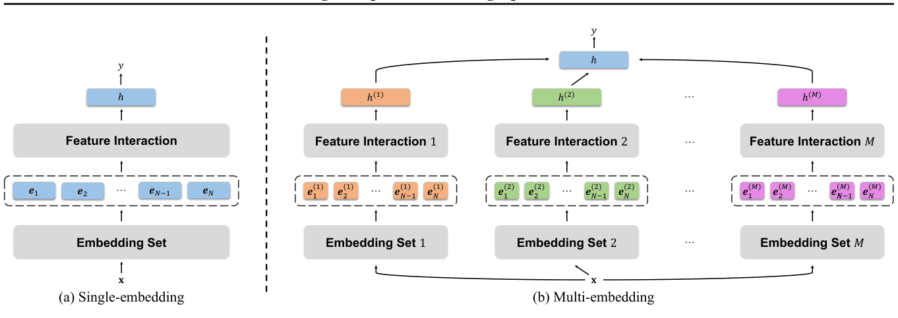

# On the Embedding Collapse when Scaling up Recommendation Models (论推荐模型扩容时的嵌入坍缩)

- **会议/期刊**: ICML 2024
- **作者与机构**: Xingzhuo Guo, Junwei Pan, Ximei Wang, Baixu Chen, Jie Jiang, Mingsheng Long（清华大学软件学院 BNRist / 腾讯）
- **推荐链路定位**: 精排（CTR 预估模型的参数可扩展性）
- **研究方向**: CTR 预估与特征交叉
- **论文原文**: [https://arxiv.org/abs/2310.04400v2](https://arxiv.org/abs/2310.04400v2)
- **开源代码**: [https://github.com/thuml/Multi-Embedding](https://github.com/thuml/Multi-Embedding)

## TL;DR (1分钟核心速览)

本文直面一个反直觉事实：推荐模型嵌入维度普遍只有 10 量级，但直接放大（2×–10×）几乎不涨点甚至掉点。作者用 SVD 谱分析发现嵌入矩阵高度低秩，称之 **嵌入坍缩 (Embedding Collapse)**；并从理论上证明特征交互具有**双面效应**——交互会传递低信息丰富度并加剧坍缩，但又是抑制虚假特征过拟合的必要保障。据此提出 **Multi-Embedding (ME)**：保持单嵌入维度不变，复制 M 套独立嵌入表并各配专属交互模块。在 Criteo/Avazu 的 8:1:1 划分与全库 AUC 评估下，6 个主流模型 10× 扩容时平均取得 **+0.0011 绝对 AUC**，且随规模单调不降。

## Background & Motivation (背景与核心矛盾)

- **主流范式**: 推荐模型 = 每字段嵌入表 $\mathbf{E}_i\in\mathbb{R}^{D_i\times K}$+ 高阶特征交互模块$\mathcal{I}$+ MLP$\mathcal{F}$；嵌入参数占 DCNv2 基线的 **>92%**，是真正的性能瓶颈与参数洼地。
- **前人局限**: (i) 单嵌入直接扩容失效——Criteo 上 10× 后 DNN 掉 0.00136、xDeepFM 掉 0.00118、FinalMLP 掉 0.00084，仅 DCNv2 微涨 0.00018；(ii) 扩容后奇异值谱几乎贴着零走，学到的表征挤在低维子空间，参数被"闲置"。
- **核心洞察 (Key Insight)**: 提出 **信息丰富度** $\mathrm{IA}(\mathbf{E})=\|\boldsymbol{\sigma}\|_1/\|\boldsymbol{\sigma}\|_\infty$，比矩阵秩更适合$D_i\gg K$的非严格低秩场景。真实学到的$\mathbf{E}_i$ 的 IA 远低于随机初始化矩阵，且随扩容进一步下降——坍缩是**由架构导致**而非数据不足（1%→100% 数据量下 IA 非单调，甚至回落）。
- **本文切入点**: 既然交互既是坍缩的催化剂又是可扩展性的保障，"抑制交互换低秩"是死路；正确解法是**在保留交互的前提下让嵌入集之间解耦多样化**。

<figure class="paper-figure" markdown="span">
  <figcaption>图1. 现有推荐模型的可扩展性不理想。(a)：增大嵌入维度并未带来显著提升</figcaption>
</figure>

## Method (核心方法设计)

### 1. 整体框架 (Overall Architecture)

将单套嵌入拆成 $M$套**同维度**的独立嵌入集$\{\mathbf{E}_i^{(m)}\}_{m=1}^{M}$，每套走各自的交互模块$\mathcal{I}^{(m)}$，得到$M$个组合特征后**均值池化**再送入后处理 MLP。训练仍是标准 BCE + 验证集 AUC 早停；推理时嵌入参数量与交互 FLOPs 随$M$线性增长（等价于把$K$放大到$MK$），但这正是单嵌入做不到有效利用的那部分容量，ME 把它变成了有效参数。

<figure class="paper-figure" markdown="span">
  <figcaption>图7. 单嵌入（左）和多嵌入（右）模型的架构。</figcaption>
</figure>

### 2. 关键设计拆解 (Key Designs)

**1) 交互-坍缩理论：把坍缩归因到"场与场之间的信息传递"**
痛点：直接看原始嵌入表无法剥离单个 field-pair 交互的贡献。作者改看 DCNv2 隐式生成的子嵌入 $\mathbf{E}_i^{\to j}=\mathbf{E}_i\mathbf{W}_{i\to j}^\top$，发现$\mathrm{IA}(\mathbf{E}_i^{\to j})$沿两个方向**同时**递增：既随源字段$i$的 IA 走（$\text{corr}=0.81$），也随被交互字段$j$的 IA 走（$\text{corr}=0.71$）；FFM 的显式独立子嵌入同样复现（0.66 / 0.63）。理论侧对 FM 式交互做梯度分解：

$$\frac{\partial \mathcal{L}}{\partial \mathbf{e}_1}=\sum_{i=2}^{N}\boldsymbol{\theta}_i,\qquad \boldsymbol{\theta}_i=\sum_{k=1}^{K}\alpha_{i,k}\,\sigma_{i,k}\,\mathbf{v}_{i,k}$$

其中 $\alpha_{i,k}$是**与奇异值无关**的数据侧标量。直觉：$\mathbf{E}_i$一旦低 IA（$\sigma_{i,k}$失衡），梯度沿少数主谱方向被过度加权，$\mathbf{e}_1$的更新被"拽"进对方所在的低维子空间，且所有行同等退化，最终整表坍缩。玩具实验佐证：把与之交互的$\mathbf{E}_3$从高基数$D_3\gg K$换成低基数$D_3<K$，$\mathbf{E}_1$ 的 IA 从 4.3 附近被压到 3.4 附近。

**2) 双面效应的反证：抑制交互 ≠ 可扩展**
这是本文与"做正交正则/降秩正则"一类路子最本质的分野。作者做了两个对照：(i) 给 DCNv2 的投影矩阵加正交正则 $\ell_{\mathrm{reg}}=\sum_{i,j}\|(\mathbf{W}_{i\to j}^{(m)})^\top\mathbf{W}_{i\to j}^{(m)}-\lambda_{ij}^{(m)}\mathbf{I}\|_F^2$ 以保住全部归一化奇异值——IA 确实抬高，但训练损失持续降、验证 AUC 同步掉，过拟合；(ii) 换成几乎不做显式二阶交互的 DNN——IA 反而比 DCNv2 更高，可 10× 时 AUC 从 0.81228 掉到 0.81142。结论：**交互提供的域知识是扩容时的泛化锚，坍缩必须在交互框架内解，不能绕过**。

**3) ME 为何有效：分离交互才是多样性的来源**
ME 不是简单地求平均。若各嵌入集的交互模块共享或无差异，线性情形下 $\mathcal{I}^{\text{all}}$ 与单嵌入在置换意义下**同构**（附录 E 对 DNN/DCNv2 逐一证明），模型退化为单嵌入。因此 ME 在交互为线性时强制补一层非线性投影，并在后处理端减一层 MLP 保证公平对比。多样性用主角余弦度量：

$$\mathrm{div}\big(\mathbf{E}_i^{(m)},\mathbf{E}_i^{(m')}\big)=1-\frac{1}{K}\big\|\cos\big(\boldsymbol{\phi}_i^{m\leftrightarrow m'}\big)\big\|_1$$

它与 $\mathrm{rank}([\mathbf{E}_i^{(m)},\mathbf{E}_i^{(m')}])$直接挂钩（$\mathrm{rank}$拆解为两者秩和减去$\mathrm{rank}((\mathbf{U}^{(m)})^\top\mathbf{U}^{(m')})$），故多样性越高，拼接后的整体嵌入信息量越大。实测 div：单嵌入 0.54 / ME 0.66 / 理想随机 0.71；且 ME 下子嵌入 IA 与交互字段的相关性从 0.68 降到 0.52，说明它**削弱了交互-坍缩定律的传导强度**。

**训练目标与开销**: 损失为常规 BCE，CTR 二分类天然提供负样本，无额外负采样或难负样本挖掘。每个实验重复 3 次取均值，单卡 RTX 3090 可完成。

## Experimental Setup & Evaluation Protocol (实验设置与评估协议)

- **数据集与预处理**（多字段类别型 CTR 基准，非 5-core 过滤，全量使用）：

| 数据集 | #Instances | #Fields | $\sum_i D_i$|$\max D_i$|$\min D_i$ |
| :--- | :---: | :---: | :---: | :---: | :---: |
| Criteo | 45.8M | 39 | 1.08M | 0.19M | 4 |
| Avazu | 40.4M | 22 | 2.02M | 1.61M | 5 |

字段基数跨度极大（4 → 19 万），正是 IA 差异的来源。

- **数据划分与防穿越**: 随机 **8:1:1** 训练/验证/测试划分（seed=0），按验证集 AUC 早停（patience=3），**非**时间戳切分——这一点对 Click-through 场景存在轻微乐观偏差。
- **排名评测协议**: 本文是 CTR 打分任务，指标为 **Test AUC**，在全量测试样本上评估（等价于全库打分，无负采样排序）。作者沿用工业界惯例，认为 **0.001 量级 AUC 差异即显著**，并给出 3 次重复的标准差（约 $10^{-4}\sim10^{-5}$）。
- **对比基线与超参**: 6 个主流模型 DNN / IPNN / NFwFM / xDeepFM / DCNv2 / FinalMLP（附录另补 AutoInt）。基座嵌入维度 $K=10$（NFwFM 因带池化取 50），MLP 隐层 400×3，DCNv2 用 4 个 cross 层，Adam + lr 1e-3 + batch 2048。扩容因子 2×/3×/4×/10×。

## Key Experimental Results (实验关键数据)

### 1. 主实验对比 (Main Results)

| 模型 | Criteo SE-base | Criteo SE-10× | Criteo ME-10× | Avazu SE-base | Avazu SE-10× | Avazu ME-10× |
| :--- | :---: | :---: | :---: | :---: | :---: | :---: |
| DNN | 0.81228 | 0.81142 | 0.81287 (Δ+0.00145) | 0.78744 | 0.78648 | 0.78884 (Δ+0.00236) |
| IPNN | 0.81272 | 0.81262 | 0.81311 (Δ+0.00049) | 0.78732 | 0.78745 | 0.78949 (Δ+0.00204) |
| NFwFM | 0.81059 | 0.81113 | 0.81210 (Δ+0.00097) | 0.78684 | 0.78799 | **0.78974** (Δ+0.00175) |
| xDeepFM | 0.81217 | 0.81116 | 0.81299 (Δ+0.00183) | 0.78743 | 0.78693 | 0.78927 (Δ+0.00234) |
| DCNv2 | 0.81339 | 0.81357 | **0.81385** (Δ+0.00028) | 0.78786 | 0.78856 | 0.78942 (Δ+0.00086) |
| FinalMLP | 0.81259 | 0.81175 | 0.81303 (Δ+0.00128) | 0.78751 | 0.78662 | 0.78830 (Δ+0.00168) |

（Δ 为 ME-10× 相对同模型 SE-10× 的绝对 AUC 增益；全表最高值加粗。）

### 2. 消融与机制分析 (Ablation & Mechanism)

| 配置 | 交互模块 | Criteo AUC (10×) | 嵌入多样性 div | IA / 现象 |
| :--- | :--- | :---: | :---: | :--- |
| DCNv2-SE（基线） | 单套 | 0.81357 | 0.54 | IA 低，随规模下降 |
| DCNv2-SE + 正交正则 | 抑制 | 未提升（过拟合，验证 AUC 下降） | — | IA 显著抬高 |
| DNN-SE（无显式二阶交互） | 无 | 0.81142 | — | IA 高于 DCNv2 |
| ME-Shared（交互全共享） | 共享 | 低于完整 ME | 0.62 | 可扩展性变差 |
| ME-Restricted（正则限制交互差异） | 受限 | 低于完整 ME | 0.65 | 可扩展性变差 |
| ME-Separated（完整） | 分离 | **0.81385** | 0.66 | IA 全字段提升 |
| 理想随机初始化 | — | — | 0.71 | 多样性上界参考 |

数据量维度（表 2）：同一 $K=40$ 下，1% 数据 IA=13.30、100% 数据 IA=6.64；ME 在 100% 数据下仍达 7.64，且在各数据量档位全面高于单嵌入。

### 3. 关键实验发现 (Key Findings)

1. **坍缩是交互传导的，且可从子嵌入侧定量证实**：DCNv2 子嵌入 IA 沿源字段与目标字段双向递增（corr 0.81 / 0.71），FFM 复现（0.66 / 0.63）；玩具实验中仅把交互对象从 $D_3\gg K$换成$D_3<K$，$\mathbf{E}_1$ 的 IA 便从 4.3 附近塌到 3.4 附近——低 IA 字段实打实"污染"了邻居。
2. **"压低秩"路线被实验证伪，双面效应成立**：正交正则 DCNv2 与 DNN 都拿到了更高 IA，却在扩容时过拟合（DNN 10× 掉 0.00086 至 0.81142）。这说明 IA 不是越高越好，可扩展性的真正条件是"高 IA **且** 保留交互"。
3. **ME 的收益来源是交互分离而非单纯加参数**：完整 ME 相对 SE 在 10× 时平均 +0.0011 绝对 AUC（工业界认定为显著），而把交互改成 Shared/Restricted 后多样性从 0.66 退到 0.62/0.65、可扩展性同步下滑；线上微信朋友圈从 SE 升级到 ME，GMV **+3.9%**。

## Highlights & Limitations (亮点、对比与审稿批判)

- **与代表作对比**: 与 DCNv2 / FinalMLP 等"设计更强的交互算子"的路线正交——本文不改交互形式，只改嵌入的组织方式，因此可作为**插件**叠加在任意现有模型上（文中对 6 个模型 + AutoInt 全部验证）。相较 MoE/多兴趣（Weston et al., 2013）的多向量表征，本文的 M 套嵌入是"全字段复制 + 交互分离"，而非按兴趣切片，且给出了坍缩视角的理论依据。
- **可迁移亮点**: (i) $\mathrm{IA}=\|\boldsymbol{\sigma}\|_1/\|\boldsymbol{\sigma}\|_\infty$ 是一个极低成本（一次 SVD）的嵌入质量监控指标，可直接挂到线上训练流水线做容量诊断；(ii) "复制嵌入集 + 专属交互 + 均值池化"这一模式可迁移到序列推荐的多兴趣解耦、多模态推荐的多视角表征；同时注意**线性交互下必须补非线性**否则退化为单嵌入，这是一个易踩的坑。
- **审稿级局限批判**: (i) 评估仅 Criteo/Avazu 两个公开集且为随机 8:1:1 划分，缺少时间切分与冷启动划分，对真实分布漂移下的可扩展性未作检验；(ii) 参数量与交互 FLOPs 随 $M$线性增长，线上收益（GMV +3.9%）与推理成本之间的权衡、以及$M$的上限在哪里，正文未给延迟与吞吐数据；(iii) 增益量级在$10^{-4}$AUC，虽符合 CTR 惯例，但标准差也在$10^{-4}\sim10^{-5}$，部分模型（DCNv2 的 +0.00028）显著性偏弱。

## Rating (四维评分)

- **方法创新性 (Novelty)**: ⭐⭐⭐⭐⭐ （首次系统识别并命名嵌入坍缩，IA 指标 + 梯度谱分解给出可验证的因果链条，双面效应的反证实验尤为扎实）
- **评估协议与实验扎实度 (Protocol & Experiments)**: ⭐⭐⭐⭐ （6 个基线 × 5 个扩容档 × 2 数据集 × 3 次重复，机制实验充分；但缺时间切分/冷启动划分与线上延迟数据）
- **写作与数学规范度 (Clarity & Rigor)**: ⭐⭐⭐⭐ （坍缩定理与 ME 同构性证明清晰，附录对线性退化、多样性-秩关系逐一交代；IA 的跨规模可比性仅在附录简短讨论）
- **工业落地与复现价值 (Industrial & Practical Value)**: ⭐⭐⭐⭐⭐ （代码开源、单卡可复现、插件式改造代价极低，且已有腾讯广告线上 A/B 与 GMV 佐证）

