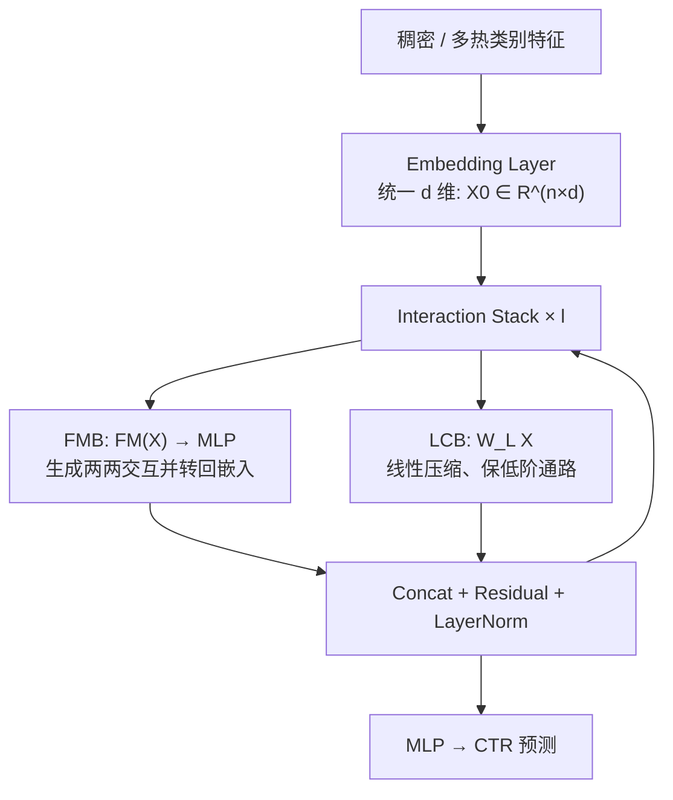
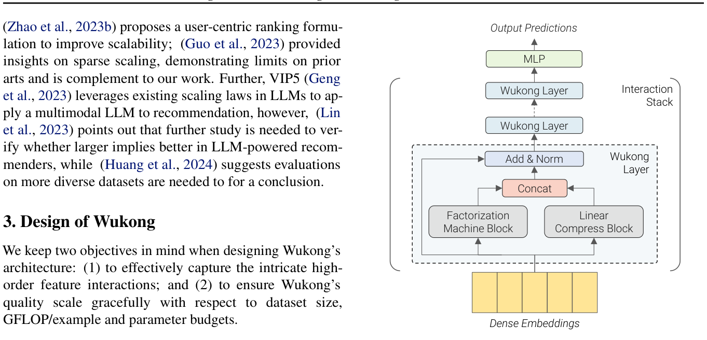
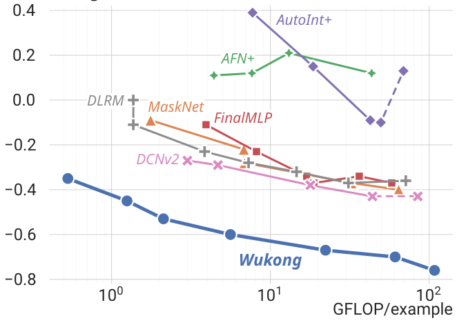

# Wukong: Towards a Scaling Law for Large-Scale Recommendation (面向大规模推荐的缩放律探索)

- **会议/期刊**: ICML 2024
- **作者与机构**: Buyun Zhang, Liang Luo, Yuxin Chen, ... , Max Naumov, Wenlin Chen (Meta AI)
- **推荐链路定位**: 精排（CTR/CVR 稠密交互层）
- **研究方向**: CTR/CVR 预估与特征交叉 / 工业架构与可扩展训练
- **论文原文**: [arxiv.org/abs/2403.02545v4](https://arxiv.org/abs/2403.02545v4)
- **开源代码**: 暂未开源

## TL;DR (1分钟核心速览)

现有 CTR 模型靠“稀疏缩放”（只扩 embedding 表）堆到万亿参数却无法利用算力，而 DLRM 缺高阶交互、DCNv2/AutoInt+ 升尺度后收益迅速饱和甚至训练发散。Wukong 提出**纯堆叠因子分解机**架构与协同升尺度策略：第 $i$层并行 FMB（FM+MLP）与 LCB（线性压缩），使每层覆盖$1\sim 2^i$ 阶交互。在 6 个 BARS 协议公开数据集上 AUC 全部最优/并列最优（相对提升 0.07%–0.52%），并在 146B 样本内部数据上跨两个数量级算力（>100 GFLOP/example）保持缩放律，LogLoss 相对最优基线改善超 0.2%。

## Background & Motivation (背景与核心矛盾)

- **主流范式**：DLRS 长期依赖稀疏缩放——扩大 embedding 表行数与维度以降低碰撞、提升表达力，参数量已达万亿级。
- **前人局限 ①**：仅扩 embedding 无法提升特征间高阶交互的建模能力，且 embedding lookup 吃不到加速器新增的算力红利，分布式场景下基础设施成本高、利用率低。
- **前人局限 ②**：稠密侧的代表作无法有效升尺度——DLRM 结构上缺乏高阶交互；DCNv2 扩 CrossNet 无质量增益、扩 DeepNet 易发散；AutoInt+ 扩注意力后出现 loss explosion；这些模型在 31–36 GFLOP/example 处即饱和。
- **核心洞察 (Key Insight)**：FM 本身只解决二阶交互，但若借鉴“二进制指数 (binary exponentiation)”思想**堆叠** FM——每层在上一层基础上再做一次两两交互——则第 $i$层天然覆盖$1 \sim 2^{i}$ 阶特征交互，阶数随深度指数增长而非线性增长。
- **本文切入点**：用 FMB + LCB 的双块并联层构成可无限加高加宽的交互栈，把“模型变深”直接翻译为“交互阶数指数提升”，从而在大规模数据上换取可持续的质量增益。

## Method (核心方法设计)

### 1. 整体框架 (Overall Architecture)

稠密与多热类别特征先经 Embedding Layer 统一到全局维度 $d$：重要特征分配多个 embedding、次要特征用小维度 embedding 拼接后经 MLP 升维，最终得到$\mathbf{X}_0 \in \mathbb{R}^{n\times d}$（每个 embedding 向量视为**整体单元**，不做逐元素展开）。随后送入$l$ 层 Interaction Stack，每层由并行的 Factorization Machine Block 与 Linear Compression Block 组成，两路输出拼接后加残差并做 LayerNorm；栈顶接 MLP 输出 CTR/CVR 预测。训练侧配合 FSDP + Neo/NeuroShard 列分片、FP16 embedding 与 BF16 梯度通信支撑超大模型。

<figure class="paper-figure" markdown="span">
  <figcaption>图 2：Wukong 采用交互堆栈捕获特征交互。堆栈中每一层由一个 Factorization Machine Block 和一个 Linear Compress Block 组成。</figcaption>
</figure>

### 2. 关键设计拆解 (Key Designs)

1. **指数阶交互栈（FMB + LCB 双块并联）**：解决“深堆叠后低阶信息被冲掉、训练不稳”的问题。第 $i$ 层输出为
$$\mathbf{X}_{i+1}=\mathrm{LN}\big(\mathrm{concat}(\mathrm{FMB}_i(\mathbf{X}_i),\ \mathrm{LCB}_i(\mathbf{X}_i))+\mathbf{X}_i\big)$$
其中 $\mathrm{FMB}(\mathbf{X})=\mathrm{reshape}(\mathrm{MLP}(\mathrm{LN}(\mathrm{flatten}(\mathbf{X}\mathbf{X}^{\top}))))$负责显式生成两两交互并把交互矩阵压回$n_F$个 embedding，$\mathrm{LCB}(\mathbf{X}_i)=\mathbf{W}_L\mathbf{X}_i$只做线性重组、不升阶。由归纳法可得第$i$层覆盖$1\sim 2^i$阶交互：下界由 LCB 保住、上界由 FMB 对两个$2^{i-1}$ 阶结果再交互达成。直觉上 LCB 是“保底恒等通路”，残差是“训练稳定器”——消融显示二者单删都几乎无损、同删则退化 1.84%，正说明其功能冗余但共同构成安全网。

2. **低秩优化 FM**：朴素 $\mathbf{X}\mathbf{X}^{\top}$的存储与计算随特征数平方增长，千级特征即不可行。作者利用“$d\le n$时点积矩阵秩不超过$d$”的低秩性质，右乘可学习投影$\mathbf{Y}\in\mathbb{R}^{n\times k}$，并借结合律改写：
$$\mathbf{X}\mathbf{X}^{\top}\mathbf{Y}=\mathbf{X}(\mathbf{X}^{\top}\mathbf{Y}),\qquad O(n^2 d)\rightarrow O(nkd),\ k\ll n$$
先算 $\mathbf{X}^{\top}\mathbf{Y}$再左乘，存储从$n\times n$降到$n\times k$；进一步可用 MLP 从线性压缩输入生成$\mathbf{Y}$，使投影随样本自适应（输入注意力式）。整体复杂度约$O(ndh\log n + h^2)$。

3. **训练目标、负采样与推理**：CTR 二分类交叉熵为主目标（AUC 调参、LogLoss 辅助），数据本身即隐式正负样本，无额外负采样。Criteo 万亿级单遍训练做 3000+ 次网格搜索，稠密用 Adam (lr=0.04, $\beta_2=1$)、稀疏用 Rowwise Adagrad (lr=0.04)；内部数据集全局 batch 262,144、embedding 维度 160、稀疏表固定 627B 参数、128–256 张 H100。推理侧无额外解码开销，但超大稠密模型需蒸馏/多任务 foundation model 摊薄服务成本。

## Experimental Setup & Evaluation Protocol (实验设置与评估协议)

- **数据集与预处理**（公开集沿用 BARS benchmark 的官方预处理以对齐前人结果）：

| 数据集 | #Samples | #Features | 特征/场景说明 |
| :--- | :---: | :---: | :--- |
| Frappe | 0.29M | 10 | App 使用日志 + 上下文 |
| MicroVideo | 1.7M | 7 | 微视频，含多模态 embedding |
| MovieLens Latest | 2M | 3 | 用户-电影评分 |
| KuaiVideo | 13M | 8 | 快手短视频点击，含内容理解 embedding |
| TaobaoAds | 26M | 21 | 淘宝 8 天广告 CTR |
| Criteo Terabyte | 4B | 39 | 24 天广告点击反馈 |
| Internal | 146B | 720 | 双任务：点击 + 转化 |

- **数据划分与防穿越**：公开集五者采用 BARS 默认划分（比例切分），**Criteo 用最后一天做测试**（严格时间切分）；内部集为**在线训练 + 取最后 1B 窗口**评估，杜绝未来信息泄漏。
- **排名评测协议**：CTR 场景无 Full-Ranking 概念，主指标为 **AUC**（越高越好）与 **LogLoss**（越低越好），内部集另报相对 DLRM 基线（1.37 GFLOP 配置）的 **Relative LogLoss**，该数据集上 0.02% 即视为显著。
- **基线与超参**：对比 AFN+、AutoInt+、DLRM、DCNv2、FinalMLP、MaskNet、xDeepFM 共 7 个 SOTA；公开集 embedding 维度在默认值与 128 中择优，内部集统一 160；Wukong 仅调 dropout、优化器与 LCB 压缩比。

## Key Experimental Results (实验关键数据)

### 1. 主实验对比 (Main Results)

| 模型 | Frappe | MicroVideo | MovieLens | KuaiVideo | TaobaoAds | Criteo TB |
| :--- | :---: | :---: | :---: | :---: | :---: | :---: |
| AFN+ | 0.9812 | 0.7220 | 0.9648 | 0.7348 | 0.6416 | 0.8023 |
| AutoInt+ | 0.9806 | 0.7155 | 0.9693 | 0.7297 | 0.6437 | 0.8073 |
| DCNv2 | 0.9774 | 0.7187 | 0.9683 | 0.7360 | 0.6457 | 0.8096 |
| DLRM | 0.9846 | 0.7173 | 0.9685 | 0.7357 | 0.6430 | 0.8076 |
| FinalMLP | **0.9868** | 0.7247 | **0.9723** | 0.7374 | 0.6434 | 0.8096 |
| MaskNet | 0.9816 | 0.7255 | 0.9676 | 0.7376 | 0.6433 | 0.8100 |
| xDeepFM | 0.9780 | 0.7167 | 0.9667 | 0.7118 | 0.6342 | 0.8084 |
| **Wukong** | **0.9868** | **0.7292** | **0.9723** | **0.7414** | **0.6488** | **0.8106** |
| Improv. | +0.00% | **+0.51%** | +0.00% | **+0.52%** | **+0.48%** | **+0.07%** |

LogLoss 方面 Wukong 在 MovieLens（0.1794 vs 最佳基线 0.2089）、KuaiVideo（0.4367 vs 0.4372）、Criteo（0.1225 vs 0.1226）同时取得最优，说明其不仅排序能力强、概率校准也未因加深而劣化。

### 2. 消融实验 (Ablation Study)

内部数据集，各组件输出置零后的 Relative LogLoss 增量：

| 配置 | Δ LogLoss (%) | 解读 |
| :--- | :---: | :--- |
| w/o FMB (置零) | +0.80 | 交互主体，退化最大 |
| w/o LCB (置零) | +0.03 | 单独移除几乎无损 |
| w/o Residual | +0.08 | 单独移除影响轻微 |
| w/o LCB & Residual | +1.84 | 二者同时缺失则崩溃 |

单组件升尺度（以 base 配置逐项翻倍）：

| 缩放项 | 质量趋势 | 说明 |
| :--- | :---: | :--- |
| 层数 $l$ | ↑↑↑ 最大 | 指数阶交互直接生效 |
| FMB 内 MLP 规模 | ↑↑ 显著 | 交互结果转换容量 |
| $k$/$n_F$ | ↑ 有益 | 交互投影与嵌入数 |
| $n_L$ | → 饱和 | 线性压缩通道冗余 |
| $k,n_F,n_L$ 联合 | ↑↑↑ 最优 | 协同放大优于单项 |

### 3. 关键实验发现 (Key Findings)

1. **公开集全胜但幅度有限**：Wukong 在 6 个数据集 AUC 全部最优或并列最优，相对提升 0.07%（Criteo）至 0.52%（KuaiVideo）；MovieLens 的 LogLoss 由 0.2089 降至 0.1794，说明堆叠 FM 的价值主要体现在概率校准与高阶场景，而非单纯排序名次。
2. **缩放律真实存在**：内部集上 Wukong 在等效 GFLOP 下 LogLoss 比最强基线优超 0.2%，拟合 $y=-100+99.56x^{0.00071}$，即复杂度每提升 4 倍约改善 0.1%，且该趋势贯穿两个数量级直至 >100 GFLOP；相比之下 DLRM 在 31、FinalMLP 在 36 GFLOP 处饱和，DCNv2 需 40 倍复杂度才追平 Wukong，AutoInt+/DCNv2 继续放大则发散。
3. **加高优于加宽**：图层数 $l$的提升带来最大质量跃迁，而 LCB 宽度$n_L$单独扩大已饱和；配合消融中“LCB 与残差功能冗余”的现象可推断——Wukong 的真实增益来自$l$ 带来的交互阶数指数增长，LCB 只是保证低阶通路不被抹除的必要配套设施。

<figure class="paper-figure" markdown="span">
  <figcaption>图 1：Wukong 在推荐领域模型复杂度跨越两个数量级并超过 100 GFLOP/example 的范围内，性能优于现有最先进模型，并展现出缩放律。</figcaption>
</figure>

## Highlights & Limitations (亮点、对比与审稿批判)

- **与代表作对比**：DLRM 只用 FM 捕捉二阶交互后接 MLP，高阶能力缺失；DCNv2 的 CrossNet 是逐元素特征交叉，扩深即不稳；xDeepFM 以外积构造高阶，在 Criteo 量级即内存溢出（本文内部集直接放弃）。Wukong 的关键差异是**以 embedding 为单位做低秩 FM + 线性压缩保底**，从而把“深度”变成可扩展的正交轴。
- **可迁移亮点**：① 低秩恒等式 $\mathbf{X}\mathbf{X}^{\top}\mathbf{Y}=\mathbf{X}(\mathbf{X}^{\top}\mathbf{Y})$ 可迁移到任何双线性/注意力交互块的复杂度压缩；② 将 Wukong 组件移植回 AutoInt+ 的对照实验显示，V 投影由 FFN 换为 MLP 提升 0.34%，注意力后加 MLP 提升 0.65%，金字塔形 + 两者组合在省 90% FLOPs 下仍提升 0.57%——是一份可直接复用的“Transformer 改造清单”。
- **审稿级局限批判**：① 论文自承尚未触及缩放上限，且对“为何堆叠点积结构优于 Transformer”只有直觉解释（异构特征需要 feature-wise 投影矩阵），缺乏理论刻画；② 超大模型的实时服务成本未被量化，只给出蒸馏/多任务 foundation model 的方向性建议；③ 公开集提升幅度偏小且无显著性检验，146B 内部数据不可获取，工业收益与学术可复现性之间存在明显断层。

## Rating (四维评分)

- **方法创新性 (Novelty)**: ⭐⭐⭐⭐ （“二进制指数式堆叠 FM”这一角度简洁而新颖，把深度直接映射为交互阶数；但组件本身均为已知算子组合，理论解释仍停留在直觉层面）
- **评估协议与实验扎实度 (Protocol & Experiments)**: ⭐⭐⭐⭐ （6 公开集 + 146B 内部集 + 两数量级缩放实验 + 组件/单项缩放双重消融，规模罕见；但公开集仅报 AUC/LogLoss、提升小且无显著性检验，线上 A/B 未展开）
- **写作与数学规范度 (Clarity & Rigor)**: ⭐⭐⭐⭐ （交互阶数归纳证明、复杂度推导与低秩等价变换清晰，缩放超参定义明确；但低秩投影的“理论无损”依赖 $d\le n$假设，注意力式$\mathbf{Y}$ 的性质未展开）
- **工业落地与复现价值 (Industrial & Practical Value)**: ⭐⭐⭐⭐ （Neo/NeuroShard 列分片、FSDP、FP16 embedding + BF16 梯度通信的全链路配置极具工程参考价值；但代码未开源、内部数据不可得，复现门槛高）

