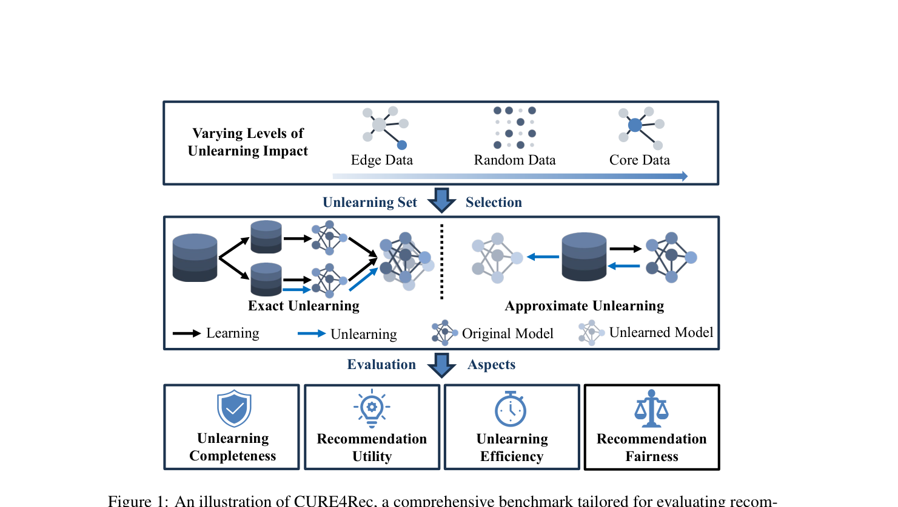
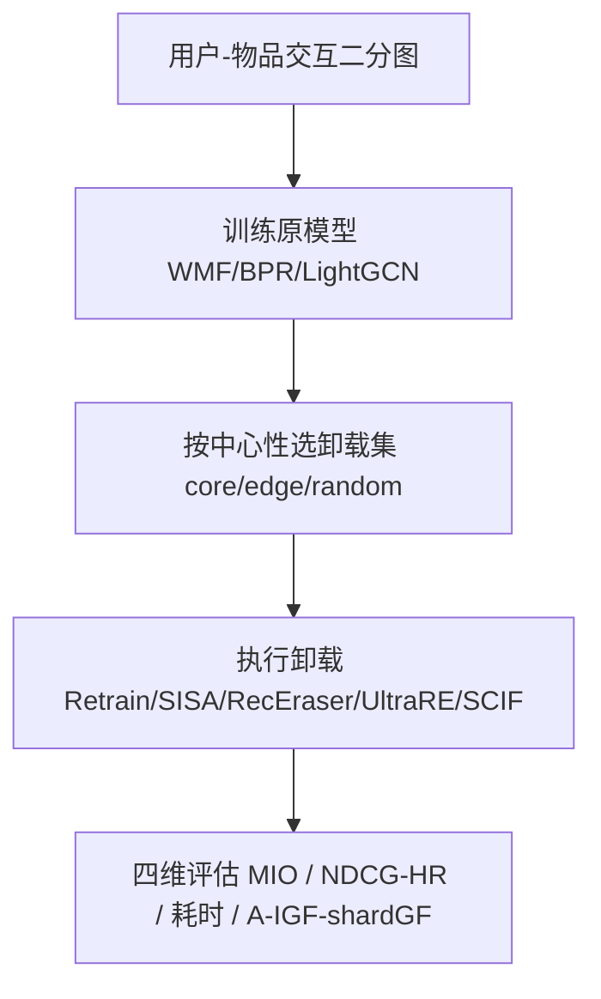
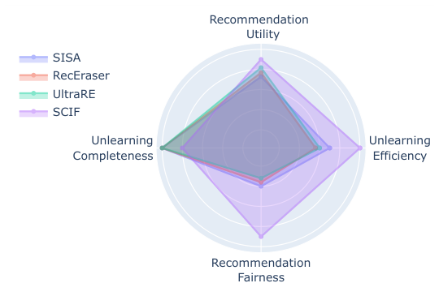

# CURE4Rec: A Benchmark for Recommendation Unlearning with Deeper Influence (CURE4Rec：面向推荐卸载深层影响的综合基准)

- **会议/期刊**: NeurIPS 2024, Datasets and Benchmarks Track
- **作者与机构**: 浙江大学、Sony AI、杭州电子科技大学
- **推荐链路定位**: 模型训练与隐私维护（推荐卸载），非在线召回/排序链路
- **研究方向**: 去偏公平、可信隐私与工业架构 / 协同过滤
- **论文原文**: [论文原文链接](https://arxiv.org/abs/2408.14393v2)
- **开源代码**: [开源代码仓库链接](https://github.com/xiye7lai/CURE4Rec)

## TL;DR (1分钟核心速览)

推荐卸载缺少统一评估，且忽视公平性与卸载集差异。本文提出 CURE4Rec 基准：以完整性（MIO）、效用（NDCG/HR@20）、效率（卸载耗时）、公平性（A-IGF/shardGF）四维，配合 core/edge/random 三类卸载集，在 ML-100K/1M/ADM 与 WMF/BPR/LightGCN 上系统评测 Retrain、SISA、RecEraser、UltraRE、SCIF。结果表明近似卸载 SCIF 效率最高、效用接近 Retrain，但完整性略逊；精确卸载的分片聚合会加剧活跃用户偏好。

## Background & Motivation (背景与核心矛盾)

- **主流范式**: GDPR 等“被遗忘权”推动机器卸载；推荐侧主流是 SISA/RecEraser/UltraRE 的精确分片重训，以及 SCIF 的影响函数近似参数修正。
- **前人局限**: ① 各方法自定指标，缺少统一的完整性、效用、效率、公平四维协议；② 只测随机卸载集，忽视不同影响程度数据（core/edge）的鲁棒性，也未评估卸载对公平性的深层影响。
- **核心洞察 (Key Insight)**: 卸载集的影响程度可由用户-物品二分图的中心性刻画；分片聚合会改变活跃/非活跃用户及分片间的效用分布，公平性正是“深层影响”的关键组成。
- **本文切入点**: 构建首个推荐卸载基准，把卸载集选择、公平性与效率纳入同一可复现实验协议。

<figure class="paper-figure" markdown="span">
  <figcaption>图 1</figcaption>
</figure>

## Method (核心方法设计)

### 1. 整体框架 (Overall Architecture)

输入用户-物品交互，先做 5-core 过滤与随机 80/10/10 划分；在相同训练集上训练同一原模型，保证所有卸载方法起点一致；再按节点重要性选择 5% 训练集用户作为卸载目标；执行精确卸载（Retrain/SISA/RecEraser/UltraRE）或近似卸载（SCIF）；最后统一在测试集、MIO 判别器与运行时上评估四维指标。基准本身不引入新推荐模型，只控制变量并系统比较。

### 2. 关键设计拆解 (Key Designs)

1. **四维评估与 MIO 完整性**：精确卸载由重训保证完整性；近似卸载用 MIO 判断目标数据是否仍“留在”模型中，理想准确率应回落到随机猜测 $0.5$。公平性用$\mathrm{A\text{-}IGF}=\overline{\mathrm{NDCG}}_{act}-\overline{\mathrm{NDCG}}_{inact}$度量活跃/非活跃组差异，用$\mathrm{shardGF}=\mathrm{Var}(\mathrm{NDCG}_{shard})$ 度量分片间差异。直觉：卸载不应只“忘掉”目标，还要保持剩余用户与分片间的效用分布。

2. **影响感知的卸载集选择**：随机集掩盖了数据难度的差异。本文用度中心性构造节点重要性 $I(x)=c(x)\cdot\frac{\sum_{y\in\mathcal{N}(x)}c(y)}{|\mathcal{N}(x)|}$，高$I$为 core 数据、低$I$ 为 edge 数据；core 卸载外溢更强、edge 卸载影响函数估计更难，从而检验方法鲁棒性。

3. **训练目标、负采样与卸载开销**：不新增损失，WMF 用加权平方误差，BPR/LightGCN 用 pairwise BPR 损失；每正样本采 4 个负例，$d=32$，batch size 512，lr 0.01，最多 500 epoch 并早停。卸载阶段只运行一次：ML-100K 随机集上 SCIF 325s，Retrain 4526s，约 14× 加速；EU 方法约 467–482s，但需分片重训。

## Experimental Setup & Evaluation Protocol (实验设置与评估协议)

- **数据集与预处理**: 统一转为隐式反馈，过滤交互数少于 5 的用户/物品（5-core）：

| 数据集 | #Users | #Items | #Interactions | 稀疏度 | 特征/场景说明 |
| :--- | :---: | :---: | :---: | :---: | :--- |
| ML-100K | 943 | 1,349 | 99,287 | 92.195% | MovieLens 显式评分转隐式 |
| ML-1M | 6,040 | 3,416 | 999,611 | 95.155% | 较大规模电影评分 |
| ADM | 478,235 | 266,414 | 836,006 | 99.999% | Amazon Digital Music，极稀疏 |

- **数据划分与防穿越 (Splitting Strategy)**: `比例划分`：每数据集随机 80% 训练、10% 验证、10% 测试；默认卸载训练集的 5%，附录探索 5%–20%；仅考察用户级（user-wise）卸载，即删除某用户全部训练交互。
- **排名评测协议 (Ranking Protocol)**: 在留出测试集上报告 NDCG@20 与 HR@20；训练阶段采用 1 正 : 4 负采样。原文未显式声明 `Full-Ranking` 还是 `Sampled Ranking`，这是复现时需补齐的协议细节。
- **对比基线与超参设置**: 5 种卸载方法——Retrain（金标准）、SISA、RecEraser、UltraRE、SCIF；3 种协同过滤模型——WMF、BPR、LightGCN。MIO 为三层 MLP (64,16,4)，100 epoch、lr 0.001；未报告显著性检验。

## Key Experimental Results (实验关键数据)

### 1. 主实验对比 (Main Results)

随机卸载集下，SCIF 在近似方法中效用最高；精确方法中 UltraRE 最强。表内加粗为“除 Retrain 外最优”，`Improv.` 为 SCIF 相对最强 EU（UltraRE）的提升。

| 方法 | ML-100K NDCG@20 | ML-100K HR@20 | ML-1M NDCG@20 | ML-1M HR@20 | ML-100K 耗时(s) | ML-1M 耗时(s) |
| :--- | :---: | :---: | :---: | :---: | :---: | :---: |
| Learn（卸载前） | 0.3215 | 0.3415 | 0.2144 | 0.2112 | — | — |
| Retrain（金标准） | 0.2872 | 0.3353 | 0.2124 | 0.2108 | 4526 | 8693 |
| SISA | 0.2092 | 0.2049 | 0.1639 | 0.1485 | 467 | 1256 |
| RecEraser | 0.2208 | 0.2142 | 0.1796 | 0.1592 | 476 | 1654 |
| UltraRE | 0.2354 | 0.2282 | 0.1891 | 0.1680 | 482 | 1595 |
| SCIF | **0.2699** | **0.2617** | **0.1922** | **0.1785** | **325** | **862** |

`Improv.`：ML-100K NDCG +14.7%、HR +14.7%；ML-1M NDCG +1.6%、HR +6.3%。但 SCIF 相对 Retrain 仍分别低 6.0%/22.0%（ML-100K NDCG/HR）。

完整性-公平性单独对比近似卸载与金标准：

| 数据集 | 方法 | MIO Acc ↓（理想 0.5） | A-IGF（绝对值越小越均衡） |
| :--- | :--- | :---: | :---: |
| ML-100K | Retrain | **0.538** | -0.0403 |
| ML-100K | SCIF | 0.563 | **-0.0268** |
| ML-1M | Retrain | **0.547** | -0.0507 |
| ML-1M | SCIF | 0.571 | **-0.0311** |
| ADM | Retrain | **0.556** | 0.0141 |
| ADM | SCIF | 0.575 | **0.0106** |

<figure class="paper-figure" markdown="span">
  <figcaption>图 2</figcaption>
</figure>

### 2. 消融/敏感性分析 (Ablation & Sensitivity)

基准无“移除某模块”式消融，核心敏感性来自卸载集类型与分片数。下表为 ML-100K、WMF 的结果：

| 方法 | 卸载集 | NDCG@20 | HR@20 | MIO Acc ↓ | A-IGF | 耗时(s) |
| :--- | :--- | :---: | :---: | :---: | :---: | :---: |
| Retrain | Core | 0.3187 | 0.3295 | 0.540 | -0.0184 | 4296 |
| Retrain | Random | 0.2872 | 0.3353 | 0.538 | -0.0403 | 4526 |
| Retrain | Edge | 0.3091 | 0.3140 | 0.536 | -0.0430 | 4687 |
| SCIF | Core | 0.2483 | 0.2382 | 0.561 | -0.0322 | 289 |
| SCIF | Random | 0.2699 | 0.2617 | 0.563 | -0.0268 | 325 |
| SCIF | Edge | 0.2894 | 0.3012 | 0.601 | -0.0375 | 316 |

分片数从 5 增至 20 时，EU 方法效率提升但效用下降，组级公平恶化，而 shardGF 下降（图 4）；卸载比例 5%–20% 的结果见附录。

### 3. 关键实验发现 (Key Findings)

1. **近似卸载的“完整性换效用”成立但有代价**：SCIF 在 ML-100K 随机集 NDCG 0.2699，较 UltraRE 高 14.7%，仅比 Retrain 低 6.0%；但 MIO 0.563 比 Retrain 0.538 高约 4.1%，说明参数修正无法完全等价于重训。
2. **EU 的分片聚合会放大公平问题**：ML-1M 上 SCIF 的 A-IGF 为 -0.0311，而 Retrain 为 -0.0507；RecEraser/UltraRE 按活跃用户分组而非随机分片，进一步把活跃用户集中到小子片，组级不公平更严重，分片数增加还会同时恶化效用与组公平。
3. **卸载集难度差异显著**：SCIF 在 ML-100K 上 core 的 NDCG 0.2483 比 edge 的 0.2894 低 14.2%；MIO 在 edge 反而更差（0.601 vs 0.561），说明边缘数据的影响函数估计更不可靠。Retrain 卸载 core 后 NDCG 0.3187 高于 random 0.2872，因移除高度活跃用户减少了冗余交互，剩余数据更“干净”。

## Highlights & Limitations (亮点、对比与审稿批判)

- **与代表作对比**: SISA 是通用 EU，RecEraser/UltraRE 面向推荐但只优化效用与效率，SCIF 只验证近似卸载的完整性/效用；CURE4Rec 首次把公平性与不同影响程度的卸载集纳入统一评测，揭示了“精确但分片”与“近似但全局”的本质权衡。
- **可迁移亮点**: ① 用图中心性 $I(x)$ 构造 core/edge 卸载集，可迁移到其他“数据影响分层”评测；② 四维评估（完整性、效用、效率、公平）可直接用于联邦卸载、LLM 推荐卸载等新场景。
- **审稿级局限批判**: ① 仅覆盖用户级卸载与三种 CF 模型，未涉及序列推荐、LLM4Rec 等实际高风险场景；近似方法只评测 SCIF 一个样本，公平性结论的普适性有限；② 评估协议未显式声明 Full-Ranking/Sampled Ranking，且 ADM 上表 2 与表 3 的 NDCG 量级差异明显（约 0.02 vs 0.35），原文未充分解释，复现一致性存疑；A-IGF 的 5% 活跃用户阈值也缺少敏感性分析。

## Rating (四维评分)

- **方法创新性 (Novelty)**: ⭐⭐⭐⭐ （首个推荐卸载综合基准，首次系统引入公平性与 core/edge/random 卸载集；但算法层面无新模型）
- **评估协议与实验扎实度 (Protocol & Experiments)**: ⭐⭐⭐⭐ （3 数据集 × 3 模型 × 5 方法 × 4 维度较完整，但仅 1 个近似方法、未报告显著性检验，ADM 指标量级需澄清）
- **写作与数学规范度 (Clarity & Rigor)**: ⭐⭐⭐⭐ （框架清晰、公式精简；A-IGF 方向与“接近 Retrain”的参照关系、以及全库/采样排序协议表述不够严谨）
- **工业落地与复现价值 (Industrial & Practical Value)**: ⭐⭐⭐⭐ （代码开源，直接对应 GDPR 删除请求与模型维护；但当前仅学术 CF 设置，线上大规模分片/延迟开销仍待验证）

