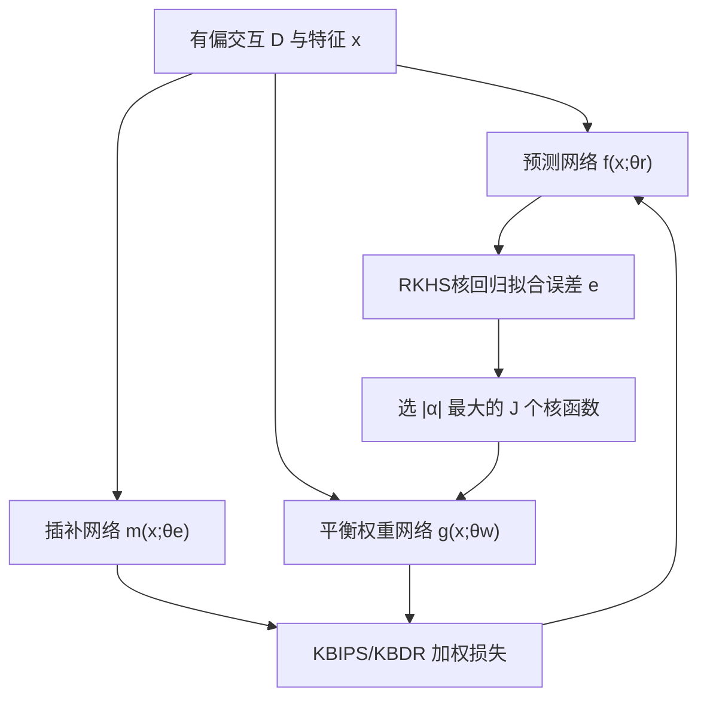

# Debiased Collaborative Filtering with Kernel-Based Causal Balancing (基于核因果平衡的去偏协同过滤)

- **会议/期刊**: ICLR 2024 (Spotlight)
- **作者与机构**: Haoxuan Li, Chunyuan Zheng, Yanghao Xiao, Peng Wu, Zhi Geng, Xu Chen, Peng Cui；北京大学、中国科学院大学、北京工商大学、中国人民大学、清华大学
- **推荐链路定位**: 精排/排序预测（CF评分预测与Top-K排序）
- **研究方向**: 去偏公平、可信隐私与工业架构 / 协同过滤与双塔召回
- **论文原文**: [论文原文链接](https://arxiv.org/abs/2404.19596v1)
- **开源代码**: [开源代码仓库链接](https://github.com/haoxuanli-pku/ICLR24-Kernel-Balancing)

## TL;DR (1分钟核心速览)

针对去偏协同过滤中倾向得分仅平衡交叉熵梯度或有限人工函数的问题，本文在RKHS中用高斯/指数核表示并自适应选择最影响偏差的平衡函数，提出KBIPS/KBDR。COAT/MUSIC/PRODUCT上以有偏训练、无偏测试的AUC/NDCG/F1协议，AKBDR-Gau较最佳基线AUC最高约+1.5%，PRODUCT NDCG@20 +2.4%。

## Background & Motivation (背景与核心矛盾)

- **主流范式**: IPS/DR通过倾向得分对观测交互重加权，使观测分布逼近目标分布；倾向模型常用交叉熵或手工平衡约束学习。
- **前人局限**: 交叉熵只隐式平衡 $\phi=\partial\pi/\partial\theta_p$，并非对任意$\phi$成立；Li et al. 2023 只选有限$J$个手工函数$h^{(j)}$，若预测误差$e_{u,i}\notin\operatorname{span}\{h^{(j)}\}$ 则平衡不足、估计仍有偏。
- **核心洞察 (Key Insight)**: 因果平衡要求对任意函数 $\phi$ 成立；高斯/指数核是universal kernel，可在RKHS逼近任意连续误差函数，且representer theorem把无限约束化为有限样本展开。
- **本文切入点**: 把平衡函数空间从“有限矩/交叉熵梯度”扩到RKHS，并用核回归系数自适应选出最该被平衡的 $J$ 个函数。

## Method (核心方法设计)

### 1. 整体框架 (Overall Architecture)

输入用户-物品对 $(u,i)$及特征$x_{u,i}$；预测网络$f$、插补网络$m$与平衡权重网络$g$交替训练。AKB 先用 RKHS 核回归拟合当前预测误差，取$|\alpha|$最大的$J$个核函数作为需平衡函数，再以熵最大化+slack惩罚学习$g$，最后用 KBIPS/KBDR 加权损失更新$f$。推理仅需$f$，平衡模块仅训练期存在。

### 2. 关键设计拆解 (Key Designs)

1. **RKHS全域平衡 (KBIPS/KBDR)**：针对“有限 $\phi$不足”的痛点，将IPS/DR中的权重改为核平衡权重$\hat w_{u,i}$，得到
$\mathcal{L}_{\text{KBIPS}}=\frac{1}{|\mathcal{D}|}\sum_{(u,i)\in\mathcal{D}}o_{u,i}\hat w_{u,i}e_{u,i}$，
$\mathcal{L}_{\text{KBDR}}=\frac{1}{|\mathcal{D}|}\sum_{(u,i)\in\mathcal{D}}[\hat e_{u,i}+o_{u,i}\hat w_{u,i}(e_{u,i}-\hat e_{u,i})]$。
直觉是：只要 $\hat w$能平衡$e$ 所在的RKHS函数，KBIPS/KBDR即逼近无偏理想损失；DR再用插补误差降方差。

2. **自适应核平衡 (AKB)**：WKB对最坏情况做minimax，RKB随机选函数，二者分别过保守/欠平衡。AKB先解核回归
$(\alpha_{s,t})=\arg\min_{\alpha}\frac{1}{|\mathcal{D}|}\sum_{(u,i)}(e_{u,i}-\sum_{(s,t)}\alpha_{s,t}K(x_{u,i},x_{s,t}))^2$，
选 $|\alpha|$最大的$J$个核函数$h^{(j)}$，再优化
$\mathcal{L}_w=\sum_{(u,i)\in\mathcal{O}}\hat w\log\hat w+\gamma\sum_{j=1}^{J}([-C-\hat\tau_j]_+ + [\hat\tau_j-C]_+)$，
其中 $\hat\tau_j=\sum_{\mathcal{D}}o\hat w h^{(j)}-\frac{1}{|\mathcal{D}|}\sum_{\mathcal{D}}h^{(j)}$。$C$允许有限样本下的软平衡，$\gamma$ 控制约束强度；按误差贡献选函数比随机/手工矩更贴近真实偏差来源。

3. **训练目标、负采样与推理效率**：三模块交替优化 $\mathcal{L}_{\text{KBDR}}$、$\mathcal{L}_w$与插补损失$\mathcal{L}_e=\frac{1}{|\mathcal{D}|}\sum o\hat w(\hat e-e)^2$；本任务非采样负例训练，倾向/平衡标签使用全体$\mathcal{D}$的$o_{u,i}$，无需Uniform/In-batch负采样。推理只调用$f(x)$，开销同MF；训练瓶颈是核回归与选核，需批采样/选$J$ 控制。

## Experimental Setup & Evaluation Protocol (实验设置与评估协议)

- **数据集与预处理**:

| 数据集 | #Users | #Items | #Interactions | 稀疏度/密度 | 特征/场景说明 |
| :--- | :---: | :---: | :---: | :---: | :--- |
| COAT | 290 | 300 | 6,960 biased + 4,640 unbiased | 8.0% biased / 13.3% total | 5-scale评分，<3记0，否则1 |
| MUSIC | 15,400 | 1,000 | 311,704 biased + 54,000 unbiased | 2.02% biased / 2.38% total | 5-scale评分，<3记0，否则1 |
| PRODUCT | 1,411 | 3,327 | 4,676,570 | 99.62% | 视频观看比例，<2记0，否则1；近乎全曝光 |

- **数据划分与防穿越 (Splitting Strategy)**: 沿用前作的biased-train / unbiased-test协议：有偏评分训练，无偏评分测试；未见全局时间戳切分或冷启动划分报告。
- **排名评测协议 (Ranking Protocol)**: 在无偏测试评分上算AUC、NDCG@K、F1@K；非全库未交互Full-Ranking，论文未报告采样负正比。COAT/MUSIC取K=5，PRODUCT取K=20。
- **对比基线与超参设置**: 以MF为基座，对比IPS、SNIPS、ASIPS、IPS-V2、DR、DR-JL、MRDR、DR-BIAS、DR-MSE、MR、TDR、SDR、DR-V2等；Adam，lr∈{0.01,0.03,0.05,0.1}，C、σ²、γ网格搜索；配对t检验 $p\le0.05$。嵌入维度正文未单列，沿用基线设置。

## Key Experimental Results (实验关键数据)

### 1. 主实验对比 (Main Results)

表1：代表性基线 vs. AKBDR-Gau（AUC / NDCG@K / F1@K；加粗为本文最优）。

| 数据集 | 方法 | AUC | NDCG@K | F1@K |
| :--- | :--- | :---: | :---: | :---: |
| COAT | MF | 0.703 | 0.605 | 0.467 |
| COAT | IPS | 0.717 | 0.617 | 0.473 |
| COAT | IPS-V2 | 0.726 | 0.627 | 0.479 |
| COAT | DR | 0.718 | 0.623 | 0.474 |
| COAT | TDR | 0.714 | 0.634 | 0.483 |
| COAT | SDR | 0.735 | 0.640 | 0.484 |
| COAT | DR-V2 | 0.734 | 0.639 | 0.487 |
| COAT | **AKBDR-Gau** | **0.746** | **0.646** | **0.492** |
| MUSIC | MF | 0.673 | 0.635 | 0.306 |
| MUSIC | IPS | 0.678 | 0.638 | 0.318 |
| MUSIC | IPS-V2 | 0.685 | 0.646 | 0.320 |
| MUSIC | DR | 0.684 | 0.658 | 0.326 |
| MUSIC | TDR | 0.688 | 0.662 | 0.329 |
| MUSIC | SDR | 0.688 | 0.661 | 0.329 |
| MUSIC | DR-V2 | 0.690 | 0.660 | 0.328 |
| MUSIC | **AKBDR-Gau** | **0.694** | **0.664** | **0.332** |
| PRODUCT | MF | 0.753 | 0.449 | 0.124 |
| PRODUCT | IPS | 0.755 | 0.452 | 0.131 |
| PRODUCT | IPS-V2 | 0.764 | 0.476 | 0.135 |
| PRODUCT | DR | 0.755 | 0.462 | 0.135 |
| PRODUCT | TDR | 0.772 | 0.489 | 0.142 |
| PRODUCT | SDR | 0.773 | 0.491 | 0.143 |
| PRODUCT | DR-V2 | 0.773 | 0.488 | 0.142 |
| PRODUCT | **AKBDR-Gau** | **0.782** | **0.503** | **0.148** |

相对全表最佳基线：COAT AUC +1.5%、NDCG@5 +0.9%、F1@5 +1.0%；MUSIC AUC +0.4%、NDCG@5 +0.3%、F1@5 +0.9%；PRODUCT AUC +0.8%、NDCG@20 +2.4%、F1@20 +3.5%。

### 2. 消融实验 (Ablation Study)

表2：PRODUCT上平衡函数选择策略消融（统一Gaussian核；MF/IP/DR为无平衡或基础对照）。

| 变体 | AUC | NDCG@20 | F1@20 |
| :--- | :---: | :---: | :---: |
| MF | 0.753 | 0.449 | 0.124 |
| +IPS | 0.755 | 0.452 | 0.131 |
| +DR | 0.755 | 0.462 | 0.135 |
| RKBIPS-Gau | 0.760 | 0.470 | 0.133 |
| WKBIPS-Gau | 0.763 | 0.476 | 0.137 |
| AKBIPS-Gau | **0.767** | **0.480** | **0.139** |
| RKBDR-Gau | 0.766 | 0.469 | 0.134 |
| WKBDR-Gau | 0.773 | 0.490 | 0.142 |
| AKBDR-Gau | **0.782** | **0.503** | **0.148** |

### 3. 关键实验发现 (Key Findings)

- **自适应选核是主增益来源**：PRODUCT上AKBDR-Gau较WKBDR-Gau AUC +0.009、NDCG@20 +0.013，较RKBDR-Gau +0.016/+0.034；随机选核欠平衡、最坏情况约束过保守。
- **仅改平衡函数空间即可稳定涨点**：AKBIPS-Gau较IPS-V2在PRODUCT上AUC 0.767 vs 0.764、NDCG@20 0.480 vs 0.476、F1 0.139 vs 0.135，说明交叉熵/有限人工矩确实不足。
- **DR+AKB组合最佳，J与γ需适中**：AKBDR-Gau较AKBIPS-Gau NDCG@20 0.503 vs 0.480，体现插补降方差；图1显示核平衡在不同J下稳定优于矩平衡，WKB对J不敏感，AKB随J增加而改善；图2显示γ约5/10较优，过强约束反而损性能。

## Highlights & Limitations (亮点、对比与审稿批判)

- **与代表作对比 (vs. Prior Work)**: IPS/DR只改损失；IPS-V2/DR-V2加有限人工平衡函数；本文把平衡函数空间扩到RKHS，并用核回归系数自适应选函数，理论上覆盖任意连续误差。
- **可迁移亮点**: 用核回归系数 $|\alpha|$选“最该平衡”的函数/样本，可迁移到其他倾向加权任务；slack阈值$C$ 提供有限样本下的软约束，避免严格平衡不可行。
- **审稿级局限批判**: 核回归/选核训练成本随 $|\mathcal{D}|$ 增长，J、σ²、C、γ较敏感；实验仅MF backbone，未报全库排序/采样负例比、时间切分与线上A/B，工业大规模近似仍需验证。

## Rating (四维评分)

- **方法创新性 (Novelty)**: ⭐⭐⭐⭐ （把因果平衡从有限矩/交叉熵提升到RKHS全域近似，并用自适应选核处理无限约束，理论视角新颖）
- **评估协议与实验扎实度 (Protocol & Experiments)**: ⭐⭐⭐⭐ （三个公开数据+工业集，IPS/DR全家族对比与显著性检验较完整；但划分与全库排序协议报告不足）
- **写作与数学规范度 (Clarity & Rigor)**: ⭐⭐⭐⭐ （定理链条清晰，RKHS/representer theorem衔接严谨；核矩阵复杂度与超参敏感性讨论略简）
- **工业落地与复现价值 (Industrial & Practical Value)**: ⭐⭐⭐ （推理复用MF开销低且代码开源，训练期核回归需工程近似，适合作为去偏插件而非即插即用全链路方案）

