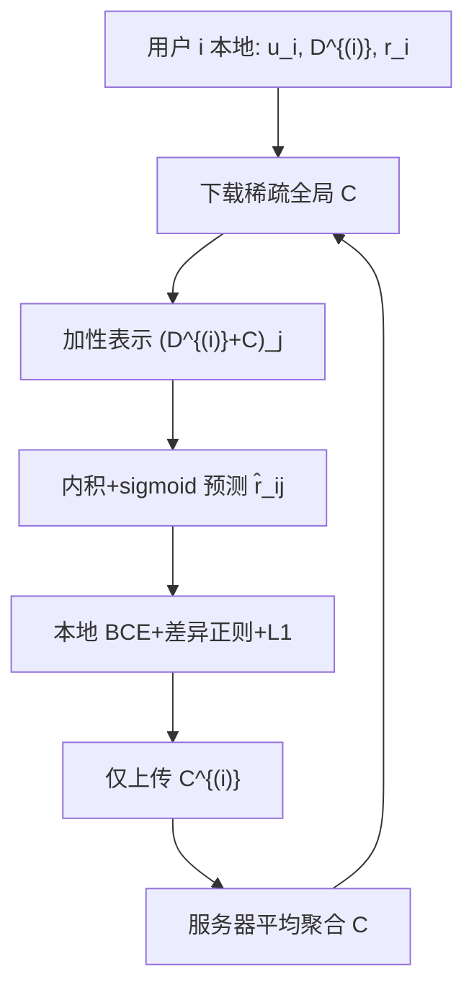
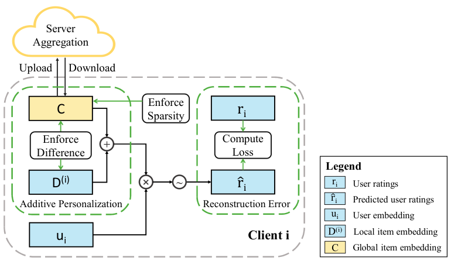

# Federated Recommendation with Additive Personalization（带加性个性化的联邦推荐）

- **会议/期刊**: ICLR 2024
- **作者与机构**: Zhiwei Li, Guodong Long (UTS); Tianyi Zhou (UMD)
- **推荐链路定位**: 召回（联邦矩阵分解评分预测）
- **研究方向**: 去偏公平、可信隐私与工业架构 / 协同过滤
- **论文原文**: [https://arxiv.org/abs/2301.09109v4](https://arxiv.org/abs/2301.09109v4)
- **开源代码**: [https://github.com/mtics/FedRAP](https://github.com/mtics/FedRAP)

## TL;DR (1分钟核心速览)

联邦推荐中的全局物品嵌入对所有用户相同，无法刻画“同一物品在不同用户眼中的差异”，且稠密传输昂贵。FedRAP 将物品嵌入分解为稀疏全局矩阵 $C$与本地个性化矩阵$D^{(i)}$，用 L1 稀疏、差异正则和 tanh 课程联合训练。六数据集 Leave-One-Out、4 负采样 HR/NDCG@10 下全面优于 FedMF/FedNCF/PFedRec，ML-100K 达 97.09/87.81。

## Background & Motivation (背景与核心矛盾)

- **主流范式**: 联邦推荐多采用“共享物品嵌入 + 本地用户嵌入”的 partial model，客户端只保留用户侧参数，服务器聚合物品侧参数。
- **前人局限**: ① 所有客户端共享同一物品向量，抹平用户对同一物品的个性化感知；② 稠密物品矩阵带来昂贵通信；PFedRec 虽个性化物品，却削弱了跨用户共享的协同知识。
- **核心洞察 (Key Insight)**: 用户评分由“物品共性属性 + 用户私有偏差”共同决定，因此物品表示可加性分解为全局 $C$与本地$D^{(i)}$。
- **本文切入点**: 用稀疏全局视角保共享、本地加性视角保个性，并用课程正则避免早期加性个性化拖累训练。

## Method (核心方法设计)

### 1. 整体框架 (Overall Architecture)

FedRAP 将每个客户端视为一个用户：服务器维护全局物品矩阵 $C\in\mathbb{R}^{m\times k}$，客户端本地保存用户向量$u_i$与个性化物品矩阵$D^{(i)}$。前向时以$(D^{(i)}+C)_j$作为用户$i$对物品$j$的个性化表示，经内积与 sigmoid 得$\hat{r}_{ij}$；本地用 BCE 更新$u_i,D^{(i)},C^{(i)}$，仅上传$C^{(i)}$，服务器对参与客户端求平均。L1 稀疏降低通信，差异正则保证$C$与$D^{(i)}$ 互补，课程权重避免早期加性个性化伤害。

<figure class="paper-figure" markdown="span">
  <figcaption>图1：FedRAP 的框架。对于每个用户-i，FedRAP 利用其评分 ri 作为标签，在本地训练用户嵌入 ui 和本地物品嵌入 D(i)。通过将 D(i) 加到来自服务器的全局物品嵌入 C 上，即加性个性化，FedRAP 基于共享知识和个人视角创建个性化物品嵌入，从而产生更好的推荐。由于客户端和服务器仅通信 C，FedRAP 强制其稀疏性以降低通信成本，并鼓励其与 D(i) 的差异，使二者互补。</figcaption>
</figure>

### 2. 关键设计拆解 (Key Designs)

1. **加性个性化（Additive Personalization）**：痛点在于共享 $C$无法表达个体感知。FedRAP 令$\hat{r}_{ij}=\sigma(\langle u_i,(D^{(i)}+C)_j\rangle)$，并以$-\lambda\|D^{(i)}-C\|_F^2$推远二者：$C$学跨用户共性，$D^{(i)}$ 学用户私有偏差，相加后既保留协同知识又实现物品侧个性化。

2. **稀疏全局与课程正则**：稠密 $C$的传输是 FL 瓶颈，故对$C$加$\mu\|C\|_1$。但训练初期$C,D^{(i)}$均不可靠，直接加性会掉点，故用$\lambda(a,v_1)=\tanh(a/10)v_1$、$\mu(a,v_2)=\tanh(a/10)v_2$ 逐步增强正则，实现从“全个性化”到“加性个性化”的平滑过渡。

3. **训练目标、隐私与推理**：总损失为 $\mathcal{L}=\sum_i[\mathrm{BCE}(\hat{r}_i,r_i)-\lambda(a,v_1)\|D^{(i)}-C\|_F^2]+\mu(a,v_2)\|C\|_1$。客户端只传$C$，服务器聚合。若启用 DP，则对$\nabla_C$裁剪到阈值$\tau$，敏感度上界$2\eta\tau/n_s$，加高斯噪声；推理只需$u_i$与$D^{(i)}+C$内积，单客户端复杂度$O(km)$，服务器每轮$O(kmn)$。

## Experimental Setup & Evaluation Protocol (实验设置与评估协议)

- **数据集与预处理**: 原文只说明保留至少 10 条交互的用户；下表计数为公开版本规模，过滤后略降。

| 数据集 | 反馈 | #Users | #Items | #Interactions | 说明 |
| :--- | :---: | :---: | :---: | :---: | :--- |
| TaFeng | 隐式 | — | — | — | 杂货购物 |
| ML-100K | 显式二值化 | 943 | 1,682 | 100k | $r>0\to1$ |
| ML-1M | 显式二值化 | 6,040 | 3,706 | 1,000,209 | $r>0\to1$ |
| Video | 显式二值化 | 5,130 | 1,685 | 37,126 | Amazon Instant Video |
| LastFM | 显式二值化 | 1,892 | 17,632 | 92,834 | LastFM-2K |
| QB-article | 隐式 | — | — | — | 腾讯 QB |

- **数据划分与防穿越 (Splitting Strategy)**: `Leave-One-Out`，每个用户最后一条交互作测试。
- **排名评测协议 (Ranking Protocol)**: `Sampled Ranking`，每个正样本随机配 4 个负样本；报告 HR@10、NDCG@10。
- **对比基线与超参**: NCF、LightGCN（集中式），FedMF、FedNCF、PFedRec、CentRAP（FedRAP 集中式上界）；$d=32$，batch 2048，100 轮通信 × 10 次本地迭代，5 次重复取均值。

## Key Experimental Results (实验关键数据)

### 1. 主实验对比 (Main Results)

原文图 2 仅给柱状图，未给基线精确表；下表 ML-100K 基线为图 2 目测近似（≈），仅示相对差距，FedRAP 为可核验值。

| 方法 | HR@10 | NDCG@10 | 类型 |
| :--- | :---: | :---: | :--- |
| NCF | ≈84.0 | ≈74.0 | 集中式 |
| LightGCN | ≈86.0 | ≈76.0 | 集中式 |
| FedMF | ≈82.0 | ≈71.0 | FL-MF |
| FedNCF | ≈88.0 | ≈78.0 | FL-NCF |
| PFedRec | ≈94.0 | ≈82.0 | 最佳 FL 基线 |
| **FedRAP** | **97.09** | **87.81** | 本文 |
| CentRAP | ≈97.6 | ≈88.6 | 集中式上界 |

相对 PFedRec，FedRAP 在 ML-100K 上约 **+3.3% HR / +7.1% NDCG**。六数据集上 FedRAP 均优于所有 FL 方法；TaFeng 99.43/99.11、ML-1M 93.24/71.87、Video 46.53/28.17、LastFM 23.29/10.99、QB 53.98/25.98。

### 2. 消融实验 (Ablation Study)

| 变体 | 改动 | 关键结果 |
| :--- | :--- | :--- |
| FedRAP-C | 仅全局 $C$ | 最差，说明物品侧个性化不可缺 |
| FedRAP-D | 仅本地 $D^{(i)}$ | 接近 PFedRec，低于 FedRAP，说明丢失共享知识 |
| FedRAP-No | 去 $\|C\|_1$ | 与 FedRAP 接近但略低，且通信更大 |
| FedRAP-L2 | 用 L2 替代 L1 | $C$非零参数更多：$8.07\%/88.94\%$vs$4.19\%/67.36\%$（阈值$10^{-1}/10^{-2}$） |
| 课程变体 | fixed/sin/square/frac | 均低于 tanh；frac 最差，验证早期加性有害 |
| FedRAP+DP | 仅对 $C$ 加噪 | ML-100K HR 97.09→93.64，NDCG 87.81→80.15；降幅 3.55%/8.72% |

### 3. 关键实验发现 (Key Findings)

1. **加性分解是主因**：FedRAP-C 最差、FedRAP-D 接近 PFedRec，完整 FedRAP 最优，说明“共享共性 + 私有差异”比任何单侧个性化都更稳。
2. **课程调度不可省**：固定权重与 frac 衰减均掉点，tanh 递增使模型先学可靠表示、后加强互补约束，避免早期 $C/D$ 重叠造成负迁移。
3. **稀疏与隐私可兼顾**：L1 将 $C$的大参数占比从 8.07% 降至 4.19%，降低通信；仅对$C$ 加 DP 噪声时最大 HR 降幅 9.93%，但仍优于 FL 基线。

## Highlights & Limitations (亮点、对比与审稿批判)

- **与代表作对比**: FedMF/FedNCF 共享稠密物品嵌入，无物品侧个性化；PFedRec 强调物品个性化但弱化全局共享；FedRAP 用加性分解同时保留二者，并以稀疏 $C$ 降通信。
- **可迁移亮点**: “全局稀疏 + 本地残差”的加性参数化适合通信受限的联邦场景；课程式正则可用于任何“先共享、后个性化”的迁移学习。
- **审稿级局限**: ① 每个客户端仍需存储 $D^{(i)}\in\mathbb{R}^{m\times k}$，物品多时本地存储与计算不低；② 评估仅用 4 负采样排序，未给 Full-Ranking 与真实通信字节/时延；③ DP 只报告固定噪声实验，缺少隐私预算-效用曲线。

## Rating (四维评分)

- **方法创新性 (Novelty)**: ⭐⭐⭐⭐ （加性分解简单有效，课程正则与稀疏通信有工程巧思，但理论深度有限）
- **评估协议与实验扎实度 (Protocol & Experiments)**: ⭐⭐⭐⭐ （六数据集、5 次重复与充分消融；但主表为柱状图、采样排序，基线精确值不足）
- **写作与数学规范度 (Clarity & Rigor)**: ⭐⭐⭐⭐ （目标函数与算法清晰，DP 敏感度推导完整；部分符号与实验细节偏简）
- **工业落地与复现价值 (Industrial & Practical Value)**: ⭐⭐⭐⭐ （代码开源、通信仅传 $C$、支持 DP；本地稠密矩阵与真实部署开销仍需验证）

