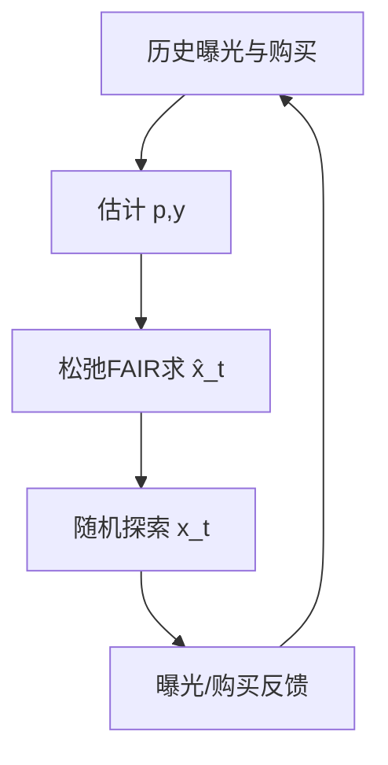

# Interpolating Item and User Fairness in Multi-Sided Recommendations（多边推荐中物品与用户公平的插值）

- **会议/期刊**: arXiv preprint (v3 2024；ICLR/NeurIPS/ICML 2024 目录候选)
- **作者与机构**: Qinyi Chen, Jason Cheuk Nam Liang, Negin Golrezaei (MIT)；Djallel Bouneffouf (IBM Research)
- **推荐链路定位**: 重排/在线曝光分配（单物品或≤K套装）
- **研究方向**: 去偏公平、可信隐私与工业架构 / 强化学习与动态探索推荐
- **论文原文**: [论文原文链接](https://arxiv.org/abs/2306.10050v3)
- **开源代码**: 暂未开源

## TL;DR (1分钟核心速览)

针对多边平台中平台收入、物品曝光与用户效用难以兼顾，且现有公平推荐多聚焦单侧、依赖完整数据的问题，本文提出FAIR约束优化：以物品/用户单侧公平解为锚，用$\delta_I,\delta_U$插值跨组公平；并设计FORM，在bandit反馈下用置信域松弛公平约束、随机探索低曝光物品、IPW估计购买率。Amazon Review在线模拟（$N=30,M=5,K=3,T=2000$，10次）中，FairRec/TFROM收入损失约38%，FORM在$\delta=0.2$时损失<10%，并维持物品/用户公平。

## Background & Motivation (背景与核心矛盾)

- **主流范式**: 公平推荐多分别做item fairness或user fairness；少数双边工作也通常固定公平定义，忽略平台收入。
- **前人局限**: FairRec偏静态双边公平，TFROM偏在线双边公平但不建模平台收入；二者均假设已知问题实例，无法处理bandit反馈下的不确定约束。
- **核心洞察 (Key Insight)**: Proposition 1表明单侧最优会严重伤害其他方；在线时公平约束连“是否满足”都无法直接验证，学习与公平会互相干扰。
- **本文切入点**: 将多边公平写成可调$\delta$的约束优化，再用“松弛约束+随机探索”实现在线低regret求解。

## Method (核心方法设计)

### 1. 整体框架 (Overall Architecture)

平台每轮观察用户类型$j$，选择单物品或≤$K$套装。离线基准FAIR先求物品公平解$f^I$（SWF最大化）与用户公平解$f^U$（每类用户最优物品），再在收入最大化下要求各方结果不低于其公平解的$\delta_I,\delta_U$比例。在线阶段FORM用历史购买估计$\hat\theta_t=(\hat p_t,\hat y_t,r)$，每轮解松弛后的FAIR，再对估计解做随机探索后曝光；观测购买后更新IPW估计。

### 2. 关键设计拆解 (Key Designs)

1. **FAIR：多边公平的插值约束**：痛点是把平台、物品、用户目标割裂。FAIR以单侧公平解为锚，用可解释参数插值：
$\max_{x\in\Delta^{MN}}\mathrm{rev}(x)\ \text{s.t.}\ O_i^I(x)\ge\delta_I O_i^I(f^I),\ O_j^U(x)\ge\delta_U O_j^U(f^U)$，其中$\mathrm{rev}(x)=\sum_{i,j}r_i p_j y_{i,j}x_{i,j}$。$\delta$越大越公平，且可直接诊断“公平价格”PoF。
2. **FORM：松弛约束+随机探索**：在线无法验证约束，FORM解$\mathrm{rev}(x;\hat\theta_t)$，约束右端降$\eta_t$：
$O_i^I(x;\hat\theta_t)\ge\delta_I O_i^I(f^I(\hat\theta_t);\hat\theta_t)-\eta_t$，用户侧同理；再令$x_{t,i,j}=(1-N\epsilon_t)\hat{x}_{t,i,j}+\epsilon_t$。$\eta_t$随置信界收缩，$\epsilon_t$随时间下降，兼顾可行性与低曝光物品估计。
3. **训练目标、估计与推理**：无标准损失与负采样；每轮解线性规划，用IPW估计$\hat y_{t+1,i,j}=\frac{1}{n_{j,t}}\sum_{k=1}^{n_{j,t}}\frac{\mathbb{I}\{I_{\tau_{j,k}}=i,z_{\tau_{j,k}}=1\}}{x_{\tau_{j,k},i,j}}$，$\hat p$为样本均值。理论保证$\mathbb{E}[R(T)],\mathbb{E}[R_F(T)]\le O(MN^{1/3}T^{-1/3})$；推理开销主要是每轮LP。

## Experimental Setup & Evaluation Protocol (实验设置与评估协议)

- **数据集与预处理**: 原文未报告5-core过滤；仅选30个跨用户类型方差最高的物品以制造物品-用户兴趣错位。

| 数据集 | #Users | #Items | #Interactions | 稀疏度/密度 | 特征/场景说明 |
| :--- | :---: | :---: | :---: | :---: | :--- |
| Amazon “Clothing, Shoes and Jewelry” | 5类（原始用户数未报告） | 30（按方差选） | 原始未报告；模拟$T=2000\times10$次 | 未报告 | MF+k-means分类；MNL购买；$r_i\sim U[0.5,1.5]$；$K=3$ |

- **数据划分与防穿越**: 在线时序模拟，非Leave-One-Out/比例划分；每轮仅用$t-1$前历史更新，新用户到达后即时推荐，避免未来信息。
- **排名评测协议**: 非Top-N Full-Ranking/Sampled Ranking；评估时均收入、物品结果与用户效用的归一化曲线，10次模拟取均值（图注含标准误）。
- **对比基线与超参**: greedy、max-utility、min-revenue、random、FairRec、TFROM；$N=30,M=5,K=3,T=2000$，$\delta_I,\delta_U\in[0,1]$重点报告0.2/0.8；未报告embedding维度与显著性$p$值。

## Key Experimental Results (实验关键数据)

### 1. 主实验对比 (Main Results)

原文以图1报告，未给完整数值表；下表保留可核验数字，`n.r.`表示图仅给曲线/趋势。

| 方法 | 收入(norm.) | 物品公平（最小归一化结果） | 用户公平（归一化） |
| :--- | :---: | :---: | :---: |
| greedy | **≈100%** | 极低，部分物品≈0 | ≈0.95+ |
| max-utility | 显著损失 | 偏斜 | ≈0.95+ |
| min-revenue | 显著损失 | **≈1.0（最高）** | ≈0.95+ |
| random | 显著损失 | 高但不均 | ≈0.95+ |
| FairRec | ≈62% | 高 | ≈0.95+ |
| TFROM | ≈62% | 高（均匀曝光） | ≈0.95+ |
| FORM($\delta_I=0.2,\delta_U=0.2$) | **≥90%** | ≥0.2 | 高且可控 |
| FORM($\delta_I=0.8,\delta_U=0.2$) | 下降 | ≥0.8 | 高且可控 |

FORM($\delta=0.2$)相对FairRec/TFROM收入约$+28$pp（约$+45\%$相对），同时避免物品结果归零。

### 2. 消融实验 (Ablation Study)

原文未给组件消融表；以下为算法机制对照（理论归因，无独立数值）。

| 变体 | 改动 | 预期后果 |
| :--- | :--- | :--- |
| Full FORM | 松弛+探索+IPW | 收入/公平regret均$O(MN^{1/3}T^{-1/3})$ |
| w/o relaxation ($\eta_t=0$) | 用估计实例硬约束 | 估计误差可致持续违约，公平无保证 |
| w/o exploration ($\epsilon_t=0$) | 纯利用$\hat{x}_t$ | 低曝光物品购买率估计偏差，长期公平受损 |
| w/o IPW | 朴素购买率 | 受曝光概率影响，$\hat y$有偏 |

### 3. 关键实验发现 (Key Findings)

1. **收入-公平可调优于固定公平**：FairRec/TFROM收入约62%（损失38%）；FORM在$\delta=0.2$时损失<10%，说明约束插值保留平台收入。
2. **物品公平是主要瓶颈**：Amazon数据中用户MNL效用与收入较对齐，PoF随$\delta_I$近似线性上升，$\delta_U$接近1才显著；item约束多为binding。
3. **松弛+探索支撑低regret**：时均收入快速收敛到fair-rev；探索项随$t$下降，$N=30,K=3$下每轮LP可承受，契合$O(MN^{1/3}T^{-1/3})$。

## Highlights & Limitations (亮点、对比与审稿批判)

- **与代表作对比**: FairRec静态双边、TFROM在线双边但均忽略平台收入且依赖完整实例；本文同时建模平台/物品/用户，用$\delta$插值并提供不确定约束下的低regret在线算法。
- **可迁移亮点**: 按置信界松弛公平约束可迁移到曝光分配；$\delta$与PoF可作为业务调参和诊断工具。
- **审稿级局限批判**: 仅$N=30,M=5,K=3,T=2000$小规模模拟，未评估大规模LP延迟；理论依赖局部Lipschitz、唯一公平解与随机到达，对抗/非平稳扩展有限；无开源代码与显著性检验。

## Rating (四维评分)

- **方法创新性 (Novelty)**: ⭐⭐⭐⭐ （多边公平插值+不确定约束bandit低regret，机制清晰）
- **评估协议与实验扎实度 (Protocol & Experiments)**: ⭐⭐⭐ （真实数据模拟但规模小，缺完整数值表与显著性检验）
- **写作与数学规范度 (Clarity & Rigor)**: ⭐⭐⭐⭐ （约束、PoF与regret定义严谨，附录证明完整）
- **工业落地与复现价值 (Industrial & Practical Value)**: ⭐⭐⭐ （$\delta$可调有业务价值，但大规模LP开销与无代码限制复现）

