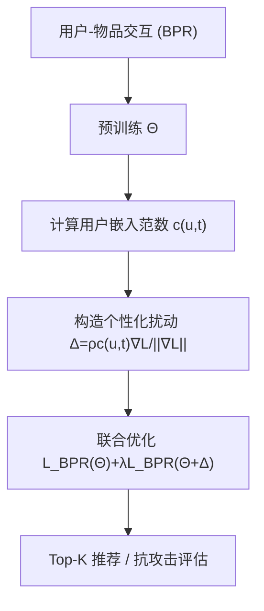
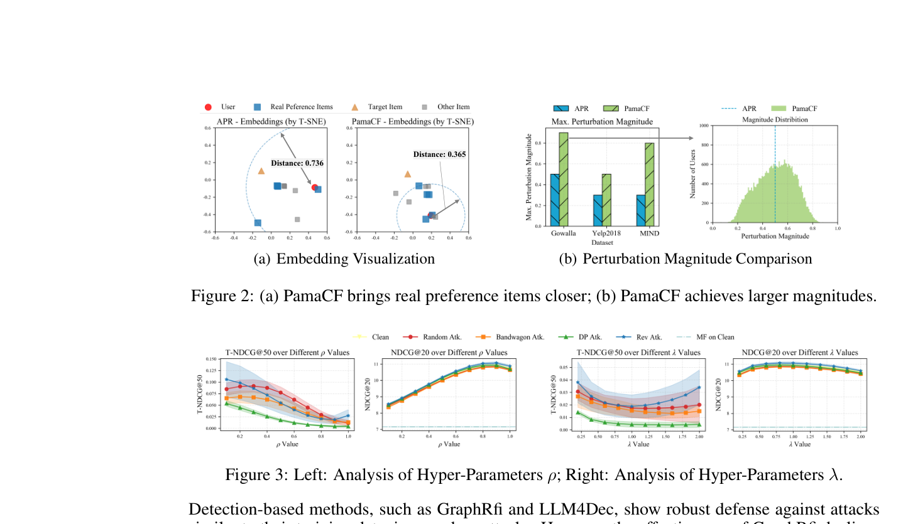

# Understanding and Improving Adversarial Collaborative Filtering for Robust Recommendation（理解并改进面向鲁棒推荐的对抗协同过滤）

- **会议/期刊**: NeurIPS 2024（Advances in Neural Information Processing Systems 37）
- **作者与机构**: Kaike Zhang, Qi Cao, Yunfan Wu, Fei Sun, Huawei Shen, Xueqi Cheng；中科院计算所 AI 安全重点实验室、UCAS
- **推荐链路定位**: 召回/精排（CF 表征训练）
- **研究方向**: 去偏公平、可信隐私与工业架构 / 协同过滤与双塔召回
- **论文原文**: [论文原文链接](https://arxiv.org/abs/2410.22844v2)
- **开源代码**: [开源代码仓库链接](https://github.com/Kaike-Zhang/PamaCF)

## TL;DR (1分钟核心速览)

针对对抗协同过滤（ACF）缺乏理论解释、且所有用户共用同一扰动幅度的问题，本文证明 ACF 在干净/投毒数据下均降低推荐误差，并给出误差下降界；据此提出按用户嵌入尺度分配扰动幅度的 PamaCF。在 Gowalla/Yelp/MIND 的 Top-K 排序与 T-HR@50 攻击成功率评估上，推荐指标平均提升 13.84%/22.04%，攻击成功率最高降约 50%。

## Background & Motivation (背景与核心矛盾)

- **主流范式**: ACF/APR 在训练时对用户、物品嵌入施加“最小化推荐损失、最大化扰动损失”的最小最大对抗训练，无需攻击标签即可提升鲁棒性。
- **前人局限**: CV 中对抗训练常牺牲干净样本精度，而推荐中的 ACF 却经验性同时涨点与抗攻击，缺少理论解释；APR 对所有用户使用统一 $\epsilon$，忽略用户嵌入尺度差异。
- **核心洞察 (Key Insight)**: 高斯单物品模型可证 ACF 的推荐误差更低；误差下降界在约束内随扰动幅度增大，且用户最大扰动幅度与 $\|\mathbf{u}\|$ 正相关。图1 中五个用户的 NDCG@20 在各自最大幅度内提升、越界后显著下降。
- **本文切入点**: 以归一化嵌入范数的 sigmoid 生成用户级扰动系数，用全局 $\rho$ 控制幅度，将“统一扰动”改为“个性化最大扰动”。

<figure class="paper-figure" markdown="span">
  ![图1：五个用户（受随机攻击\[30\]影响）在不同扰动幅度下的NDCG@20。](../../../../assets/papers/2410.22844v2/figure_1.png)<figcaption>图1：五个用户（受随机攻击[30]影响）在不同扰动幅度下的NDCG@20。</figcaption>
</figure>
*图1：五个用户在随机攻击下随扰动幅度变化的 NDCG@20，支持“个性化最大幅度”动机。*

## Method (核心方法设计)

### 1. 整体框架 (Overall Architecture)

PamaCF 保留 ACF 的“预训练—BPR—对抗训练”三段式：先以 BPR 预训练 $\Theta$；每个 batch 对$(u,i,j)$计算用户嵌入范数，得到$c(u,t)$，沿对抗损失梯度方向构造幅度为$\rho c(u,t)$的$\Delta_u/\Delta_i/\Delta_j$；联合优化原 BPR 与对抗 BPR。训练后仅用$\Theta$ 做 Top-K 打分，推理无额外扰动开销。

### 2. 关键设计拆解 (Key Designs)

1. **误差界驱动的个性化幅度**：定理 1/2 表明，在 $\epsilon<\min(\|\mathbf{u}^{(t)}\|,\|\bar{\mathbf{u}}\|)/(\eta\lambda)$且$\|\bar{\mathbf{u}}\|\gg\sigma$时，ACF 的推荐误差低于传统 CF。定理 3/4 进一步给出误差下降界，其核心量$\Psi(u,t+k)=(1+\lambda)\gamma_u C_{t+k}\|\mathbf{u}^{(t+k)}\|$，$\gamma_u=(1-\eta\lambda\epsilon/\|\mathbf{u}\|)^{-1}$；约束内$\epsilon$ 越大，界越优，故应尽量放大每个用户的可承受扰动。

2. **PamaCF 扰动算子**：令 $\epsilon_u^{\max}=\rho c(u,t)$，其中$c(u,t)=\mathrm{sigmoid}\big((\|\mathbf{u}^{(t)}\|-\overline{\|\mathbf{u}^{(t)}\|})/\overline{\|\mathbf{u}^{(t)}\|}\big)$，再取$\Delta_u=\epsilon_u^{\max}\Gamma_u/\|\Gamma_u\|$。物品与负样本扰动同样受$c(u,t)$约束，使三元组扰动幅度与用户尺度一致，避免统一$\epsilon$ 对大小范数用户“一刀切”。

3. **训练目标、负采样与推理效率**：总损失为 $\mathcal{L}_{\text{PamaCF}}=\mathcal{L}_{\text{BPR}}(\Theta)+\lambda\mathcal{L}_{\text{BPR}}(\Theta+\Delta_{\text{PamaCF}})$，$\|\Delta_{u/i/j}\|\le\rho c(u,t)$；沿用 BPR 逐对负采样。训练每 batch 需额外计算扰动梯度，开销上升；在线仅用原嵌入打分，推理成本与 backbone 一致。

## Experimental Setup & Evaluation Protocol (实验设置与评估协议)

- **数据集与预处理**: 过滤交互数少于 10 的用户/物品；MIND 按原文采样子集。

| 数据集 | #Users | #Items | #Interactions | 稀疏度/密度 | 特征/场景说明 |
| :--- | :---: | :---: | :---: | :---: | :--- |
| Gowalla | 29,858 | 40,981 | 1,027,370 | 99.92% / 0.08% | LBS 签到 |
| Yelp2018 | 31,668 | 38,048 | 1,561,406 | 99.88% / 0.12% | 本地商户 |
| MIND | 141,920 | 36,214 | 20,693,122 | 99.60% / 0.40% | 新闻推荐 |

- **数据划分与防穿越 (Splitting Strategy)**: 按用户 80%/20% 划分训练/测试，训练内再随机 10% 作验证；非全局时间戳切分，存在未来交互穿越风险。
- **排名评测协议 (Ranking Protocol)**: 推荐用 Recall/NDCG@10、@20；攻击用 T-HR@50、T-NDCG@50，越低越鲁棒。原文未显式披露候选采样比例，按全库未交互 Top-K 排序理解更稳妥。
- **对比基线与超参设置**: backbone 为 MF、LightGCN、NeurMF；防御基线含 StDenoise、GraphRfi、LLM4Dec、APR、SharpCF。5 次重复取均值±标准差，未报告 $p$值；嵌入维度$d$正文未列，学习率/权重衰减及$\rho\in[0.1,1.0]$、$\lambda\in[0.2,2.0]$ 网格搜索。

## Key Experimental Results (实验关键数据)

### 1. 主实验对比 (Main Results)

MF backbone；R/N@20，T-HR@50 越低越鲁棒。

| 模型 | Gowalla Clean R/N | Gowalla Random T-HR↓ | Gowalla DP T-HR↓ | Yelp Clean R/N | Yelp Rev T-HR↓ | MIND Clean R/N | MIND Random T-HR↓ | MIND DP T-HR↓ |
| :--- | :---: | :---: | :---: | :---: | :---: | :---: | :---: | :---: |
| MF | 11.35/7.16 | 0.148 | 0.201 | 3.76/2.97 | 0.153 | 1.20/0.68 | 0.032 | 0.023 |
| StDenoise | 10.48/8.07 | 0.200 | 0.292 | 3.41/2.61 | 0.331 | 1.13/0.63 | 0.036 | 0.010 |
| GraphRfi | 10.43/7.97 | 0.159 | 0.174 | 3.73/2.94 | 0.129 | 1.20/0.67 | 0.031 | 0.020 |
| APR | 13.06/10.65 | 0.201 | 0.034 | 4.09/3.20 | 0.098 | 1.22/0.68 | 0.083 | 0.008 |
| SharpCF | 13.20/10.02 | 0.204 | 0.303 | 3.93/3.11 | 0.152 | — | — | — |
| LLM4Dec | — | — | — | — | — | 1.20/0.68 | 0.020 | 0.019 |
| **PamaCF** | **13.48/10.94** | **0.070** | **0.021** | **4.18/3.29** | **0.045** | **1.30/0.73** | **0.012** | **0.000** |

相对最佳防御基线，Gowalla Random/DP 的 T-HR@50 分别降 52.72%/36.33%，Yelp Rev 降 54.24%；相对 backbone，Recall/NDCG 平均提升 13.84%/22.04%。

### 2. 消融实验 (Ablation Study)

原文无逐模块 `w/o` 表；以 MF（无对抗）、APR（均匀 $\epsilon$）、PamaCF（个性化幅度）作等效控制。

| 设置 | Gowalla Clean R/N@20 | Gowalla Random T-HR↓ | Gowalla DP T-HR↓ | 结论 |
| :--- | :---: | :---: | :---: | :--- |
| MF | 11.35/7.16 | 0.148 | 0.201 | 无对抗 |
| APR | 13.06/10.65 | 0.201 | 0.034 | 均匀扰动 |
| **PamaCF** | **13.48/10.94** | **0.070** | **0.021** | 个性化幅度 |

<figure class="paper-figure" markdown="span">
  <figcaption>图2：(a) PamaCF使真实偏好物品更接近；(b) PamaCF达到更大的幅度。</figcaption>
</figure>
*图2：PamaCF 的嵌入可视化与扰动幅度对比；真实偏好更近、目标物品更远。*

### 3. 关键实验发现 (Key Findings)

1. **干净数据上 ACF 并非“稳健性换性能”**：PamaCF 在 Gowalla 比 APR 再提 R@20 13.06→13.48、N@20 10.65→10.94，较 MF 提升 18.75%/52.84%；MIND R 1.30 亦高于 APR 1.22。
2. **鲁棒性提升集中在优化型攻击**：Gowalla DP T-HR 0.021 vs APR 0.034，Yelp Rev 0.045 vs APR 0.098，MIND DP 0.000；Gowalla Random 从最佳基线 0.148 降至 0.070。
3. **机制来自个性化幅度而非单纯加噪**：图2 将最远真实偏好物品距离 0.736 降至 0.365，同时推远目标物品；$\rho\in0.7$–$0.9$最优，$\lambda>1$ 后防御趋稳但过大损性能。

## Highlights & Limitations (亮点、对比与审稿批判)

- **与代表作对比 (vs. Prior Work)**: APR 对所有用户统一 $\epsilon$，SharpCF 改优化面但仍未按用户尺度调幅；PamaCF 由误差界推出$c(u,t)$，无需攻击标签。GraphRfi/LLM4Dec 依赖监督模式或物品侧信息，跨攻击易失配。
- **可迁移亮点**: 用嵌入范数构造个性化扰动系数可迁移到 LightGCN/NeurMF；理论界可作为 $\rho,\lambda$ 的调参先验，避免盲目加大扰动。
- **审稿级局限批判**: 理论依赖高斯单物品与 $\|\bar{\mathbf{u}}\|\gg\sigma$ 假设，未覆盖序列/多行为推荐；实验缺显著性检验与明确候选采样协议，且对抗训练每 batch 多一次梯度，训练成本上升，线上部署需权衡。

## Rating (四维评分)

- **方法创新性 (Novelty)**: ⭐⭐⭐⭐ （从误差界推出“按范数个性化扰动”，比 APR 的统一 $\epsilon$ 更具理论依据）
- **评估协议与实验扎实度 (Protocol & Experiments)**: ⭐⭐⭐⭐ （三数据集、四类攻击、三 backbone、5 次重复；但缺显著性检验与采样协议细节）
- **写作与数学规范度 (Clarity & Rigor)**: ⭐⭐⭐⭐ （定理链条清晰，假设边界明确；实际 CF 与高斯模型间仍有跳跃）
- **工业落地与复现价值 (Industrial & Practical Value)**: ⭐⭐⭐⭐ （代码开源、模型无关、推理无额外开销；训练期对抗梯度带来成本）

