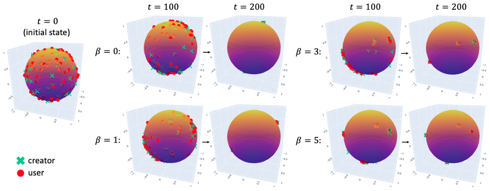
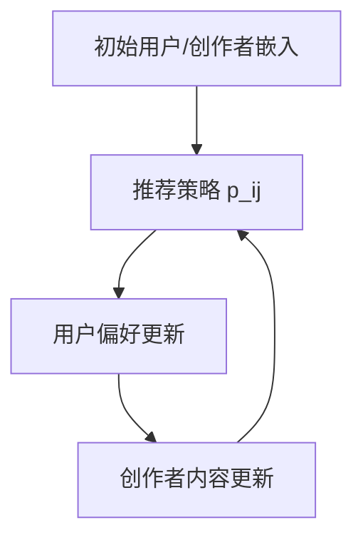

# User-Creator Feature Polarization in Recommender Systems with Dual Influence（双重影响下推荐系统中的用户—创作者特征极化）

- **会议/期刊**: NeurIPS 2024
- **作者与机构**: Tao Lin, Kun Jin, Andrew Estornell, Xiaoying Zhang, Yiling Chen, Yang Liu；Harvard / Google / ByteDance / UCSC
- **推荐链路定位**: 平台生态与长期多样性（非单阶段召回/精排）
- **研究方向**: 去偏公平、可信隐私与工业架构 / 系统动力学与极化
- **论文原文**: [论文原文链接](https://arxiv.org/abs/2407.14094v2)
- **开源代码**: 暂未开源

## TL;DR (1分钟核心速览)

本文指出现有推荐多样性研究忽略“用户偏好”与“创作者内容”会随推荐共同演化，提出 user-creator feature dynamics，并用吸收 Markov 链证明：只要每个创作者有正概率被推荐，系统几乎必然走向共识或双极极化。合成与 MovieLens 仿真显示，多样性目标/均匀流量反而加速极化；top-k 截断以牺牲短期推荐多样性换取长期创作者多样性（k=50→1 时 TP 1.00→0.27）。

## Background & Motivation (背景与核心矛盾)

- **主流范式**: 静态偏好/静态内容假设下，用 re-ranking、多样性正则、均匀流量提升推荐多样性。
- **前人局限**: 只研究推荐对用户或创作者的单侧影响；短视优化“推荐列表多样性”无法保证“平台创作多样性”，甚至可能加速长期极化。
- **核心洞察 (Key Insight)**: 用户与创作者嵌入在单位球上按推荐曝光互相拉扯，形成双变量动力系统；只要推荐概率全为正，系统就会被吸收到最多两个对立簇。
- **本文切入点**: 形式化双重影响动力学，证明极化不可避免，再检验 top-k、阈值截断、多样性目标、均匀流量等真实设计。

<figure class="paper-figure" markdown="span">
  <figcaption>图 1：相同初始化、不同推荐敏感度 β 下模拟动力学的快照。β 越大，时间步 t = 200 时的簇越多。</figcaption>
</figure>
图 1：不同推荐敏感度 β 下 t=200 的簇结构快照；β 越大，稳定簇越多、极化越弱。

## Method (核心方法设计)

### 1. 整体框架 (Overall Architecture)

系统维护用户嵌入 $U^t\in\mathbb{R}^{d\times m}$与创作者嵌入$V^t\in\mathbb{R}^{d\times n}$，每轮先由推荐策略给出$p_{ij}^t$，为每个用户采样一个创作者；用户按曝光内容更新偏好，创作者按被推荐用户集合更新创作风格；循环至收敛。MovieLens 实验先用双塔拟合真实评分得到初始嵌入，再运行同一动力学。

### 2. 关键设计拆解 (Key Designs)

1. **用户-创作者双重更新**：痛点是把推荐只看成静态排序；本文令用户向/背离被推荐创作者移动，创作者向/背离其受众移动，核心为 $u_j^{t+1}=P(u_j^t+\eta_u f(v_i^t,u_j^t)v_i^t)$与$v_i^{t+1}=P(v_i^t+\frac{\eta_c}{|J_i^t|}\sum_{j\in J_i^t}g(u_j^t,v_i^t)u_j^t)$，其中$P(x)=x/\|x\|_2$。直觉是正反馈放大同质簇、负反馈把簇推远。
2. **必然极化定理**：在 $p_{ij}^t\ge p_0>0$、$\eta_c\le \eta_uL_f/2$、$\eta_u<1/2$ 下，几乎任意初态都会到达 R-consensus 或 R-bi-polarization；证明用吸收 Markov 链，说明“给所有创作者留正概率”的探索流量不能救多样性。
3. **截断改变吸收态**：top-k 使未被选中的创作者 $p_{ij}=0$，可形成$\lfloor n/k\rfloor$个吸收簇；阈值$\tau=0$虽允许$d+1$簇但常落到极化态，较大阈值如$0.707$更利于长期多样性。训练无显式损失、无负采样；softmax 全量推理$O(nd)$，top-k 为$O(n+k\log n)$，阈值截断$O(n)$。

## Experimental Setup & Evaluation Protocol (实验设置与评估协议)

- **数据集与预处理**:

| 数据集 | #Users | #Items/Creators | #Interactions | 稀疏度/密度 | 特征/场景说明 |
| :--- | :---: | :---: | :---: | :---: | :--- |
| 合成数据 | 100 | 50 | 100×1000 仿真步 ×100 次 | N/A | $d=10$，单位球，softmax 推荐 |
| MovieLens 20M | 2,000 仿真子集（原始 138,493） | 2,000 仿真子集（原始 26,744） | 20M ratings | 原始约 0.54% | $d=16$，双塔 16×16 拟合初始化 |

- **数据划分与防穿越**: 非传统 train/test 划分；MovieLens 仅用评分拟合双塔初始化，再仿真演化，不存在排序标签穿越。
- **排名评测协议**: 不适用 Full-Ranking / Sampled Ranking；报告群体级 CD、RD、RR、TP，合成重复 100 次均值±标准差，MovieLens 迭代至稳定。
- **对比基线与超参**: 无传统 CF 基线；对照设计包括 uniform/β、softmax β、top-k k、阈值 τ、多样性目标 ρ。默认 β=1、ηu=ηc=0.1、T=1000；无显著性 p 值。

## Key Experimental Results (实验关键数据)

### 1. 主实验对比 (Main Results)

原文无传统推荐基线；下表以全量 softmax（k=50）为高极化参照，比较 top-k 截断（合成数据，β=1）。

| 设置 | k | CD↑ | RD↑ | RR↑ | TP↓ | ΔCD / ΔTP vs k=50 |
| :--- | :---: | :---: | :---: | :---: | :---: | :---: |
| 全量 softmax | 50 | 1.00±.03 | **0.42±.01** | 0.76±.01 | 1.00±.001 | — |
| top-k | 25 | 0.52±.32 | 0.03±.03 | 0.97±.02 | 0.91±.13 | −48.0% / −9.0% |
| top-k | 20 | 0.91±.15 | 0.00±.01 | **1.00±.01** | 0.68±.12 | −9.0% / −32.0% |
| top-k | 10 | 1.17±.06 | 0.00±.001 | **1.00±.001** | 0.50±.07 | +17.0% / −50.0% |
| top-k | 5 | 1.31±.02 | 0.00±.001 | **1.00±.001** | 0.35±.03 | +31.0% / −65.0% |
| top-k | 1 | **1.40±.001** | 0.00±.001 | **1.00±.001** | **0.27±.001** | +40.0% / −73.0% |

### 2. 消融实验 (Ablation Study)

合成数据、β=1 的机制对照：

| 变体 | CD↑ | RD↑ | RR↑ | TP↓ |
| :--- | :---: | :---: | :---: | :---: |
| 去掉 top-k（全量 softmax） | 1.00 | **0.42** | 0.76 | 1.00 |
| top-k，k=5 | 1.31 | 0.00 | **1.00** | 0.35 |
| 阈值截断 τ=0 | 0.13 | 0.00 | **1.00** | 0.97 |
| 阈值截断 τ=0.707 | **1.38** | 0.00 | **1.00** | **0.30** |

### 3. 关键实验发现 (Key Findings)

1. **β 越大越不易极化**：β=0 的均匀推荐使不同创作者共享相近用户集合，更新方向趋同，系统更快极化；β 增大后 t=200 可形成更多簇，TP 下降。
2. **top-k 是“短期多样性换长期多样性”**：k=50→1 使 CD +40%、TP −73%，但 RD 从 0.42 崩到 0；MovieLens 上 k=2000→100 亦使 CD 1.00→1.36、TP 1.00→0.28。
3. **阈值与多样性目标存在反直觉风险**：τ=0 时 CD 仅 0.13、TP 0.97；τ=0.707 时 CD 1.38、TP 0.30。MovieLens 上增大 ρ 可提高 CD 却提高 TP，说明必须区分推荐多样性与创作多样性。

## Highlights & Limitations (亮点、对比与审稿批判)

- **与代表作对比 (vs. Prior Work)**: Dean & Morgenstern 只建模用户偏好漂移；Eilat & Rosenfeld、Jagadeesan 等只建模创作者策略/供给侧均衡；本文首次把用户与创作者双向演化放入同一吸收 Markov 链框架。
- **可迁移亮点**: TP 指标可直接用于监测平台长期极化；top-k/阈值截断可作为“高效用+长期多样性”的正则化设计；固定用户特征（年龄、性别等）可稳定动力学。
- **审稿级局限批判**: 定理依赖符号型 $g$、单位球与更新率约束，且未给出收敛速率；top-k 虽改善 CD/TP，却使 RD 接近 0，未解决用户侧短期体验；实验为合成+MovieLens 仿真，无线上 A/B 与开源代码。

## Rating (四维评分)

- **方法创新性 (Novelty)**: ⭐⭐⭐⭐⭐ （首次形式化用户-创作者双重影响，并用吸收 Markov 链给出极化必然性，结论反直觉）
- **评估协议与实验扎实度 (Protocol & Experiments)**: ⭐⭐⭐ （合成与 MovieLens 仿真覆盖多设计，但无标准排序基线、无线上验证，仅报告均值±标准差）
- **写作与数学规范度 (Clarity & Rigor)**: ⭐⭐⭐⭐ （定理、吸收态与证明结构清晰；部分假设较强，收敛速率留作开放问题）
- **工业落地与复现价值 (Industrial & Practical Value)**: ⭐⭐⭐ （top-k/截断洞察可直接指导生态治理，但缺少代码与真实平台部署证据）

