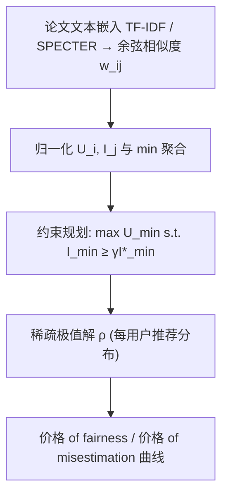
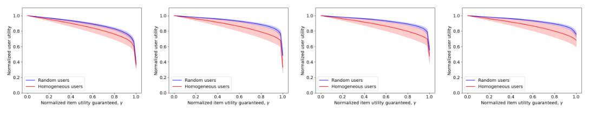

# User-Item Fairness Tradeoffs in Recommendations (推荐系统中用户-物品公平性权衡)

- **会议/期刊**: NeurIPS 2024
- **作者与机构**: Sophie Greenwood, Sudalakshmee Chiniah, Nikhil Garg (Cornell Tech)
- **推荐链路定位**: 推荐策略分配层（打分矩阵 → 约束优化 → 每用户推荐分布），非端到端排序网络
- **研究方向**: 去偏公平、可信隐私与工业架构 / 冷启动与长尾推荐
- **论文原文**: [https://arxiv.org/abs/2412.04466v1](https://arxiv.org/abs/2412.04466v1)
- **开源代码**: [https://github.com/vschiniah/ArXiv_Recommendation_Research](https://github.com/vschiniah/ArXiv_Recommendation_Research)

## TL;DR (1分钟核心速览)

本文直面「物品公平约束必然伤害用户、但代价由谁承担未知」这一黑箱问题：将双边公平写成**带物品公平约束的极小极大归一化效用规划**，借由极值解的稀疏结构给出闭式刻画，导出两条现象——用户偏好越多样，物品公平越"免费"；偏好被误估的用户（冷启动）在最坏情形下会被公平约束推去消费全局最不受欢迎的物品。在 arXiv 论文推荐原型（13.9 万篇训练论文、14,307 篇冷启动物品、SPECTER/TF-IDF 打分）上，以凸优化求解 50 个公平强度 $\gamma$实测：$\gamma \le 0.9$时用户代价极小，$\gamma \to 1$ 时代价陡增，且同质用户群的代价显著更高。

## Background & Motivation (背景与核心矛盾)

- **主流范式**: 每用户推荐预测效用最高的物品（$\arg\max_j w_{ij}$），或多边公平算法在目标函数中加不公平惩罚/加公平约束（Basu et al.、Wang & Joachims、Chen et al.）。
- **前人局限其一**: 只优化"最热"，曝光极度塌缩——arXiv 实测中位情况下 **超过 47% 的论文被推荐给任意用户的概率低于 $0.0001\%$**，即便用户数与物品数相当。
- **前人局限其二**: 多边公平工作只给算法不给刻画，无人回答"公平的价格是多少、由哪个用户付"，而闭式求解在任意效用矩阵下不可行（解依赖全局结构）。
- **核心洞察 (Key Insight)**: 用**归一化最小效用**（而非平均效用）作公平度量后，最优推荐策略在对称类型结构下具有**稀疏支撑**，于是非线性凹规划可退化为线性规划并解析求解，tradeoff 变成效用矩阵的函数。
- **本文切入点**: 定义两个可测量指标——公平的价格 $\pi^{F}_{U|I}$与误估的价格$\pi^{M}_{U}$，先在理论上定符号与量级，再用真实数据"落地验证"。

## Method (核心方法设计)

### 1. 整体框架 (Overall Architecture)

模型输入是平台对每个用户-物品对的效用估计矩阵 $\mathbf{w}\in\mathbb{R}^{m\times n}$（本文用论文摘要嵌入余弦相似度构造）；先做按"各自最优"的归一化，得到用户/物品侧的最小归一化效用$U_{\min}, I_{\min}$；再求解"最大化最差用户效用、同时要求最差物品效用不低于物品公平最优值的$\gamma$倍"的约束规划，输出每用户的推荐概率向量$\rho_i$。训练侧不涉及梯度学习，求解侧是凸优化（cvxpy + SCS），评估侧比较不同$\gamma$下的$U_{\min}$ 曲线。

### 2. 关键设计拆解 (Key Designs)

1. **归一化双边公平规划（把"公平"变成可比较的比值）**：若直接用原始效用，一个对所有用户都只有 $\epsilon$效用的劣质物品会因"绝对曝光均衡"被迫推给所有人。故做双侧归一化$U_i = \frac{\sum_j \rho_{ij}w_{ij}}{\max_j w_{ij}}$、$I_j = \frac{\sum_i \rho_{ij}w_{ij}}{\sum_i w_{ij}}$，消除效用尺度与"人人都不喜欢的物品"的干扰，再取$\min$ 构成 egalitarian 目标：

$$\max_{\rho\in\Delta^{m}_{n-1}} U_{\min}(\rho,\mathbf{w}) \quad \text{s.t.}\quad I_{\min}(\rho,\mathbf{w}) \ge \gamma I^{*}_{\min}(\mathbf{w})$$

公平的"价格"即 $\pi^{F}_{U|I}(\mathbf{w}) = \frac{U^{*}_{\min}(\mathbf{w}) - U^{*}_{\min}(1,\mathbf{w})}{U^{*}_{\min}(\mathbf{w})}$；误估的价格即$\pi^{M}_{U}(\gamma,\mathbf{w},\hat{\mathbf{w}}) = \frac{U^{*}_{\min}(\gamma,\mathbf{w}) - U_{\min}(\hat{\rho}(\gamma),\mathbf{w})}{U^{*}_{\min}(\gamma,\mathbf{w})}$。

2. **稀疏结构定理（把凹规划降维成 LP）**：约束本身也是另一个凹规划的最优解集，直接求解不可行。作者限定"同类型用户同分布"的对称策略集 $S_{\text{symm}}$（$K$ 个用户类型），证明其满足唯一性条件，且基本可行解满足

$$|\{(k,j): \rho_{kj}>0\}| \le n+K-1,\qquad \#\{j: \rho_{kj},\rho_{k'j}>0,\ k\neq k'\} \le K-1$$

即 $nK$个变量里至多$n+K-1$个非零、至多$K-1$个物品被跨类型共享。直觉：物品公平约束只逼迫少数"中间物品"承担均衡任务，其余物品仍可确定性投放，于是可用单纯形闭式反解$\alpha$（类型比例）。

3. **两条理论结论与求解开销**：**定理 3（多样性红利）** 在两类偏好互反的群体中证明 $\pi^{F}_{U|I}(\alpha)$关于$\alpha$（类型 1 占比）在$[0,1/2]$递减、$[1/2,1]$递增，即群体越异质、物品公平越"免费"；同质极端情形可手算得线性负关系$U_{\min}+I_{\min}\le 1+\epsilon$。**定理 4（误估代价被公平放大）** 当已知类型占比$\beta>1/n$且冷启动用户效用被估为全体均值时，无约束时$\pi^{M}_{U}(0)\le 1/2$，而满约束下对任意$\epsilon$存在效用配置使$\pi^{M}_{U}(1)>1-\epsilon$——冷启动用户"每项估计都偏弱"，公平约束恰好把他们推向无人要的物品。求解无负采样概念，60 次凸规划求解、每次子问题规模$\sim 200\times 500$，秒级。

## Experimental Setup & Evaluation Protocol (实验设置与评估协议)

- **数据集与预处理**: 采用 arXiv + Semantic Scholar 引用数据，**物品侧严格冷启动**（2020 年新论文仅有文本、无任何交互/引用）：

| 数据集划分 | #Users | #Items | #Interactions | 稀疏度/密度 | 特征/场景说明 |
| :--- | :---: | :---: | :---: | :---: | :--- |
| 偏好训练池 (pre-2020) | 178,260 | 139,308 | 作者-论文从属关系 | 极稀疏 | 论文摘要 → TF-IDF / SPECTER 嵌入 |
| 待推荐物品池 (2020) | — | 14,307 | 无（冷启动物品） | — | 仅标题/摘要文本 |
| 实验子采样池 | 20,512 | 14,307 | 余弦相似度矩阵 | — | 每轮抽 200 物品 × 500 用户 |

- **数据划分与防穿越 (Splitting Strategy)**: **全局时间戳切分**（pre-2020 建模偏好 → 2020 论文为待推物品 → post-2020 引用作为标签），天然杜绝未来信息泄漏；用户侧另设**模拟冷启动划分**（随机屏蔽 10% 用户的全部历史，视为无数据）。
- **排名评测协议 (Ranking Protocol)**: **非传统 Top-N 排序评测**，无 Recall/NDCG。效度检验用逐对 logistic 回归（相似度 $w_{ij}$→ 是否被引用）；主指标为凸优化求得的$U_{\min}(\gamma)$，$\gamma$取$[0,1]$上 50 个等距点，异质/同质对比各重复 10 次并绘$\pm 2$ 标准误。
- **对比基线与超参设置**: 无 recommender 基线对标，比较维度为 ①效用估计器（Max/Mean × TF-IDF/SPECTER 四种），②公平准则（max-min / Nash welfare / max-sum-3-min），③群体构成（随机总体 vs. k-means 41 簇同质子群，每簇期望 500 用户）。

## Key Experimental Results (实验关键数据)

### 1. 主实验对比 (Main Results)

效用估计器的效度检验（logistic 回归，因变量＝用户 post-2020 是否引用该论文）：

| 打分模型 | 系数 | Std. Err | z-value | Adjusted $R^2$ |
| :--- | :---: | :---: | :---: | :---: |
| Max score, TF-IDF | 12.4100 | 0.058 | **212.178** | 0.08915 |
| Mean score, TF-IDF | 20.2122 | 0.131 | 154.835 | 0.04616 |
| Max score, SPECTER | 18.4557 | 0.250 | 73.695 | **0.1347** |
| Mean score, SPECTER | 16.2482 | 0.246 | 66.148 | 0.09085 |

四个模型系数均显著（$p<0.05$级别，$z>66$），说明用文本相似度作效用代理在稀疏引用事件上具备合理预测力；**Max 聚合在两个嵌入空间下均优于 Mean**（$R^2$ 0.1347 vs 0.0909；0.0892 vs 0.0462），支持"取最大相似度更能刻画用户多元兴趣"的假设，主实验因而选用 Max+TF-IDF。

### 2. 消融实验 (Ablation Study)

原文该部分以图（Fig. 2–5）呈现，下表为对建模假设逐项松绑后的**定性归因**（未给数值表，不作数值臆造）：

| 松绑的假设 | 替代设定 | 结论 |
| :--- | :--- | :--- |
| 公平准则 = max-min 用户效用 | 换为 Nash welfare $U_{NW}$| 权衡形态保持（需处理$U_{NW},I_{NW}<0$ 的约束改写） |
| 公平准则 = max-min | 换为 max-sum-3-min ($k=3$) | 权衡形态保持 |
| 用户/物品效用对称 $w_{ij}$ 共享 | 物品效用改为用户效用与曝光的线性插值 | 相关性下降时，权衡与"多样性降低代价"结论仍稳健 |
| 群体同质性 | k-means 41 簇 vs. 随机总体 | 同质群体 tradeoff 曲线更陡，与定理 3 一致 |
| 效用完全已知 | 屏蔽 10% 用户（模拟冷启动） | $\gamma=0$时代价已高，$\gamma=1$ 未进一步恶化 |

### 3. 关键实验发现 (Key Findings)

1. **公平的价格呈"临界相变"**：$\gamma\in[0,0.9]$区间内用户侧代价很小（$\gamma$增大而$U_{\min}$缓降），但$\gamma\to 1$ 时曲线陡降——把物品公平推到理论最优几乎必然牺牲最差用户。
2. **多样性红利被数据证实**：同质簇（41 个 k-means 簇、每簇 ≈500 用户）的 tradeoff 曲线系统性高于 500 随机用户的异质总体，即群体偏好越分散，物品公平越接近"免费"；这与定理 3 的 $\alpha\to 1/2$ 最优完全对应。
3. **误估才是主要伤害源，而非公平约束**：在 $\gamma\approx 0$处两条曲线（正确估计 vs. 误估）的落差已经很大，加满物品公平约束后落差反而略缩小——理论最坏情形（$\pi^M_U$ 可任意大）在真实数据上体现为"代价早已饱和"，说明平台应先修冷启动估计再谈公平约束。

<figure class="paper-figure" markdown="span">
  <figcaption>图4：无对称性假设下实证发现的稳健性：当物品效用与用户效用相关性降低时，用户-物品公平性权衡与多样性。这里，用户效用 wU 取自 arXiv 推荐引擎相似度分数，如 图3a 所示。对每幅图，物品效用是用户效用与曝光之间的线性插值。形式上，wI</figcaption>
</figure>

## Highlights & Limitations (亮点、对比与审稿批判)

- **与代表作对比**: 相较 Wang & Joachims（群体公平 + 物品曝光，算法导向）、Chen et al.（把公平的价格定义为平台收入的代价），本文把价格重新定义为**用户侧公平的代价**，并解释其由"偏好多样性"而非"目标错位"驱动；相较同期 Kleinberg & Meister 刻画"多少用户承受多少代价"的分布，本文聚焦**最差单个用户**并给出其与效用矩阵结构的闭式关系；相较 Liu & Burke"利用弱偏好用户消化冷门物品"，本文证明该现象在约束优化下会被**自动且更激进地触发**，是对冷启动用户的结构性伤害。
- **可迁移亮点**: ① 用 max-aggregation 汇聚用户历史嵌入以刻画多元兴趣（$R^2$ 提升 46%）；② "归一化 + 极小极大 + 稀疏结构 → LP 闭式"这一套路可直接搬到曝光配给、创作者激励等资源分配问题。
- **审稿级局限批判**: ① 理论只覆盖单物品推荐、效用对称共享、2–3 类用户的极端配置，多物品列表与多类型群体的闭式性未知；② 实证为了凸优化可解只采样 $200\times500$ 的子矩阵，且无线上 A/B 与真实点击反馈，物品冷启动设定也意味着结论尚未在"有交互噪声"的场景验证。

## Rating (四维评分)

- **方法创新性 (Novelty)**: ⭐⭐⭐⭐ （把双边公平的"价格"从收入口径转到用户口径，并用稀疏极值结构拿到闭式解，理论上扎实且少见）
- **评估协议与实验扎实度 (Protocol & Experiments)**: ⭐⭐⭐⭐ （时间切分 + 引用标签 + 10 次重复置信区间设计干净，但属离线小规模子采样模拟，缺真实交互与线上验证）
- **写作与数学规范度 (Clarity & Rigor)**: ⭐⭐⭐⭐ （归一化、价格定义、定理条件与证明路径清晰，假设松绑放在附录并逐条讨论）
- **工业落地与复现价值 (Industrial & Practical Value)**: ⭐⭐⭐ （代码与数据管线已开源，凸优化求解秒级可上线；但需扩展到多物品列表与真实效用，工程侧仍属决策分析工具而非可直接部署的排序器）

