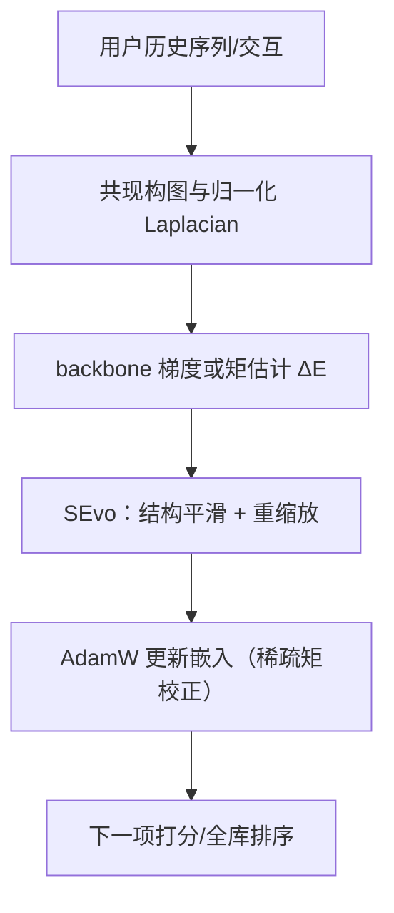
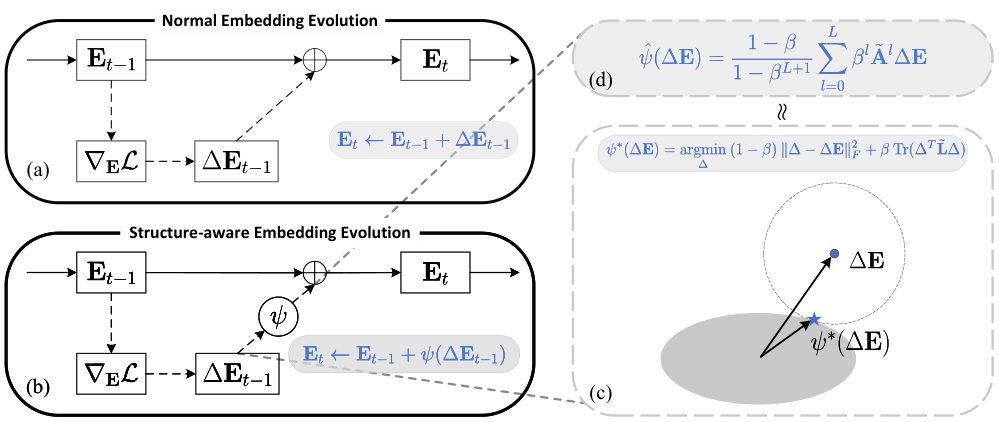

# Graph-enhanced Optimizers for Structure-aware Recommendation Embedding Evolution (图增强优化器驱动的结构感知推荐嵌入演化)

- **会议/期刊**: NeurIPS 2024
- **作者与机构**: Cong Xu、Jun Wang、Jianyong Wang、Wei Zhang；华东师范大学、清华大学
- **推荐链路定位**: 召回/排序（序列推荐下一项预测）
- **研究方向**: 图神经网络与知识图谱推荐 / 序列与会话推荐
- **论文原文**: [https://arxiv.org/abs/2310.03032v3](https://arxiv.org/abs/2310.03032v3)
- **开源代码**: [https://github.com/MTandHJ/SEvo](https://github.com/MTandHJ/SEvo)

## TL;DR (1分钟核心速览)

针对序列推荐中GNN中间模块训练/推理重、mini-batch采样导致相关节点嵌入演化不一致的问题，SEvo把图拉普拉斯正则施加在参数更新量而非特征/标签上，用重缩放Neumann近似得到结构感知且方向感知的$\hat{\psi}$，并修正AdamW稀疏梯度矩估计。6个Amazon/ML数据集按5-core过滤、Leave-One-Out划分、全库排序；SASRec等平均提升9%–23%，Electronics/Clothing最高+92.5%/+139.1%。

## Background & Motivation (背景与核心矛盾)

- **主流范式**: 序列推荐通常用SASRec/BERT4Rec等backbone建模兴趣，再叠加GNN或会话图模块注入物品共现结构。
- **前人局限**: SR-GNN/LESSR需动态构图，MAERec需路径采样，训练与推理开销大；同时海量物品联合训练时，采样随机性使高相似节点更新方向差异明显。
- **核心洞察 (Key Insight)**: 结构信息不必只经GNN前向传播获得，也可直接约束“嵌入如何演化”；但平滑更新量与保持下降方向存在内在冲突。
- **本文切入点**: 将图正则从特征/标签平滑迁移到更新量平滑，并给出可证明收敛的结构感知优化器插件。

## Method (核心方法设计)

### 1. 整体框架 (Overall Architecture)

输入为用户历史交互序列；由序列内共现统计对称邻接矩阵$A$，归一化为$\tilde A$与$\tilde L$。backbone生成梯度或AdamW矩估计$\Delta E$，SEvo在写回嵌入前将其平滑并重缩放；推荐损失与推理打分链路均沿用原模型，因此在线推理零额外开销。

<figure class="paper-figure" markdown="span">
  <figcaption>图1：SEvo 概述。(a) 常规嵌入演化。(b) （第2节）结构感知嵌入演化。(c) （第2.2节）从 ∆E 到 ψ∗(∆E) 变化的几何可视化。灰色椭圆表示具有适当平滑性的区域。(d) （第2.3节）具有更快收敛保证的 L 层近似。</figcaption>
</figure>
图1：SEvo 将普通梯度更新投影到适度平滑区域，并以重缩放 Neumann 近似保持下降方向。

### 2. 关键设计拆解 (Key Designs)

1. **结构感知的更新量平滑**：普通更新$E_t\leftarrow E_{t-1}+\Delta E_{t-1}$只保证损失下降，不保证相邻节点同向演化。SEvo求$\min_{\Delta}(1-\beta)\|\Delta-\Delta E\|_F^2+\beta\operatorname{Tr}(\Delta^\top\tilde L\Delta)$，把$\Delta E$投影到适度平滑区域；$\beta$越大平滑越强，直觉是高相似节点共享更新方向。

2. **方向保持的Neumann近似与重缩放**：直接闭式需大矩阵逆；迭代近似仅在$\beta<1/2$时方向感知，否则可能反向。Neumann近似对任意$\beta\in[0,1)$结构/方向感知；进一步用$\hat{\psi}(\Delta E;\beta)=\frac{1-\beta}{1-\beta^{L+1}}\sum_{l=0}^{L}\beta^l\tilde A^l\Delta E$抵消尺度收缩，把收敛率从$O(C/((1-\beta)^2T))$改进到$O(C/((1-\beta)T))$。

3. **AdamW稀疏矩校正与效率**：未采样节点原更新按$O(\beta_1^{p/2})$衰减，与SEvo的活跃/不活跃能量分配叠加后过强。当$g_t=0$时改为$m_t=\beta_1m_{t-1}+(1-\beta_1)\frac{1}{1-\beta_1^{t-1}}m_{t-1}$，$v_t$同理；这样保持无偏且$p$步空闲后$\Delta e_{t+p-1}=\Delta e_{t-1}$。总损失$\mathcal L$沿用backbone，负采样不变。

## Experimental Setup & Evaluation Protocol (实验设置与评估协议)

- **数据集与预处理**: Amazon Reviews 2014/2018与MovieLens-1M，过滤交互少于5的用户/物品：

| 数据集 | #Users | #Items | #Interactions | 密度 | 平均长度 |
| :--- | ---: | ---: | ---: | ---: | ---: |
| Beauty | 22,363 | 12,101 | 198,502 | 0.073% | 8.9 |
| Toys | 19,412 | 11,924 | 167,597 | 0.072% | 8.6 |
| Tools | 16,638 | 10,217 | 134,476 | 0.079% | 8.1 |
| MovieLens-1M | 6,040 | 3,416 | 999,611 | 4.85% | 165.5 |
| Electronics | 728,489 | 159,729 | 6,737,580 | 0.0058% | 9.24 |
| Clothing | 1,219,337 | 376,378 | 11,282,445 | 0.0025% | 9.25 |

- **数据划分与防穿越**: `Leave-One-Out`：最后一条交互测试，倒数第二条验证。
- **排名评测协议**: `Full-Ranking`全库未交互物品排序，报告HR@N与NDCG@N。
- **对比基线与超参**: LightGCN/SR-GNN/LESSR/MAERec为图基线，GRU4Rec/SASRec/BERT4Rec/STOSA为序列backbone；仅重调lr、weight decay、dropout，默认$L=3$、$\beta=0.99$，5次独立运行paired t-test，$p<0.05$。

## Key Experimental Results (实验关键数据)

### 1. 主实验对比 (Main Results)

表1：NDCG@10主结果（粗体为各列最佳；末行为SASRec+SEvo相对SASRec提升）。

| 方法 | Beauty | Toys | Tools | ML-1M |
| :--- | ---: | ---: | ---: | ---: |
| LightGCN | 0.0240 | 0.0240 | 0.0176 | 0.0427 |
| SR-GNN | 0.0203 | 0.0245 | 0.0135 | 0.1071 |
| LESSR | 0.0264 | 0.0292 | 0.0135 | 0.1373 |
| MAERec | 0.0346 | 0.0440 | 0.0226 | 0.1292 |
| GRU4Rec | 0.0198 | 0.0177 | 0.0145 | 0.1350 |
| SASRec | 0.0336 | 0.0413 | 0.0258 | 0.1333 |
| BERT4Rec | 0.0395 | 0.0366 | 0.0211 | 0.1693 |
| STOSA | 0.0391 | 0.0472 | 0.0231 | 0.1181 |
| SASRec+SEvo | 0.0411 | 0.0475 | 0.0274 | 0.1385 |
| BERT4Rec+SEvo | 0.0430 | 0.0410 | 0.0235 | **0.1743** |
| STOSA+SEvo | **0.0457** | **0.0532** | **0.0293** | 0.1295 |
| SASRec+SEvo `Δ` | +22.3% | +15.0% | +6.2% | +3.9% |

### 2. 消融实验 (Ablation Study)

表2：核心组件消融与机制验证。

| 消融项 | 设置 | 关键观察 |
| :--- | :--- | :--- |
| 去掉重缩放 | $\beta=0.99$ | Beauty/ML-1M损失初期收敛明显变慢，说明重缩放必要 |
| 迭代近似 vs Neumann | $\beta>0.7$| Beauty上迭代近似失效；Neumann在$0.99$仍稳定 |
| 去掉AdamW矩校正 | 稀疏梯度 | GRU4Rec/STOSA平均提升下降，BERT4Rec影响较小 |
| 先验类型 | ML-1M genre vs 交互 | 交互HR@10=0.2567，genre=0.2549，baseline=0.2482 |
| 优化器可插拔 | SGD/Adam/AdamW | 三者+SEvo均提升，AdamW最佳，因权重衰减无需平滑 |

### 3. 关键实验发现 (Key Findings)

- **backbone普适增益**：SASRec+SEvo在Beauty/Toys的NDCG@10从0.0336/0.0413升至0.0411/0.0475，即+22.3%/+15.0%；STOSA+SEvo达0.0457/0.0532，说明优化器级结构注入可替代重GNN模块。
- **规模越大收益越明显**：Electronics上HR@1从0.0033升至0.0063（+92.5%），NDCG@10+53.9%；Clothing上HR@1从0.0071升至0.0171（+139.1%），NDCG@10+89.1%，而每epoch仅多2.22s/8.27s且推理时间不变。
- **平滑与收敛须同时满足**：$\beta=0.99$显著降低$J_{\rm smoothness}$；迭代近似在$\beta>0.7$失效，重缩放Neumann将最坏收敛率改善一个$(1-\beta)$因子，稀疏矩校正则缓解未采样节点更新过衰减。

## Highlights & Limitations (亮点、对比与审稿批判)

- **与代表作对比 (vs. Prior Work)**: LightGCN靠多层传播、SR-GNN/LESSR靠动态会话图、MAERec靠路径采样；SEvo不展前向GNN，只在优化器内平滑更新，故无额外推理时延，训练开销也远小于MAERec。
- **可迁移亮点**: 图正则可施加到任意嵌入表的更新量；矩校正适用于所有稀疏embedding优化；共现图可替换为类目或蒸馏先验。
- **审稿级局限批判**: 静态邻接矩阵与归一化在百万节点仍占内存，且难适应动态兴趣；$\beta$与$L$全局共享，对相似度质量敏感；实验仅离线LOO全库排序，缺线上A/B与冷启动/噪声鲁棒性评估。

## Rating (四维评分)

- **方法创新性 (Novelty)**: ⭐⭐⭐⭐ （首次把图正则用于更新量而非特征/标签，并给出结构/方向感知与收敛分析）
- **评估协议与实验扎实度 (Protocol & Experiments)**: ⭐⭐⭐⭐ （6数据集含百万节点、LOO全库排序、5次运行显著性检验，但缺线上验证）
- **写作与数学规范度 (Clarity & Rigor)**: ⭐⭐⭐⭐ （定理与算法清晰，最终重缩放形式非平凡；附录证明较重）
- **工业落地与复现价值 (Industrial & Practical Value)**: ⭐⭐⭐⭐ （代码开源，推理零改动、训练增量小；静态图与内存开销仍待工程优化）

