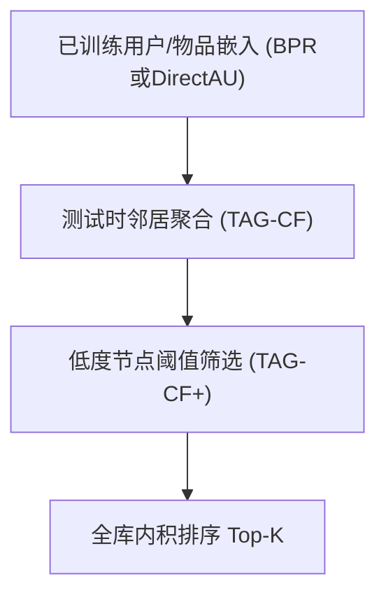

# How Does Message Passing Improve Collaborative Filtering? (消息传递为何能提升协同过滤？)

- **会议/期刊**: NeurIPS 2024
- **作者与机构**: Clark Mingxuan Ju 等，Snap Inc. / University of Notre Dame / UC Riverside
- **推荐链路定位**: 召回（表征增强/测试时增强）
- **研究方向**: 图神经网络与知识图谱推荐 / 协同过滤与双塔召回
- **论文原文**: [论文原文链接](https://arxiv.org/abs/2404.08660v2)
- **开源代码**: [开源代码仓库链接](https://github.com/snap-research/Test-time-Aggregation-for-CF)

## TL;DR (1分钟核心速览)

本文追问消息传递为何提升 CF：系统消融与 Laplacian 学习分析表明，增益主要来自前向邻居表征而非反向梯度，且低度节点受益更大。据此提出 TAG-CF，仅在推理时做一次邻居聚合，作为即插即用模块增强 BPR/DirectAU 表征；在 6 个数据集、Full-Ranking 协议下，冷/低度用户最高提升 39.2%，全体用户最高 31.7%，额外开销 <0.5%。

## Background & Motivation (背景与核心矛盾)

- **主流范式**: GNN-based CF 以 LightGCN 为事实骨干，在用户-物品二部图上堆叠消息传递（MP），并默认其收益机制与节点分类等经典图任务相同。
- **前人局限**: 一方面，既有工作未区分前向邻居信息与反向伴随梯度的贡献；另一方面，它们通常假设高度节点受益更大，但 LightGCN 去掉可学习变换反而更强，已与经典 GNN 经验矛盾。
- **核心洞察 (Key Insight)**: 展开一层 LightGCN 的相似度可见额外三类邻居内积项；消融显示去掉邻居信息使 NDCG@20 在 Yelp/Gowalla/Amazon 降 25.9%/29.7%/14.5%，去掉邻居梯度仅降 3.1%/0.1%/4.1%。定理 1 进一步表明，在单位范数下 $\mathcal{L}_{BPR}$与$\mathcal{L}_{DirectAU}$均被 MP 目标$\sum_{(i,j)\in\mathcal{D}}\|\mathbf{u}_i-\mathbf{i}_j\|_2^2$ 上界，监督信号已在反传中“隐式 MP”，故高度节点增益反而有限。
- **本文切入点**: 把 MP 从训练时搬到测试时，只做一次且优先服务低度节点。

## Method (核心方法设计)

### 1. 整体框架 (Overall Architecture)

输入是已用 BPR、DirectAU、ENMF 或 UltraGCN 训练好的用户/物品嵌入；训练阶段完全不跑 MP，也不新增参数。推理时按式 (7) 对节点做一跳邻居聚合，TAG-CF+ 再按验证集选出的度阈值仅聚合低度节点；最后用增强后的嵌入做全库内积排序。

### 2. 关键设计拆解 (Key Designs)

1. **前向/反向解耦诊断（为什么 MP 有效）**：痛点在于既有工作把 MP 的收益笼统归因于图结构。本文固定训练/测试流程，分别移除“测试时邻居信息”和“反传邻居梯度”：前者导致 14.5%–29.7% 的 NDCG@20 下降，后者仅 0.1%–4.1%，说明推理时聚合即可回收大部分收益。直觉是 LightGCN 的线性展开把邻居表征直接注入打分，而梯度只做微调。
2. **TAG-CF 测试时聚合（即插即用增强）**：对已训练嵌入 $\mathbf{u}_i,\mathbf{i}_j$，在推理时计算
$\mathbf{u}_i^{*}=\mathbf{u}_i+\sum_{j\in\mathcal{N}(u_i)}|\mathcal{N}(u_i)|^{m}|\mathcal{N}(j)|^{n}\mathbf{i}_j$，物品侧对称。$m=n=-1/2$时退化为单层 LightGCN，但二部图异质邻居使固定归一化不总最优，因此在$[-2,0]$内调$m,n$。由于只聚合一次，避免训练中每 epoch 重复查询邻居的邻居爆炸。
3. **TAG-CF+ 与训练/推理开销**：低度节点邻居稀疏且 MP 增益更大，故只对度低于验证集所选阈值的节点聚合。训练损失不变，BPR 逐正样本采样负例，DirectAU 用随机用户/物品的均匀性项替代显式负采样；推理仅一次 MP，额外开销约 $0.05\times10^3$ 秒，低于 MF 总训练时间的 0.5%。

## Experimental Setup & Evaluation Protocol (实验设置与评估协议)

- **数据集与预处理**: 5 个学术基准 + 1 个 Snap 工业数据，未做 5-core 过滤；统计如下：

| 数据集 | #Users | #Items | #Interactions | 稀疏度/密度 | 特征/场景说明 |
| :--- | :---: | :---: | :---: | :---: | :--- |
| Amazon-book | 52,643 | 40,981 | 2,984,108 | 99.94% | 图书隐式反馈 |
| Anime | 73,515 | 12,295 | 7,813,727 | 99.13% | 动画隐式反馈 |
| Gowalla | 29,858 | 40,981 | 1,027,370 | 99.91% | 签到/位置社交 |
| Yelp-2018 | 31,668 | 38,048 | 1,561,406 | 99.87% | 本地商户评论 |
| MovieLens-1M | 6,040 | 3,629 | 836,478 | 96.18% | 电影评分二值化 |
| Internal | ~0.5M | ~0.2M | ~7M | 99.99% | Snap 工业推荐 |

- **数据划分与防穿越 (Splitting Strategy)**: 采用 `group-by-user` 随机划分，每个用户 80%/10%/10% 为训练/验证/测试；非全局时间戳切分，也非严格冷启动划分。
- **排名评测协议 (Ranking Protocol)**: 无偏 `Full-Ranking`，全部物品作为候选，报告 NDCG@20 与 Recall@20；另在附录给出 @10 结果。
- **对比基线与超参设置**: 基线含 MF、ENMF、UltraGCN、NGCF、LightGCN、SGL、SimGCL、LightGCL；嵌入维度统一 $d=64$，每模型最多 25 次超参搜索，10 个随机种子报告均值±标准差；未报告正式显著性$p$ 值。

## Key Experimental Results (实验关键数据)

### 1. 主实验对比 (Main Results)

表 1：整体 NDCG@20（越高越好；粗体为行内最优，†按原文报告 MF+TAG-CF 相对 MF 的提升）。

| 数据集 | MF | ENMF | NGCF | LightGCN | UltraGCN | MF+TAG-CF | UltraGCN+TAG-CF | Impr.† |
| :--- | :---: | :---: | :---: | :---: | :---: | :---: | :---: | :---: |
| Amazon-Book | 8.01 | 6.13 | 6.97 | 8.06 | 5.77 | **8.13** | 6.11 | +1.5% |
| Anime | 24.01 | 30.17 | 22.54 | 27.97 | 30.30 | 27.25 | **30.89** | +9.8% |
| Gowalla | 9.77 | 5.23 | 8.65 | **9.96** | 8.53 | 9.88 | 9.02 | +1.1% |
| Yelp-2018 | 6.25 | 3.79 | 5.54 | 6.33 | 5.01 | **6.36** | 5.53 | +1.8% |
| MovieLens-1M | 22.51 | 20.57 | 23.17 | 26.64 | 26.50 | 29.65 | **29.68** | +31.7% |

Internal 上 MF+TAG-CF 将 NDCG@20 从 7.04 提至 8.54（+21.3%），ENMF/UltraGCN 因 OOM 未跑通。TAG-CF 在低度用户上收益更明显：MovieLens-1M 低度 MF 从 20.98 提至 29.20（+39.2%）。

### 2. 消融实验 (Ablation Study)

表 2：LightGCN 变体 NDCG@20（DirectAU 训练）。

| 变体 | Yelp-2018 | Gowalla | Amazon-book |
| :--- | :---: | :---: | :---: |
| LightGCN | 6.36 | 9.88 | 8.13 |
| w/o grad. | 6.16 | 9.87 | 7.80 |
| w/o neigh. info | 4.71 | 6.95 | 6.95 |
| w/o both | 6.09 | 9.83 | 7.75 |

### 3. 关键实验发现 (Key Findings)

1. **前向邻居信息是主因**：去掉邻居信息使 NDCG@20 在 Yelp/Gowalla/Amazon 降 25.9%/29.7%/14.5%，而去掉邻居梯度仅降 3.1%/0.1%/4.1%，故测试时一次聚合即可回收大部分 MP 收益。
2. **低度用户受益更大**：TAG-CF 对 ENMF/MF 的低度用户 NDCG@20 平均提升 4.6%/9.1%，高于整体 3.2%/7.1%；MovieLens-1M 低度 MF 提升 39.2%，整体提升 31.7%，与“监督信号隐式 MP 已覆盖高度节点”一致。
3. **效率与 SOTA 兼顾**：TAG-CF 额外开销约 $0.05\times10^3$ 秒（<0.5% MF 训练时间），较 LightGCN 加速 1.44×–4.06×；对比 SGL/SimGCL/LightGCL，NDCG/Recall 平均排名 1.2/1.7，综合运行时间总排名 1.9 最优。

## Highlights & Limitations (亮点、对比与审稿批判)

- **与代表作对比 (vs. Prior Work)**: LightGCN/NGCF 在训练中逐层 MP，TAG-CF 只在推理时聚合一次；SGL/SimGCL 靠对比学习增强训练，TAG-CF 不改训练目标而直接增强已学嵌入，因而以 <1% 时间取得可比或更优效果。
- **可迁移亮点**: ① 任意已训练 CF 嵌入可外挂测试时邻居聚合；② 按度阈值只增强低度节点，可同时降计算并提性能。
- **审稿级局限批判**: ① $m,n$ 需在验证集上网格搜索，且对 BPR 高方差嵌入的适应性弱于 DirectAU；② 随机 80/10/10 划分并非时间切分，“冷用户”实为低度用户代理，严格零样本冷启动与线上分布漂移仍未验证。

## Rating (四维评分)

- **方法创新性 (Novelty)**: ⭐⭐⭐⭐ （首次解耦 MP 的前向邻居信息与反向梯度，并给出 BPR/DirectAU 被 MP 目标上界的定理，TAG-CF 极简但洞察扎实）
- **评估协议与实验扎实度 (Protocol & Experiments)**: ⭐⭐⭐⭐ （5 学术+1 工业数据、10 seeds、Full-Ranking 与消融完整；但随机划分非时间/严格冷启动，未报显著性检验）
- **写作与数学规范度 (Clarity & Rigor)**: ⭐⭐⭐⭐ （展开式与定理证明清晰；$m,n$ 调参和 TAG-CF+ 阈值选择略依赖验证集）
- **工业落地与复现价值 (Industrial & Practical Value)**: ⭐⭐⭐⭐⭐ （开源、即插即用、<0.5% 训练开销，Snap 工业数据验证，聚合可落 SQL/BigQuery）

