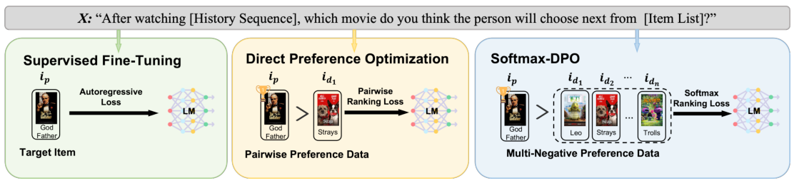

# On Softmax Direct Preference Optimization for Recommendation (面向推荐的 Softmax 直接偏好优化)

- **会议/期刊**: NeurIPS 2024
- **作者与机构**: Yuxin Chen, Junfei Tan, An Zhang, Zhengyi Yang, Leheng Sheng, Enzhi Zhang, Xiang Wang, Tat-Seng Chua (新加坡国立大学 / 中科大 / 北海道大学)
- **推荐链路定位**: 重排（候选集列表打分）
- **研究方向**: 大语言模型推荐 (LLM4Rec) / 序列推荐
- **论文原文**: [https://arxiv.org/abs/2406.09215v3](https://arxiv.org/abs/2406.09215v3)
- **开源代码**: [https://github.com/chenyuxin1999/S-DPO](https://github.com/chenyuxin1999/S-DPO)

## TL;DR (1分钟核心速览)

现有 LM 推荐器把历史交互转成 prompt、只以正样本标题为目标做语言建模微调（next-token），既没利用负样本，也没对齐"个性化排序"这一真实目标。本文把成对 DPO 的 Bradley-Terry 偏好模型升级为 Plackett-Luce 部分排序模型，提出 S-DPO：一个 prompt 配多个负样本，用 softmax 形式的排序损失微调 LLaMA2-7B。理论上证明 S-DPO 等价于负采样 softmax/InfoNCE 损失，并自带难负样本加权。在 20 候选采样排序协议下，三个数据集 HR@1 较次优基线提升 11.10%–47.03%。

## Background & Motivation (背景与核心矛盾)

- **主流范式**: 将用户历史交互序列与候选集写成文本 prompt，用正样本物品标题作为监督目标，以语言建模损失做 SFT（TALLRec），或额外注入协同 embeddings（LLaRA）。
- **前人局限**: ① next-token 目标与"在候选中排对序"不一致，负样本完全被丢弃，偏好数据利用率极低；② 即便引入偏好对齐，DPO 也只处理成对 (正, 单负) 数据，其余负样本的信息被浪费。
- **核心洞察 (Key Insight)**: 用户序列推荐天然是一个**部分排序**问题（$e_p\succ e_d,\forall e_d\in E_d$），而 Plackett-Luce 模型对部分排名的边缘化恰好化简为对全部候选的 softmax；把 DPO 的隐式奖励$r_\theta(x_u,e)=\beta\log\frac{\pi_\theta(e|x_u)}{\pi_{\mathrm{ref}}(e|x_u)}$ 代入即得一个"多负样本版 DPO"。
- **本文切入点**: 不改模型结构、不引入协同 ID 特征，只改训练目标——把排序信息显式注入 LM 的参数更新。

## Method (核心方法设计)

### 1. 整体框架 (Overall Architecture)

模型分两阶段。**Stage-1 SFT**：把用户历史 $H_u$、候选集$C$与任务描述拼成 prompt$x_u$，配正样本标题$e_p$做语言建模损失微调（仅对 item title 的 token 计算损失），注入领域知识并保证指令遵循率（ValidRatio）。**Stage-2 偏好对齐**：对同一 prompt 采样 1 个正样本与$K$个随机负样本构成$\{x_u,e_p,E_d\}$，用 S-DPO 损失继续训练 3 个 epoch，使 LM 学会"把正样本排在所有负样本之前"。推理时把候选集内 20 个物品标题逐一喂给模型，取序列对数似然最高者作为推荐结果。整体流程见 图 1。

<figure class="paper-figure" markdown="span">
  <figcaption>图 1：S-DPO 框架。现有方法使用语言建模损失微调 LM，未针对推荐进行定制；与之不同，S-DPO 提出将排序信息显式注入 LM。更进一步，S-DPO 在用户偏好数据中引入多个负样本，并将成对 DPO 损失推广为 softmax 排序损失。</figcaption>
</figure>

### 2. 关键设计拆解 (Key Designs)

1. **多负样本偏好分布（PL 部分排序 → softmax）**：DPO 的 BT 模型只能建模两两比较，无法吸收 $K$个负样本。作者对 PL 模型枚举"以$p$ 为首"的全部排列并求和，得到边缘化偏好分布
 $p^*(e_p\succ e_d,\forall e_d\in E_d|x_u)=\dfrac{\exp(r(x_u,e_p))}{\sum_{j=1}^{K}\exp(r(x_u,e_j))}$，
 即所有负样本项在排列求和后相互抵消，只剩一个归一化 softmax。直觉：负样本越多，分母越接近真实候选分布，排序信号越"全局"。

2. **S-DPO 损失与难负样本梯度**：把上述分布代入偏好学习目标（式 3）并用 $r_\theta$ 替换奖励，得
 $\mathcal{L}_{\text{S-DPO}}=-\mathbb{E}\log\sigma\Big(-\log\sum_{e_d\in E_d}\exp\big(\beta\log\tfrac{\pi_\theta(e_d|x_u)}{\pi_{\mathrm{ref}}(e_d|x_u)}-\beta\log\tfrac{\pi_\theta(e_p|x_u)}{\pi_{\mathrm{ref}}(e_p|x_u)}\big)\Big)$。
 当 $|E_d|=1$时严格退化为 DPO（附录 A.2）。其梯度为$\nabla_\theta\mathcal{L}\propto\sigma(\log\sum\exp g)\cdot\big[\nabla_\theta\log\pi_\theta(e_p)-\sum_{e_d}\frac{\exp g(e_d)}{\sum_{e_d'}\exp g(e_d')}\nabla_\theta\log\pi_\theta(e_d)\big]$，其中$g(e_d)=r_\theta(e_d)-r_\theta(e_p)$。关键在第二项：每个负样本被赋予 softmax 权重，奖励高的**难负样本**（模型已经"差点选中"的物品）获得更大下压梯度——这正是对比学习难负挖掘的机制，而 DPO 对所有负样本一视同仁。

3. **训练目标、负采样与推理效率**：总损失 $=\mathcal{L}_{\text{LM}}(\text{SFT})+\mathcal{L}_{\text{S-DPO}}$；负样本为候选集内**均匀随机采样**（非 in-batch、非显式难负检索），$K$在$\{3,5\}$中搜索。效率上 DPO 需为$K$个 (prompt, response) 对分别前向，复杂度$\Theta(2KCMS_t)$；S-DPO 共享一次 prompt 前向、仅对$K+1$个标题并行打分，降至$\Theta((K+1)(CM+1)S_t)$，负样本越多相对优势越大（约为 DPO 的$\tfrac{1}{2}+\tfrac{1}{2K}$ 倍）。

## Experimental Setup & Evaluation Protocol (实验设置与评估协议)

- **数据集与预处理**: Goodreads 采用 $\ge 20$ 交互过滤；标题作为物品文本描述。

| 数据集 | #Sequences | #Items | #Interactions | 密度 | 场景 |
| :--- | :---: | :---: | :---: | :---: | :--- |
| MovieLens (100K) | 943 | 1,682 | 100,000 | 6.31% | 电影评分 |
| Goodreads | 6,031 | 4,500 | 220,100 | 0.81% | 图书评论 |
| LastFM | 1,220 | 4,606 | 73,510 | 1.31% | 音乐艺人 |

- **数据划分与防穿越**: 每条序列按时间排序后做 **8:1:1 比例划分**，保证训练/验证/测试无信息泄漏（序列内时间切分，非全局时间戳切分）。
- **排名评测协议**: **Sampled Ranking**——每个测试样本从**未交互物品中随机采 20 个负样本 + 1 个正样本**，报告 HR@1；LM 难以输出完整排序，故不用 NDCG。额外报告 **ValidRatio**（输出能命中候选集内标题的比例）以衡量指令遵循能力。
- **对比基线与超参**: 传统 (GRU4Rec / Caser / SASRec)、LM 增强 (MoRec)、LM 基座 (LLaMA2 零样本、Chat-REC+GPT-4、TALLRec、LLaRA)。骨干统一 LLaMA2-7B，SFT 5 epoch + 对齐 3 epoch，batch 128，对齐阶段 lr $1\times10^{-5}$，$\beta=1$，4×A100。

## Key Experimental Results (实验关键数据)

### 1. 主实验对比 (Main Results)

| 模型 | Goodreads HR@1 | Valid | LastFM HR@1 | Valid | MovieLens HR@1 | Valid |
| :--- | :---: | :---: | :---: | :---: | :---: | :---: |
| GRU4Rec | 0.3867 | 1.0000 | 0.2616 | 1.0000 | 0.3750 | 1.0000 |
| Caser | 0.4174 | 1.0000 | 0.2233 | 1.0000 | 0.3861 | 1.0000 |
| SASRec | 0.3581 | 1.0000 | 0.2233 | 1.0000 | 0.3444 | 1.0000 |
| LLaMA2 (零样本) | 0.0233 | 0.3845 | 0.0246 | 0.3443 | 0.0421 | 0.4421 |
| Chat-REC (GPT-4) | 0.3306 | 1.0000 | 0.3770 | 1.0000 | 0.2000 | 0.9895 |
| MoRec | 0.2877 | 1.0000 | 0.1652 | 1.0000 | 0.2822 | 1.0000 |
| TALLRec | 0.4983 | 0.9573 | 0.4180 | 0.9836 | 0.3895 | 0.9263 |
| LLaRA | 0.5292 | 0.9950 | 0.4508 | 0.9918 | 0.4737 | 0.9684 |
| **S-DPO (Ours)** | **0.6609** | 0.9900 | **0.6628** | **0.9992** | **0.5263** | 0.9895 |
| Improv. vs 次优 | +24.89% | — | +47.03% | — | +11.10% | — |

### 2. 消融实验 (Ablation Study)

| 变体 (LastFM / MovieLens / Goodreads) | HR@1 (L / M / G) | Valid (L / M / G) | 训练复杂度 |
| :--- | :---: | :---: | :---: |
| SFT (w/o ranking) | 0.5980 / 0.3895 / 0.4983 | 0.9980 / 0.9684 / 0.9573 | $\Theta(CMS_t)$ |
| DPO, 1 负样本 | 0.6342 / 0.4947 / 0.6381 | 0.9972 / 0.9684 / 0.9900 | $\Theta(2CMS_t)$ |
| DPO, $K=3$独立成对 | 0.6413 / 0.4947 / 0.6628 | 0.9964 / 0.9474 / 0.9900 |$\Theta(2KCMS_t)$ |
| **S-DPO, $K=3$** | **0.6477 / 0.5263 / 0.6661** | **0.9980 / 0.9895 / 0.9950** |$\Theta((K+1)(CM+1)S_t)$ |

### 3. 关键实验发现 (Key Findings)

1. **收益来自"损失形式"，不只是"多给负样本"**：把 3 个负样本简单拆成 3 个 DPO 对（DPO-$K$）在 MovieLens 上 HR@1 与单负 DPO 完全相同（0.4947），而 S-DPO 用同样负样本升到 0.5263（+3.16 pt），说明 softmax 归一化带来的跨负样本竞争才是关键；Goodreads 上 +2.80 pt、LastFM 上 +1.35 pt 同向验证。
2. **负样本数单调增益且优于 DPO 的收敛行为**：$K$从 1 增到 15（$\beta=1$）性能持续上升；验证损失下降快于 DPO、正样本隐式奖励持续增长且更稳定，说明多负样本提供了更大且更有判别性的排序梯度（难负挖掘）。$\beta$过小（0.1–0.5）会冲垮 SFT 知识（ValidRatio 骤降），过大（5）则学不到排序，$\beta=1$ 最佳。
3. **骨干可迁移但有边界**：换成 Pythia-2.8B，LastFM HR@1 从 LM 损失 0.1611 → S-DPO(8 neg) 0.2200；Mistral-7B 在 MovieLens 从 0.4211 → 0.4947；但 Mistral 在 LastFM 上 S-DPO(3)=0.7679 反而略低于 LM 损失 0.7828，提示强骨干 + 短序列场景下偏好对齐可能挤压已有知识。

## Highlights & Limitations (亮点、对比与审稿批判)

- **与代表作对比 (vs. Prior Work)**: 与 TALLRec 的差别是"改目标而非只改数据格式"——TALLRec 仍是正样本语言建模；与 LLaRA 的差别是"不靠协同 ID embedding 注入排序信号，而在损失层面对齐"；与 DPO 的差别是把 BT 成对偏好推广到 PL 部分排序，并给出与 softmax/InfoNCE 的等价性证明，从而把推荐领域成熟的采样损失理论"借"给 LLM 对齐。
- **可迁移亮点**: ① 一次 prompt 前向 + $K+1$个 response 打分的并行实现，把偏好对齐训练成本从$O(K)$次前向降到$O(1)$，可直接复用到 listwise 重排与生成式推荐的偏好微调；② "损失只在 item title token 上计算"这一细节对生成式推荐微调有普遍参考价值。
- **审稿级局限批判**: ① 评测仅用 20 候选的采样排序 HR@1，未做全库 Full-Ranking 或 NDCG@K，绝对量级与真实线上差距大；② 负样本上限 15 且训练开销随 $K$线性增长，无法验证更大$K$（如全候选）下的饱和点；③ 仅在单域序列推荐实验，未涉及跨域/多任务，且 Mistral-LastFM 的负向结果未被讨论。

## Rating (四维评分)

- **方法创新性 (Novelty)**: ⭐⭐⭐⭐ （把 PL 部分排序边缘化优雅地化简为 softmax，并给出 DPO↔BPR、S-DPO↔softmax 损失的结构性对应与难负梯度分析，理论增量清晰）
- **评估协议与实验扎实度 (Protocol & Experiments)**: ⭐⭐⭐ （三数据集 + 8 基线 + 消融/超参/骨干分析完整，但 20 候选采样排序偏弱，缺全库排序与显著性检验）
- **写作与数学规范度 (Clarity & Rigor)**: ⭐⭐⭐⭐ （推导链完整、附录给出退化与梯度证明，复杂度对比明确；部分符号 $C_M$ 定义略简）
- **工业落地与复现价值 (Industrial & Practical Value)**: ⭐⭐⭐⭐ （代码开源、仅改训练损失即可 plug-in，且工程实现把 $K$ 负样本前向成本摊薄到 1 次，适合精排/重排阶段偏好微调）

