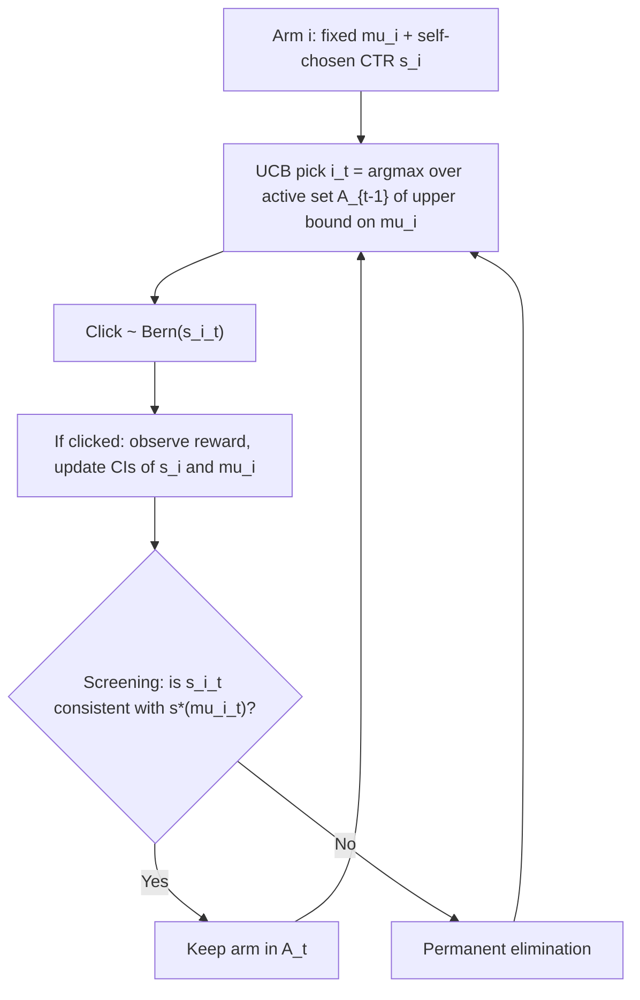
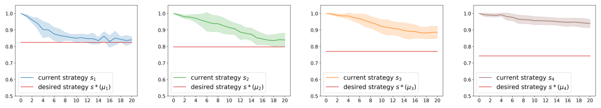

# Bandits Meet Mechanism Design to Combat Clickbait in Online Recommendation（结合机制设计与多臂老虎机以对抗在线推荐中的标题党）

- **会议/期刊**: ICLR 2024（arXiv 预印本 2023-11）
- **作者与机构**: Thomas Kleine Buening (Oslo)、Aadirupa Saha (TTIC/Apple)、Christos Dimitrakakis (Neuchâtel)、Haifeng Xu (UChicago)
- **推荐链路定位**: 召回/在线探索策略（流量分配与曝光机制）
- **研究方向**: 强化学习与动态探索推荐 / 去偏公平与可信工业架构
- **论文原文**: [https://arxiv.org/abs/2311.15647v1](https://arxiv.org/abs/2311.15647v1)
- **开源代码**: 暂未开源

## TL;DR (1分钟核心速览)

标题党的根源是"点击率由供应商自己写"：臂不仅拥有固定后点击价值 $\mu_i$，还能自由选择 CTR$s_i$来最大化自身被点击次数，而平台效用$u(s_i,\mu_i)$在$s_i$上非单调。本文提出 strategic click-bandit 模型与激励感知算法 **UCB-S**：用双侧置信区间对偏离平台期望策略$s^*(\mu_i)$的臂施加可信的永久淘汰威胁。理论上证明存在 NE、刻画全部近似均衡$s_i=s^*(\mu_i)+O(H\max\{\Delta_i,\sqrt{K\log T/T}\})$，并给出任意均衡下$\tilde{O}(\sqrt{KT})$强策略遗憾与$\Omega(\sqrt{KT})$下界；仿真显示 UCB-S 迫使最优臂收敛至期望策略，而标准 UCB 全部臂停留在$s\approx1$ 并持续高遗憾。

## Background & Motivation (背景与核心矛盾)

- **主流范式**: 推荐/广告把曝光当作经典 MAB 或 contextual bandit，按点击或后点击奖励做 UCB/Thompson 探索，隐含假设"臂的参数是外生的、不可被臂自己改变"。
- **前人局限**: ① Yelp/Airbnb/YouTube 的图、标题、房源描述由供应商提供，因此 CTR 是**策略性内生变量**；② Braverman et al. (2019) 只做基于分成拍卖的精确激励，Feng et al. (2020)、Dong et al. (2022) 只考虑"有界操纵预算下的鲁棒性"，都不允许在 $s_i,\mu_i$ 均未知时进行无支付的机制设计。
- **核心洞察 (Key Insight)**: 作者构造了 $\mu$-Oracle 与$(s,\mu)$-Oracle 两个"全知"反例——即使已知全部参数，只要无视策略性，任何均衡下都会遭受$\Omega(\beta T)$与$\Omega(\min\{\beta,\eta\}T)$的**线性**弱策略遗憾。取$u(s,\mu)=s\mu-\lambda(s-\mu)^2$、$\lambda=5$、$\mu_{i^*}=0.8$、$\mu_i\le0.7$时$\beta,\eta\ge0.1$，故"把 CTR 学准"本身无济于事。
- **本文切入点**: 把无支付机制设计与在线学习合并——平台先公开承诺算法 $\mathcal{M}$，再用"可置信淘汰"把臂的自利最优反应拉回$s^*(\mu_i)$。

## Method (核心方法设计)

### 1. 整体框架 (Overall Architecture)

交互分两阶段：平台先**公开承诺**机制 $\mathcal{M}$；随后各臂同时提交（未知的）策略$s_i$。每轮$t$：UCB-S 在活跃集$A_{t-1}$中按后点击奖励上置信界选臂$i_t$；臂$i_t$以$s_{i_t}$被点击（臂得 1 单位效用，平台才观测到后点击奖励$r_{t,i_t}$）；随后用$\hat{s}^t_{i_t}$、$\hat{\mu}^t_{i_t}$的置信区间做筛选判定，偏离期望策略者被永久移出$A_t$，活跃集清空后退化为均匀随机。训练即在线交互本身，无离线训练阶段；推理开销与标准 UCB 同阶，仅额外维护两个 Bernoulli 置信区间。

### 2. 关键设计拆解 (Key Designs)

1. **可置信淘汰威胁（Screening Rule）**：平台只看得到点击频次，无法直接观测臂"是否作弊"；作者把每一轮的悲观/乐观 CTR 估计 $s^t_i=\hat{s}^t_i-\sqrt{2\log T/n_t(i)}$、$\overline{s}^t_i=\hat{s}^t_i+\sqrt{2\log T/n_t(i)}$与$\mu$的置信区间复合，判定$\mu_i$的可能取值下$s^*$的取值带，一旦二者不相交即淘汰：$s^t_{i_t}<\min_{\mu\in[\underline{\mu}^t_{i_t},\overline{\mu}^t_{i_t}]}s^*(\mu)$或$\overline{s}^t_{i_t}>\max_{\mu\in[\underline{\mu}^t_{i_t},\overline{\mu}^t_{i_t}]}s^*(\mu)$。直觉：诚实的臂（$s_i=s^*(\mu_i)$）被误杀概率$\le1/T^2$，而撒谎臂会在$O(H^2\log T/(s_i(s_i-s^*(\mu_i))^2))$ 次曝光内被抓——威胁因此是**可信**的，且强度随被选次数增加。
2. **均衡刻画：被选得越多越诚实**：定理 5.2 证明对任意 $\sigma\in\mathrm{NE}(\text{UCB-S})$与任意$s\in\mathrm{supp}(\sigma)$，
$s_i=s^*(\mu_i)+O\!\big(H\cdot\max\{\Delta_i,\sqrt{K\log T/T}\}\big)$，其中$\Delta_i=\mu^*-\mu_i$。因为最优臂预期获$\Theta(T/K)$次曝光、次优臂仅$\Theta(\log T/\Delta_i^2)$ 次，臂能"安全利用"的置信区间宽度直接由曝光量决定，于是**选择策略本身成为激励工具**，形成"激励全体诚实 vs. 只推最优臂"的张力。
3. **训练目标、反馈与代价**：平台无显式损失函数，目标为最大化 $\sum_t u(s_{i_t},\mu_{i_t})$，相对全知基准$u(s^*,\mu^*)$ 定义强策略遗憾
$R_T^+(\text{UCB-S})=LH\cdot O\big(\sqrt{KT\log T}+\sum_{i:\Delta_i>0}\log T/\Delta_i\big)$，
即 $\tilde{O}(\sqrt{KT})$且**对每个 NE 一致成立**；定理 5.5 给出$\Omega(\sqrt{KT})$ 弱策略遗憾下界，说明激励设计的代价与 MAB 极小极大复杂度同阶、几乎无损。负采样/离线采样均不涉及，反馈为 bandit 式（未点击则无奖励观测）。

<figure class="paper-figure" markdown="span">
  <figcaption>图2：K = 4 个臂响应 UCB-S 机制时，每个臂使用梯度上升最大化其效用 vi 的策略行为。红色为各臂 i 分别对应的期望策略 s∗(µi)。如定理5.2所示，次优臂 i 的真实性（即与 s∗(µi) 的距离）受该臂最优性差距 Δi 支配。可以看到，随着 Δi 增大，距离 si − s∗(µi) 增大，这印证了上述结论。与理论结果一致，最优臂 1 最有意愿接近期望策略（因为被淘汰时损失最大）。</figcaption>
</figure>

## Experimental Setup & Evaluation Protocol (实验设置与评估协议)

本文为**理论 + 仿真**论文，不含公开推荐数据集基准，故无 5-core 过滤、无 Leave-One-Out/全库排序协议。评估对象是"策略性臂在重复交互中自利调整"下的遗憾表现。

- **仿真环境**: 臂通过**去中心化梯度上升**（对自身效用 $v_i$求近似梯度）而非直接求 NE，以模拟无先验知识的真实供应商；20 个 epoch，每个 epoch 与机制交互$T=5\times10^4$ 轮，结果对 10 次完整运行取均值并给出标准差阴影。
- **效用设定**: $u(s,\mu)=s\mu-\lambda(s-\mu)^2$，$\lambda=5$，故期望策略闭式$s^*(\mu)=(1+\tfrac{1}{2\lambda})\mu=1.1\mu$；初始策略统一取$s_i=1$（作者报告$s_i=0$、$0.5$ 结论类似）。
- **臂配置（K=4）**:

| 臂 $i$|$\mu_i$| 最优性差距$\Delta_i$| 期望策略$s^*(\mu_i)=1.1\mu_i$ | UCB-S 下策略行为 | 标准 UCB 下策略行为 |
| :--- | :---: | :---: | :---: | :--- | :--- |
| 1（最优） | 0.75 | 0 | 0.825 | 收敛并贴近 $s^*(\mu_1)$| 停于$\approx1$ |
| 2 | 0.725 | 0.025 | 0.7975 | 轻微偏离，$\propto\Delta_2$| 停于$\approx1$ |
| 3 | 0.70 | 0.05 | 0.77 | 中度偏离 | 停于 $\approx1$ |
| 4 | 0.675 | 0.075 | 0.7425 | 偏离最大 | 停于 $\approx1$ |

- **对比基线**: 标准 UCB（incentive-unaware）、$\mu$-Oracle、$(s,\mu)$-Oracle，附加理论下界对照；显著性以理论界与多次运行标准差替代$p$ 值检验。

## Key Experimental Results (实验关键数据)

### 1. 主实验对比 (Main Results)：理论保证汇总

| 方法 | 激励感知 | 遗憾类型 | 遗憾阶 | 备注 |
| :--- | :---: | :--- | :--- | :--- |
| $\mu$-Oracle（知$\mu$，选$\arg\max\mu_i$） | ✗ | 弱策略遗憾 |$\Omega(\beta T)$| 最优臂必取$s=1$，**线性** |
| $(s,\mu)$-Oracle | ✗ | 弱策略遗憾 |$\Omega(\min\{\beta,\eta\}T)$ | 全知仍**线性** |
| 标准 UCB | ✗ | 弱策略遗憾 | 仿真中持续高位 | 臂策略锁在 $\approx1$ |
| **UCB-S（本文）** | ✓ | **强策略遗憾（任意 NE）** | $\tilde{O}(\sqrt{KT})$ | 均衡刻画 + 淘汰威胁 |
| 任意机制下界 (Thm 5.5) | — | 弱策略遗憾 | $\Omega(\sqrt{KT})$ | UCB-S 近似最优 |

### 2. 消融实验 (Ablation Study)

| 配置 | 臂策略结果 | 遗憾表现 |
| :--- | :--- | :--- |
| 完整 UCB-S（含 screening） | 最优臂贴近 $s^*(\mu_1)$，次优臂偏离随$\Delta_i$ 增大 | 前期略高，随 epoch 显著下降 |
| **w/o screening（= 标准 UCB）** | 四臂全部停留 $\approx1$ | 全程高位、无下降趋势 |
| w/o 淘汰后均匀随机回退 | 活跃集清空后失去探索信号 | 无定义的保护项，估计不可控 |
| 初始化 $s_i\in\{0,0.5,1\}$ | 收敛结论一致 | 对初始化不敏感 |

### 3. 关键实验发现 (Key Findings)

1. **激励设计在 $T$尺度上碾压"学准参数"**：在$\beta,\eta\ge0.1$的实例上，两种 Oracle 的遗憾为$0.1T$，取$T=5\times10^4$即$5{,}000$；UCB-S 的$\sqrt{KT\log T}$（$K=4$）仅数百量级，差约一个数量级，且随$T$ 增大差距持续放大。
2. **真实性由最优性差距精确支配**：$\Delta_1=0$的最优臂偏离上界为$O(H\sqrt{K\log T/T})$，而$\Delta_4=0.075$的末位臂偏离上界为$O(H\Delta_4)$——图 2 中四臂收敛位置随$\Delta_i$单调外扩，与定理 5.2 的$\max\{\Delta_i,\sqrt{K\log T/T}\}$ 形式逐项吻合；这说明"曝光频次即谈判筹码"。
3. **淘汰机制存在显式的短期—长期权衡**：UCB-S 因淘汰触发"全员均匀随机"，初期遗憾反而**高于**标准 UCB；但臂在下一 epoch 调整策略后，UCB-S 遗憾迅速下探并稳定低于 UCB，而后者始终无法脱离 $\Omega(T)$ 线性区间——这与 Proposition 4.1 的"无激励必线性"论断一致。

## Highlights & Limitations (亮点、对比与审稿批判)

- **与代表作对比**: 相比 Braverman et al. (2019) 的"分成拍卖 + 精确真实报价"，本文在 $s_i,\mu_i$ 双未知、无支付的设定下只能做到**近似** NE，但换来了对推荐场景（CTR/后点击奖励双通道）的直接建模；相比 Wang et al. (SIGIR'21) 用反事实推断做点击后去偏，本文不改预估模型，而是从**激励层**根除标题党动机，属于机制而非打分修正。
- **可迁移亮点**: ①"置信区间相交判定"可作为通用的**策略合规审计器**，迁移到创作者激励、商家刷单、LLM 生成内容的真实性筛选；②把"曝光次数"当作激励强度变量的思路，可直接用于设计 LTV/内容质量加权的流量分配规则。
- **审稿级局限批判**: ①实验仅 $K=4$、单一效用族的仿真，缺少真实平台数据与更大$K$的规模验证，且依赖"臂最终成 NE 或按梯度上升理性反应"的行为假设；②淘汰后均匀随机回退会在冷启动或全体不诚实场景造成显著短期遗憾，且$\lambda$（一致性惩罚权重）与$H$、$L$  Lipschitz 常数直接决定界紧致度，工程上难以标定；③要求平台可**预先公开承诺**机制，一旦平台后期修改筛选阈值，威胁的可信性即失效。

## Rating (四维评分)

- **方法创新性 (Novelty)**: ⭐⭐⭐⭐⭐ （首次把 CTR 内生策略化并入 MAB，并给出"无激励必线性"的反例下界与近似 NE 刻画，理论切口新颖）
- **评估协议与实验扎实度 (Protocol & Experiments)**: ⭐⭐⭐ （定理链条完整、上下界近乎匹配，但仿真规模仅 $K=4$ 且无真实数据或大规模验证）
- **写作与数学规范度 (Clarity & Rigor)**: ⭐⭐⭐⭐⭐ （模型、NE 存在性、均衡刻画与遗憾分解层层递进，附录证明完备，$\beta/\eta$ 反例构造清晰）
- **工业落地与复现价值 (Industrial & Practical Value)**: ⭐⭐⭐ （机制仅需 UCB 加一条筛选规则，易集成到现有探索流量，但无开源代码且依赖平台承诺与行为理性假设）

