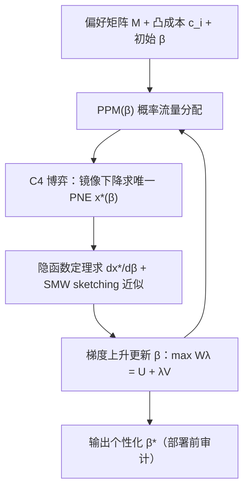
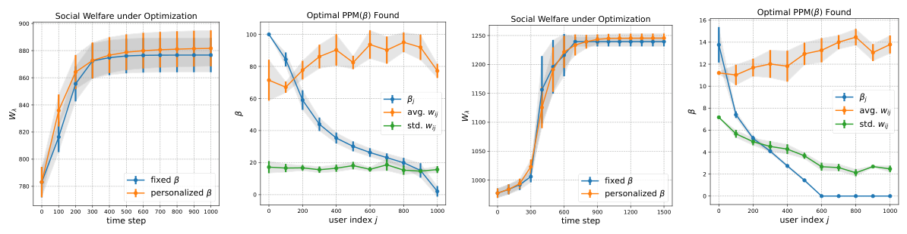

# Unveiling User Satisfaction and Creator Productivity Trade-Offs in Recommendation Platforms (推荐平台中用户满意度与创作者生产力的权衡揭示)

- **会议/期刊**: arXiv 预印本（ICLR/NeurIPS/ICML 2024 目录候选）
- **作者与机构**: Fan Yao, Hongning Wang（University of Virginia）；Yiming Liao, Jingzhou Liu, Shaoliang Nie, Qifan Wang（Meta）；Haifeng Xu（University of Chicago）
- **推荐链路定位**: 平台策略层——流量分配与探索强度（非单点召回/精排）
- **研究方向**: 强化学习与动态探索推荐 / 去偏公平与工业架构
- **论文原文**: [https://arxiv.org/abs/2410.23683v2](https://arxiv.org/abs/2410.23683v2)
- **开源代码**: 暂未开源

## TL;DR (1分钟核心速览)

UGC 平台的推荐算法不仅决定用户看什么，更通过流量分配反向激励创作者产量。本文提出 Cournot 内容创作竞争博弈 **C4**：创作者以**生产频率**为策略、按 PPM(β) 概率匹配争夺流量、成本凸增。理论上证明 C4 恒存在唯一纯纳什均衡 (PNE)，且在均质用户下用户满意度 $U$随探索强度$\beta$严格递增、总内容供给$V$严格递减——即"越精准的推荐越饿死创作者"。作者把"找最优 β"写成双层优化，用隐函数定理 + Sherman-Morrison-Woodbury  sketching 求近似梯度。合成环境与 MovieLens-1M 仿真中社会福利$W=U+\lambda V$ 提升超 20%。

## Background & Motivation (背景与核心矛盾)

- **主流范式**: 创作者竞争建模沿用 C3 框架（Yao et al.），假设创作者只能通过**选题差异化**争流量，产量被设为等速恒定；平台侧则用相关性排序最大化即时匹配质量。
- **前人局限**: (1) C3 类模型完全忽略了**内容创作体量 (volume)** 这一维度，而 Instagram/YouTube 的实证显示流量曝光会直接抬升创作者日产频率；(2) 纯相关性驱动的低探索策略让流量几乎由 relevance 决定，产量对收益的边际贡献被抹平，成熟创作者会收缩到"最小可行产量"。
- **核心洞察 (Key Insight)**: 流量分配的**随机性强度 β**（探索强度）才是连接"短期用户满意度"与"长期内容池丰度"的隐形旋钮：β→+∞ 时仅最相关创作者吞掉全部流量、产量塌缩；β→0 时流量均匀化引发"产量军备竞赛"却牺牲匹配精度。两端皆次优。
- **本文切入点**: 用 Cournot 式的**产量竞争**替换选题竞争，使均衡产量 $x^*(\beta)$ 可解析预测，从而把"该给多少探索"变成一个可离线求解、部署前审计的优化问题。

## Method (核心方法设计)

### 1. 整体框架 (Overall Architecture)

输入为用户-创作者偏好矩阵 $\mathbf{M}=[w_{ij}]$、创作者成本函数$c_i(\cdot)$与机制参数$\boldsymbol{\beta}=(\beta_1,\dots,\beta_m)$。平台按 Personalized Probabilistic Matching 分配：用户$j$的一份流量按$x_i e^{\beta_j w_{ij}}$的比例切给创作者$i$，故创作者效用$u_i=\sum_j P_{ij}-c_i(x_i)$。给定$\boldsymbol{\beta}$，以多智能体镜像下降（Algorithm 2）求唯一 PNE 得$x^*(\boldsymbol{\beta})$；随后把 PNE 作为约束，用隐函数定理对$\boldsymbol{\beta}$求$W_\lambda$的梯度，经 sketching 近似后梯度上升更新$\boldsymbol{\beta}$，循环至收敛。输出为逐用户探索强度方案，作为上线前审计工具。

<figure class="paper-figure" markdown="span">
  <figcaption>图2：子图1、2：算法1下的社会福利提升曲线，以及合成环境中所获最优 βj 的分布。子图3、4：MovieLens 环境中的相同图。λ = 0.5。</figcaption>
</figure>

### 2. 关键设计拆解 (Key Designs)

1. **C4 博弈与唯一 PNE（把"产量"纳入竞争）**：前人模型无法预测产量，因为产量不进入收益函数。本文令流量份额正比于"质量 $\times$努力"：$P_{ij}=\frac{x_i e^{\beta_j w_{ij}}}{\sum_{k}x_k e^{\beta_j w_{kj}}}$，效用

$$u_i(x_i,x_{-i};\boldsymbol{\beta})=\sum_{j=1}^{m}\frac{x_i e^{\beta_j w_{ij}}}{\sum_{k=1}^{n}x_k e^{\beta_j w_{kj}}}-c_i(x_i).$$

证明其 Hessian 满足 Rosen 的**对角严格凹 (1-DSC)** 条件，故对任意凸成本恒有唯一 PNE。直觉：$\beta$大时份额由$e^{\beta w}$主导，$\partial u_i/\partial x_i$ 中对产量的敏感度趋零，理性创作者只维持最低产量。

2. **U–V 权衡定理（核心理论贡献）**：定义短期满意度 $U=\sum_j\sum_i w_{ij}P_{ij}$（对$x$的等比缩放不变，故只反映即时匹配）与长期供给$V=\sum_i x_i^*$。定理 2 证明$m=1$且$w_i$不全相同时，$U(\beta)$**严格递增**、$V(\beta)$在$\beta\ge\beta_0$后**严格递减**。证明难点在于$x^*$无闭式，需借隐函数定理 + Sherman-Morrison 化简秩一更新的矩阵求逆，并用 Cauchy-Schwarz 分离出$\sum_i\delta_i(1-2P_i)(w_i-T)^2$ 的正性。

3. **双层优化的近似梯度与推理开销**：目标 $\max_{\boldsymbol{\beta}\ge 0} W_\lambda=U(x^*(\boldsymbol{\beta}),\boldsymbol{\beta})+\lambda V(x^*(\boldsymbol{\beta}))$，s.t.$x^*$为 PNE。由一阶条件$F(x,\boldsymbol{\beta})=0$ 得

$$\frac{dx^*}{d\boldsymbol{\beta}}=\left(D+YZ^{\top}\right)^{-1}B,\quad \frac{dW_\lambda}{d\boldsymbol{\beta}}=\left(\frac{\partial U}{\partial x^*}+\lambda\frac{\partial V}{\partial x^*}\right)\frac{dx^*}{d\boldsymbol{\beta}}+\frac{\partial U}{\partial\boldsymbol{\beta}},$$

其中 $D$为$n\times n$对角阵（含$c_i''$与$P_{ij}^2/x_i^{*2}$）。直接求逆为$O(n^3)$，改用 SMW 公式$(D+YZ^\top)^{-1}=D^{-1}-D^{-1}Y(I+Z^\top D^{-1}Y)^{-1}Z^\top D^{-1}$，再对用户维度采样比例$\delta$构造$\tilde{Y},\tilde{Z}$，复杂度降至$O(n^2\tilde{m}+n\tilde{m}^2+\tilde{m}^3)$。热启动：用上一轮$\boldsymbol{\beta}$的 PNE 作下一轮初值。**无负采样**（本模型非对比学习范式）；在线侧只需查表$\beta_j$ 做 softmax 采样，开销可忽略，重计算全在离线审计阶段。

## Experimental Setup & Evaluation Protocol (实验设置与评估协议)

- **数据集与预处理**:

| 数据集 | #Users | #Items (Creators) | #Interactions | 稀疏度/密度 | 特征/场景说明 |
| :--- | :---: | :---: | :---: | :---: | :--- |
| Synthetic | 1,000 | 200 | — | — | $d=32$，50 个球面簇心 +$\mathcal{N}(c_i,0.5^2 I)$；$w$为点积后归一到$[0,1]$；$c_i(x)=c_i x^{\rho}$，$\rho=1.5$，$c_i\sim U[0.1,0.5]$ |
| MovieLens-1M | 1,000（从 6,040 采样） | 200（从 3,706 采样） | 全部评分 | — | Deep Matrix Factorization $d=32$ 拟合 1–5 星，5 折 CV 平均 RMSE=0.739 |

- **数据划分与防穿越 (Splitting Strategy)**: 非序列推荐场景，**无 Leave-One-Out / 时间戳切分**；MovieLens 侧仅用 5 折交叉验证检验嵌入质量（RMSE=0.739），随后用全量数据训练嵌入并固定，不存在测试集泄漏风险。
- **排名评测协议 (Ranking Protocol)**: **非 Full-Ranking / 非 Sampled Ranking**——本文不评测 Top-K 排序指标，而是评测**均衡态福利指标** $U$、$V$、$W_\lambda=U+\lambda V$。误差棒来自 10 次独立生成的合成环境。
- **对比基线与超参设置**: 基线为"固定机制族"——$\beta\to 0$（近均匀分配）、$\beta=100$（近确定性贪心，初始点）、homogeneous 最优$\beta$、personalized 最优$\beta$。Algorithm 1 超参：$\delta=0.1$、$\eta=200$、$T$至 1,500 步；Algorithm 2 超参：$T=10000$、$\eta=0.1$、$\epsilon=10^{-2}$、$x_i^{(0)}=1.0$。

## Key Experimental Results (实验关键数据)

### 1. 主实验对比 (Main Results)

> 原文未提供传统精度基线表，下表以"机制族"为基线，$W_\lambda$ 数值为图 2 曲线读数近似（原文明确报告最优机制下福利增益 **>20%**）。

| 环境 ($\lambda=0.5$) | 机制 |$W_\lambda$相对初始$\beta\equiv100$ | 定性表现 |
| :--- | :--- | :---: | :--- |
| Synthetic | $\beta\equiv100$（近确定性，基线） | 0 |$U$高、$V$ 低 |
| Synthetic | homogeneous $\beta^*$| ≈ +11% | 全用户共享单一$\beta$ |
| Synthetic | **personalized $\beta^*$** | **> +20%** | 逐用户$\beta_j$，最优 |
| MovieLens-1M | $\beta\equiv100$（基线） | 0 | — |
| MovieLens-1M | homogeneous $\beta^*$ | ≈ +15% | — |
| MovieLens-1M | **personalized $\beta^*$** | **> +20%** | 略优于 homogeneous |

### 2. 消融实验 (Ablation Study)

以 $\lambda$（长期供给权重）与个性化粒度作为消融维度：

| 设置 | Synthetic $\Delta W$| MovieLens-1M$\Delta W$| 最优$\beta_j$ 结构 |
| :--- | :---: | :---: | :--- |
| $\lambda=0.5$，personalized | > +20% | > +20% | 挑剔用户大$\beta$、开放用户小$\beta$ |
| $\lambda=0.5$，homogeneous | ≈ +11% | ≈ +15% | 单一$\beta$ |
| $\lambda=0.1$，personalized | ≈ +4% | ≈ +2% | 结构与$\lambda=0.5$ 一致 |
| 移除 sketching（全量求逆） | 结果同，耗时 $O(n^3)$ | 同 | — |

### 3. 关键实验发现 (Key Findings)

1. **理论权衡在异构用户下依然成立**：$\beta$从 2.0 增至 200，$U$单调上升而$V$单调下降（图 1/3 右图，10 次重复误差棒），说明定理 2 的$m=1$假设可被$m=1000$ 的聚簇用户群放松，权衡来自机制而非用户同质性。
2. **最优 β 呈"挑剔度分层"结构**：将用户按 $\{w_{ij}\}_{i=1}^{n}$的均值与标准差排序后，最优$\beta_j$与均值正相关、与标准差负相关——对偏好分散的"开放型"用户调小$\beta$（加大探索，"安全地"换供给），对只认少数创作者的"挑剔型"用户保持大$\beta$（守住满意度）。这是个性化机制优于 homogeneous 的直接来源。
3. **增益对 $\lambda$敏感但方向稳定**：$\lambda$从 0.5 降到 0.1，提升幅度从 >20% 降至约 2–4%，但最优$\beta$ 的层级结构完全不变；说明福利增益主要来自"把探索预算精准投给容错用户"，而非单纯全局降精度。

## Highlights & Limitations (亮点、对比与审稿批判)

- **与代表作对比 (vs. Prior Work)**: 相比 C3 系列（Yao et al. 2023/2024）只在**选题维度**建模且产量恒定，C4 首次让产量成为策略变量并给出唯一 PNE，从而量化 $V$；相比 Tullock 竞赛（Tullock, 1980）仅处理同质线性成本，C4 扩展到异质凸成本并叠加平台分配机制$\beta$；相比 Zeng et al. (2024) 的纯实证现场实验，本文提供了可反事实审计的均衡模型与优化算法。
- **可迁移亮点**: (1) 将"探索强度"参数化为用户级可微旋钮、用隐函数定理对**均衡约束**求超参梯度——可迁移到任何 bandit 探索率/温度系数调优；(2) 用"偏好均值-标准差"刻画用户容错度以分配探索预算，是冷启动/多样性打散的直接启发式。
- **审稿级局限批判**: (1) 模型强假设创作者**领域固定、质量不变、只调频率**，无法覆盖真实平台的选题漂移与质量竞争；(2) 评估完全离线仿真，$w_{ij}$由点积代理真实偏好、创作者成本函数形式人为设定，缺乏真实 A/B 与$c_i$的可辨识性讨论；(3) sketching 采样率$\delta=0.1$的方差与$\eta=200$的敏感性未做系统扫描，$O(n^2\tilde{m})$ 在千万级创作者规模下的可行性存疑。

## Rating (四维评分)

- **方法创新性 (Novelty)**: ⭐⭐⭐⭐ （C4 把产量纳入创作者竞争并给出唯一 PNE 与 U–V 单调性定理，理论增量扎实；但机制本身是 PPM/Tullock 的自然扩展）
- **评估协议与实验扎实度 (Protocol & Experiments)**: ⭐⭐⭐ （理论 + 双环境仿真 + 10 次重复误差棒较规范，但无真实线上 A/B、无标准 ranking 指标，福利数字部分依赖读图）
- **写作与数学规范度 (Clarity & Rigor)**: ⭐⭐⭐⭐ （定理证明完整，隐函数 + Sherman-Morrison + Cauchy-Schwarz 的推导链条清晰，符号统一）
- **工业落地与复现价值 (Industrial & Practical Value)**: ⭐⭐⭐ （"部署前审计工具"定位切中平台痛点，算法可直接嵌入离线沙盒；但依赖对 $c_i$与$w_{ij}$ 的准确估计，且未开源）

