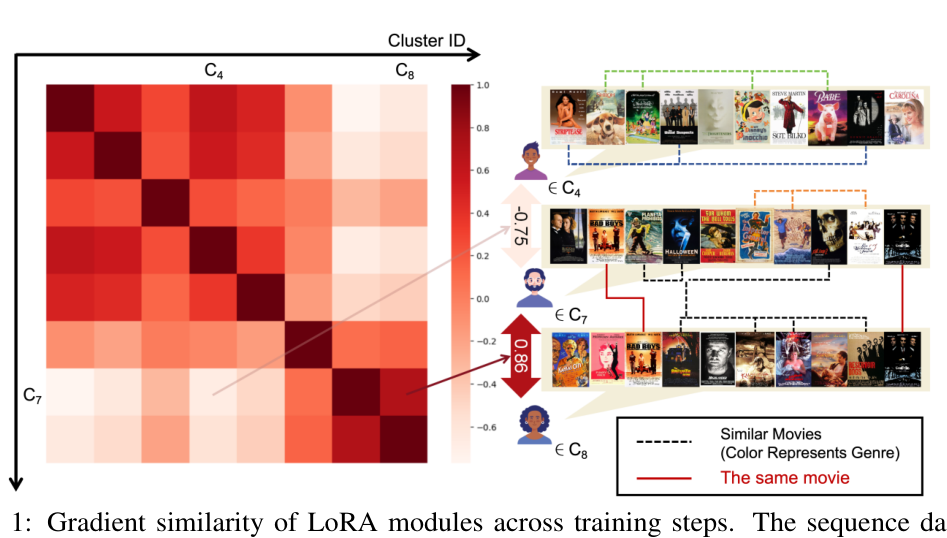
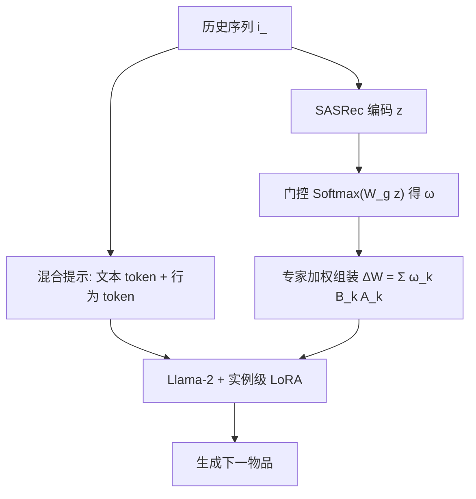
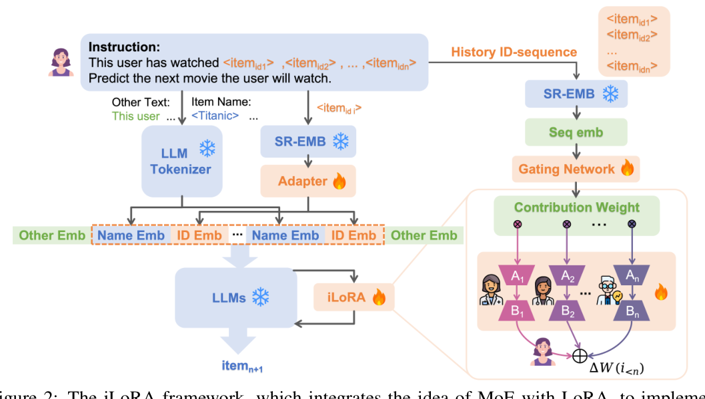

# Customizing Language Models with Instance-wise LoRA for Sequential Recommendation (面向序列推荐的实例级 LoRA 定制)

- **会议/期刊**: NeurIPS 2024 (poster)
- **作者与机构**: Xiaoyu Kong, Jiancan Wu, An Zhang, Leheng Sheng, Hui Lin, Xiang Wang, Xiangnan He (USTC / NUS / 中国电子科技集团)
- **推荐链路定位**: 生成式端到端 (LLM 指令微调做下一物品预测)
- **研究方向**: 序列与会话推荐 / 大语言模型推荐 (LLM4Rec)
- **论文原文**: [https://arxiv.org/abs/2408.10159v4](https://arxiv.org/abs/2408.10159v4)
- **开源代码**: [https://github.com/AkaliKong/iLoRA](https://github.com/AkaliKong/iLoRA)

## TL;DR (1分钟核心速览)

LLM 序列推荐的主流做法是「混合提示 + 单个 LoRA 微调」，但同一个 LoRA 要服侍兴趣截然不同的百万级序列，梯度几何严重错位、互相拉扯（负迁移）。本文把 LoRA 的两个低秩矩阵按秩切分成 $K$个专家，再用一条 SASRec 序列表征经 softmax 门控生成实例级权重，动态组装出该序列专属的$\Delta W$。在 LastFM / MovieLens / Steam 的全库 HitRatio@1 上分别为 0.5000 / 0.5275 / 0.5264，较 LLaRA 提升 10.9% / 19.3% / 6.4%，可训练参数几乎不增 (<1%)。

## Background & Motivation (背景与核心矛盾)

- **主流范式**: 将用户历史行为序列转成「文本 token + 行为 token」的混合提示，冻结 LLM 主体，仅用标准 LoRA ($\Delta W = BA$) 做指令微调（TALLRec、LLaRA、ChatRec 等）。
- **前人局限**: 已有工作全部聚焦于**改提示**，而把 LoRA 的选择视为默认常量；于是 (i) 一个共享 $\Delta W$ 无法刻画个体行为差异，(ii) 兴趣相距遥远的序列在同一参数上更新方向冲突，造成负迁移。
- **核心洞察 (Key Insight)**: 作者用梯度相似度热图证明，LLaRA 的损失几何按协同空间聚类——协同近的序列梯度相似度高（如某对用户 0.86，共同偏好惊悚片），协同远的序列相似度跌到 $-0.75$，即标准的「多任务冲突」图景。
- **本文切入点**: 既然每条序列可视作一个独立任务，那就把「多 LoRA 专家」的 MoE 思想塞进**单个 LoRA 的秩维度**里，用实例级门控免费换来定制化，避免为百万序列各建一个 LoRA 的资源灾难。

<figure class="paper-figure" markdown="span">
  <figcaption>图1：LoRA 模块在不同训练步骤下的梯度相似性。使用欧氏距离将序列数据集划分为 8 个簇，并采用层次聚类对簇重新排序，使协同空间中更接近的簇在热图中也更靠近。梯度相似性用于评估损失的几何特征，单元格颜色越深表示相似性越高。右侧案例研究中，虚线连接相似项，实线连接相同项。梯度相似度为 0.86 的用户共享强烈的兴趣 i</figcaption>
</figure>

## Method (核心方法设计)

### 1. 整体框架 (Overall Architecture)

输入侧沿用 LLaRA 的混合提示：物品元数据经 LLM tokenizer 得到文本 token $\mathbf{s}$，物品 ID 经预训练 SASRec 得到$\mathbf{z}$，再由可训练投影拼接为$\mathbf{e}=\mathrm{Concat}(\mathbf{s},\mathrm{Proj}_{\tau_1}(\mathbf{z}))$。关键分支是：同一条序列先由 SASRec 编码为整体表征$\mathbf{z}$，送入门控网络产生$K$个专家的注意力权重$\boldsymbol{\omega}$，据此把被切分后的上/下投影子矩阵加权合成为该实例专属的$\Delta W(\mathbf{i}_{<n})$，注入 Llama-2-7B 的注意力层完成自回归生成。训练只更新 LoRA 专家、门控与跨模态投影；推理时一条序列只需一次 SASRec 前向 + 一次门控 + 一次 LLM 生成，附加开销可忽略。

<figure class="paper-figure" markdown="span">
  <figcaption>图2：iLoRA 框架，将 MoE 的思想与 LoRA 相结合，为各种序列实现按序列定制的激活模式。</figcaption>
</figure>

### 2. 关键设计拆解 (Key Designs)

1. **低秩矩阵的专家切分 (Rank Splitting)**：痛点是为每条序列建 LoRA 不可行（序列数达百万级）。做法是不新增参数，而是把 $B\in\mathbb{R}^{d_{out}\times r}$、$A\in\mathbb{R}^{r\times d_{in}}$沿秩维切成$K$段：$B=[B_1,\dots,B_K]$、$A=[A_1,\dots,A_K]$，每个专家只用$r^{*}=r/K$的局部秩。直觉上，总参数量$\sum_k (d_{out}+d_{in})r/K$ 与标准 LoRA 完全相同，因此**容量不变、只变路由方式**，天然规避过拟合。

2. **序列表征引导的门控 (Sequence-Guided Gating)**：痛点是路由信号若只依赖 prompt 文本 token，会退化为与协同信息无关的表面匹配。作者用 SASRec 的序列向量作引导：$\boldsymbol{\omega}=\mathrm{Softmax}(W_g\mathbf{z})$，$\mathbf{z}\in\mathbb{R}^{d}$浓缩了用户行为模式，$W_g\in\mathbb{R}^{K\times d}$。相比随机初始化或 token-collapsed 表征，协同表征引导能让相似序列激活相似专家、相异序列激活互补专家，从源头切断跨序列的梯度冲突。

3. **专家聚合与训练目标**：实例级 LoRA 参数 $\Delta W(\mathbf{i}_{<n})=\sum_{k=1}^{K}\omega_k B_k A_k$，前向写作$\mathbf{h}'=W\mathbf{h}+\frac{\alpha}{r}\Delta W(\mathbf{i}_{<n})\mathbf{h}$，即同一 LLM 对不同序列呈现不同有效权重；总损失仍是下一物品 token 的负对数似然$\mathcal{L}=-\sum_{(x,y)}\sum_{t=1}^{|y|}\log P_{\phi+\Delta\phi(\mathbf{i}_{<n})}(y_t\mid x,y_{<t})$。训练采用标准 teacher-forcing 下一 token 监督，**无额外负采样**（候选集合隐含在全库生成式打分中）；默认$K=4$、$r$ 与 LLaRA 对齐、LoRA 施加于 Q/V 投影。

## Experimental Setup & Evaluation Protocol (实验设置与评估协议)

- **数据集与预处理**: 完全复用 LLaRA 发布的三个基准（LastFM、MovieLens、Steam），采用与原文一致的序列构造与 `leave-one-out` 式「历史前缀 → 下一物品」指令对；正文未复述统计量（见原文附录 A），下表仅列领域属性：

| 数据集 | #Users | #Items | #Interactions | 稀疏度/密度 | 特征/场景说明 |
| :--- | :---: | :---: | :---: | :---: | :--- |
| LastFM | —(见附录A) | — | — | 高稀疏 | 音乐艺人交互，兴趣跨度极大 |
| MovieLens | — | — | — | 中密度 | 电影观看，类型偏好明显 |
| Steam | — | — | — | 中稀疏 | 游戏购买/游玩，长尾严重 |

- **数据划分与防穿越 (Splitting Strategy)**: 沿用 LLaRA 的按时间顺序前缀切分（每个用户最后一步作为测试目标，前面的行为构成输入序列），测试集目标物品不进入提示，无未来信息泄漏。
- **排名评测协议 (Ranking Protocol)**: 采用**全库候选 Full-Ranking**——模型以生成式方式直接输出物品 ID/描述，判定是否命中真实下一物品，记 `HitRatio@1`；同时报告 `ValidRatio` 衡量生成结果落在合法物品集合内的比例（即指令遵循率），避免「乱答也算对」的虚高。
- **对比基线与超参设置**: 传统序列模型 GRU4Rec / Caser / SASRec；LLM 类 Llama2-7B 零样本、ChatRec、MoRec、TALLRec、LLaRA；backbone 为 Llama-2-7B，LoRA 总秩与传统设置一致，专家数 $K\in\{1,2,4,8\}$做敏感性分析，默认$K=4$；未报告显著性检验。

## Key Experimental Results (实验关键数据)

### 1. 主实验对比 (Main Results)

| 模型 | LastFM HR@1 | MovieLens HR@1 | Steam HR@1 | ValidRatio (L/M/S) |
| :--- | :---: | :---: | :---: | :---: |
| GRU4Rec | 0.2616 | 0.3750 | 0.4168 | 1.00 / 1.00 / 1.00 |
| Caser | 0.2233 | 0.3861 | 0.4368 | 1.00 / 1.00 / 1.00 |
| SASRec | 0.2233 | 0.3444 | 0.4010 | 1.00 / 1.00 / 1.00 |
| Llama2-7B (zero-shot) | 0.0246 | 0.0421 | 0.0135 | 0.34 / 0.44 / 0.17 |
| MoRec | 0.1652 | 0.2822 | 0.3911 | 1.00 / 1.00 / 1.00 |
| TALLRec | 0.4180 | 0.3895 | 0.4637 | 0.98 / 0.93 / 0.98 |
| LLaRA (uniform LoRA) | 0.4508 | 0.4421 | 0.4949 | 1.00 / 0.97 / 1.00 |
| **iLoRA (Ours)** | **0.5000** | **0.5275** | **0.5264** | **1.00 / 0.99 / 1.00** |
| Improv. (vs. LLaRA) | +10.9% | +19.3% | +6.4% | — |

### 2. 消融实验 (Ablation Study)

| 配置 | 变化 | 结论 |
| :--- | :--- | :--- |
| 门控引导信号：SASRec 序列表征 | 基准（最优） | 三个数据集一致最优 |
| 门控引导：随机初始化表征 | 下降 | 说明路由需协同语义而非可学习噪声 |
| 门控引导：token-collapsed 表征 | 下降 | 说明文本表征不足以区分行为差异 |
| 专家数 $K=1$（退化为 LoRA） | 最低 | 验证实例级定制的必要性 |
| 专家数 $K=2$ | 略升 | Steam/MovieLens 提升不显著，LastFM 微降 |
| 专家数 $K=4$| 最优 | 比$K=2$ 高 5.2% / 6.4% / 2.2% |
| 专家数 $K=8$ | 持平或下降 | Steam 上快速收敛后过拟合，泛化受损 |

### 3. 关键实验发现 (Key Findings)

1. **负迁移是真实瓶颈而非玄学**: 梯度相似度热图显示 LLaRA 的跨簇相似度可低至 $-0.75$，而 iLoRA 让部分不相干簇的相似度逼近 0，同时 HR@1 提升 6.4%–19.3%，说明「解耦参数更新方向」直接兑现为精度。
2. **门控信号质量决定上限**: 换成随机初始化或 token-collapsed 引导即掉点，证明收益并非来自 MoE 的额外非线性，而是来自 SASRec 协同表征对序列相似性的正确度量——这与 LLaRA 只改提示、不动参数的路线形成本质分野。
3. **容量收益存在饱和点**: $K$从 2 增到 4 平均带来约 4.6% 相对提升，但$K=8$ 反而退化（Steam 上训练早期即达峰、后续无增益），表明专家过细会过度拟合个体噪声、牺牲跨序列泛化。

## Highlights & Limitations (亮点、对比与审稿批判)

- **与代表作对比 (vs. Prior Work)**: 与 TALLRec 的差异在于后者靠指令数据质量、无协同行为 token；与 LLaRA 的差异在于本文首次把「LoRA 怎么选」当成一等公民，用 MoE 在同一参数量预算下实现参数级个性化，而非继续堆提示工程；相对 MoRec 这类纯 ID 对齐方案，则保留了 LLM 的语义推理能力。
- **可迁移亮点**: (i) 「沿秩切分 + 门控加权」这一零参数增量的定制化套路可直接搬到多场景/跨域 LoRA、以及扩散推荐的条件分支；(ii) 用轻量序列模型（SASRec）产出的表征作为路由信号，是低成本、可解释的实例条件注入范式。
- **审稿级局限批判**: (i) 评测只在三个中等规模数据集上做 HR@1，未给出手工负采样或采样排序的对照，也没有显著性检验，统计可信度偏弱；(ii) 推理仍需对每条候选序列跑一次 LLM 生成，且门控为 soft 路由、$K$ 增大后收益消失，论文自承未探索 hard routing 与更大专家规模，线上延迟与吞吐未做量化。

## Rating (四维评分)

- **方法创新性 (Novelty)**: ⭐⭐⭐⭐ （把 MoE 压进 LoRA 秩维、参数零增量的实例级定制思路干净，且有梯度相似度的诊断支撑）
- **评估协议与实验扎实度 (Protocol & Experiments)**: ⭐⭐⭐ （全库 HR@1 + ValidRatio 双指标合理，但数据集仅三个、缺显著性检验与统计表）
- **写作与数学规范度 (Clarity & Rigor)**: ⭐⭐⭐⭐ （公式链条从切分到聚合清晰可复现，符号统一；对秩预算的等价性说明到位）
- **工业落地与复现价值 (Industrial & Practical Value)**: ⭐⭐⭐ （代码开源、附加参数 <1%，但依赖 7B LLM 在线生成，延迟成本仍是落地门槛）

