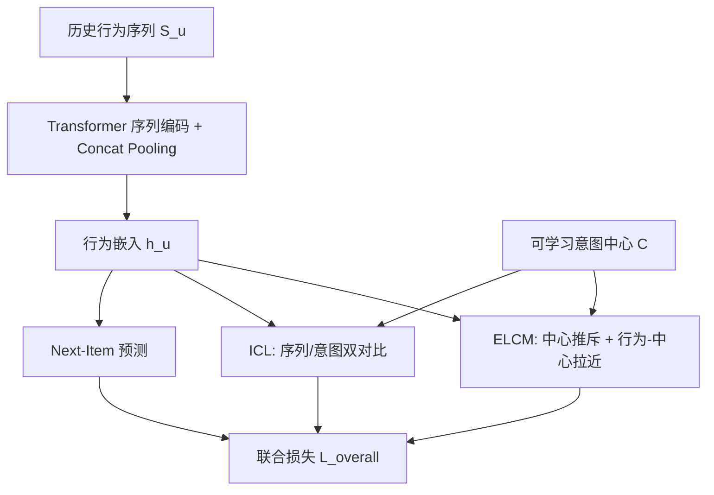

# End-to-end Learnable Clustering for Intent Learning in Recommendation (面向推荐的端到端可学习聚类意图学习)

- **会议/期刊**: NeurIPS 2024
- **作者与机构**: Yue Liu, Shihao Zhu, Jun Xia, Yingwei Ma, Jian Ma, Xinwang Liu, Shengju Yu, Kejun Zhang, Wenliang Zhong；蚂蚁集团、NUS、西湖大学、阿里、国防科大、浙大
- **推荐链路定位**: 召回（next-item retrieval）
- **研究方向**: 序列与会话推荐 / 自监督对比学习与交互去噪
- **论文原文**: [https://arxiv.org/abs/2401.05975v5](https://arxiv.org/abs/2401.05975v5)
- **开源代码**: [https://github.com/yueliu1999/ELCRec](https://github.com/yueliu1999/ELCRec)

## TL;DR (1分钟核心速览)

现有意图学习沿EM框架，每步需对全量用户行为聚类，且聚类与表征学习割裂，难扩展且易次优。ELCRec把意图聚类中心变成可学习神经元，用推-拉聚类损失与意图辅助对比学习做mini-batch端到端训练。在Beauty等四个基准上采用Leave-One-Out全库排序，Beauty的NDCG@5较ICLRec提升8.9%，训练时间降22.5%。

## Background & Motivation (背景与核心矛盾)

- **主流范式**: 序列推荐用Transformer编码历史行为；意图学习通过聚类挖掘用户潜在意图，代表ICLRec采用E步全量聚类、M步自监督表征的交替优化。
- **前人局限**: E步需在全量用户嵌入上跑k-Means，复杂度随$|U|$线性增长，十亿级用户易OOM；交替优化使行为学习与意图学习分离，导致次优性能与实时更新滞后。
- **核心洞察 (Key Insight)**: 意图数$k$远小于用户数$|U|$，因此k个聚类中心可作为网络参数在mini-batch中更新；中心还能反过来作为对比学习的自监督锚点。
- **本文切入点**: 用端到端可学习聚类模块替代EM的E步，并将意图中心注入对比学习，统一行为表征、意图聚类与下一物品预测。

## Method (核心方法设计)

### 1. 整体框架 (Overall Architecture)

输入用户历史行为序列，经Transformer编码与拼接池化得到行为嵌入$\mathbf{h}_u$；同时将$k$个意图中心$\mathbf{C}\in\mathbb{R}^{k\times d}$初始化为可学习参数。ELCM通过“中心互斥+行为-中心拉近”解耦复杂意图；ICL用聚类中心作为自监督信号，对增强视图做序列对比与意图对比；最后与next-item预测联合优化，推理阶段仍按序列编码后对物品打分。

### 2. 关键设计拆解 (Key Designs)

1. **端到端可学习聚类模块 ELCM（替代全量E步）**：痛点来自全量聚类不可扩展；本文将中心归一化到单位球，设计推-拉损失  
$\mathcal{L}_{cluster}=-\frac{1}{(k-1)k}\sum_{i=1}^{k}\sum_{j\ne i}\|\hat{\mathbf{c}}_i-\hat{\mathbf{c}}_j\|_2^2+\frac{1}{bk}\sum_{i=1}^{b}\sum_{j=1}^{k}\|\hat{\mathbf{h}}_i-\hat{\mathbf{c}}_j\|_2^2$。  
第一项推斥不同意图中心以降低重叠，第二项把行为拉向所有中心而非最近中心，避免错误最近中心造成确认偏差；复杂度$O(bkd+k^2d)$，仅随batch增长。

2. **意图辅助对比学习 ICL（用中心当自监督信号）**：对序列做mask/crop/reorder增强得到两视图；标准序列对比拉近同用户两视图、推远批内负样本。随后按$idx=\arg\min_i\|\mathbf{c}_i-\mathbf{h}_u^{v1}\|_2^2$查询最近意图，以$\tilde{\mathbf{h}}_u^{v1}=\mathbf{h}_u^{v1}\oplus\mathbf{c}_{idx}$或加性shift融合，再做行为-意图对比，使同意图行为聚合、异意图分离。  
$\mathcal{L}_{icl}=\mathcal{L}_{seq\_cl}+\mathcal{L}_{intent\_cl}$。

3. **训练目标、负采样与推理效率**：总损失  
$\mathcal{L}_{overall}=\mathcal{L}_{\mathrm{next}}+0.1\mathcal{L}_{icl}+\alpha\mathcal{L}_{cluster}$，  
next-item为主监督，ICL用批内负样本，聚类项无需显式负采样。推理不新增候选生成结构；训练因避免全量聚类，平均显存降9.58%，Beauty运行时间降22.49%。

## Experimental Setup & Evaluation Protocol (实验设置与评估协议)

- **数据集与预处理**: Amazon Sports/Beauty/Toys与Yelp，保留交互数不少于5的用户和物品（5-core）：

| 数据集 | #Users | #Items | #Interactions | Avg.Len | Sparsity |
| :--- | :---: | :---: | :---: | :---: | :---: |
| Sports | 35,598 | 18,357 | 0.3M | 8.3 | 99.95% |
| Beauty | 22,363 | 12,101 | 0.2M | 8.9 | 99.95% |
| Toys | 19,412 | 11,924 | 0.17M | 8.6 | 99.93% |
| Yelp | 30,431 | 20,033 | 0.3M | 8.3 | 99.95% |

- **数据划分与防穿越 (Splitting Strategy)**: 采用`Leave-One-Out`，最后一次交互作测试、倒数第二次作验证、其余作训练，继承ICLRec设置。
- **排名评测协议 (Ranking Protocol)**: `Full-Ranking`全库未交互物品排序，报告HR@5/20与NDCG@5/20；训练中的对比负样本来自mini-batch内其他样本。
- **对比基线与超参设置**: 对比BPR-MF、GRU4Rec、Caser、SASRec、BERT4Rec、DSSRec、S3-Rec、CL4SRec、ICLRec；$d=64$，$T=50$，$k=256/512$，$\alpha\in\{0.1,1,10\}$，t-test显著性$p<0.05$。

## Key Experimental Results (实验关键数据)

### 1. 主实验对比 (Main Results)

| 方法 | Sports HR@5 | Sports NDCG@5 | Beauty HR@5 | Beauty NDCG@5 | Toys HR@5 | Toys NDCG@5 | Yelp HR@5 | Yelp NDCG@5 |
| :--- | :---: | :---: | :---: | :---: | :---: | :---: | :---: | :---: |
| BPR-MF | .0141 | .0091 | .0212 | .0130 | .0120 | .0082 | .0127 | .0082 |
| SASRec | .0206 | .0135 | .0374 | .0241 | .0463 | .0306 | .0160 | .0101 |
| BERT4Rec | .0217 | .0143 | .0360 | .0216 | .0274 | .0174 | .0196 | .0121 |
| S3-Rec | .0121 | .0084 | .0189 | .0115 | .0143 | .0123 | .0101 | .0068 |
| CL4SRec | .0217 | .0137 | .0423 | .0281 | .0526 | .0362 | .0229 | .0144 |
| ICLRec | .0263 | .0173 | .0495 | .0326 | **0.0586** | .0397 | .0233 | .0150 |
| ELCRec | **0.0286** | **0.0185** | **0.0529** | **0.0355** | .0585 | **0.0403** | **0.0236** | **0.0152** |
| Improv. vs ICLRec | — | +6.94% | — | +8.90% | — | +1.51% | — | +1.14% |

### 2. 消融实验 (Ablation Study)

下表为四项指标HR@5+HR@20+NDCG@5+NDCG@20之和：

| 变体 | Sports | Beauty | Toys | Yelp |
| :--- | :---: | :---: | :---: | :---: |
| B | .1343 | .2390 | .2664 | .1258 |
| B+ICL | .1379 | .2398 | .2675 | .1262 |
| B+ELCM | .1396 | .2432 | **0.2718** | .1285 |
| ELCRec | **0.1405** | **0.2473** | .2686 | **0.1305** |

### 3. 关键实验发现 (Key Findings)

- ELCM是主增益来源：四个数据集上`B+ELCM`均优于`B`，Beauty从.2390升至.2432（+1.76%），Yelp从.1258升至.1285（+2.15%），说明可学习中心确实分离了潜在意图。
- ICL并非总与ELCM正向叠加：Toys上`B+ELCM`(.2718)反而高于`ELCRec`(.2686)，且Toys的HR@5未显著优于ICLRec，表明中心质量会放大/削弱意图对比学习的收益。
- 端到端聚类兼顾效果与效率：Beauty上NDCG@5提升8.90%，同时运行时间下降22.49%、显存下降11.35%；工业A/B中直播PVCTR+2.45%、VV+2.28%，新用户PVCTR+6.96%，验证冷启动场景可用性。

## Highlights & Limitations (亮点、对比与审稿批判)

- **与代表作对比 (vs. Prior Work)**: ICLRec仍需离线全量聚类并交替优化；ELCRec把聚类中心变为可学习参数，mini-batch联合优化。相比S3-Rec/CL4SRec只做自监督表征，本文显式建模用户潜在意图；相比IOCRec等意图方法，本文不依赖复杂EM式交替流程。
- **可迁移亮点**: “聚类中心=可学习锚点”可迁移到多兴趣召回、用户分群与冷启动分组；把中心作为对比学习自监督信号，也可用于图/多模态表征的意图级对齐。
- **审稿级局限批判**: 意图数$k$需预设，敏感性实验虽显示$k\in[256,512]$较稳，但未知意图数场景仍需调参；ICL在Toys上不稳定，说明中心质量与对比学习的协同机制尚缺理论约束。公开数据规模较小，效率收益可能低估/波动；工业部署细节与中心更新频率仍受业务约束。

## Rating (四维评分)

- **方法创新性 (Novelty)**: ⭐⭐⭐⭐ （把EM式意图聚类改写为可学习中心端到端优化，机制简洁且有mini-batch复杂度优势）
- **评估协议与实验扎实度 (Protocol & Experiments)**: ⭐⭐⭐⭐ （四个主流基准、Leave-One-Out全库排序、t-test与消融齐全；Toys上存在非显著/负向结果）
- **写作与数学规范度 (Clarity & Rigor)**: ⭐⭐⭐⭐ （推-拉聚类损失和复杂度分析清楚，但ICL融合策略与模块协同的理论解释偏经验）
- **工业落地与复现价值 (Industrial & Practical Value)**: ⭐⭐⭐⭐⭐ （代码开源，130M PV线上A/B验证，显存与时间可降，plug-and-play属性强）

