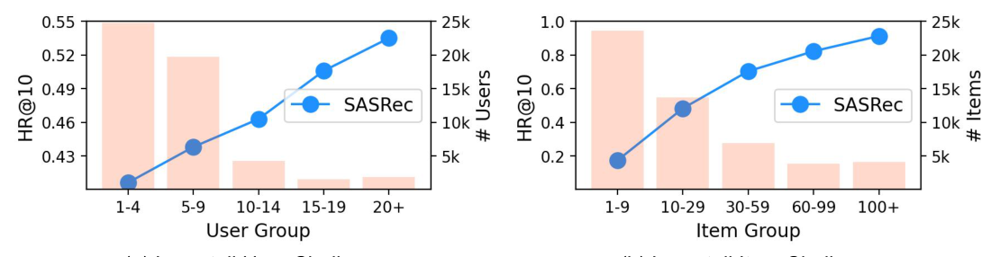
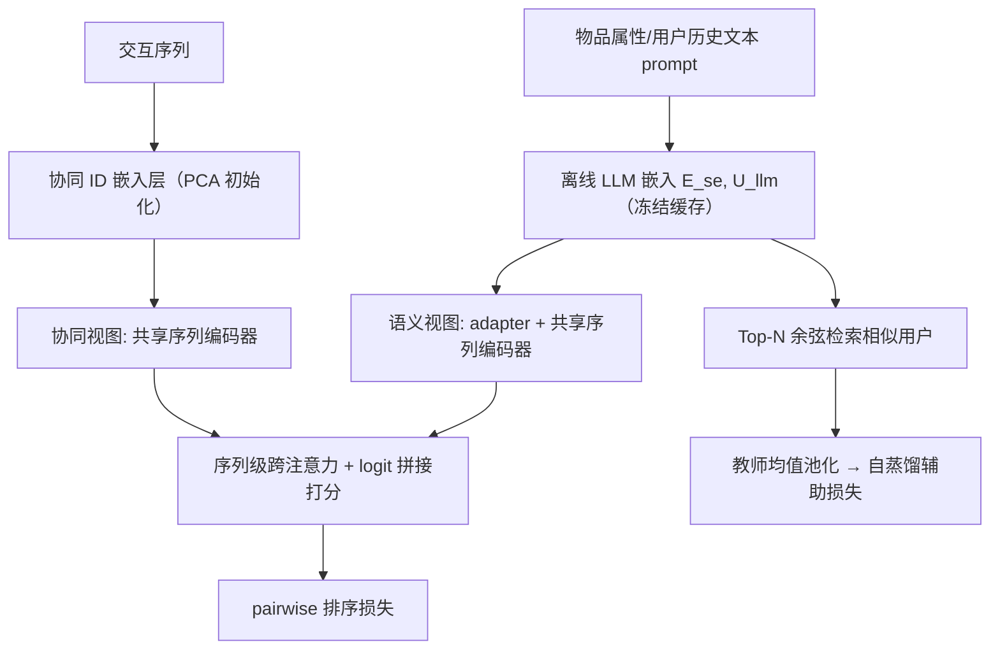

# LLM-ESR: Large Language Models Enhancement for Long-tailed Sequential Recommendation (面向长尾序列推荐的大语言模型增强框架)

- **会议/期刊**: NeurIPS 2024 (Spotlight)
- **作者与机构**: Qidong Liu, Xian Wu, Yejing Wang, Zijian Zhang, Feng Tian, Yefeng Zheng, Xiangyu Zhao；西安交通大学、香港城市大学、腾讯优图、吉林大学、西湖大学
- **推荐链路定位**: 召回（下一物品预测 / 序列打分）
- **研究方向**: 序列与会话推荐 / 大语言模型推荐 (LLM4Rec)
- **论文原文**: [https://arxiv.org/abs/2405.20646v2](https://arxiv.org/abs/2405.20646v2)
- **开源代码**: [https://github.com/Applied-Machine-Learning-Lab/LLM-ESR](https://github.com/Applied-Machine-Learning-Lab/LLM-ESR)

## TL;DR (1分钟核心速览)

真实序列推荐系统中 >80% 用户交互不足 10 条、71.4% 物品交互不足 30 次，传统 SRS 在长尾用户与长尾物品上双双失效；已有的协同增强方法（CITIES、MELT）会陷入"跷跷板"（提升长尾却砸掉头部）或引入噪声。LLM-ESR 将 LLM 语义嵌入**离线缓存**并冻结，构造"语义视图 + 协同视图"双分支（跨注意力 + logit 拼接）解决长尾物品，再用 LLM 用户嵌入检索相似用户做自蒸馏解决长尾用户，且推理阶段完全不调用 LLM。在 Yelp/Fashion/Beauty 三数据集、GRU4Rec/Bert4Rec/SASRec 三种骨干上，SASRec 骨干下 H@10 相对最强基线 LLMInit 提升 4.0%/9.8%/4.0%，Yelp 长尾物品 H@10 从 0.1760 升至 0.1893。

## Background & Motivation (背景与核心矛盾)

- **主流范式**: 以 SASRec/Bert4Rec/GRU4Rec 为代表，纯靠协同 ID 序列的自注意力/RNN 编码器捕捉转移模式；长尾补救则走"头部→尾部"的知识迁移（CITIES 用头物品推断尾物品嵌入）或伪序列增广（MELT 双向分支）。
- **前人局限**: ① CITIES/MELT 只依赖协同共现，二者的尾部收益伴随头部显著下滑（Yelp 上 CITIES 的 H@10 0.5828 反低于 SASRec 0.5940），即 seesaw 问题；② 协同相似度在稀疏用户上极不可靠，增广出来的伪交互本身带噪。
- **核心洞察 (Key Insight)**: LLM 语义空间天然不按流行度偏斜——t-SNE 显示 SASRec/CITIES/MELT 的物品嵌入严格按热度聚簇，而 LLM 嵌入分布均匀。因此语义是破解长尾的"另一条正交信号"，且用户侧语义同样可用来度量相似度，弥补交互相似度的噪声。
- **本文切入点**: 把 LLM 当**离线嵌入生成器**（不是在线推理器），冻结语义嵌入以保留其流形，只学习轻量 adapter 与融合层，从而在零额外推理成本下注入语义。

<figure class="paper-figure" markdown="span">
  <figcaption>图1：SASRec 在 Beauty 数据集上的初步实验。</figcaption>
</figure>

## Method (核心方法设计)

### 1. 整体框架 (Overall Architecture)

输入为用户交互序列与物品属性文本。离线阶段：用 `text-embedding-ada-002` 编码物品属性 prompt 得到 $\mathbf{E}^{se}\in\mathbb{R}^{|\mathcal{V}|\times d_{llm}}$、编码用户历史物品标题 prompt 得到用户语义库$\mathbf{U}^{llm}$，全部缓存并**冻结**。在线训练：双视图模块并行编码语义序列（冻结$\mathbf{E}^{se}$+ 可训练 adapter）与协同序列（可训练 ID 嵌入），经序列级跨注意力交互后各自过**共享**序列编码器，logit 级拼接打分；同时用$\mathbf{U}^{llm}$检索$N$ 个相似用户，其双视图表示为教师、目标用户为学生做自蒸馏。推理时只走双视图分支，检索与蒸馏模块整体免除。

### 2. 关键设计拆解 (Key Designs)

1. **双视图建模 + 两级融合（破解长尾物品）**：痛点是把 LLM 嵌入当 ID 层初始化再微调（LLMInit/SAID）会在 fine-tune 中破坏原始语义关系。本文冻结 $\mathbf{E}^{se}$，只训两层 adapter 做维度与空间变换：$\mathbf{e}^{se}_i=\mathbf{W}_{a2}(\mathbf{W}_{a1}\mathbf{e}^{llm}_i+\mathbf{b}_{a1})+\mathbf{b}_{a2}$；序列级融合用跨注意力让语义序列查询协同序列$\hat{\mathbf{S}}^{co}=\mathrm{Softmax}(\frac{\mathbf{Q}\mathbf{K}^{\top}}{\sqrt{d}})\mathbf{V}$，logit 级再拼接两视图向量打分$P(v_{n_u+1}=v_j)=[\mathbf{e}^{se}_j:\mathbf{e}^{co}_j]^{\top}[\mathbf{u}^{se}:\mathbf{u}^{co}]$。直觉：协同视图保头部精度，语义视图给尾部物品"可迁移的相似性"，两级融合让二者互补而非互相拉扯。另用 PCA 降维的$\mathbf{E}^{se}$ 初始化协同嵌入层，缓解"预训练 vs 从零训练"两分支的优化不平衡。

2. **检索增强自蒸馏（破解长尾用户）**：长尾用户序列太短，编码器无法提取偏好。用 $\mathcal{U}_k=\mathrm{Top}\text{-}N(\{\cos(\mathbf{u}^{llm}_k,\mathbf{u}^{llm}_j)\}_{j=1}^{|\mathcal{U}|})$检索语义近邻（比交互相似度抗噪），教师信号为目标用户与相似用户表示的均值池化，损失为$\mathcal{L}_{SD}=\frac{1}{|\mathcal{U}|}\sum_k\|[\mathbf{u}^{se}_k:\mathbf{u}^{co}_k]-[\mathbf{u}^{se}_{T_k}:\mathbf{u}^{co}_{T_k}]\|_2^2$，教师侧梯度截断。自蒸馏（学生=教师同一模型）避免引入额外大模型，且仅在训练期生效。

3. **训练目标、负采样与推理效率**：总损失 $\mathcal{L}=\mathcal{L}_{Rank}+\alpha\mathcal{L}_{SD}$，$\mathcal{L}_{Rank}$ 为 backbone 原生的 pairwise BPR 式排序损失（GRU4Rec 用 sequence-to-one，SASRec/Bert4Rec 用 sequence-to-sequence），负样本按 SASRec 协议**每正样本随机采 1 个负例**。训练只更新协同嵌入层、adapter、跨注意力与序列编码器。推理只需两次前向（双视图），LLM 调用为 0，新增开销仅为缓存的一次性嵌入生成。

## Experimental Setup & Evaluation Protocol (实验设置与评估协议)

- **数据集与预处理**（沿用 SASRec 流程，保留交互 ≥3 的用户，剔除冷启动用户）：

| 数据集 | #Users | #Items | #Interactions(约) | 稀疏度 | 平均序列长 |
| :--- | :---: | :---: | :---: | :---: | :---: |
| Yelp | 15,720 | 11,383 | ~192k | 99.89% | 12.23 |
| Amazon Fashion | 9,049 | 4,722 | ~34.6k | 99.92% | 3.82 |
| Amazon Beauty | 52,204 | 57,289 | ~395k | 99.99% | 7.57 |

- **数据划分与防穿越**: `Leave-One-Out`——每序列最后一项作测试、倒数第二项作验证，其余训练；无时间戳切分。
- **排名评测协议**: `Sampled Ranking`，对每个测试正例随机采 **100 个未交互负例**（1:100）计算 H@10 / N@10，**非 Full-Ranking**，因此数值绝对值偏高、长尾物品命中被采样放大，跨论文比较需谨慎。
- **对比基线与超参**: 传统增强 CITIES、MELT；LLM 增强 RLMRec（去掉 profile 生成以适配序列）、LLMInit（LLM2Bert4Rec/SAID 式初始化）；骨干 GRU4Rec / Bert4Rec / SASRec。基线嵌入维 $d=128$，LLM-ESR 因双分支取$d=64$（等效参数量对齐）；batch 128、lr 1e-3、Adam、early stop patience 20；$N\in\{2,6,10,14,18\}$最优 10，$\alpha\in\{1,0.5,0.1,0.05,0.01\}$最优 0.1；以 N@10 早停选模，三次随机种子（42/43/44）均值并做双侧$t$检验（$p<0.05$）。

## Key Experimental Results (实验关键数据)

### 1. 主实验对比 (Main Results)

SASRec 骨干（其余两种骨干趋势一致，LLM-ESR 均最优）：

| 数据集 | 方法 | H@10 | N@10 | Improv.(H@10) |
| :--- | :--- | :---: | :---: | :---: |
| Yelp | SASRec | 0.5940 | 0.3597 | — |
| Yelp | CITIES | 0.5828 | 0.3540 | -1.9% |
| Yelp | MELT | 0.6257 | 0.3791 | — |
| Yelp | RLMRec | 0.5990 | 0.3623 | — |
| Yelp | LLMInit | 0.6415 | 0.3997 | — |
| Yelp | **LLM-ESR** | **0.6673** | **0.4208** | **+4.02% / +5.28%** |
| Fashion | SASRec | 0.4956 | 0.4429 | — |
| Fashion | MELT | 0.4875 | 0.4150 | — |
| Fashion | RLMRec | 0.4982 | 0.4457 | — |
| Fashion | LLMInit | 0.5119 | 0.4492 | — |
| Fashion | **LLM-ESR** | **0.5619** | **0.4743** | **+9.77% / +5.59%** |
| Beauty | SASRec | 0.4388 | 0.3030 | — |
| Beauty | CITIES | 0.2256 | 0.1413 | -48.6% |
| Beauty | MELT | 0.4334 | 0.2775 | — |
| Beauty | RLMRec | 0.4460 | 0.3075 | — |
| Beauty | LLMInit | 0.5455 | 0.3656 | — |
| Beauty | **LLM-ESR** | **0.5672** | **0.3713** | **+3.98% / +1.56%** |

长尾分桶（Yelp, SASRec）：Tail-Item H@10 = **0.1893**（SASRec 0.1142，LLMInit 0.1760）；Tail-User H@10 = **0.6685**（SASRec 0.5893）；Beauty Tail-Item H@10 = **0.2257** vs LLMInit 0.1714（+31.7%）；Beauty GRU4Rec 骨干整体 H@10 0.4917 vs LLMInit 0.4151（+18.5%）。

### 2. 消融实验 (Ablation Study)

Yelp + SASRec（H@10 / N@10）：

| 变体 | Overall | Tail-Item | Tail-User |
| :--- | :---: | :---: | :---: |
| **LLM-ESR 完整** | **0.6673 / 0.4208** | **0.1893** | **0.6685** |
| w/o Co-view（去协同视图） | 0.6320 / 0.3816 | 0.1898 | 0.6318 |
| w/o Se-view（去语义视图） | 0.6468 / 0.4038 | 0.1105 | 0.6459 |
| w/o SD（去自蒸馏） | 0.6572 / 0.4121 | 0.2003 | 0.6566 |
| w/o Share（双视图独立编码器） | 0.6595 / 0.4158 | 0.1728 | 0.6606 |
| w/o CA（去跨注意力） | 0.6644 / 0.4160 | 0.1850 | 0.6652 |
| 单层 Adapter | 0.6108 / 0.3713 | 0.1107 | 0.6065 |
| 随机初始化协同嵌入层 | 0.6440 / 0.3984 | 0.1899 | 0.6388 |
| 完整 prompt 但不冻结语义层 | 0.6069 / 0.3664 | 0.1284 | 0.6028 |

### 3. 关键实验发现 (Key Findings)

1. **语义视图专门救尾部、协同视图专门保头部**：去掉语义视图使 Tail-Item H@10 从 0.1893 崩到 0.1105（-41.6%），而整体仅降 3.1%；去掉协同视图则头部 0.8080→0.7621 明显下滑，但 Tail-Item 微升。这定量证明了双视图是"正交分工"，也解释了为何 CITIES 单一协同迁移必出跷跷板。
2. **不冻结语义嵌入是最大的性能杀手**：完整 prompt 下若不冻结，整体 H@10 从 0.6673 掉到 0.6069（-9.1%），Tail-Item 从 0.1893 掉到 0.1284；且在裁剪 prompt（仅保留 name+categories，平均词数 38.38→20.33）时两者几乎持平，说明微调会让语义嵌入与协同嵌入一起过拟合交互稀疏区，冻结是长尾泛化的前提。
3. **自蒸馏与检索规模存在窄窗口**：$\alpha$从 1 扫到 0.01 时精度先升后降（过强蒸馏压制排序损失收敛，过弱无效），$N$最优为 10，$N$ 再增大相似度下降；去蒸馏后 Tail-User H@10 降至 0.6566（-1.8%），收益不算大但与分组分析一致——越靠前的长尾用户组（1–4、5–9）增益越显著。

## Highlights & Limitations (亮点、对比与审稿批判)

- **与代表作对比**: vs **LLMInit/SAID**：同样用 LLM 物品嵌入，但对方直接初始化并微调、只用物品侧语义；本文冻结嵌入 + adapter + 双视图，并额外开发用户侧语义价值。vs **MELT**：同样目标"双长尾"，但 MELT 在协同空间内做双向分支迁移，会在部分骨干（GRU4Rec）上伤及若干分组；本文换到语义空间且模型无关，三种骨干均稳定增益。vs **RLMRec**：其为协同过滤设计，直接搬到序列模型（且去掉 profile 生成）后几乎无增益（Yelp 0.5990 仅微高于 SASRec 0.5940）。
- **可迁移亮点**: ① "LLM 离线嵌入 + 冻结 + 轻 adapter"是把大模型塞进低延迟系统的通用范式，推理零额外成本；② 用 LLM 用户嵌入替代交互向量做近邻检索，可作为任何"相似用户/对比增广"模块的去噪相似度度量。
- **审稿级局限批判**: ① **评估协议偏弱**——仅 1:100 采样排序，长尾物品在 100 负例中极易被命中，H@10 的高绝对值与 0.22 的尾部提升可能在 Full-Ranking 下大幅缩水，且未报告全库排序结果与置信区间宽度；② 未做**冷启动物品**实验（用户过滤掉 <3 交互者，物品侧新物品的 LLM 嵌入缓存与协同嵌入缺失如何对齐未讨论）；③ 依赖 OpenAI `text-embedding-ada-002` 单一 API，且需为每个数据集手写 prompt 模板，属性缺失/文本极短场景（文中 Crop 实验已显示掉点）鲁棒性有限；④ 超参 $\alpha,N$ 在每个数据集都需重搜，工程成本未量化，也未报告训练/推理时延与显存对比。

## Rating (四维评分)

- **方法创新性 (Novelty)**: ⭐⭐⭐⭐ （冻结语义 + 双视图两级融合 + 语义近邻自蒸馏的组合颇为巧妙，t-SNE 流行度去偏的动机与消融互相印证，但各组件本身均为已有技术的重新编排，无理论分析支撑）
- **评估协议与实验扎实度 (Protocol & Experiments)**: ⭐⭐⭐☆ （三数据集 × 三骨干 + 长尾四分组 + 5 分组细粒度分析 + 冻结/裁剪文本鲁棒性实验较完整，但仅 1:100 采样排序、无 Full-Ranking 与冷启动物品实验是明显短板）
- **写作与数学规范度 (Clarity & Rigor)**: ⭐⭐⭐⭐ （架构图与公式链条清晰、算法伪代码与 prompt 模板完整披露，复杂度分析缺失、部分记号如 $\hat{\mathbf{S}}^{se}$与$\hat{\mathbf{S}}^{co}$ 在正文有笔误）
- **工业落地与复现价值 (Industrial & Practical Value)**: ⭐⭐⭐⭐⭐ （代码开源、LLM 完全离线化使线上延迟与不含 LLM 的 SASRec 基本一致，冻结语义层 + 共享编码器的显存友好设计对工业序列召回极具吸引力）

